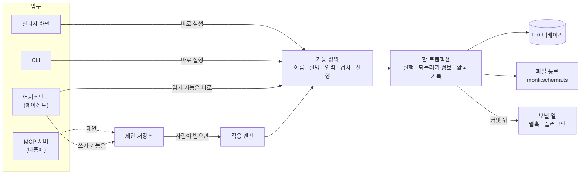
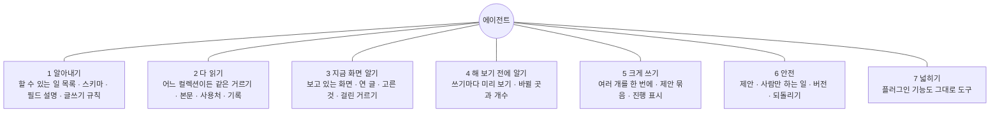
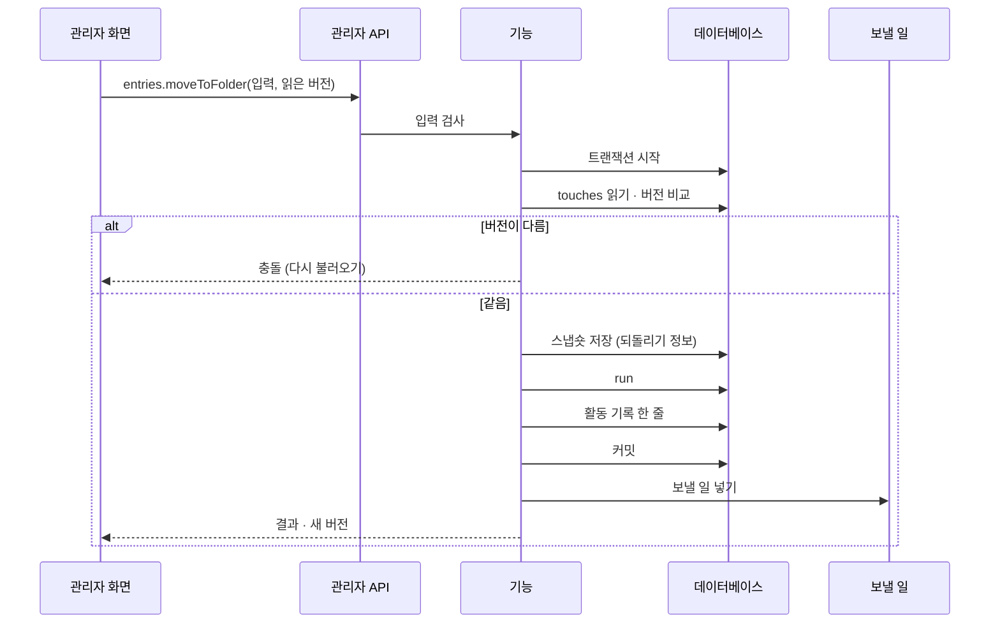
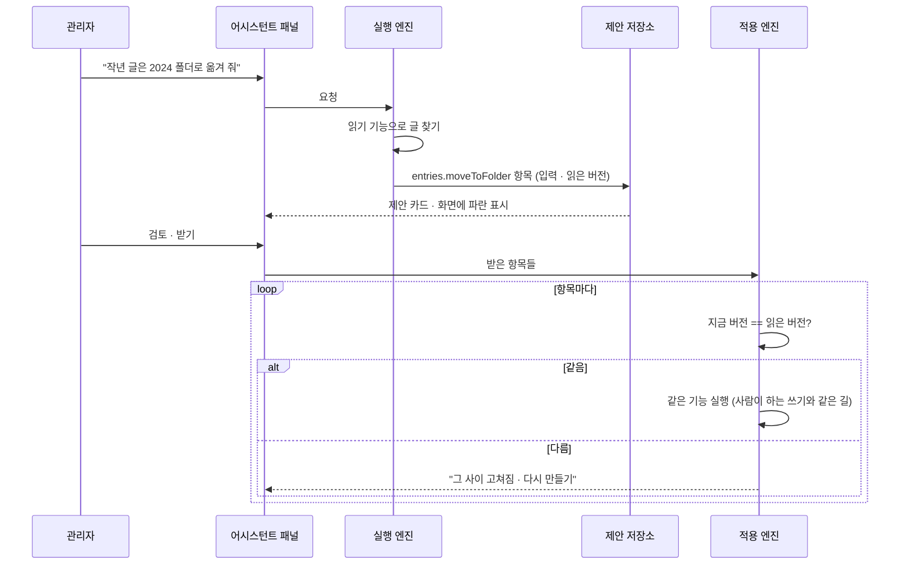
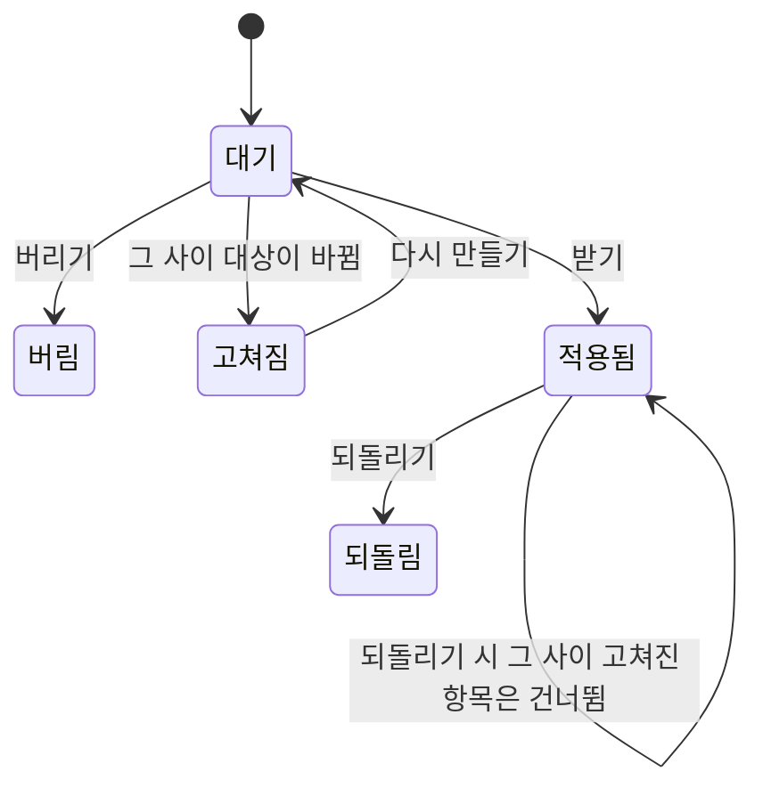
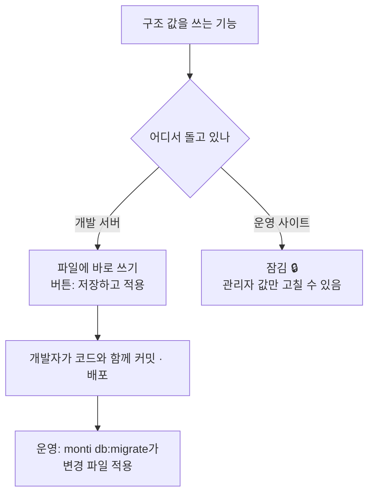

# 00 기본 구조

상태: 초안 (2026-11-05).

## 한 문장

Monti가 하는 일은 모두 **기능**으로 정의한다. 관리자 화면, 어시스턴트, CLI가 같은 기능을 같은 검사로 부른다. 사람은 기능을 바로 실행한다. 에이전트는 실행하지 않고 **제안**을 쌓는다. 사람이 받은 제안은 사람의 다른 고침과 함께 검토를 거쳐 저장될 때 같은 기능으로 실행된다.

## 원칙

1. **기능 하나, 입구 여럿.** 기능 하나를 정의하면 관리자 API, 에이전트 도구, CLI 명령이 함께 생긴다. 화면에만 있는 기능도, 에이전트만 쓰는 기능도 없다.
2. **같은 검사.** 누가 부르든 입력 검사, 권한, 버전 확인이 같다. 에이전트를 위한 지름길은 없다.
3. **에이전트의 쓰기는 모두 제안이다.** 받기 전에는 아무것도 바뀌지 않는다. 예외는 사람이 칸 하나에 대고 누른 "✦ 채우기"(바로 넣기)뿐이다.
4. **사람만 하는 일이 있다.** 영구 삭제와 휴지통 비우기는 사람만 한다. 그래서 제안에는 되돌릴 수 없는 항목이 없다.
5. **쓰면 남는다.** 모든 쓰기는 활동 기록에 한 줄을 남기고, 되돌릴 수 있는 것은 되돌리기 정보를 함께 남긴다.
6. **버전으로 덮어쓰기를 막는다.** 레코드마다 버전이 있고, 쓰기는 읽었을 때의 버전을 함께 보낸다. 관리자는 한 명이지만, 같은 사람이 탭 두 개에서 고치거나 에이전트와 겹칠 수 있다.

## 전체 구조



- **기능 정의**는 한 곳에 모인다. 플러그인도 같은 방법으로 기능을 더한다.
- **제안 저장소**는 에이전트가 부른 쓰기 기능의 이름과 입력을 대화에 묶어 서버에 저장한다.
- **적용 엔진**은 받은 제안 항목을 하나씩 같은 기능으로 실행한다.
- **파일 통로**는 `monti.schema.ts`처럼 저장소 파일에 사는 값을 쓰는 길이다. 개발 서버에서만 파일에 쓰고, 운영 사이트에서는 잠긴다(아래 "두 종류의 값").
- **보낼 일**은 커밋된 뒤에만 나간다. 트랜잭션이 실패하면 아무것도 나가지 않는다. 실패한 전송은 활동 기록에서 다시 보낸다(13번 문서).

## 에이전트가 일할 수 있는 바탕

어시스턴트가 CMS 어디서나 사람만큼 일하려면, 모든 기능이 아래 일곱 가지를 갖춰야 한다. 기능 문서마다 "에이전트" 절이 이것을 그 기능에 맞춰 적는다.



1. **알아내기.** `meta.capabilities`(읽기)가 지금 사이트에서 쓸 수 있는 기능과 그 설명을 내놓는다. 플러그인이 더한 기능도 들어 있다. 스키마와 필드마다의 설명, 사이트의 글쓰기 규칙도 읽기 기능으로 있다. 에이전트는 미리 외운 것이 아니라 이것을 읽고 일한다.
2. **다 읽기.** 글 찾기는 컬렉션마다 따로 있지 않고 `entries.query` 하나다. 목록 화면의 거르기(06번 문서)와 같은 거르기 말을 쓴다. 그래서 사람이 목록에서 거를 수 있는 것은 에이전트도 거를 수 있고, 에이전트가 찾은 결과를 목록 화면에 그대로 띄울 수 있다.
3. **지금 화면 알기.** 요청마다 화면이 맥락을 함께 보낸다. 어느 화면인지, 연 글과 그 버전, 고른 행, 걸린 거르기다. "이 글", "고른 것들"이 무엇인지 여기서 안다. 화면을 움직이는 일은 `screen` 기능으로 한다.
4. **해 보기 전에 알기.** 값에 영향이 큰 쓰기 기능은 `preview`를 함께 정의한다. 실제로 쓰지 않고 바뀔 곳과 개수, 막히는 곳을 돌려준다. 에이전트는 제안하기 전에 이것으로 확인하고, 제안 카드는 이것으로 "글 9편 · 폴더 이동"을 보인다.
5. **크게 쓰기.** 쓰기 기능은 처음부터 여러 대상을 받는다(`ids: string[]`). 한 요청이 만든 항목들은 제안 하나로 묶이고, 검토 화면에서 묶음별로 보인다. 오래 걸리는 실행은 단계와 진행("옮기는 중 · 3 / 12")을 패널에 흘려보낸다.
6. **안전.** 쓰기는 제안, 영구 삭제는 사람만, 버전 확인, 되돌리기(위 원칙). 글 속에 적힌 명령은 명령이 아니다. 에이전트가 할 수 있는 최대치는 제안이다.
7. **넓히기.** 플러그인이 기능을 정의하면 관리자 API, 에이전트 도구, CLI가 함께 생긴다. 에이전트 쪽 코드를 따로 쓰지 않는다.

이 일곱 가지가 있으면, 에이전트를 더 똑똑하게 만드는 일(모델, 지시문)과 할 수 있는 일을 늘리는 일(기능 추가)이 서로 따로 간다.

## 기능 정의

```ts
export const moveToFolder = defineOperation({
  name: "entries.moveToFolder",
  kind: "write",
  // The model reads this; the admin never sees it.
  description: "Move entries into a folder, or out of every folder with folderId null.",
  input: z.object({
    ids: z.array(z.string()).min(1),
    folderId: z.string().nullable(),
  }),
  // Reads the records it will touch, so the engine can keep their versions and snapshots.
  touches: (input, ctx) => ctx.entries.byIds(input.ids),
  check: (input, ctx) => ctx.folders.mustExist(input.folderId),
  // What would change, without writing. The agent and the proposal card use it.
  preview: (input, ctx) => ctx.entries.diffFolder(input.ids, input.folderId),
  run: (input, ctx) => ctx.entries.setFolder(input.ids, input.folderId),
  // One line for the activity log and the proposal card.
  summary: (input, ctx) => ctx.t("entries.moveToFolder", { count: input.ids.length }),
});
```

| 종류 | 무엇 | 에이전트가 부르면 |
|---|---|---|
| `read` | 읽기. 목록, 글, 스키마, 사용처 | 바로 실행 |
| `write` | 쓰기. 저장, 발행, 옮기기, 휴지통으로 | 제안 항목이 된다 |
| `screen` | 브라우저에서 화면을 움직이기. 목록 거르기, 글 열기, 고르기 | 브라우저가 바로 실행. 데이터는 바뀌지 않는다 |
| `write` + `humanOnly` | 영구 삭제, 휴지통 비우기, 키 지우기 | 도구로 나가지 않는다 |

- 입력은 Zod 스키마로 적는다. 같은 스키마로 관리자 API의 요청 검사, 에이전트 도구의 JSON 스키마, CLI 인자 검사를 만든다.
- `touches`는 기능이 건드릴 레코드를 미리 읽는다. 적용 엔진은 이것으로 버전을 비교하고 되돌리기 스냅숏을 찍는다. 기능을 쓰는 사람은 되돌리기 코드를 따로 쓰지 않는다.
- `prepare`는 쓰기가 트랜잭션을 열기 전에, 데이터베이스를 잡지 않은 채 하는 일이다. 다른 서비스에 묻는 일(이 키를 받아 주는가)이 여기 온다. 읽고 묻기만 하고 쓰지 않는다. 돌려준 값은 `check`와 `run`이 받고, 그 둘은 `prepare`가 읽은 것이 그대로인지 트랜잭션 안에서 다시 본다(2026-11-12, 14의 키). 부른 쪽이 읽은 버전은 `prepare` 앞에서 먼저 비교하고(다르면 충돌), 트랜잭션 안에서 한 번 더 비교한다.
- `secretInputs`는 비밀인 입력(서비스 키)의 이름이다. 명령줄은 그 입력을 인자로 받지 않고 표준 입력에서 읽는다(`--secret -`). 셸 기록과 프로세스 목록에 남지 않게 하려는 것이다.
- 쓰기가 더 알릴 수 있는 것(2026-11-12, 10의 제안):
  - `each`: 하나씩 다루는 입력 목록의 이름(`ids`). 에이전트가 여럿을 넣어 부르면 제안에서는 대상마다 한 항목이 된다.
  - `follows`: 적은 곳만 바꾸고 읽은 버전을 입력에 담는 쓰기가, 같은 제안의 앞 항목이 올린 버전 위에서 실행될 수 있게 입력을 고쳐 준다. 따라갈 수 없으면(값을 통째로 바꾸면) `null`.
  - `places`: 쓰기가 바꾸는 자리들의 이름. 모든 기능이 같은 꼴로 적는다(`entry:<id>/title`, `entry:<id>/field/<이름>`, `entry:<id>/body/<블록 id>`, 본문 통째는 `entry:<id>/body`, 사이트에 보이는 모습은 `entry:<id>/site`, 있는 곳은 `entry:<id>/folder`, 레코드 전체는 `entry:<id>`). 같은 제안에서 대기 중인 항목과 같은 자리이거나 한쪽이 다른 쪽을 담는 쓰기는, 기능이 달라도 제안이 되지 않는다. `follows`가 있는 쓰기는 자기 자리를 말해야 하고, 자리를 말한 앞 쓰기만 따라간다. 짝의 표는 10번 문서에 있다.
  - `bookkeeping`: 사이트를 바꾸지 않고 어시스턴트의 책만 정리하는 쓰기(제안 버리기, 항목 빼기). 활동 기록에 줄을 남기지 않고 되돌리기도 없다.

## 흐름

기능은 입력 하나에 답 하나다. 일이 되는 대로 소식을 보내야 하는 것은 **흐름**(`defineStream`)이다: 어시스턴트의 실행, 제안 적용(10). 흐름은 트랜잭션 하나가 아니고, 제 활동 기록 줄이 없고(흐름이 한 쓰기들이 저마다 남긴다), 사람만 시작한다. 에이전트의 도구가 아니다.

- 관리자 API는 흐름마다 `POST …/streams/<이름>`을 둔다. `{ input }`을 받고, 답은 이벤트를 한 줄에 JSON 하나씩 보낸다(`application/x-ndjson`). 세션이 없으면 401, 없는 흐름은 404, 맞지 않는 입력은 400이다. 첫 이벤트 전에 생긴 오류는 기능처럼 상태 코드로, 그 뒤의 오류는 마지막 이벤트 `{ "type": "error", … }`로 온다.
- CLI는 흐름도 명령이다. 이벤트를 한 줄씩 찍는다.
- 듣는 쪽이 떠나면(`signal`) 흐름이 안다. 무엇을 할지는 흐름이 정한다: 실행은 이어서 할 수 있게 멈추고, 적용은 끝까지 한다.
- 플러그인은 `streams`로 흐름을 더한다. 플러그인은 `attach`로 자기가 들어간 사이트를 받고(제 기능 안에서 다른 기능을 부를 때), `cleanUp`으로 휴지통 정리와 같은 때에 제 것을 치운다.

## 사람이 하는 쓰기



## 제안과 적용



제안 항목 하나의 상태:



- 제안은 대화가 있는 동안 계속 유효하다. 만료는 없다.
- 한 제안의 항목은 같은 제안 안 앞 항목이 만들 것(새 폴더, 새 태그)을 임시 id로 가리킬 수 있다. 적용 엔진은 앞 항목이 만든 진짜 id로 바꿔 넣고, 앞 항목을 빼면 그것을 가리키는 뒤 항목도 함께 뺀다(07번 문서).
- 버린 제안은 카드와 지난 대화 줄에 "버림"으로 남고, 활동 기록에는 남지 않는다.
- 받는 곳이 두 가지다. 편집기와 설정처럼 초안이 있는 화면에서 받으면 그 값은 저장 전 변경이 되고, 사람이 저장할 때 적용 엔진을 거친다(05번 문서). 여러 글에 걸친 제안은 제안 검토 화면에서 받고, 받으면 바로 적용된다. 어느 쪽이든 모든 변경은 사람의 검토를 거쳐 저장된다.

## 되돌리기

- 적용 엔진은 쓰기 전에 `touches`가 읽은 레코드의 모습을 스냅숏으로 남긴다. 스냅숏은 30일 동안 남고, 그동안만 되돌릴 수 있다(13번 문서).
- 되돌리기는 레코드마다 "지금 버전이 적용 직후 버전과 같은가"를 본다. 같으면 스냅숏으로 되돌리고, 다르면 그 레코드는 건너뛰고 "그 사이 고쳐짐"이라고 알린다. 덮어쓰지 않는다.
- 구조 값 쓰기(개발 서버의 스키마 변경)는 되돌리기가 없다. 값을 옮기고 지운 일을 거꾸로 되돌릴 수 없기 때문이다. 기록만 남고, 되돌리려면 반대로 바꾸는 변경을 새로 만든다.
- 영구 삭제는 되돌릴 수 없으므로 사람만 한다(원칙 4).

## 활동 기록

모든 쓰기가 한 줄을 남긴다.

```ts
type ActivityRow = {
  id: string;
  at: Date;
  actor: "admin" | "assistant" | "cli" | { plugin: string };
  operation: string;           // "entries.moveToFolder"
  summary: string;             // "글 9편 · 2024 폴더로"
  targets: { kind: string; id: string }[];
  conversationId?: string;     // assistant rows link to their conversation
  undo?: { snapshotId: string; undoneAt?: Date };
  delivery?: "pending" | "sent" | "failed";  // outgoing webhooks for this write
};
```

## 두 종류의 값

값은 **사이트 코드가 그 값에 기대는가**로 가른다.

- **구조 값**은 사이트 코드가 기대는 값이다. 컬렉션과 필드의 모양, 공개 주소, 언어 목록. 코드와 함께 개발되고 배포되어야 하므로 저장소의 `monti.schema.ts`에 있다.
- **관리자 값**은 관리자 화면과 어시스턴트만 쓰는 값이다. 표시 이름, 설명, 속성 패널 배치, 편집기 허용, 템플릿, 번역 사용 여부, 글쓰기 규칙. 운영 사이트에서도 바로 고칠 수 있게 데이터베이스에 있다.
- 한 값은 두 곳 중 한 곳에만 있다. 자세한 표는 [01-content-structure.md](01-content-structure.md#어디에-사는가)에 있다.

구조 값은 **개발 서버에서만** 바꾼다. 사이트 코드와 같이 바뀌어야 하는 값이라 어차피 개발 서버에서 코드와 함께 고치고, 커밋하고, 배포한다. 운영 사이트에서 CMS만 따로 PR을 올리는 길은 두지 않는다. 관리자 값은 어느 환경에서나 데이터베이스에 바로 쓴다.



파일과 데이터베이스가 어떻게 같이 바뀌는지는 [01-content-structure.md](01-content-structure.md)의 "구조 바꾸기"에 있다.

## 입구

| 입구 | 누가 | 쓰기 |
|---|---|---|
| 관리자 API | 관리자 화면 | 바로 실행 |
| 에이전트 도구 | 어시스턴트 | 제안 |
| CLI | 터미널의 개발자 | 바로 실행 |
| MCP 서버 (나중에) | Claude Code 같은 바깥 에이전트 | 제안 |

- 서버를 다루는 관리 명령(`monti db:setup`, `monti db:migrate`, `monti restore`, `monti trash:purge`, `monti deliveries:run`)은 기능이 아니다. 화면과 에이전트에는 나오지 않고 CLI에만 있다.

## 기능 목록

| 기능 | 종류 | 하는 일 |
|---|---|---|
| `meta.capabilities` | read | 지금 사이트에서 쓸 수 있는 기능과 설명, 입력 모양. 플러그인 기능도 든다. 에이전트에게는 사람만 하는 기능이 빠진다 |

- 되돌리기(`activity.undo`)는 13번 문서의 기능이다.

## 화면 쪽 조각

- `useOperation(name)`: 기능 하나를 부르는 훅. 버전을 함께 보내고, 충돌이면 화면이 다시 불러오기를 보이게 한다.
- `useProposals(target)`: 화면에 있는 레코드에 걸린 대기 중 제안. 파란 표시를 그리는 쪽이 쓴다(05번 문서).

## 결정 기록

- 2026-11-05, 소유자: 에이전트는 시킬 때만 일한다. 스스로 일하는 에이전트는 아래 "나중에 할 것"에 둔다.
- 2026-11-05, 소유자: 바깥 에이전트(MCP)는 설계만 열어 두고 지금 만들지 않는다.
- 2026-11-05, 소유자: 화면에서 받은 제안은 바로 저장되지 않고 저장 전 변경이 된다. 모든 변경은 검토를 거쳐 사람이 최종 저장한다.
- 2026-11-05, 소유자: 운영 사이트에서 구조 값을 PR로 바꾸는 길은 없다. 구조 값은 사이트 코드와 함께 개발 서버에서 바꾸는 것이라, 운영에서 CMS만 PR을 올리는 것은 어색하다. 운영 사이트에서 구조 값은 늘 잠긴다.
- 2026-11-05, 소유자: 값은 사이트 코드가 기대는가로 가른다. 기대면 파일(구조 값), 아니면 데이터베이스(관리자 값).
- 2026-11-05, 소유자: 모든 기능은 에이전트가 쓸 수 있는 바탕(위 일곱 가지)을 갖춘다.
- 2026-11-05, 소유자: 데이터베이스는 Postgres만 쓴다. 다른 데이터베이스는 필요할 때 더한다.
- 2026-11-05, 소유자: 본문의 원본은 JSON 문서다. MDX는 플러그인이 읽고 내보낸다(03번 문서).
- 2026-11-05: 입력 스키마는 Zod로 적는다. 요청 검사, 도구의 JSON 스키마, CLI 인자를 한 정의에서 만든다.
- 2026-11-05: 되돌리기는 기능마다 거꾸로 하는 코드를 쓰는 대신 스냅숏으로 한다. 기능을 더하는 사람(플러그인 포함)이 되돌리기를 빠뜨릴 수 없게 하려는 것이다.

## 나중에 할 것

### MCP 서버

기능 정의에서 MCP 도구 목록을 만든다. 바깥 에이전트의 쓰기도 제안이 되어 관리자 화면에서 받는다. 지금 할 일은 기능 정의가 화면에 묶이지 않게 두는 것뿐이다.

### 스스로 일하는 에이전트

정해 둔 때에 에이전트가 알아서 일하는 것이다. 예: "글을 발행하면 영어 번역 제안을 만들어 둔다", "매주 월요일 요약이 빈 글을 채워 둔다".


지금 구조 위에 더할 것:

1. **때.** 기능이 커밋된 뒤 내는 이벤트(발행됨, 올림)와 시간표(매주 월요일). 이벤트는 보낼 일과 같은 줄에서 나온다.
2. **규칙.** 무엇을 시킬지(요청 문장), 어떤 도구를 쓸 수 있는지, 어느 컬렉션에서만 하는지. 규칙을 만들고 끄는 화면이 있어야 한다. 아직 시안이 없다.
3. **사람 없는 실행.** 지금 실행 엔진은 패널이 열린 채 이벤트를 흘려보낸다. 패널 없이 서버에서 끝까지 도는 실행이 필요하다. `screen` 기능은 쓸 수 없다.
4. **받을 곳.** 아무도 보고 있지 않으므로 결과 제안이 쌓일 곳과 알림이 필요하다. 사이드바 개수, 활동 기록의 한 줄.
5. **한도.** 실행마다, 하루마다 토큰 한도. 모델이 거절하거나 한도에 걸리면 실패로 기록한다.
6. **되먹임 막기.** 에이전트가 만든 제안을 받아서 생긴 발행이 다시 같은 규칙을 부르지 않게 한다. 기록의 `actor`로 가린다.
7. **더 조심할 것.** 시키지 않은 글을 읽고 움직이므로 글 속 명령에 더 쉽게 속는다. 쓰기는 제안뿐이라 최악은 받지 않으면 끝이지만, 규칙마다 쓸 수 있는 도구를 좁히는 것이 기본이어야 한다.

지금 설계에서 이것을 위해 지킬 것은 셋이다. 쓰기가 모두 제안이라는 것, 커밋 뒤 이벤트가 한 줄로 나온다는 것, 실행 엔진이 패널에 묶이지 않는다는 것.

## 끝 조건

번호는 테스트 이름의 앞머리다(`00-1 …`). 테스트가 어느 약속을 지키는지 여기서 찾는다.

- **00-1** 기능 하나를 정의하면 관리자 API 라우트, 에이전트 도구, CLI 명령이 생긴다. 셋 중 하나를 따로 손으로 쓰는 곳이 없다.
- **00-2** 에이전트가 부른 쓰기 기능은 데이터를 바꾸지 않고 제안 항목만 만든다. 받은 항목은 사람이 부른 것과 같은 길로 실행된다.
- **00-3** 모든 쓰기가 활동 기록을 남긴다. 되돌릴 수 있는 쓰기는 되돌리기가 되고, 그 사이 고쳐진 레코드는 건너뛴다.
- **00-4** 버전이 다른 쓰기는 충돌로 거절된다.
- **00-5** 에이전트가 `meta.capabilities`만 읽고 플러그인 기능까지 쓸 수 있다. 사람이 목록에서 거를 수 있는 것은 `entries.query`로도 거를 수 있다(`entries.query`는 06에서).
- **00-6** 한 데이터베이스를 여러 사이트(스키마마다 하나)가 같이 쓸 때, 다른 사이트가 표를 만들거나 지우는 중에도 이 사이트의 마이그레이션은 실패하지 않는다. 마이그레이션 도구가 데이터베이스의 모든 표를 훑는 사이에 다른 스키마의 표가 사라지면, 단계를 하나도 돌리기 전이므로 다시 시도한다(2026-11-05, CI에서 드물게 실패하던 원인).
