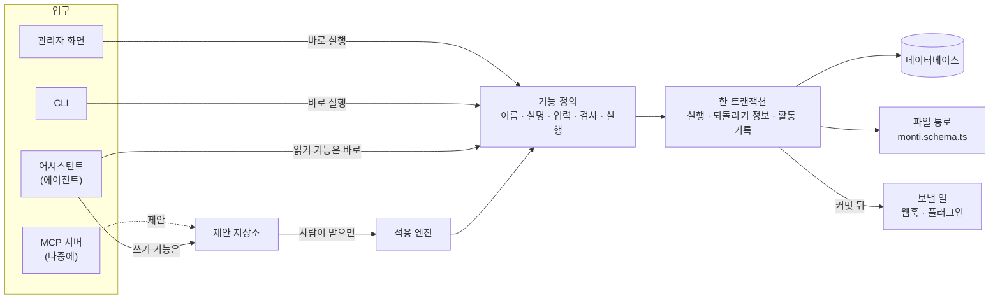
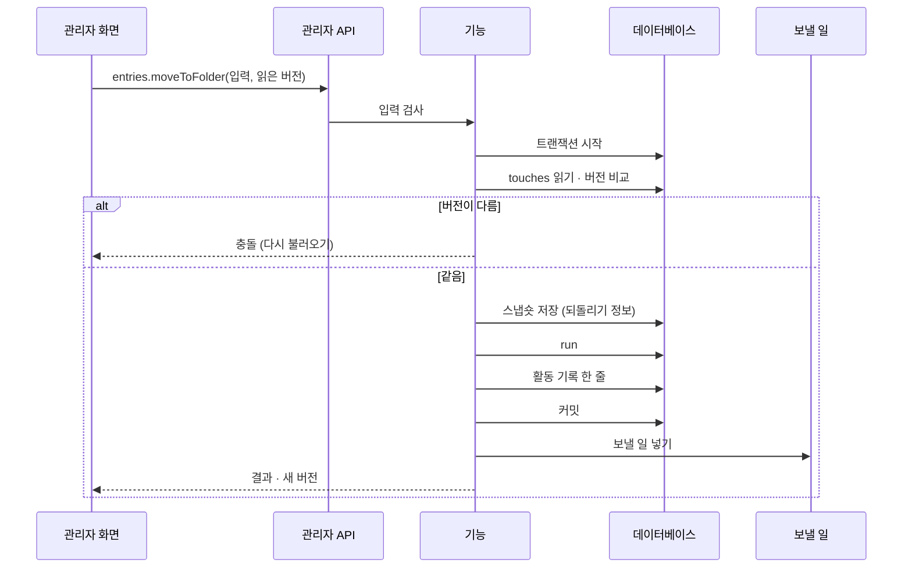
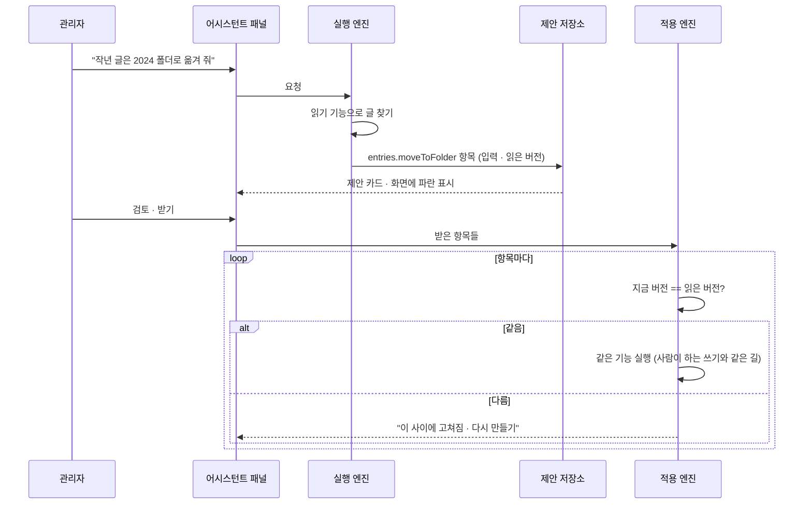
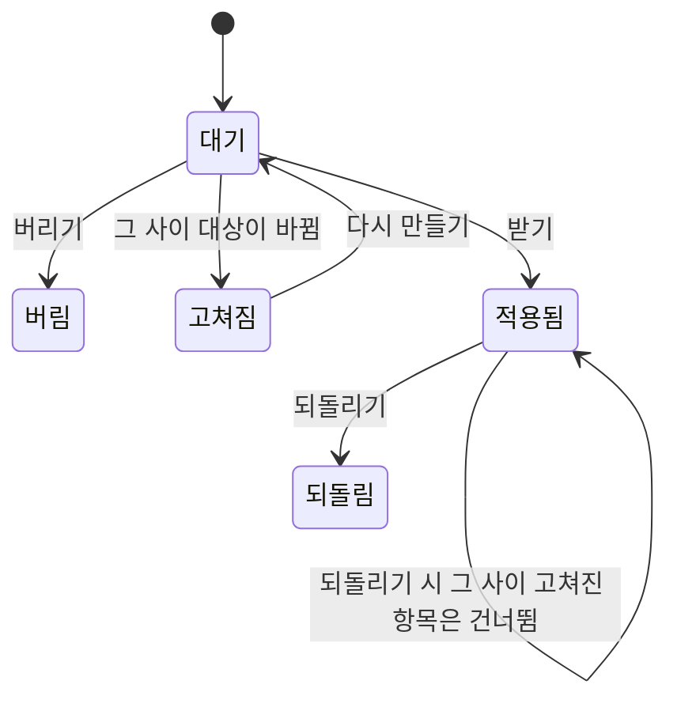
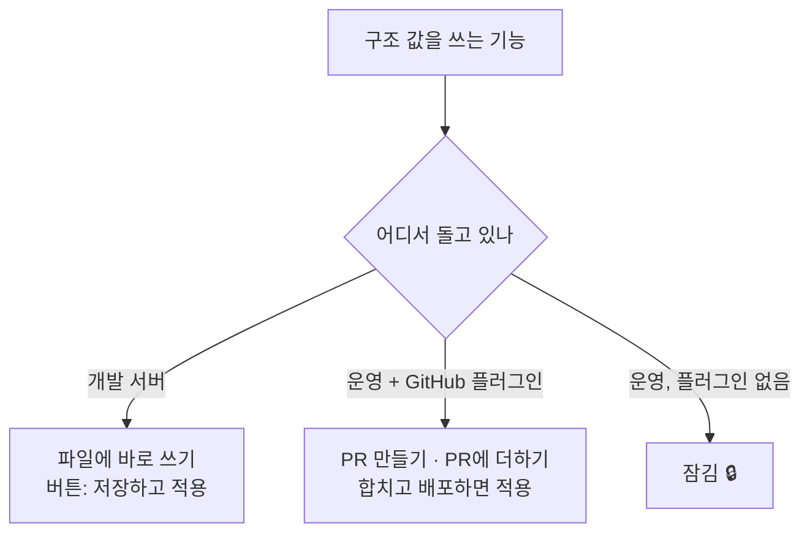
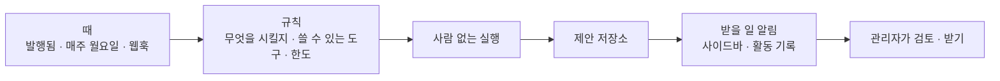

# 00 기본 구조

상태: 초안 (2026-11-05).

## 한 문장

Monti가 하는 일은 모두 **기능**으로 정의한다. 관리자 화면, 어시스턴트, CLI가 같은 기능을 같은 검사로 부른다. 사람은 기능을 바로 실행한다. 에이전트는 실행하지 않고 **제안**을 쌓고, 사람이 받으면 그때 같은 기능이 실행된다.

## 원칙

1. **기능 하나, 입구 여럿.** 기능 하나를 정의하면 관리자 API, 에이전트 도구, CLI 명령이 함께 생긴다. 화면에만 있는 기능도, 에이전트만 쓰는 기능도 없다.
2. **같은 검사.** 누가 부르든 입력 검사, 권한, 버전 확인이 같다. 에이전트를 위한 지름길은 없다.
3. **에이전트의 쓰기는 모두 제안이다.** 받기 전에는 아무것도 바뀌지 않는다. 예외는 사람이 칸 하나에 대고 누른 "✦ 채우기"(바로 넣기)뿐이다.
4. **사람만 하는 일이 있다.** 영구 삭제와 휴지통 비우기는 사람만 한다. 그래서 제안에는 되돌릴 수 없는 항목이 없다.
5. **쓰면 남는다.** 모든 쓰기는 활동 기록에 한 줄을 남기고, 되돌릴 수 있는 것은 되돌리기 정보를 함께 남긴다.
6. **버전으로 덮어쓰기를 막는다.** 레코드마다 버전이 있고, 쓰기는 읽었을 때의 버전을 함께 보낸다. 관리자는 한 명이지만, 같은 사람이 탭 두 개에서 고치거나 에이전트와 겹칠 수 있다.

## 전체 구조



- **기능 정의**는 한 곳에 모인다. 플러그인도 같은 방법으로 기능을 더한다.
- **제안 저장소**는 에이전트가 부른 쓰기 기능의 이름과 입력을 대화에 묶어 서버에 저장한다.
- **적용 엔진**은 받은 제안 항목을 하나씩 같은 기능으로 실행한다.
- **파일 통로**는 `monti.schema.ts`처럼 저장소 파일에 사는 값을 쓰는 길이다. 환경에 따라 파일에 바로 쓰거나, PR을 만들거나, 잠긴다(아래 "환경").
- **보낼 일**은 커밋된 뒤에만 나간다. 트랜잭션이 실패하면 아무것도 나가지 않는다. 실패한 전송은 활동 기록에서 다시 보낸다(13번 문서).

## 기능 정의

```ts
export const moveToFolder = defineOperation({
  name: "entries.moveToFolder",
  kind: "write",
  // The model reads this; the admin never sees it.
  description: "Move entries into a folder, or out of every folder with folderId null.",
  input: z.object({
    ids: z.array(z.string()).min(1),
    folderId: z.string().nullable(),
  }),
  // Reads the records it will touch, so the engine can keep their versions and snapshots.
  touches: (input, ctx) => ctx.entries.byIds(input.ids),
  check: (input, ctx) => ctx.folders.mustExist(input.folderId),
  run: (input, ctx) => ctx.entries.setFolder(input.ids, input.folderId),
  // One line for the activity log and the proposal card.
  summary: (input, ctx) => ctx.t("entries.moveToFolder", { count: input.ids.length }),
});
```

| 종류 | 무엇 | 에이전트가 부르면 |
|---|---|---|
| `read` | 읽기. 목록, 글, 스키마, 사용처 | 바로 실행 |
| `write` | 쓰기. 저장, 발행, 옮기기, 휴지통으로 | 제안 항목이 된다 |
| `screen` | 브라우저에서 화면을 움직이기. 목록 거르기, 글 열기, 고르기 | 브라우저가 바로 실행. 데이터는 바뀌지 않는다 |
| `write` + `humanOnly` | 영구 삭제, 휴지통 비우기, 키 지우기 | 도구로 나가지 않는다 |

- 입력은 Zod 스키마로 적는다. 같은 스키마로 관리자 API의 요청 검사, 에이전트 도구의 JSON 스키마, CLI 인자 검사를 만든다.
- `touches`는 기능이 건드릴 레코드를 미리 읽는다. 적용 엔진은 이것으로 버전을 비교하고 되돌리기 스냅숏을 찍는다. 기능을 쓰는 사람은 되돌리기 코드를 따로 쓰지 않는다.

## 사람이 하는 쓰기



## 제안과 적용



제안 항목 하나의 상태:



- 제안은 대화가 있는 동안 계속 유효하다. 만료는 없다.
- 버린 제안은 카드와 지난 대화 줄에 "버림"으로 남고, 활동 기록에는 남지 않는다.

## 되돌리기

- 적용 엔진은 쓰기 전에 `touches`가 읽은 레코드의 모습을 스냅숏으로 남긴다.
- 되돌리기는 레코드마다 "지금 버전이 적용 직후 버전과 같은가"를 본다. 같으면 스냅숏으로 되돌리고, 다르면 그 레코드는 건너뛰고 "그 사이 고쳐짐"이라고 알린다. 덮어쓰지 않는다.
- 파일 통로로 PR이 된 쓰기(운영 사이트의 스키마 변경)는 되돌리기가 없다. 기록만 남는다.
- 영구 삭제는 되돌릴 수 없으므로 사람만 한다(원칙 4).

## 활동 기록

모든 쓰기가 한 줄을 남긴다.

```ts
type ActivityRow = {
  id: string;
  at: Date;
  actor: "admin" | "assistant" | "cli" | { plugin: string };
  operation: string;           // "entries.moveToFolder"
  summary: string;             // "글 9편 · 2024 폴더로"
  targets: { kind: string; id: string }[];
  conversationId?: string;     // assistant rows link to their conversation
  undo?: { snapshotId: string; undoneAt?: Date };
  delivery?: "pending" | "sent" | "failed";  // outgoing webhooks for this write
};
```

## 환경

구조 값(스키마, 언어 목록, 공개 주소처럼 `monti.schema.ts`에 사는 값)은 환경에 따라 쓰는 길이 다르다. 나머지 값은 어느 환경에서나 데이터베이스에 바로 쓴다.



파일과 데이터베이스가 어떻게 같이 바뀌는지는 [01-content-structure.md](01-content-structure.md)의 "구조 바꾸기"에 있다.

## 입구

| 입구 | 누가 | 쓰기 |
|---|---|---|
| 관리자 API | 관리자 화면 | 바로 실행 |
| 에이전트 도구 | 어시스턴트 | 제안 |
| CLI | 터미널의 개발자 | 바로 실행 |
| MCP 서버 (나중에) | Claude Code 같은 바깥 에이전트 | 제안 |

## 화면 쪽 조각

- `useOperation(name)`: 기능 하나를 부르는 훅. 버전을 함께 보내고, 충돌이면 화면이 다시 불러오기를 보이게 한다.
- `useProposals(target)`: 화면에 있는 레코드에 걸린 대기 중 제안. 파란 표시를 그리는 쪽이 쓴다(05번 문서).

## 결정 기록

- 2026-11-05, 소유자: 에이전트는 시킬 때만 일한다. 스스로 일하는 에이전트는 아래 "나중에 할 것"에 둔다.
- 2026-11-05, 소유자: 바깥 에이전트(MCP)는 설계만 열어 두고 지금 만들지 않는다.
- 2026-11-05: 입력 스키마는 Zod로 적는다. 요청 검사, 도구의 JSON 스키마, CLI 인자를 한 정의에서 만든다.
- 2026-11-05: 되돌리기는 기능마다 거꾸로 하는 코드를 쓰는 대신 스냅숏으로 한다. 기능을 더하는 사람(플러그인 포함)이 되돌리기를 빠뜨릴 수 없게 하려는 것이다.

## 나중에 할 것

### MCP 서버

기능 정의에서 MCP 도구 목록을 만든다. 바깥 에이전트의 쓰기도 제안이 되어 관리자 화면에서 받는다. 지금 할 일은 기능 정의가 화면에 묶이지 않게 두는 것뿐이다.

### 스스로 일하는 에이전트

정해 둔 때에 에이전트가 알아서 일하는 것이다. 예: "글을 발행하면 영어 번역 제안을 만들어 둔다", "매주 월요일 요약이 빈 글을 채워 둔다".



지금 구조 위에 더할 것:

1. **때.** 기능이 커밋된 뒤 내는 이벤트(발행됨, 올림)와 시간표(매주 월요일). 이벤트는 보낼 일과 같은 줄에서 나온다.
2. **규칙.** 무엇을 시킬지(요청 문장), 어떤 도구를 쓸 수 있는지, 어느 컬렉션에서만 하는지. 규칙을 만들고 끄는 화면이 있어야 한다. 아직 시안이 없다.
3. **사람 없는 실행.** 지금 실행 엔진은 패널이 열린 채 이벤트를 흘려보낸다. 패널 없이 서버에서 끝까지 도는 실행이 필요하다. `screen` 기능은 쓸 수 없다.
4. **받을 곳.** 아무도 보고 있지 않으므로 결과 제안이 쌓일 곳과 알림이 필요하다. 사이드바 개수, 활동 기록의 한 줄.
5. **한도.** 실행마다, 하루마다 토큰 한도. 모델이 거절하거나 한도에 걸리면 실패로 기록한다.
6. **되먹임 막기.** 에이전트가 만든 제안을 받아서 생긴 발행이 다시 같은 규칙을 부르지 않게 한다. 기록의 `actor`로 가린다.
7. **더 조심할 것.** 시키지 않은 글을 읽고 움직이므로 글 속 명령에 더 쉽게 속는다. 쓰기는 제안뿐이라 최악은 받지 않으면 끝이지만, 규칙마다 쓸 수 있는 도구를 좁히는 것이 기본이어야 한다.

지금 설계에서 이것을 위해 지킬 것은 셋이다. 쓰기가 모두 제안이라는 것, 커밋 뒤 이벤트가 한 줄로 나온다는 것, 실행 엔진이 패널에 묶이지 않는다는 것.

## 끝 조건

- 기능 하나를 정의하면 관리자 API 라우트, 에이전트 도구, CLI 명령이 생긴다. 셋 중 하나를 따로 손으로 쓰는 곳이 없다.
- 에이전트가 부른 쓰기 기능은 데이터를 바꾸지 않고 제안 항목만 만든다. 받은 항목은 사람이 부른 것과 같은 길로 실행된다.
- 모든 쓰기가 활동 기록을 남긴다. 되돌릴 수 있는 쓰기는 되돌리기가 되고, 그 사이 고쳐진 레코드는 건너뛴다.
- 버전이 다른 쓰기는 충돌로 거절된다.
