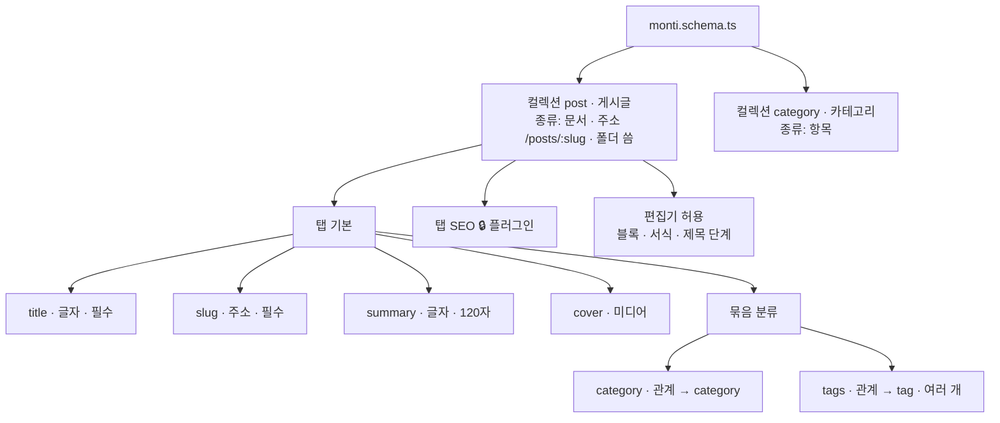
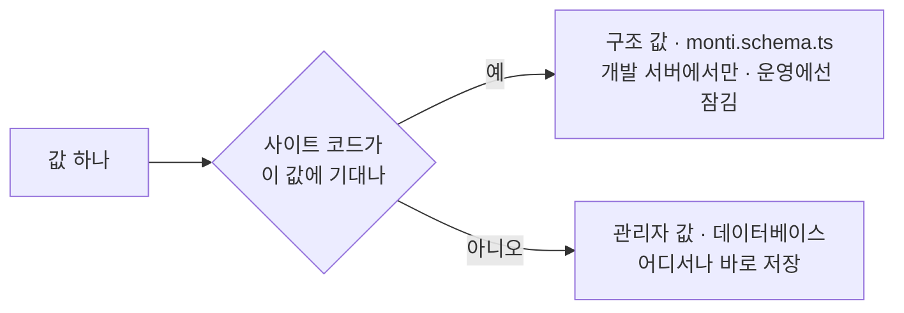
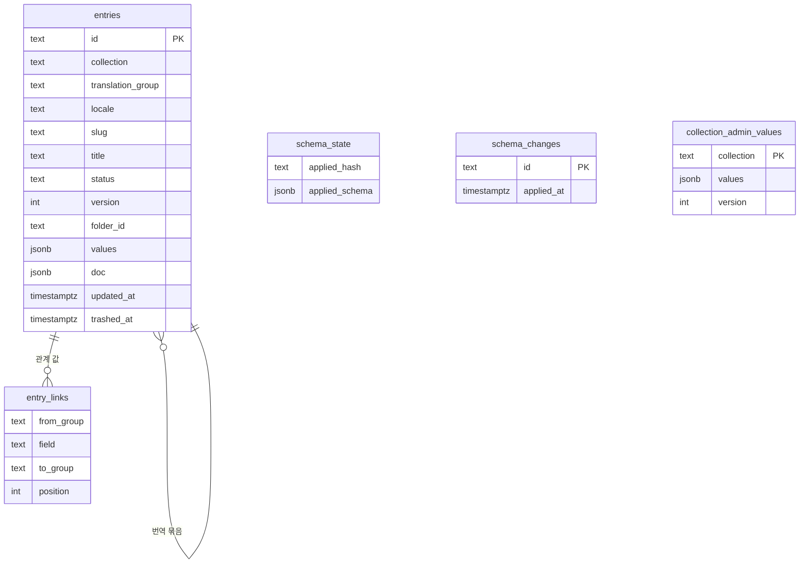
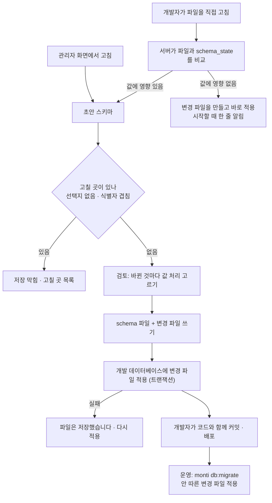

# 01 콘텐츠 구조

상태: 초안 (2026-11-05). D1, D2는 소유자가 정했다(결정 기록).

## 한 문장

컬렉션은 글의 종류(게시글, 메모, 카테고리)이고, 필드는 그 종류가 담는 값(요약, 대표 이미지, 태그)이다. 사이트 코드와 함께 바뀌어야 하는 구조는 저장소의 `monti.schema.ts` 파일에 있고, 관리자만 쓰는 값(표시 이름, 설명, 배치)은 데이터베이스에 있다. 구조를 바꾸면 값이 어떻게 되는지를 사람이 검토에서 고른다.

## 원칙

1. **사이트 코드가 기대는 값은 파일에, 아닌 값은 데이터베이스에.** 필드 이름과 종류처럼 사이트 코드가 읽는 값은 코드와 함께 개발되고 배포되어야 하므로 `monti.schema.ts`에 둔다. 표시 이름이나 설명처럼 관리자 화면만 쓰는 값은 운영 사이트에서도 바로 고칠 수 있게 데이터베이스에 둔다. 한 값은 두 곳 중 한 곳에만 있다.
2. **파일은 사람이 읽는다.** `monti.schema.ts`는 순수한 값이다. 개발자는 파일을 직접 고쳐도 되고, 관리자 화면에서 고쳐도 된다. 결과는 같다.
3. **바꾸기 전에 검토한다.** 이미 저장된 값에 영향이 있는 변경(이름 바꿈, 지움, 새 필수)은 검토에서 값을 어떻게 할지 고른 뒤에만 적용된다.
4. **구조 변경은 개발자의 일이다. CMS는 묻기만 하고 대신 지키지 않는다.** 구조는 사이트 코드와 함께 바뀌고 함께 배포된다. 그래서 필드를 지우면 값도 지워진다. 숨겨 남기거나 따로 보관하지 않는다. 실수에 대한 안전망은 백업(14)이다. 대신 검토는 개발 데이터의 숫자로 물을지 말지를 정하지 않는다. 개발에 값이 없어도 운영에는 있을 수 있으므로, 저장된 값에 닿을 수 있는 변경(지움, 이름 바꿈, 새 필수)은 늘 묻는다.
5. **필드 종류는 네 가지다.** 글자, 고르기, 미디어, 관계. 그 밖의 종류는 필요해질 때 더한다.
6. **만들 때 정한 것은 바꾸지 않는다.** 컬렉션의 식별자와 종류, 필드의 종류는 만든 뒤 바꿀 수 없다. 바꾸려면 새로 만들고 값을 옮긴다.

## 쓰는 화면과 흐름

- 기준 화면: `Screens/Reference/Assistant` › CollectionBasics, CollectionEditor, `Screens/Reference/Settings` › Schema, SchemaAddField, SchemaField, SchemaReview.
- 흐름: [흐름 4 · 컬렉션](../admin/flows/04-collections.md) 전부, [흐름 11 · 설정](../admin/flows/11-settings.md)의 15~20단계. 9~14b단계(GitHub 플러그인으로 PR)는 빠진다(결정 기록).
- 이 구조를 읽는 곳: 편집기 속성 패널(02), 목록 열(06), 관계(08), 어시스턴트의 스키마 읽기(10).

## 모양



- **컬렉션의 종류**는 두 가지다. 문서(본문이 있고 초안과 발행이 있다: 게시글, 메모)와 항목(본문 없이 짧고, 저장하면 바로 사이트에 나간다: 카테고리, 태그). 발행 상태가 필요한 대상(소개 글이 있는 시리즈)은 문서로 만든다.
- **Every collection starts with `title` and `slug`.** Both fields are fixed and required. A document always has a public `path` in the `/prefix/:slug` form. An item may omit `path`; its `slug` remains the stable item identifier used by relations and the admin.
- **탭과 묶음**은 속성 패널의 배치다. 값의 모양에는 영향이 없다. 플러그인이 둔 탭(SEO)은 잠겨 있다.
- **미디어**는 컬렉션 목록에 없는 내장 종류다(09번 문서).

## 어디에 사는가

가르는 물음은 하나다. **사이트 코드가 이 값에 기대는가?** 기대면 코드와 같이 바뀌어야 하므로 파일(구조 값)이고, 아니면 데이터베이스(관리자 값)다.



| 값 | 어디 | 이유 |
|---|---|---|
| Collection identifier, kind, and optional public address | 파일 | Site code relies on the identifier and kind, and on the address when a public page is enabled |
| 필드 이름, 종류, 필수, 최대 글자 수, 언어 방식 | 파일 | 사이트 코드가 이 모양을 읽는다 |
| 관계의 대상, 여러 개 | 파일 | 값의 모양이 바뀐다 |
| 고르기 선택지의 값 | 파일 | 사이트 코드가 값으로 나눠 그린다 |
| 컬렉션 표시 이름, 폴더 사용 | 데이터베이스 | 관리자 화면만 쓴다 |
| 필드 표시 이름, 설명 | 데이터베이스 | 관리자 화면과 어시스턴트만 쓴다 |
| 고르기 선택지의 라벨 | 데이터베이스 | 관리자 화면만 쓴다 |
| 속성 패널의 탭, 묶음, 순서 | 데이터베이스 | 관리자 화면의 배치다 |
| 편집기 허용(블록, 서식, 제목 단계) | 데이터베이스 | 편집기에서 무엇을 넣을지다. 사이트는 있는 블록을 모두 그릴 수 있다 |

- 관리자 화면은 두 값을 섞어 보인다. 운영 사이트에서는 구조 값이 잠기고 관리자 값만 고칠 수 있다(흐름 11·17).
- 새 컬렉션이나 새 필드를 개발 서버에서 만들면, 그때 정한 관리자 값(표시 이름, 설명, 배치)은 변경 파일에 "처음 값"으로 실려 간다. 운영 사이트는 배포할 때 그 값이 아직 없으면 넣는다. 그 뒤로는 데이터베이스가 그 값의 주인이다. 덧씌우기가 아니라 처음 한 번 넣는 것이다.
- 관리자 값이 비어 있으면 화면은 식별자를 그대로 보인다(`summary`).

## 필드

| 종류 | 화면 이름 | 설정 |
|---|---|---|
| `text` | 글자 | 여러 줄, 최대 글자 수 |
| `select` | 고르기 | 선택지(값과 라벨), 여러 개 |
| `media` | 미디어 | 받을 것(이미지 / 모든 파일). 값은 파일과 그 글에서의 대체 텍스트(`{ media, alt }`, 09번 문서) |
| `relation` | 관계 | 가리킬 컬렉션, 여러 개, 목록에 없으면 새로 만들기 |

모든 종류에 공통인 설정:

- **표시 이름**과 **설명**(관리자 값). 설명은 그 필드가 어디에 쓰이는지와 어떻게 쓰면 좋은지다. 시트에서 "✦ 설명"으로 보이고, 글 화면에는 보이지 않으며 어시스턴트가 읽는다(2026-11-05, 소유자: "설명"에서 바꿈. 규칙보다 목적이 먼저다). 그 필드를 어떻게 채우는지에 대한 규칙이라, 운영 사이트에서 바로 고칠 수 있다.
- **필수.** 비어 있으면 발행할 수 없다(02번 문서의 발행 전 할 일).
- **언어.** 세 가지 중 하나다.

| 값 | 화면 | 뜻 |
|---|---|---|
| `same` | 언어 공통 | 언어와 상관없이 값 하나. 카테고리 |
| `perLocale` | 언어마다 | 언어마다 따로 쓴다. 제목, 요약 |
| `fromSource` | 원문 따름 | 언어마다 값을 둘 수 있지만, 비어 있으면 원문 값을 쓴다. 주소, 대표 이미지(미디어 필드의 기본값, 09번 문서) |

## 파일

```ts
// monti.schema.ts — only what the site's code relies on
import { defineSchema } from "@monti-cms/core";

export default defineSchema({
  collections: {
    post: {
      kind: "document",
      path: "/posts/:slug",
      fields: {
        title: { kind: "text", required: true, locale: "perLocale" },
        slug: { kind: "slug", required: true, locale: "fromSource", from: "title" },
        summary: { kind: "text", max: 120, locale: "perLocale" },
        cover: { kind: "media", accept: "image" },
        category: { kind: "relation", to: "category" },
        tags: { kind: "relation", to: "tag", many: true, createMissing: true },
        format: { kind: "select", options: ["memo", "essay", "tutorial"] },
      },
    },
    category: {
      kind: "item",
      fields: {
        title: { kind: "text", required: true, locale: "perLocale" },
        slug: { kind: "slug", required: true, locale: "fromSource", from: "title" },
        description: { kind: "text", locale: "perLocale" },
      },
    },
  },
});
```

관리자 값은 데이터베이스에 컬렉션마다 한 줄로 있다.

```ts
type CollectionAdminValues = {
  collection: "post";
  label: "게시글";
  folders: true;
  fields: {
    summary: { label: "요약"; description: "목록과 검색 결과에 나오는 한 문장. 결론을 먼저." };
    format: { label: "글 종류"; optionLabels: { memo: "메모"; essay: "에세이"; tutorial: "튜토리얼" } };
  };
  layout: [{ tab: "기본"; fields: ["title", "slug", "summary", "cover", { group: "분류"; fields: ["category", "tags"] }] }];
  editor: { blocks: "all"; marks: "all"; headings: [2, 3] };
  version: number;
};
```

- 배치(`layout`)가 없으면 탭 하나에 필드를 파일에 적힌 순서대로 둔다.
- 파일에 없는 필드가 관리자 값에 남아 있으면 무시한다. 필드를 지우는 변경이 그 필드의 관리자 값(표시 이름, 설명, 배치 속 자리)도 지우고, 이름을 바꾸는 변경은 그것을 새 이름으로 옮긴다. 운영 배포도 같은 단계를 따르므로 표시 이름이 사라지지 않는다.
- 플러그인이 더하는 필드와 탭은 이 파일에 적히지 않는다. 플러그인 설정에서 온다.

## 데이터베이스



- 모든 컬렉션의 글이 `entries` 표 하나에 있다(D1).
- 시스템이 쓰는 값(컬렉션, 언어, 주소, 제목, 상태, 버전, 폴더, 날짜)은 열이다. 정렬하고 거르는 데 쓰기 때문이다.
- 필드 값은 `values` 한 칸에 JSON으로 있다. 본문은 `doc`이다. 발행본과 고치는 중인 본을 어떻게 나누는지는 02번 문서에서 정한다.
- 관계 값은 대상의 번역 묶음 id이고, `entry_links`에도 묶음끼리 적는다(08번 문서). "쓰인 글 수", 대상이 지워질 때 끊기, 관계로 거르기가 이 표를 쓴다.
- 지운 필드의 값은 `values`에서 함께 지워진다. 읽기 API는 지금 스키마에 있는 필드만 내놓는다.
- 컬렉션마다 읽기 전용 뷰를 만든다(`monti_post`, `monti_category`). 필드 하나가 열 하나라서, 데이터베이스를 직접 열어 보는 개발자가 표처럼 읽을 수 있다. 스키마를 적용할 때마다 다시 만든다.
  - 뷰 이름이 core의 표와 겹치면 안 되므로 `activity`, `admin`, `delivery`, `migration`, `proposal`, `session`, `settings`는 컬렉션 이름으로 쓸 수 없다(`media`는 휴지통이 쓰는 종류 이름이라 함께 막는다). 스키마 검사가 막고, core의 표 목록과 이 이름들이 맞는지는 테스트가 본다.
  - Postgres는 이름을 63바이트까지만 지킨다. 컬렉션 이름은 57자(`monti_`를 붙여 63), 필드 이름은 63자까지다. 넘으면 스키마 검사가 "이름이 너무 깁니다"로 막는다. 긴 이름 둘이 같은 뷰 이름으로 잘리는 일이 없게 하려는 것이다.
  - 필드 이름을 바꾸면 그 필드의 라벨과 배치뿐 아니라 목록의 열 순서, 숨김, 끌어 맞춘 너비도 새 이름으로 따라간다. 필드를 지우면 함께 빠진다.
- `collection_admin_values`는 위의 관리자 값이다. 운영 사이트에서도 바로 쓰고, 다른 쓰기처럼 활동 기록과 되돌리기가 있다.
- `schema_state`는 이 데이터베이스가 마지막으로 따른 스키마다. 파일과 비교해서 누가 파일을 손으로 고쳤는지 안다.

## 구조 바꾸기

구조는 개발 서버에서만 바꾼다. 모든 구조 변경은 **변경 파일**을 남기고, 데이터베이스는 변경 파일을 차례로 따라간다. 개발 데이터베이스는 저장할 때, 운영 데이터베이스는 배포할 때 같은 변경 파일을 적용한다.

```ts
// monti/changes/2026-11-05-1432-post-fields.json
{
  "id": "2026-11-05-1432-post-fields",
  "steps": [
    { "do": "renameField", "collection": "post", "from": "summary", "to": "excerpt", "values": "move" },
    { "do": "removeField", "collection": "post", "field": "subtitle", "values": "clear" },
    { "do": "fillField", "collection": "post", "field": "format", "value": "memo" }
  ],
  "firstAdminValues": {
    "post": { "fields": { "format": { "label": "글 종류", "optionLabels": { "memo": "메모" } } } }
  }
}
```



- 개발자가 파일을 직접 고쳤는데 값에 영향이 있으면(필드 하나가 사라지고 다른 하나가 생김), 서버는 이름 바꿈인지 지움과 새로 만듦인지 알 수 없다. 그래서 관리자 화면에 "파일이 바뀌었습니다 · 검토"를 띄우고 사람이 고르게 한다. 고르면 변경 파일이 생긴다.
- 운영 사이트는 배포할 때 `monti db:migrate`로 안 따른 변경 파일을 적용한다. 안 따른 변경 파일이 남아 있어도 관리자 화면에는 띄우지 않는다. 배포는 개발자의 일이라, 사이트가 시작할 때 서버 로그에 남긴다(결정 기록).
- 변경 파일은 그 변경이 끝난 뒤의 스키마를 함께 적는다. 데이터베이스가 따르지 않은 변경 파일을 개발 서버가 뒤늦게 적용하면("다시 적용", 시작할 때), 데이터베이스는 그 변경 파일의 스키마를 따르는 것으로 적힌다. 그 뒤에 `monti.schema.ts`를 손으로 더 고쳤으면 그 고침은 따로 계획되고, 값에 닿으면 검토를 거친다. 밀린 변경에 묻어 검토 없이 들어가지 않는다.
- 파일 쓰기와 쓰다 만 것의 정리는 한 번에 하나만 돈다. 같은 체크아웃에서 개발 서버 둘이나 명령이 함께 돌아도, 쓰는 중인 변경을 버려진 것으로 보고 지우거나 마저 끝내지 않는다.
  - 세션을 줄 세우는 것은 사이트의 데이터베이스에 있는 잠금이다(Postgres 권고 잠금, "이 사이트의 스키마 파일"). 한 사이트의 프로세스는 모두 같은 데이터베이스를 쓴다. 잠금의 열쇠는 구조를 적어 두는 표(`schema_state`)를 그 연결이 찾아간 것이다. 검색 경로가 달라도 같은 표에 닿는 연결은 같은 잠금을 잡고, 한 데이터베이스의 다른 사이트(다른 표)는 서로 기다리지 않는다.
  - 파일을 쓰는 저장은 제 트랜잭션이 끝날 때까지 잠금을 쥔다. 쓰다 만 `.part`를 본 쪽은 잠금을 기다리고, 10초 안에 얻지 못하면 "스키마 파일을 다른 곳에서 쓰고 있습니다"로 거절된다(`schema.filesBusy`). 아무것도 읽거나 쓰지 않았으니 다시 하면 된다. 남의 잠금을 넘겨받는 일은 없다.
  - 데이터베이스 연결은 프로세스가 살아 있는 채로 끊길 수 있다(연결이 떨어짐, 백엔드가 종료됨). 그러면 잠금은 풀리는데 그 프로세스는 아직 파일을 쓰는 중이다. 그래서 파일 옆에 "주인 표시"를 둔다: `monti/changes/.owner.<pid>.<토큰>.<호스트>`라는 빈 파일로, 쓰기나 정리가 잠금을 쥔 채 시작할 때 만들고 끝나거나 그만둘 때 제 손으로 지운다. 이름이 표시의 전부라 반쯤 쓰인 표시가 없고, 표시를 지울 때 남의 표시가 함께 지워지지 않는다.
  - 잠금을 얻은 쪽은 먼저 표시를 본다. 표시의 주인이 일하는 중이면(같은 프로세스면 그 토큰이 일하는 중인지, 이 컴퓨터의 다른 프로세스면 그 번호의 프로세스가 살아 있는지) 같은 10초를 기다린 뒤 `schema.filesBusy`로 거절되고 아무것도 건드리지 않는다. 주인의 프로세스가 없으면 충돌로 남은 것이라, 표시를 지우고 쓰다 만 것을 마저 끝내거나 지운다. 지난 시간으로 판단하는 것은 없다.
  - 연결이 끊긴 채 쓰던 쪽은 표시를 쥐고 있으므로 혼자 끝내거나 혼자 실패한다. 실패해서 스키마 파일을 옛 글자로 되돌리는 것은 제 표시가 아직 있을 때만 한다.
  - 표시가 가려내지 못하는 것: 충돌 뒤 그 프로세스 번호를 다른 프로그램이 받으면 그 프로그램이 끝날 때까지 "일하는 중"으로 읽힌다. 다른 컴퓨터의 표시(공유 폴더, 다른 이름으로 다시 뜬 컨테이너)는 물어볼 수 없어 늘 "일하는 중"이다. 이때는 표시 파일을 손으로 지워야 풀리고, 서버 로그가 그 파일 이름을 알려 준다.
  - `.part`가 없으면 읽는 쪽은 잠금을 잡지 않는다. 읽은 뒤에 생긴 `.part`는 건드리지 않는다. 데이터베이스 없이 파일만 읽는 곳(`monti db:setup`, `monti db:migrate`)은 이름을 얻은 변경 파일만 읽으므로 잠금과 상관없다.
  - 연결이 하나뿐인 데이터베이스(스토리북과 화면 테스트의 PGlite)에서는 권고 잠금이 모두 그 한 연결의 것이라 서로를 막지 못한다. 거기서는 연결을 한 번에 한 트랜잭션만 쓰므로 그것이 쓰기와 정리를 갈라 놓는다. 프로세스가 하나뿐이라 다른 프로세스와 겹칠 일도 없다.
- 화면을 연 뒤에 파일이 바뀌면(흐름 11·19), 초안의 기준 해시가 달라져 "다시 불러오기"가 뜬다.

### 바뀐 것마다 고르는 값 처리

| 바뀐 것 | 고를 수 있는 것 (첫 번째가 기본) | 검토에 보이는 것 |
|---|---|---|
| 필드 이름 바꿈 | 값 옮기기 · 빈 칸으로 시작(옛 값은 지워진다) | 값이 있는 글 n편 |
| 필드 지움 | 값 지우기(빨간 "지우고 적용") · 다른 필드로 옮기기(그 필드가 빈 글에만) | 값이 있는 글 n편 |
| 새 필수 필드 | 빈 글을 한 값으로 채우기 · 비워 두기(채우기 전까지 발행 못 함) | 빈 글 n편 |
| 새 필드, 필드 설정 고침 | 고를 것 없음 | 저장된 데이터는 바뀌지 않습니다 |
| 공개 주소 바꿈 | 고를 것 없음 | 전과 후, "옛 주소는 404가 됩니다" |
| 컬렉션 새로 | 고를 것 없음 | 저장된 데이터는 바뀌지 않습니다 |
| 컬렉션 지움 | 고를 것 없음(빨간 "지우고 적용") | "이 컬렉션의 글이 모두 지워집니다" |

- 필드 세 줄은 개발 데이터에 해당하는 글이 0편이어도 묻는다. 숫자는 이 개발 데이터의 것이고, 운영에는 같은 처리가 배포할 때 적용된다.
- 공개 주소 바꿈과 컬렉션 지움에는 숫자를 보이지 않는다. 개발 데이터의 숫자는 운영과 다르고, 고를 것도 없다. 이 컬렉션을 가리키는 관계 필드가 남아 있으면 검사가 "고칠 곳"으로 막는다.
- 컬렉션 지우기는 휴지통을 거치지 않는다. 정의는 파일에, 글은 두 데이터베이스(개발과 운영)에 있어서, 화면이 설명할 수 있는 방법으로 되살릴 수 없기 때문이다(2026-10-27 결정).

## 기능 목록

| 기능 | 종류 | 하는 일 |
|---|---|---|
| `schema.read` | read | 지금 스키마와 그 해시 |
| `schema.check` | read | 초안의 고칠 곳 목록 |
| `schema.plan` | read | 초안과 지금 스키마의 차이, 바뀐 것마다 영향받는 글 수와 고를 것 |
| `schema.apply` | write · 파일 통로 | 계획과 고른 값 처리로 schema 파일과 변경 파일을 쓰고 적용 |
| `schema.retry` | write | 적용에 실패한 변경 파일을 다시 적용 |
| `collections.updateAdminValues` | write | 표시 이름, 설명, 배치, 편집기 허용. 어느 환경에서나 바로 저장. 준 키만 바꾼다: 주지 않은 키는 저장된 그대로고, `null`을 주면 그 키를 비운다(필드는 필드마다, 키마다) |
| `collections.export` | read | 컬렉션 하나의 글을 내보내기 파일로 |

## 에이전트

- 에이전트는 `schema.read`로 모든 컬렉션과 필드, 그리고 필드마다 설명(목적과 쓰는 법)을 읽는다. 다른 기능의 글 읽기와 쓰기는 이것을 보고 값을 맞춘다.
- 개발 서버에서 어시스턴트가 스키마를 바꾸면 `schema.apply`가 제안이 된다. 화면에서는 필드 목록에 "✦ 제안" 표시로 보이고, 받으면 같은 검토를 거친다.
- 운영 사이트에서는 `schema.apply`가 도구 목록에 없다. 구조를 바꿔 달라는 요청에는 개발 서버에서 할 일이라고 답하고, 관리자 값(표시 이름, 설명, 배치)은 제안할 수 있다.

## 화면 쪽 조각

- `useSchemaDraft()`: 설정 › 컬렉션의 초안. 바뀐 곳 목록과 하나씩 되돌리기를 05번 문서의 바뀜 표시로 내놓는다.
- `PropertyPanel`: 스키마에서 속성 패널을 그리는 부품. 편집기(02)와 "속성 패널 미리보기"가 같은 것을 쓴다.
- `ChangeReview`: `schema.plan`의 결과를 그리는 검토 시트. 언어 빼기(04)도 같은 시트를 쓴다.

## 결정 기록

- 2026-11-05, 소유자: 쓸모없는 필드 설정 넷을 뺐다. 줄 수(입력 칸은 글에 따라 늘어난다), 안내 문구(사람용 설명 칸이 하나 더 생긴다), 비어 있으면 본문에서 채우기(글자 필드는 모두 "✦ 채우기"가 있고 설명을 읽고 채운다, 10번 문서), 제목으로 사용(모든 컬렉션에 `title`이 있다). 필요해지면 그때 더한다.
- 2026-11-05, 소유자: 모든 컬렉션의 글을 표 하나(`entries`)에 담고 필드 값은 JSON 한 칸(`values`)에 둔다. 컬렉션마다 읽기 전용 뷰를 만든다. 컬렉션마다 표를 두는 방식은 필드를 고칠 때마다 표 구조 변경을 두 데이터베이스에 맞춰야 하고, "지운 필드 값 남겨 두기"에 따로 장치가 필요해서 고르지 않았다.
- 2026-11-05, 소유자: 값은 "사이트 코드가 기대는가"로 가른다. 기대는 값(스키마)은 코드와 함께 바뀌어야 하므로 파일에, 아닌 값(표시 이름, 설명, 배치, 편집기 허용, 템플릿, 번역 사용 여부)은 운영 사이트에서도 바로 고치도록 데이터베이스에 둔다. 한 값은 한 곳에만 있다. 개발 서버에서 만든 새 컬렉션의 관리자 값은 변경 파일에 처음 값으로 실려 간다.

- 2026-11-05, 소유자: 필드 종류는 글자, 고르기, 미디어, 관계 네 가지로 시작한다. 숫자, 날짜 같은 종류는 필요할 때 더한다.
- 2026-11-06, 소유자: 예전 CMS에 있던 조건부 필드(T76), 관계의 손 순서와 가리키는 쪽에서 고치기(T74), 사이트가 바꾸는 입력 컴포넌트(T75)는 필요하다. "필요할 때"가 왔으므로 진행 기록에 할 때를 적었다.
- 2026-11-05, 소유자: 운영 사이트에서 PR로 구조를 바꾸는 길은 없다. 흐름 11의 9~14b단계(GitHub 플러그인, PR 만들기, PR에 더하기)와 기준 화면의 PR 상태는 빠진다. 흐름 11·13의 "바로 저장돼요 / PR로 가요" 검토도 필요 없다.
- 2026-11-05, 소유자: 지운 필드의 값은 함께 지운다. "남겨 두기"는 없앤다. 구조 변경은 개발 서버에서 사이트 코드와 함께 이루어지고 배포되므로 운영 사이트를 지키는 것은 CMS가 책임질 영역이 아니다. 대신 개발 데이터의 숫자로 묻기를 건너뛰지 않는다. 같은 이름으로 다시 만든 필드는 빈 칸으로 시작한다.
- 2026-11-05, 소유자: 컬렉션 지우기와 공개 주소 바꾸기의 검토는 한 줄과 빨간 버튼뿐이다. "받아 두기"와 지워지는 폴더, 옛 주소, 끊기는 관계, 본문 링크의 개수는 뺀다. 개발 데이터의 숫자로 운영을 설명할 수 없고, 운영을 지키는 것은 CMS의 일이 아니다.
- 2026-11-05, 소유자: 편집기 허용에서 블록을 끌 때 그 블록을 쓰는 글이 있으면, 글은 그대로 두고 표시만 한다([03-body-editor.md](03-body-editor.md#결정-기록)). 편집기 허용을 바꾸는 검토에는 고를 것이 없다.
- 2026-11-05: 필드 종류, 컬렉션 식별자와 종류는 만든 뒤 바꾸지 않는다. 기준 화면의 필드 시트도 종류를 잠긴 글로 보인다.
- 2026-11-05: 모든 구조 변경은 변경 파일을 남기고, 데이터베이스는 변경 파일을 따른다. 개발과 운영이 같은 길을 쓰고, 운영 사이트는 배포할 때 적용된다.
- 2026-11-05, 소유자: 운영 사이트의 데이터베이스가 배포된 스키마보다 뒤에 있어도(`monti db:migrate`를 돌리지 않음) 관리자 화면에는 알리지 않는다. 화면을 보는 관리자는 명령을 돌릴 수 없고, 배포는 개발자의 일이다. 사이트가 시작할 때 서버 로그에 남긴다(T13).

## 끝 조건

- **01-1** 관리자 화면과 파일 직접 수정이 같은 변경 파일을 만들고, 개발 서버와 운영 배포가 같은 방법으로 적용한다.
- **01-2** 흐름 4의 모든 단계와 흐름 11의 15~20단계가 이 기능 목록만으로 된다.
- **01-3** 운영 사이트에서는 어떤 입구로도 구조 값을 바꿀 수 없다. 관리자 값은 바꿀 수 있다.
- **01-4** 값에 영향이 있는 변경은 검토에서 고르기 전에는 적용되지 않는다. 개발 데이터에 해당 글이 없어도 묻는다.
- **01-5** 지운 필드의 값은 함께 지워진다. "다른 필드로 옮기기"를 고르면 그 필드가 빈 글로 옮겨진다.
- **01-6** 어시스턴트의 스키마 변경은 제안으로 보이고, 받으면 같은 검토를 거친다.
- **01-7** 데이터베이스에 적용하다 실패하면 파일은 저장된 채 남고, "다시 적용"으로 끝낼 수 있다.
