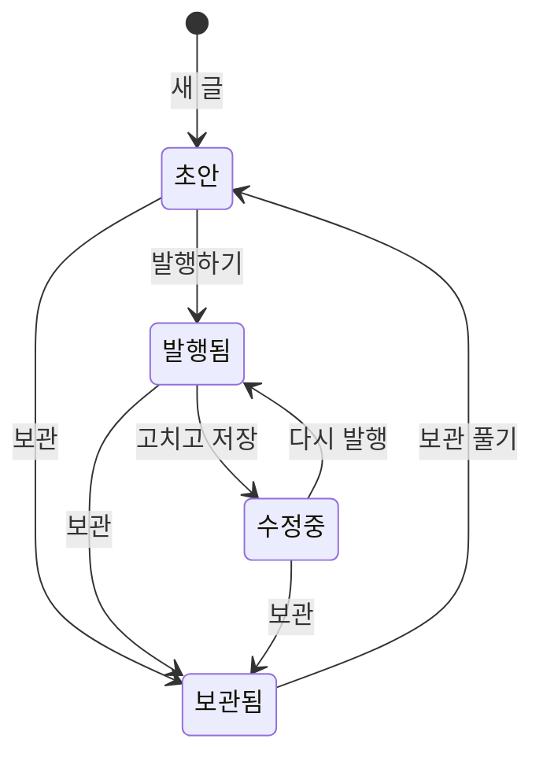
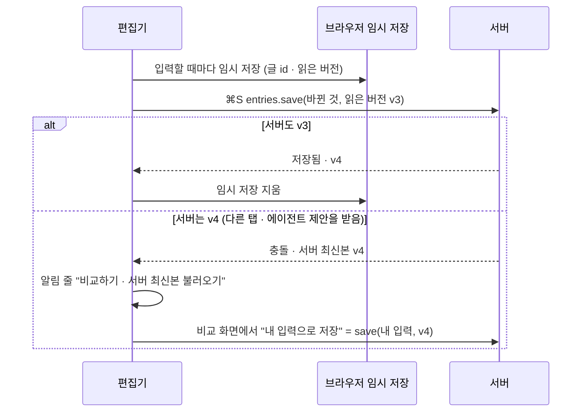
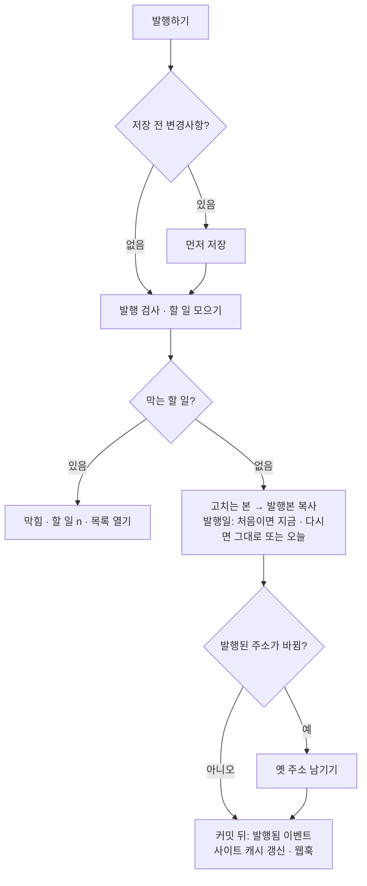
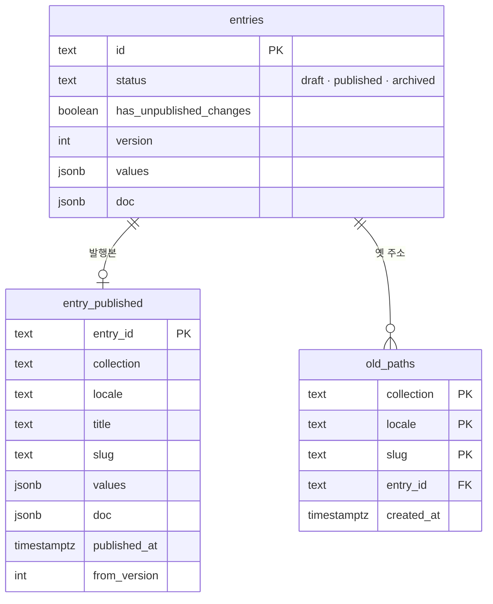

# 02 글의 일생

상태: 초안 (2026-11-05). 결정은 모두 정해졌다.

## 한 문장

글 하나에는 **고치는 본**과 **발행본** 두 가지가 있다. 관리자는 고치는 본을 저장하고, 발행하면 고치는 본이 발행본으로 복사된다. 사이트는 발행본만 읽는다.

## 원칙

이 문서의 상태와 발행은 문서 컬렉션(게시글, 메모)의 것이다. 항목 컬렉션(카테고리, 태그)은 발행이 없고 저장하면 바로 사이트에 나간다(08번 문서). 항목도 보관과 휴지통은 있다.

1. **사이트는 발행본만 본다.** 저장은 사이트를 바꾸지 않는다. 발행만 바꾼다.
2. **저장은 사람이 한다.** ⌘S나 "저장 전 변경사항" 칸을 눌러 서버에 저장한다. 그 사이의 입력은 브라우저에 임시로 남아 창이 닫혀도 잃지 않는다.
3. **덮어쓰지 않는다.** 저장은 읽은 버전을 함께 보낸다. 그 사이 다른 곳에서 저장했으면 충돌로 알리고, 사람이 비교해서 고른다.
4. **발행 전 할 일은 한 목록이다.** 필수 필드, 대체 텍스트, 플러그인 검사가 모두 같은 "할 일"로 모인다. 막는 것이 남아 있으면 발행할 수 없다.
5. **발행된 주소는 끊지 않는다.** 발행된 글의 주소를 바꾸면 옛 주소는 새 주소로 넘겨 준다.

## 쓰는 화면과 흐름

- 기준 화면: `Screens/Reference/Editor` › EditorNotion, EditorCompare, `Screens/Reference/Lists` › Main(상태 열, 행 메뉴).
- 흐름: [흐름 1 · 글 쓰고 발행하기](../admin/flows/01-write-and-publish.md) 전부. 목록의 상태 거르기와 여러 글 발행은 [흐름 7](../admin/flows/07-list-tidy-up.md).
- 본문 편집(블록, 서식, 템플릿)은 03번 문서, 번역본의 발행은 04번 문서, 휴지통은 11번 문서.

## 상태

| 상태 | 화면 | 뜻 |
|---|---|---|
| 초안 | ○ 초안 | 한 번도 발행하지 않았다. 사이트에 없다 |
| 발행됨 | ● 발행됨 | 고치는 본과 발행본이 같다 |
| 수정 중 | ● 수정 중 (주황) | 발행본은 사이트에 그대로 있고, 고치는 본이 다르다 |
| 보관됨 | 보관됨 | 사이트에서 내렸다. 목록은 거를 때만 보인다. 편집기는 읽기 전용이다 |

- 휴지통에 든 글은 상태와 따로 `trashed_at`이 있다(11번 문서).
- "수정 중"은 저장한 것만 센다. 저장하지 않은 입력은 상태 줄의 "저장 전 변경사항"이다.

## 저장

편집기의 저장 칸은 네 가지 중 하나를 보인다.

| 저장 칸 | 뜻 | 누르면 |
|---|---|---|
| 저장 전 변경사항 | 서버에 안 보낸 입력이 있다. 브라우저에는 남아 있다 | 저장 |
| 저장됨 | 서버와 같다 | 알리기만 |
| 브라우저에만 임시 저장됨 | 다시 열었더니 브라우저에 서버보다 새 입력이 있다 | 비교 |
| 편집 충돌 | 저장하려 했더니 다른 곳에서 먼저 저장했다 | 비교 |

- 저장은 바뀐 칸만 보낸다(`values`의 바뀐 필드, 본문, 제목, 주소). 서버는 한 트랜잭션으로 고치는 본을 바꾸고 버전을 하나 올린다.
- 다시 열었을 때 브라우저 임시 저장본이 있으면, 그것이 읽은 버전과 지금 서버 버전을 비교한다. 서버가 그대로면 임시 저장본을 불러올지 묻고(흐름 1·18), 서버가 바뀌었으면 비교 화면으로 간다(흐름 1·19).
- 서버 자동 저장은 없다. 기준 화면이 저장을 사람의 일로 그렸고, 브라우저 임시 저장이 잃지 않게 한다.
- 로그인이 풀려서 떠난 입력은 임시 저장에 그렇게 적힌다. 다시 로그인해 돌아오면, 서버가 그대로일 때 묻지 않고 다시 들어간다. 사람이 일부러 두고 간 입력이 아니기 때문이다(15).

## 발행

### 할 일

| 할 일 | 어디서 오나 | 막나 |
|---|---|---|
| 필수 필드가 비었다 | 스키마(01) | 막는다 |
| 주소가 비었다 | 고치는 본의 주소. 스키마의 필수 여부와 상관없다 | 막는다 |
| 주소가 겹친다 | 같은 컬렉션과 언어에서 다른 글이 발행한 주소 | 막는다 |
| 새로 필수가 된 필드가 비었다 | 구조 바꾸기의 "비워 두기"(01) | 막는다 |
| 대체 텍스트 없는 이미지 n개 | 본문과 미디어 필드 | 막는다(흐름 1·10) |
| 발행 안 된 글로 가는 링크 | 본문 링크(`monti:entry/<묶음 id>`, 03). 같은 언어의 글이 사이트에 없을 때 | 알리기만 |
| 플러그인 검사 | 플러그인의 발행 검사 고리 | 플러그인이 정한다 |

- 할 일은 저장할 때마다 다시 센다. 편집기의 "할 일 n" 칸과 발행 버튼이 같은 결과를 쓴다.
- 할 일 행을 누르면 그 자리로 간다. 여러 곳을 한 번에 채우는 버튼은 없다. 채우기는 그 자리의 "✦ 채우기"로 한다.
- 맞춤법처럼 글을 고치라고 권하는 플러그인은 할 일이 아니라 상태 줄의 플러그인 칸에 나온다.

### 발행일

- 처음 발행하면 발행일은 그때다.
- 다시 발행할 때는 발행 메뉴에서 고른다. "발행하기"는 원래 발행일을 그대로 두고, "오늘 날짜로 다시 발행"은 오늘로 바꾼다(흐름 1·15). 발행일은 이 메뉴로만 정한다.

### 주소

- 새 글은 주소가 비어 있다. 주소는 사람이 속성 패널의 주소 칸에 쓰거나, ↻를 눌러 제목에서 만든다. 비어 있는 주소는 할 일 "주소 쓰기"가 되어 발행을 막는다. 발행이 주소를 몰래 만들지 않는다(2026-11-06, 소유자).
- 발행된 글의 주소를 바꾸고 다시 발행하면, 옛 주소가 새 주소로 넘어가도록 남는다. 컬렉션의 공개 주소 앞부분을 바꾸는 것은 01번 문서의 일이고, 그때 옛 주소는 남지 않는다(404).

## 미리보기

- "미리보기"는 사이트의 미리보기 경로(설정 › 사이트)에 짧게 사는 표를 붙여 연다. 사이트는 그 표가 있을 때만 고치는 본을 읽는다.
- 볼 것이 없으면(제목도 본문도 없는 새 글) 버튼이 꺼진다.

## 데이터

- `entries`의 `values`, `doc`, `title`, `slug`는 고치는 본이다(01번 문서의 표에 열이 더해진다).
- 발행본은 `entry_published`에 따로 있다. 사이트의 읽기 API는 이 표만 읽는다.
- `has_unpublished_changes`는 저장할 때 고치는 본의 제목, 주소, `values`, `doc`을 발행본과 견주어 정한다. 목록의 "수정 중"과 거르기가 이 열을 쓴다.
- 필드를 지우거나 이름을 바꾸면(01) 두 본에 같이 적용한다. 그래서 견준 결과가 바뀌지 않는다.
- 옛 주소는 컬렉션, 언어, 주소로 적는다. 컬렉션의 공개 주소 앞부분이 바뀌면 그 앞부분으로 된 옛 주소는 없어진다(404, 01).
- 같은 컬렉션과 언어에서 발행된 주소는 하나뿐이다. 다른 글이 발행한 주소를 쓰면 할 일 "주소가 겹쳐요"가 발행을 막는다.

## 기능 목록

| 기능 | 종류 | 하는 일 |
|---|---|---|
| `entries.create` | write | 새 글. 컬렉션, 언어, 템플릿(03)을 받는다 |
| `entries.get` | read | 고치는 본, 발행본 요약, 버전, 상태, 할 일 |
| `entries.save` | write | 바뀐 칸을 저장. 읽은 버전이 다르면 충돌, 보관된 글이면 거절 |
| `entries.compare` | read | 보낸 입력과 서버 최신본의 칸별 차이("다른 곳 3") |
| `entries.checkPublish` | read | 할 일 목록 |
| `entries.publish` | write · preview | 여러 글을 발행. 발행일 "그대로" 또는 "오늘" |
| `entries.archive` · `entries.unarchive` | write | 보관, 보관 풀기 |
| `entries.duplicate` | write | 고치는 본을 새 초안으로 복제 |
| `entries.export` | read | 글을 내보내기 파일로 |
| `entries.previewLink` | read | 미리보기 주소 |

- `entries.publish`의 `preview`는 글마다 할 일과 새로 생길 옛 주소를 돌려준다. 목록에서 여러 글을 발행할 때 막힌 글을 미리 보인다.

## 에이전트

- **읽기:** `entries.get`으로 고치는 본과 발행본을 모두 읽고, `entries.checkPublish`로 할 일을 안다. "발행 전에 뭐가 남았어?"에 이것으로 답한다.
- **쓰기:** `entries.save`는 제안이 된다. 편집기에서는 본문과 속성 칸에 파란 표시로 보인다(05번 문서). 받으면 그 값은 편집기의 저장 전 변경사항이 되고, 사람이 저장할 때 다른 고침과 함께 서버에 간다(05번 문서). 편집기를 열지 않은 글의 제안은 제안 검토 화면에서 받고, 받으면 바로 적용된다.
- **발행:** `entries.publish`도 제안이다. 제안 카드는 `preview`로 막힌 글을 미리 보인다.
- **지금 화면:** 편집기가 맥락으로 연 글 id, 그 글의 버전, 고른 글자 범위를 보낸다. "이 문단"이 무엇인지 여기서 안다.
- **사람만:** 없다. 이 기능의 쓰기는 모두 되돌릴 수 있다. 발행을 되돌리면 앞의 발행본으로 돌아간다.

## 화면 쪽 조각

- `useEntryEditor(id)`: 고치는 본, 저장 칸 상태, 브라우저 임시 저장, 저장, 충돌 처리. 편집기와 템플릿 편집기가 쓴다.
- `usePublish(id)`: 할 일, 발행 버튼 상태(발행하기 / 발행됨 / ▾ 메뉴), 발행.
- `EntryStatus`: 상태 표시(○ 초안, ● 발행됨, ● 수정 중, 보관됨). 목록, 편집기 머리, 관계 고르기가 같은 것을 쓴다.
- `CompareView`: 비교 화면. 충돌과 임시 저장본이 같은 것을 쓰고, 버튼만 다르다.

## 결정 기록

- 2026-11-05, 소유자: 보관은 사이트에서 내리는 것이다. 발행본을 내리고 목록 기본 보기에서 빠진다. 보관을 풀면 초안이 되고, 다시 발행해야 사이트에 나온다. "발행 취소"는 따로 두지 않는다.
- 2026-11-05, 소유자: 보관된 글은 읽기 전용이다. 편집기 머리에는 "보관 풀기" 하나만 있고(휴지통 글의 머리와 같은 모양), 고치려면 보관을 풀어 초안으로 만든다. 에이전트도 보관된 글에는 고치기 제안을 만들지 않고 "보관 풀기"를 제안한다. Contentful과 GitHub의 보관이 같은 방식이다.

- 2026-11-05: 서버 자동 저장은 두지 않는다. 저장은 사람의 일이고, 그 사이 입력은 브라우저에 남긴다. 기준 화면의 저장 칸 네 가지를 따른다.
- 2026-11-05: 발행본은 고치는 본과 다른 표에 둔다. 사이트 읽기가 한 표만 보게 하고, "수정 중"을 두 본의 비교 하나로 정한다.
- 2026-11-05: 해시 열(`working_hash`, `hash`)은 두지 않는다. 구조 바꾸기가 두 본을 SQL로 함께 고치면 저장한 해시가 낡는다. 데이터베이스가 두 본을 바로 견준다.
- 2026-11-05: `entries.save`는 읽은 버전을 입력으로 받는다. 버전 없이 저장하는 길이 없어야 명령이나 에이전트도 덮어쓰지 못한다(원칙 3).
- 2026-11-05: 여러 글 발행은 막힌 글을 건너뛰고 나머지를 발행한다. 막힌 글은 `preview`와 결과에 나온다. 모두 막혔으면 발행 자체가 거절된다.
- 2026-11-05: 미리보기 표는 `MONTI_SECRET`으로 서명한 한 시간짜리 표다. 표를 데이터베이스에 두지 않으므로 읽기 기능이 아무것도 쓰지 않는다.
- 2026-11-05: 대체 텍스트 없는 이미지는 발행을 막는다(흐름 1·10).
- 2026-11-06, 소유자: 비어 있는 주소는 발행할 때 제목으로 만들지 않고 할 일로 막는다. 사람이 모르는 사이에 공개 주소가 정해지면 안 된다. 주소는 주소 칸에 쓰거나 ↻로 제목에서 만든다. 그래서 주소 칸에는 설명 플레이스홀더가 없고, 비면 다른 칸처럼 "비어 있음"이다.

## 열린 질문

- 예약 발행은 기준 화면에 없다. 필요해질 때 `entries.publish`에 시각을 더하는 것으로 열어 둔다(2026-11-05 소유자: 나중에, README의 "나중에 할 것").
- 지난 발행본으로 돌아가기(판 기록)는 기준 화면에 없다. 되돌리기는 활동 기록의 스냅숏으로만 한다(2026-11-05 소유자: 나중에, README의 "나중에 할 것").

## 끝 조건

- **02-1** 흐름 1의 19단계가 이 기능 목록만으로 된다.
- **02-2** 저장하지 않은 입력은 창을 닫았다 열어도 남고, 다른 곳의 저장을 덮어쓰는 길이 없다. 관리자 API, 명령, 에이전트 제안 모두 읽은 버전이 다르면 저장되지 않는다.
- **02-3** 사이트의 읽기 API는 발행본만 내놓고, 미리보기 표가 있을 때만 고치는 본을 내놓는다. 지운 필드의 값은 발행본에서도 지워진다.
- **02-4** 할 일 목록, 발행 버튼, 목록에서 여러 글 발행이 같은 검사 결과를 쓴다. 플러그인 검사도 같은 목록에 든다.
- **02-5** 발행된 주소를 바꾸면 옛 주소가 새 주소로 넘어간다. 비어 있는 주소와 다른 글이 발행한 주소는 할 일이 되어 발행을 막는다.
- **02-6** 보관한 글은 사이트에서 내려가고 고칠 수 없다. 보관을 풀면 초안이 되고, 다시 발행해야 사이트에 나온다.
- **02-7** 발행을 되돌리면 앞의 발행본이 사이트에 돌아온다.
