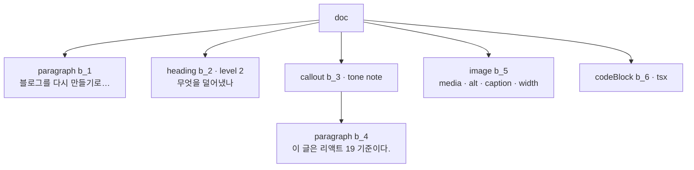
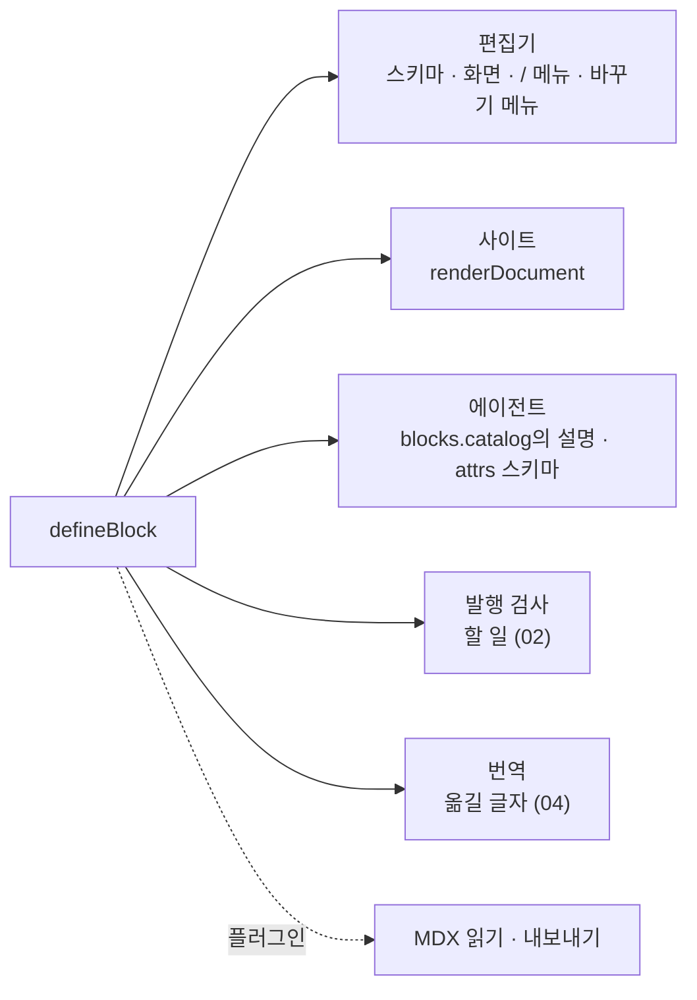
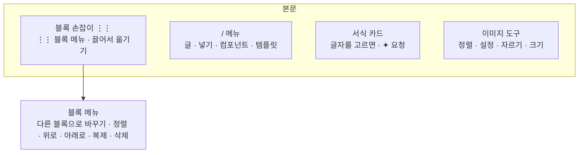
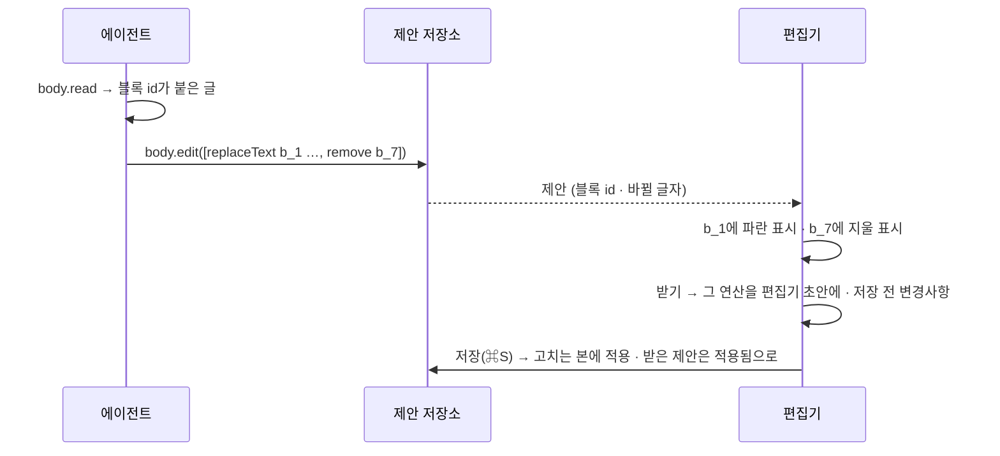

# 03 본문 편집기

상태: 초안 (2026-11-05). 결정은 모두 정해졌다.

## 한 문장

본문은 블록이 늘어선 JSON 문서이고, 블록마다 id가 있다. 블록 종류는 정의 하나로 만든다. 그 정의에서 편집기 화면, 사이트 그리기, 에이전트가 읽는 설명, MDX 변환이 나온다. 블로그의 컴포넌트도 같은 방법으로 블록이 된다.

## 원칙

1. **JSON 문서가 원본이다.** MDX는 플러그인이 읽고 내보낸다. 저장되는 것은 언제나 JSON 문서다.
2. **블록마다 id가 있다.** 번역(04)은 블록 id로 원문과 짝을 짓고, 에이전트의 제안(05)은 블록 id로 자리를 가리키고, 코드 참조는 블록 id로 코드를 가리킨다. id는 블록이 처음 생길 때 정해지고, 옮기거나 고쳐도 바뀌지 않는다.
3. **블록 정의 하나에서 모두 나온다.** 블록을 더하는 사람은 정의 하나만 쓴다. 편집기, 사이트, 에이전트, 변환을 따로 고치지 않는다.
4. **블로그의 컴포넌트가 편집기에 그대로 보인다.** 사이트가 그리는 React 컴포넌트를 편집기에서도 그린다. Monti가 사이트를 흉내 내지 않고, 관리자가 자기 컴포넌트를 꽂는다.
5. **에이전트는 블록 단위로 고친다.** 본문 전체를 다시 쓰지 않고, 블록 id를 가리켜 바꾼다. 그래서 제안이 어느 블록의 어느 글자인지 화면에 그대로 보인다.

## 쓰는 화면과 흐름

- 기준 화면: `Screens/Reference/Editor` › EditorNotion, TemplateEditor, ImageInsert, `Screens/Reference/Lists` › Templates, Empty, `Screens/Reference/Assistant` › CollectionEditor(편집기 허용).
- 흐름: [흐름 1](../admin/flows/01-write-and-publish.md)의 02~06단계(템플릿, 블록 손잡이, 서식 카드, 플러그인 칸), [흐름 6](../admin/flows/06-media.md)의 편집기에서 넣기.
- 이미지와 파일을 올리고 고르는 일은 09번 문서, 번역은 04번 문서, 제안 표시는 05번 문서.

## 문서

```ts
type Doc = {
  type: "doc";
  blocks: Block[];
};

type Block = {
  id: string;                 // "b_7Kq2", fixed for the block's life
  type: string;               // "paragraph", "heading", "callout", "component:PostCard"
  attrs?: Record<string, CmsJsonValue>;
  content?: Inline[];         // blocks that hold text
  children?: Block[];         // blocks that hold blocks (callout, tabs, columns)
};

type Inline =
  | { type: "text"; text: string; marks?: Mark[] }
  | { type: "hardBreak" }
  | { type: "footnoteRef"; id: string };

type Mark =
  | { type: "bold" | "italic" | "underline" | "strike" | "code" | "sup" | "sub" }
  | { type: "link"; href: string }   // an entry: "monti:entry/<translation group>"
  | { type: "tooltip"; text: string }
  | { type: "color"; color: string };
```



## 블록

### 블록 정의

```ts
export const callout = defineBlock({
  type: "callout",
  label: "콜아웃",
  // The model reads this to know when to use the block.
  description: "A highlighted box with an optional title, for notes and warnings.",
  menu: "insert",                                   // "/" menu group
  attrs: z.object({ tone: z.enum(["note", "warn"]), title: z.string().optional() }),
  holds: "blocks",                                  // "text" | "blocks" | "nothing"
  translate: { attrs: ["title"] },                  // text in attrs that a translation rewrites (04)
  Site: Callout,                                    // the site's own component
  Editor: CalloutEditor,                            // optional; defaults to Site with editable children
  check: (block) => (block.children?.length ? [] : [{ level: "warn", message: "비어 있는 콜아웃" }]),
});
```



### 어떤 블록이 어디에 있나

| 묶음 | 블록 | 어디에 |
|---|---|---|
| 글 | 문단, 제목(H2~H4), 글머리 목록, 번호 목록, 체크리스트, 인용, 코드 블록, 표, 구분선, 각주 | core |
| 넣기 | 이미지, 파일 | core (09번 문서의 미디어를 쓴다) |
| 넣기 | 콜아웃, 탭, 단 나누기, 접기, 코드 탐색기, 수식, 차트, 다이어그램 | `@monti-cms/blocks`. `monti add`로 사이트 소스에 넣고 고쳐 쓴다 |
| 서식 | 굵게, 기울임, 밑줄, 취소선, 코드, 링크, 위 첨자, 아래 첨자 | core |
| 서식 | 툴팁, 글자 색 | `@monti-cms/blocks` |
| 컴포넌트 | 사이트의 컴포넌트 | 관리자가 `defineBlock`으로 꽂는다 |

- "글"과 기본 서식만으로 블로그 글 하나를 쓸 수 있어야 한다. 나머지는 관리자가 고른다.
- 컬렉션마다 무엇을 켤지는 편집기 허용(01의 관리자 값)이 정한다. 끈 블록은 "/" 메뉴, "다른 블록으로 바꾸기", 에이전트의 `blocks.catalog`에서 빠진다. 서버는 막지 않는다. 이미 글에 있는 끈 블록은 그대로 남고 흐린 "끈 블록" 표시만 붙는다(결정 기록).

## 편집기



- **블록 메뉴**는 할 수 없는 행을 숨긴다(첫 블록의 "위로"). 바꾸기 메뉴는 마크다운 단축(`##`, `-`, `>`)을 행 끝에 보인다.
- **`/` 메뉴**는 한 단계다. 포커스는 본문에 남고 화살표, Enter, Esc로 움직인다. "템플릿"을 치면 템플릿만 남는다.
- **마크다운 단축**: 줄 앞의 `## `, `- `, `1. `, `> `, ` ``` `가 그 블록으로 바뀐다.
- **이미지**는 붙여 넣거나 끌어 넣으면 창 없이 그 자리에 들어가고 올리는 막대가 흐른다. 대체 텍스트와 캡션 칸에 "✦ 채우기"가 있다(바로 넣기, 00번 문서).
- **본문 검사 플러그인**(맞춤법)은 본문 글자를 받아 고칠 곳과 고칠 말을 돌려준다. 상태 줄의 플러그인 칸에 모이고, 사람이 하나씩 또는 "모두 고치기"로 고친다. 사람이 누르는 것이라 제안이 아니라 바로 고친다.

편집기 엔진은 ProseMirror(Tiptap)다. 엔진의 스키마는 블록 정의에서 만들고, 저장할 때 엔진의 문서를 위의 `Doc`으로 바꾼다. 엔진의 모양이 저장되는 일은 없다.

## 템플릿

- 템플릿은 이름과 문서(`Doc`) 하나다. 템플릿 편집기는 글 편집기의 본문 단만 쓴다(속성 패널, 언어 탭, 발행이 없다).
- 관리자 값이라 데이터베이스에 있고 운영 사이트에서도 바로 고친다(01번 문서의 "어디에 사는가").
- 템플릿은 사이트 전체에 하나의 목록이다. 새 글의 `/` 메뉴, 빈 목록의 "템플릿으로 쓰기"에서 고른다. 넣으면 커서 자리에 블록들이 새 id로 들어간다.
- 관리자 설정 › 기능의 "본문 템플릿"을 끄면 `/` 메뉴의 템플릿 묶음과 도구 › 템플릿 탭이 사라진다. 템플릿은 지워지지 않는다.

## 사이트

```ts
// in the site
import { createElement } from "react";
import { renderDocument } from "@monti-cms/core/render";
import { blocks } from "@/monti/blocks"; // the same definitions the admin uses

export function PostBody({ doc }: { doc: Doc }) {
  return renderDocument(doc, { createElement, blocks });
}
```

- 사이트는 읽기 API로 발행본의 `Doc`을 받아 `renderDocument`로 그린다. 블록 정의의 `Site` 컴포넌트를 쓴다.
- 사이트에 정의가 없는 블록(지운 플러그인의 블록)은 그리지 않고, 개발 서버에서만 경고를 낸다.

## 에이전트

- **알아내기:** `blocks.catalog(collection)`이 그 컬렉션에서 켠 블록과 서식, 블록마다 설명과 attrs 스키마를 내놓는다.
- **읽기:** `body.read(entryId)`는 본문을 블록 id가 붙은 읽기 쉬운 글로 내놓는다. JSON 그대로보다 짧고, 모델이 자리를 정확히 가리킬 수 있다.

```md
{#b_1} 블로그를 다시 만들기로 한 건 글을 쓰는 시간보다 도구를 고치는 시간이 길어졌기 때문이다.
{#b_2} ## 무엇을 덜어냈나
{#b_3} :::callout{tone=note}
{#b_4} 이 글은 리액트 19 기준이다.
:::
```

- **쓰기:** `body.edit(entryId, ops, 읽은 버전)`는 블록 단위 연산을 받는다. 에이전트가 부르면 제안이 된다(00번 문서).

```ts
type BodyOp =
  | { op: "replaceText"; block: string; from: number; to: number; text: string }  // inside one block
  | { op: "setBlock"; block: string; value: Omit<Block, "id"> }                     // replace a block's type, attrs or content
  | { op: "insert"; after: string | null; blocks: Omit<Block, "id">[] }             // new blocks get new ids
  | { op: "move"; block: string; after: string | null }
  | { op: "remove"; blocks: string[] };
```



- `replaceText`는 그 블록의 글자 위치를 쓴다. 받을 때 그 블록이 그 사이 바뀌었으면 "이 사이에 고쳐짐"이 된다(00번 문서).
- 편집기의 사람 저장은 문서 전체를 보낸다(`entries.save`의 `doc`). 블록 연산은 에이전트와 플러그인을 위한 길이다. 둘 다 같은 검사(블록 정의의 attrs 스키마, 편집기 허용)를 지난다.

## 기능 목록

| 기능 | 종류 | 하는 일 |
|---|---|---|
| `blocks.catalog` | read | 컬렉션에서 켠 블록과 서식, 설명, attrs 스키마. 컬렉션 없이 부르면 사이트의 모든 블록과 서식(설정 › 컬렉션의 에디터 탭이 고를 목록) |
| `body.read` | read | 블록 id가 붙은 읽기 쉬운 본문. 블록 몇 개만 고를 수 있다 |
| `body.edit` | write | 블록 연산으로 고치는 본을 바꾼다 |
| `templates.list` · `templates.get` | read | 템플릿 목록과 하나 |
| `templates.save` · `templates.duplicate` | write | 만들기와 고치기, 복제 |
| `templates.remove` | write | 지우기(되돌릴 수 있다) |

## 화면 쪽 조각

- `useBodyEditor(doc, catalog)`: 엔진을 만들고 블록 정의로 스키마, `/` 메뉴, 바꾸기 메뉴를 채운다. 글 편집기와 템플릿 편집기가 쓴다.
- `BlockHandle`, `FormatCard`, `SlashMenu`, `ImageTools`: 기준 화면의 부품을 엔진에 잇는 조각.
- `ProposalMarks`: 블록 id로 받은 제안을 본문 위에 그린다(05번 문서).

## 결정 기록

- 2026-11-05, 소유자: 컬렉션에서 끈 블록이 글에 있으면 남겨 두고 표시만 한다. 블록은 본문과 사이트에 그대로 있고, 편집기에서 흐린 "끈 블록" 표시가 붙는다. 고치거나 지울 수 있지만 새로 넣을 수는 없고, 발행을 막지 않는다. 편집기 허용은 설정 변경일 뿐 이미 쓴 글을 바꾸지 않는다. 템플릿을 넣을 때도 그대로 들어간다.

- 2026-11-05, 소유자: 본문의 원본은 JSON 문서다. MDX와 지시문 문법(`:::callout`)은 플러그인이 읽고 내보낸다.
- 2026-11-05: 블록은 처음 생길 때 id를 받고, 그 id는 블록이 사는 동안 바뀌지 않는다. 템플릿을 넣거나 블록을 복제하면 새 id다.
- 2026-11-05: 에이전트는 본문을 블록 연산으로 고친다. 문서 전체를 다시 쓰는 도구는 두지 않는다.
- 2026-11-05: 편집기 엔진은 ProseMirror(Tiptap)다. 엔진의 문서 모양은 저장하지 않는다.
- 2026-11-05: core에는 글 쓰기에 꼭 필요한 블록과 서식만 있다. 나머지는 `@monti-cms/blocks`에서 `monti add`로 사이트 소스에 넣는다("사용자가 만지는 것은 연다").
- 2026-11-05: 템플릿은 사이트 전체에 하나의 목록이다. 컬렉션마다 나누지 않는다.
- 2026-11-05: 서버의 검사는 문서가 전에 갖고 있던 블록을 "남은 블록"으로, 처음 보는 id나 종류가 바뀐 블록을 "새 블록"으로 본다. 사이트가 정의하지 않는 블록과 서식은 새로 넣을 수 없고, 남은 것은 그대로 둔다.
- 2026-11-05, 소유자: 편집기 허용은 서버가 막지 않는다. `/` 메뉴, 바꾸기 메뉴, 에이전트의 `blocks.catalog`만 거른다. 그래서 편집기에서 템플릿을 넣을 때도 끈 블록이 그대로 들어가고 저장된다.
- 2026-11-05, 소유자: 본문에서 글로 가는 링크는 글을 번역 묶음 id로 가리킨다(`monti:entry/<묶음 id>`). 글 주소가 바뀌어도 링크가 끊기지 않고, 그 글이 사이트에 있는지 바로 안다. 사이트는 읽기 API의 `linkPaths`로 지금 주소를 받아 그리고, 사이트에 없는 글로 가는 링크는 글자만 그린다. 같은 언어의 글이 발행되지 않았으면 할 일 "발행 안 된 글로 가는 링크"(알리기만)가 된다.
- 2026-11-05: `body.read`는 블록의 서식 없는 글자를 보인다. `replaceText`의 위치가 모델이 읽은 글자와 같아야 해서다. 바꾼 글자는 바꾼 자리 첫 글자의 서식을 받는다.
- 2026-11-05: `renderDocument`는 `@monti-cms/core/render`에 있지만 React를 가져오지 않는다. 사이트가 자기 `createElement`를 넘긴다. core는 어떤 프레임워크도 모른다는 규칙(`biome.json`)을 지키고, React가 아닌 사이트도 같은 함수를 쓴다. core 블록은 `Site` 컴포넌트가 없으면 평범한 HTML로 그린다.
- 2026-11-05: 표 블록은 칸마다 서식 없는 글자다(`attrs.rows`). 칸 안의 서식이 필요해지면 표를 블록을 담는 블록으로 바꾼다.
- 2026-11-06, 소유자: 표는 노션처럼 표 자체에서 고친다. 편집기 안의 표는 옅은 격자이고, 커서가 있는 칸의 열 위 · 행 왼쪽 손잡이가 열과 행의 메뉴(넣기, 지우기)를 열고, 포인터가 표 위에 있으면 오른쪽 · 아래 가장자리의 + 띠가 열과 행을 더한다. 머리 행은 표의 블록 메뉴에서 켜고 끈다. 편집기 엔진은 Tiptap의 표이고, 저장할 때는 `attrs.rows` · `header` · `widths`로 바꾼다(editor-tools.md "표").
- 2026-11-06, 소유자: 각주는 서식 카드의 각주 버튼이나 "/" 메뉴로 넣는다. 번호는 본문에 나오는 순서이고, 각주는 언제나 글 끝에 함께 놓인다. 본문에서 마지막 번호를 지우면 각주도 지워지고(⌘Z로 함께 돌아온다), 각주를 지우면 그 번호도 지워진다. 사이트도 같은 순서로 번호를 매겨 글 끝에 그린다.
- 2026-11-06, 소유자: 표는 언제나 본문 폭이고(가로 스크롤 없음), 열 너비는 경계를 끌어 이웃한 두 열끼리 주고받는다. 열을 넣거나 지우면 나머지 열이 비율대로 자리를 내주거나 나눠 갖는다. 너비는 본문 폭에 대한 비율(퍼센트)로 `attrs.widths`에 저장하고, 사이트는 `<colgroup>`으로 같은 비율로 그린다. 한 번도 끌지 않은 표는 `widths`가 없고 열이 고르다.
- 2026-11-05: 목록은 `listItem` 블록을 담는 블록이다(`bulletList`, `orderedList`, `checklist`). 체크리스트 항목은 `checked`를 가진다.

## 끝 조건

- **03-1** 블록 하나를 `defineBlock`으로 더하면 편집기, `/` 메뉴, 사이트 그리기, `blocks.catalog`, 발행 할 일(블록의 `check`)에 함께 나타난다.
- **03-2** 사람의 저장과 에이전트의 블록 연산이 같은 검사를 지난다.
- **03-3** 블록 id는 옮기기, 고치기, 저장, 발행을 지나도 그대로다.
- **03-4** 흐름 1의 02~06단계와 기준 화면 TemplateEditor, ImageInsert가 이 기능 목록과 09번 문서만으로 된다.
- **03-5** 사이트가 더는 정의하지 않는 블록은 글에 그대로 남고, 다른 곳을 고쳐 저장할 수 있다. 새로 넣을 수는 없다. 편집기 허용은 메뉴와 에이전트 목록만 거르므로, 끈 블록도 템플릿으로 넣으면 그대로 들어간다.
