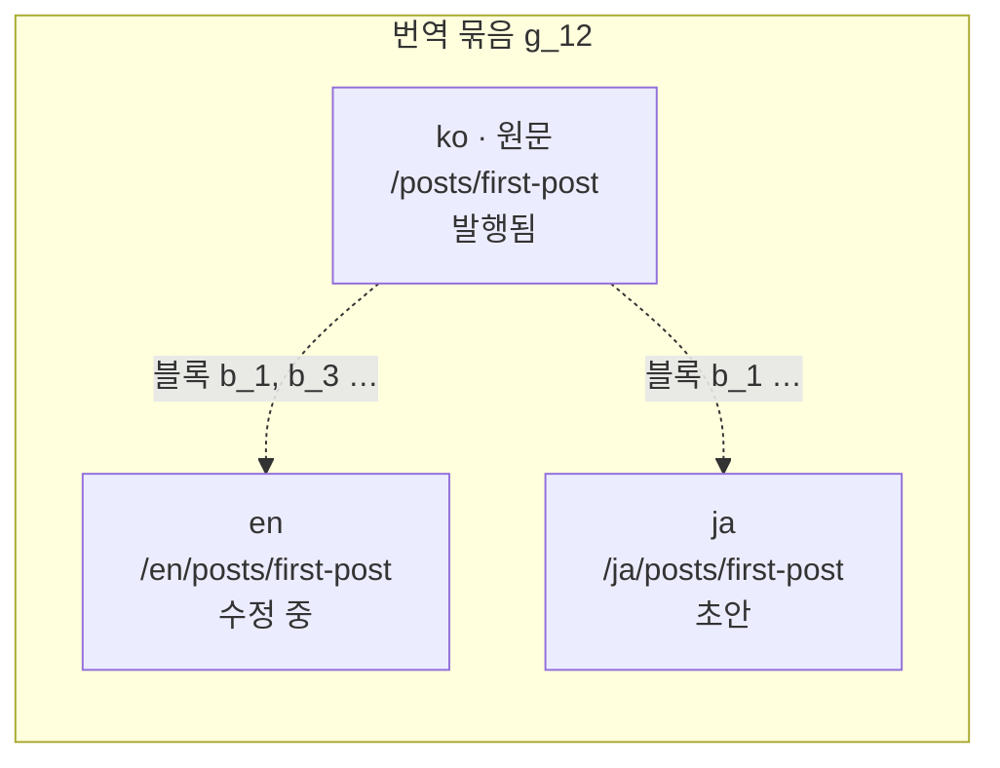
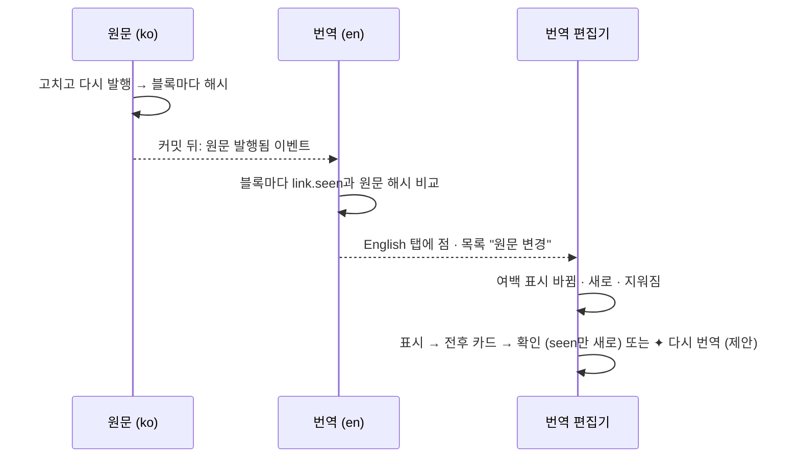
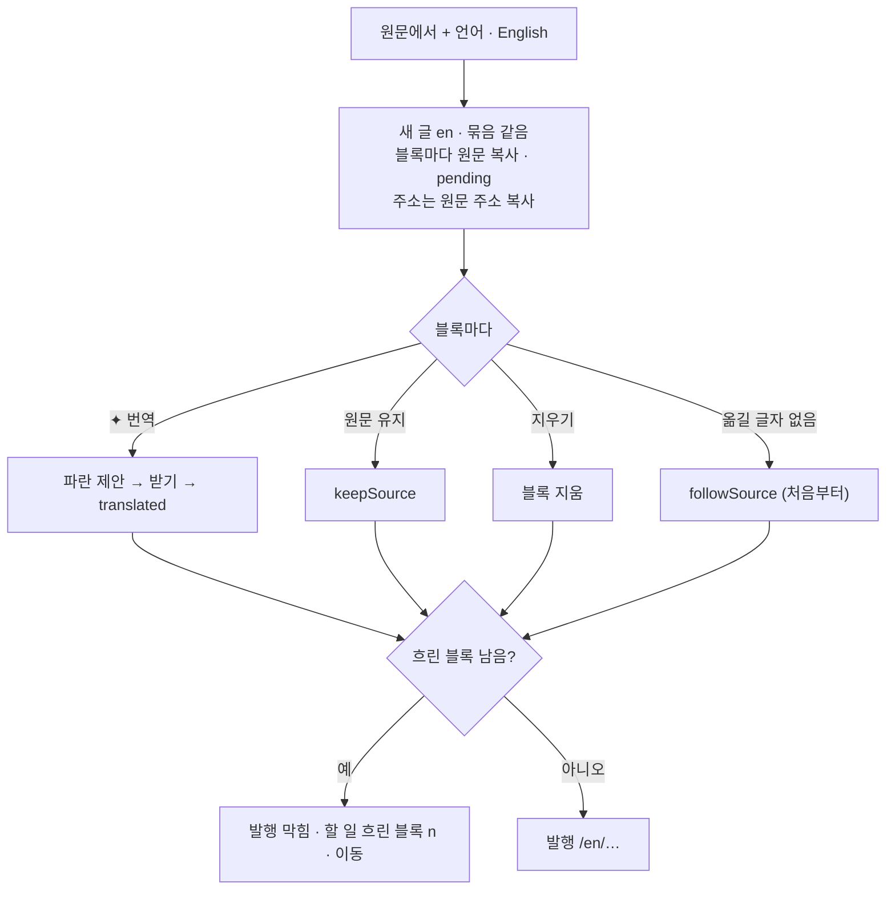
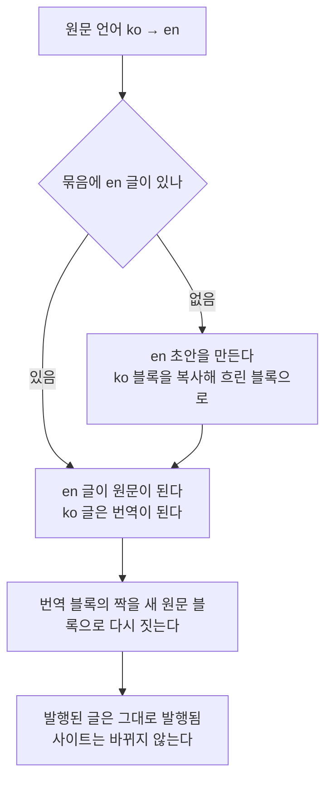

# 04 다국어

상태: 초안 (2026-11-05). 결정은 모두 정해졌다.

## 한 문장

번역은 원문의 사본이 아니라 언어마다 따로 있는 글이다. 번역 글의 블록은 원문 블록의 id를 기억하고, 원문이 다시 발행되면 어느 블록이 바뀌었는지 번역 쪽에 표시된다.

## 원칙

1. **언어 하나가 글 하나다.** 번역은 자기 주소, 자기 상태, 자기 발행이 있다. 원문이 발행된 채 번역은 초안일 수 있다.
2. **번역은 자유롭다.** 블록을 더하고, 빼고, 순서를 바꿀 수 있다. 원문과 한 줄씩 맞을 필요가 없다.
3. **짝은 블록 id로 짓는다.** 번역 블록은 어느 원문 블록에서 왔는지와 그때 원문 블록의 해시를 기억한다. 그래서 원문이 바뀌면 블록마다 알 수 있다.
4. **흐린 블록은 아직 정하지 않은 블록이다.** 번역할지, 원문 그대로 둘지, 지울지를 블록마다 정한다. 흐린 블록이 남아 있으면 발행할 수 없다.
5. **번역은 원문의 발행본을 따른다.** 원문을 저장만 하고 발행하지 않은 변경은 번역 쪽에 표시되지 않는다. 사이트에 나간 원문만 따라가면 된다(흐름 3·08).

## 쓰는 화면과 흐름

- 기준 화면: `Screens/Reference/Editor` › EditorTranslate, TranslatePaired, EditorNotion(언어 탭), `Screens/Reference/Lists` › Main(언어 열), `Screens/Reference/Settings` › Locales, AdminSettings(번역 켜기).
- 흐름: [흐름 3 · 번역](../admin/flows/03-translation.md) 전부, [흐름 11](../admin/flows/11-settings.md)의 05~08, 16단계.

## 모양



- 묶음 하나에 언어마다 글이 하나씩 있다. 원문은 사이트의 원문 언어로 된 글이다.
- 새 글은 원문 언어로 만든다. 번역은 원문 글의 "+ 언어"나 에이전트로 만든다.

## 필드 값

01번 문서의 필드 언어 방식이 번역에서 이렇게 보인다.

| 방식 | 번역 글에서 |
|---|---|
| 모두 같음 (`same`) | 원문의 값을 그대로 쓴다. 번역의 속성 패널에는 값만 글로 보이고 고칠 수 없다. 원문에서 고친다 |
| 언어마다 (`perLocale`) | 번역의 값이다. 새 번역은 비어 있다 |
| 원문 따름 (`fromSource`) | 번역의 값이 있으면 그것, 비어 있으면 원문의 값. 주소가 이렇다. 새 번역은 원문 주소를 복사해 시작한다 |

## 번역 블록

```ts
type TranslationLink = {
  from: string;          // the source block id
  seen: string;          // hash of the source block when last translated or confirmed
  state: "pending" | "translated" | "keepSource" | "followSource";
};

// a block in a translation's doc
type TranslatedBlock = Block & { link?: TranslationLink };
```

| 상태 | 화면 | 뜻 |
|---|---|---|
| `pending` | 빈 블록에 원문이 흐린 자리 표시로 | 원문 글자를 옮겨 놓았을 뿐, 아직 정하지 않았다. 편집기는 비운 채 원문을 자리 표시로 보인다. 사이트는 그리지 않는다. 발행을 막는다 |
| `translated` | 보통 | 번역했다 |
| `keepSource` | 보통 | 원문 글자를 그대로 쓰기로 했다(이름, 인용) |
| `followSource` | 보통, 끝에 "따로 고치기" | 옮길 글자가 없는 블록(코드, 수식, 다이어그램). 원문 블록을 그대로 보인다. "이 언어에서만 따로 고치기"를 누르면 `translated`가 된다 |

- 이미지는 같은 파일을 쓴다. 캡션과 대체 텍스트처럼 블록 정의가 `translate`로 적은 글자만 번역한다(03번 문서).
- `link`가 없는 블록은 번역에서 새로 쓴 블록이다. 원문과 짝이 없고, 표시도 없다.

## 원문이 바뀌면



| 표시 | 언제 | 할 수 있는 것 |
|---|---|---|
| 바뀜 | 짝 원문 블록의 해시가 `seen`과 다르다 | 전후 카드 → "확인"(글자는 그대로, `seen`만 새로) · "✦ 다시 번역"(제안) |
| 새로 | 원문에 짝 없는 블록이 생겼다 | 번역의 그 자리에 흐린 블록(`pending`)으로 들어온다 |
| 지워짐 | 짝 원문 블록이 없어졌다 | "확인"(표시만 지움) · "지우기" |

- 표시는 저장된 값이 아니라 원문 발행본과 `link`를 비교해 그때그때 센다. 그래서 원문을 되돌려 다시 발행하면 표시도 사라진다.
- "모두 확인"은 바뀜과 지워짐 표시를 한 번에 확인한다. 새로 들어온 흐린 블록은 따로 정해야 한다.
- 번역 글의 상태는 원문 변경과 따로다. 번역을 고치지 않으면 번역은 계속 "발행됨"이고, 사이트에는 옛 번역이 그대로 있다.

## 새 번역



## 언어 설정

- 언어 목록, 원문 언어, 주소의 언어 표시 방식은 구조 값이다(`monti.schema.ts`, 개발 서버에서만). 사이트 코드가 언어별 경로를 이것으로 만든다.
- 언어의 표시 이름("영어")과 시간대는 관리자 값이다.
- **원문 언어를 바꾸면** 모든 묶음에 새 원문 언어의 글이 있게 만든다. 묶음마다 원문 글은 늘 원문 언어로 된 글 하나다.



  - 새로 만든 영어 초안은 새 번역을 만들 때와 같은 모양이다. 블록은 한국어 글을 복사한 흐린 블록이다. 목록에서 초안으로 보이고, 에이전트에게 한꺼번에 번역을 시킬 수 있다.
  - 이미 발행된 글은 발행본을 건드리지 않는다. 한국어 글은 발행된 번역으로 남고, 영어 초안이 발행될 때까지 원문 변경 표시도 없다(번역은 원문의 발행본을 따른다).
- 관리자 설정의 "번역"을 끄면 언어 탭, "+ 언어", 목록의 언어 열이 사라진다. 번역 글은 지워지지 않고 사이트에도 그대로 있다.

```ts
// monti.schema.ts
export default defineSchema({
  locales: {
    source: "ko",
    list: [
      { code: "ko", name: "한국어" },
      { code: "en", name: "English" },
    ],
    prefix: "exceptSource", // "always" | "exceptSource" | "never"
  },
  collections: { /* … */ },
});
```

| 바꾸기 | 검토에서 고를 것 |
|---|---|
| 언어 더하기 | 없음 |
| 번역이 있는 언어 빼기 | 고를 것 없음. 그 언어의 번역은 함께 지워진다(빨간 "지우고 적용"). 개발 데이터에 번역이 없어도 검토를 거친다 |
| 원문 언어 바꾸기 | 없음. 새 원문 언어 글이 없는 묶음 n편에는 그 언어의 초안이 생긴다고 보인다 |

## 기능 목록

| 기능 | 종류 | 하는 일 |
|---|---|---|
| `translations.create` | write | 원문 글과 언어로 새 번역. 블록을 복사해 `pending`으로 |
| `translations.status` | read · 여러 글 | 글마다 언어별 상태와 원문 변경 수. 목록의 언어 열과 거르기가 쓴다 |
| `translations.compare` | read | 원문과 번역의 블록 짝, 표시, 바뀐 블록의 전후 |
| `translations.setBlocks` | write | 블록마다 원문 유지, 확인, 따로 고치기, 지우기 |
| `translations.confirmAll` | write | 바뀜과 지워짐 표시를 모두 확인 |
| `locales.plan` · `locales.apply` | read · write | 언어 목록 바꾸기의 검토와 적용(01번 문서의 구조 바꾸기와 같은 길) |

- 블록을 번역하는 일은 따로 기능이 없다. 에이전트가 `body.edit`으로 그 블록의 글자를 바꾸는 제안을 만들고, 받을 때 `link.state`가 `translated`, `link.seen`이 지금 원문 해시가 된다.

## 에이전트

- **알아내기:** `translations.status`로 어느 글이 번역이 없는지, 원문이 바뀌었는지 안다. "번역이 밀린 글"을 이것으로 찾는다.
- **읽기:** `translations.compare`로 원문과 번역의 짝을 블록 id로 읽는다. 사이트의 글쓰기 규칙과 필드 설명(01)을 함께 읽는다.
- **쓰기:** "✦ 번역", "✦ 다시 번역", 채팅의 "이 세 편 영어로 번역해 줘"는 모두 제안이다. 한 글 안의 번역은 편집기에 파란 표시로, 여러 글은 검토 화면에 글마다 원문 | 번역으로 보인다(흐름 3·13).
- **지금 화면:** 번역 편집기는 원문 글 id, 번역 글 id, 지금 고른 블록을 맥락으로 보낸다.

## 화면 쪽 조각

- `useTranslation(entryId)`: 원문과 번역의 짝, 표시, 흐린 블록 수.
- `SourcePane`: 원문 보기(끔 · 옆 창 · 나란히). 나란히 보기는 블록 짝을 한 줄에 놓는다.
- `ChangeMarkers`: 여백의 바뀜 · 새로 · 지워짐 표시와 전후 카드.
- `LocaleTabs`: 언어 탭과 "+ 언어". 탭의 점은 `translations.status`에서 온다.

## 결정 기록

- 2026-11-06, 소유자: 여백 표시와 목록의 낱말은 "변경" · "추가" · "삭제"다(전에는 "바뀜" · "새로" · "지워짐"). 원문에서 바뀐 말은 단어 비교 뒤에 읽기 좋게 묶는다: 바뀐 말 사이에 낀 같은 말이 양옆의 바뀐 말보다 길지 않으면 함께 바뀐 구간으로 본다(Google diff-match-patch의 의미 정리 규칙). 그래서 두 덩어리가 자리를 바꾼 문장은 "어느 쪽이 옮겨졌다"고 지어내지 않고 그 구간 전체가 전에서는 흐린 취소선, 후에서는 주황 밑줄이다.
- 2026-11-06, 소유자: 흐린 블록은 원문을 복사해 흐리게 둔 글이 아니라 자리 표시다. 편집기는 정하지 않은 블록을 비운 채로 보이고 원문 글은 자리 표시로만 그린다. 치면 친 글만 남는다. 저장되는 블록은 그대로 원문 글을 지닌다(아무도 쓰지 않은 블록은 편집기가 원문 글로 되돌려 저장한다). 그래서 "원문 유지"와 에이전트의 번역은 바뀌지 않는다.
- 2026-11-06, 소유자: 번역 블록에 커서가 있으면 짝 원문 블록이 바탕을 받는다(옆 창, 나란히). 나란히 보기에서도 번역을 그 자리에서 쓴다(T96은 미룰 까닭이 없었다).
- 2026-11-06, 소유자: 여백 표시는 블록 손잡이 바깥(글 왼쪽 32px, 순서는 표시 · 손잡이 · 글)에 둔다. 40px은 멀었다. 손잡이가 표시를 덮어 마우스로 카드가 열리지 않았다. "삭제" 카드의 "후"는 비어 있는 값처럼 흐리게 쓴다.
- 2026-11-06: 필드의 언어 방식을 적지 않으면 제목은 언어마다, 주소는 원문 따름, 나머지는 모두 같음이다(`localeModeOf`). 필드 시트도 이 기본값을 보이고, 기본값과 같으면 파일에 적지 않는다.
- 2026-11-06: 표시를 세는 재료. 원문을 발행할 때 블록마다 해시를 발행본에 둔다(`entry_published.block_hashes`). 번역이 본 원문 블록은 해시로 따로 둔다(`source_blocks`, 바뀜 카드의 "전"). 번역이 뺀 원문 블록은 번역 글에 적어 둔다(`translation_skips`). 그래서 지운 블록이 "추가"로 다시 뜨지 않는다. 목록 거르기, 탭의 점, `translations.status`는 같은 SQL 셈(`translations/count.ts`)을 쓴다.
- 2026-11-06: `link`는 core가 지킨다. 저장은 블록이 가졌던 짝을 그대로 두고, 화면이 보낸 `link`는 쓰지 않는다. 흐린 블록이나 원문을 따르는 블록의 글자를 고치면 `translated`가 된다. 에이전트의 `body.edit`로 고친 짝 블록은 `seen`도 지금 원문으로 바뀐다(다시 번역).
- 2026-11-06, 소유자: "추가"는 처음부터 흐린 블록이다. 편집기는 원문에 새로 생긴 블록을 그 자리에 흐린 블록(자리 표시)으로 보이고, 치면 바로 번역이 된다. "넣기"는 없다. 왼쪽 "추가" 표시는 남고 카드에는 "빼기"만 있다. 블록 메뉴의 "원문 유지"와 "지우기"도 다른 흐린 블록과 같다. 아무도 쓰지 않은 동안은 번역 글에 저장되지 않는다(열기만 해도 글이 바뀌지 않게). 정하지 않은 "추가"가 남아 있으면 번역을 다시 발행할 수 없다(할 일 "원문에 새로 생긴 블록"). 저장은 편집기가 보낸 새 블록의 짝이 아직 짝 없는 원문 블록일 때만 그 짝을 받는다.
- 2026-11-06: 모두 같음 필드는 사이트도 편집기도 원문의 값을 쓴다. 원문이 아직 사이트에 없으면 번역 자신의 값을 쓴다. 번역에서는 이 필드를 저장할 수 없다.
- 2026-11-06: 새 글은 원문 언어로만 만들고(`entries.create`), 번역은 복제하지 않는다(원문을 복제한다). 묶음마다 원문 글이 하나라는 규칙을 지킨다.
- 2026-11-06: 원문 언어를 바꿀 때 새로 만드는 초안은 옛 원문의 제목을 가진다. 목록은 묶음을 원문 글로 보이므로, 제목 없는 줄이 늘어서지 않게 한다. 블록은 흐린 블록이다.
- 2026-11-06: 흐름 3·12의 칩 "번역: 원문 변경"은 어시스턴트가 건 거르기(`list.show`)에만 보인다. 사람이 언어 열 메뉴에서 고른 거르기는 다른 열처럼 열 이름의 점과 메뉴의 ✓로 보인다(components/list.md). 번역 거르기도 다른 열처럼 여러 개를 함께 고르고, 그중 하나에 맞는 묶음이 남는다(2026-11-06 소유자, T97).
- 2026-11-06: 번역 스위치(12)가 생기기 전에는 사이트 언어가 둘 이상이면 번역이 켜진 것으로 본다(T93).

- 2026-11-05, 소유자: 번역이 있는 언어를 빼면 그 번역은 함께 지워진다. "남겨 두기"와 "휴지통으로"는 없앤다. 언어 목록은 구조 값이라 개발 서버에서 사이트 코드와 함께 바뀌므로, 운영 사이트의 데이터를 따로 지키는 것은 CMS의 일이 아니다(01 원칙 4).

- 2026-11-05, 소유자: 원문 언어를 바꾸면, 새 원문 언어의 글이 없는 묶음에는 그 언어의 초안을 만들어 원문으로 삼고, 옛 원문 글은 번역으로 남긴다. 그래서 "묶음마다 원문 언어의 글이 하나 있다"는 규칙이 늘 지켜진다. 발행된 글은 내리지 않는다. 바꾸는 순간 사이트에서 글이 사라지면 안 되기 때문이다.

- 2026-11-05: 번역은 원문의 발행본을 따른다. 원문을 다시 발행할 때 표시가 생긴다(흐름 3·08).
- 2026-11-05: 표시(바뀜, 새로, 지워짐)는 저장하지 않고 원문 발행본과 블록의 `link`를 비교해 센다.
- 2026-11-05: 옮길 글자가 없는 블록은 처음부터 원문을 따르고(`followSource`), 언어마다 따로 고칠 수 있다.
- 2026-10-27(흐름 3): 번역은 사본이 아니라 따로 있는 글이다. 흐린 블록은 번역 · 원문 유지 · 지우기 중 하나를 블록마다 정하고, 남아 있으면 발행을 막는다. 주소는 언어마다 있고 원문 주소를 복사해 시작한다.

## 끝 조건

- **04-1** 흐름 3의 15단계가 이 기능 목록과 03, 05번 문서만으로 된다.
- **04-2** 원문을 다시 발행하면, 바뀐 블록만 번역 쪽에 표시된다. 확인하거나 다시 번역하면 표시가 사라진다.
- **04-3** 흐린 블록은 사이트에 그려지지 않고, 남아 있으면 발행이 막힌다.
- **04-4** 목록의 언어 열, 언어 탭의 점, 에이전트의 `translations.status`가 같은 결과를 쓴다.
- **04-5** 번역 글의 필드 값은 필드의 언어 방식(모두 같음 · 언어마다 · 원문 따름)을 따른다. 편집기도 사이트도 같다.
- **04-6** 언어 목록 바꾸기(더하기, 빼기, 원문 바꾸기)가 `locales.plan` · `locales.apply`로 되고, 바꾼 뒤에도 묶음마다 원문 언어의 글이 하나 있으며 발행된 글은 그대로다.
