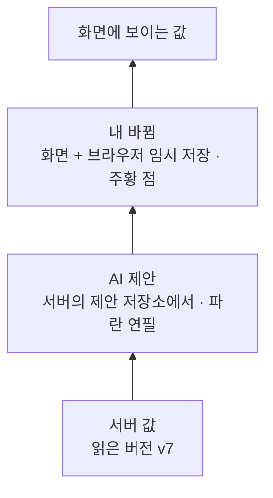
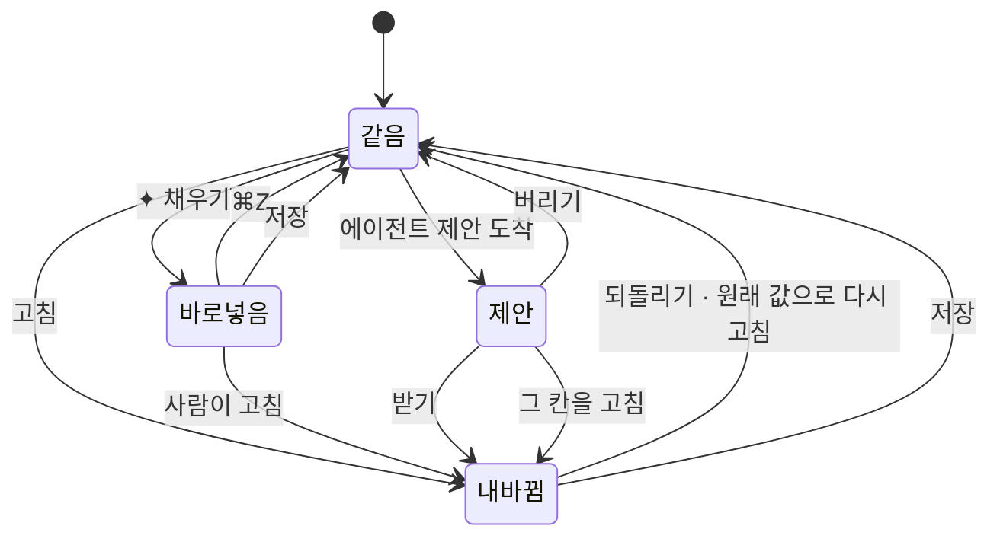
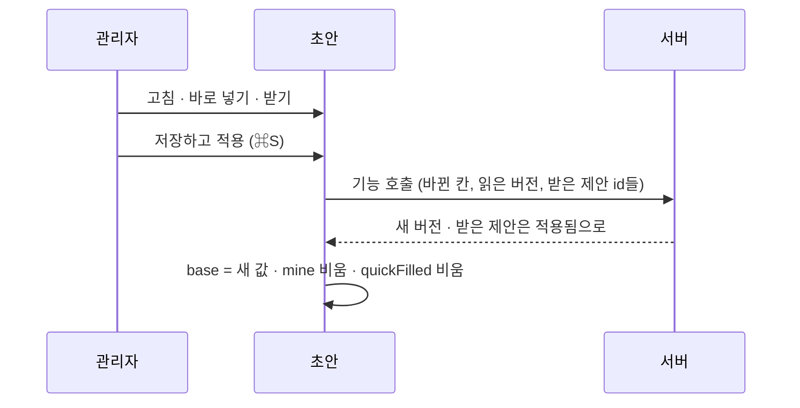

# 05 바뀜과 제안 표시

상태: 초안 (2026-11-05). 결정은 모두 정해졌다.

## 한 문장

고칠 수 있는 화면(설정, 편집기, 분류 패널)은 모두 같은 **초안**을 쓴다. 초안은 서버의 값 위에 내가 바꾼 것과 AI가 제안한 것을 겹쳐 들고, 화면은 칸마다 그 겹을 보고 "바뀜"(주황 점)과 "제안"(파란 연필)을 그린다.

## 원칙

1. **한 가지 초안.** 설정 탭, 글 편집기, 분류 패널, 컬렉션 필드가 같은 초안을 쓴다. 바뀐 곳 세기, 하나씩 되돌리기, 나가기 확인을 화면마다 따로 만들지 않는다.
2. **세 가지 표시, 세 가지 색.** 내가 바꾼 것은 주황 점, AI가 제안한 것은 파란 연필, 바로 넣기로 들어간 값은 사람이 건드릴 때까지 파란 글자. 파랑은 AI에만 쓴다.
3. **제안은 서버에 있다.** 화면을 닫아도, 다른 기기에서 열어도 제안은 남아 있다. 저장하지 않은 내 바뀜만 화면(과 브라우저 임시 저장)에 있다.
4. **하나씩 다룰 수 있다.** 바뀐 곳도 제안도 모두 하나씩 되돌리거나 받거나 버릴 수 있다. "모두"는 그 뒤에 있는 편의다.

## 쓰는 화면과 흐름

- 기준 화면: `Screens/Reference/Settings` › Settings, SettingsProposal, `Screens/Reference/Editor` › EditorProposal, EditorTranslate, `Screens/Reference/Lists` › Taxonomy(패널), `Screens/Reference/Assistant` › CollectionEditor.
- 흐름: [흐름 2](../admin/flows/02-assistant.md)의 제안 단계, [흐름 4](../admin/flows/04-collections.md)의 07, 10단계, [흐름 11](../admin/flows/11-settings.md)의 04, 11단계.
- 표시의 모양은 [components/proposal.md](../admin/components/proposal.md)와 [components/change.md](../admin/components/change.md)가 정한다. 이 문서는 그 뒤의 상태를 정한다.

## 초안의 겹



```ts
type Draft<T> = {
  base: T;                         // server value
  baseVersion: number;
  mine: Map<Path, unknown>;        // my unsaved changes
  quickFilled: Set<Path>;          // filled by "✦ 채우기"; blue until touched
  proposals: ProposalItem[];       // pending, from the proposal store, aimed at paths in this draft
};

type CellState =
  | { kind: "same" }
  | { kind: "mine"; before: unknown }               // orange dot, revert
  | { kind: "quickFilled" }                         // blue text, no accept step
  | { kind: "proposed"; item: ProposalItem };       // blue pencil, accept or discard
```

- `Path`는 초안 안의 자리다. 설정이면 `site.previewPath`, 글이면 `values.summary`나 `doc.b_4`, 컬렉션이면 `fields.summary`.
- 한 칸에 제안과 내 바뀜이 함께 있으면, 내가 고친 순간 그 제안을 받은 뒤 고친 것으로 친다(components/proposal.md "AI가 만든 상태").

## 칸 하나의 상태



## 바뀐 곳

- **세기.** 머리의 "바뀐 곳 n"은 `mine`의 칸 수다. 컬렉션 지우기처럼 칸이 아닌 바뀜도 한 줄로 센다. 제안이 있으면 "바뀐 곳 3 · 제안 2"처럼 따로 센다(SettingsProposal).
- **목록.** "바뀐 곳 n ▾"는 바뀐 칸마다 이름, 종류(이름 · 지움 · 새로 · 컬렉션 지움), "되돌리기"를 보인다. 누르면 그 칸으로 간다.
- **칸.** 바뀐 칸은 라벨 옆 주황 점과 라벨 줄 끝의 "되돌리기"를 단다. 탭 안에 바뀐 칸이 있으면 탭 이름에 점이 붙는다.
- **나가기.** `mine`이 비어 있지 않은 채 다른 화면으로 가면 "계속 고치기 · 저장하지 않고 나가기"를 묻는다(흐름 11·04). 제안은 서버에 남으므로 묻지 않는다.
- **편집기.** 글 편집기에는 칸마다의 주황 점이 없다. 상태 줄의 "저장 전 변경사항" 하나로 알린다(02번 문서). 같은 초안을 쓰되 표시만 다르다.

## 제안

- **오는 길.** 에이전트가 쓰기 기능을 부르면 제안 저장소에 항목이 생긴다(00번 문서). 화면은 `useProposals(target)`으로 그 화면의 대상(글 하나, 설정, 컬렉션 하나)에 걸린 대기 항목을 받아 초안의 `proposals`에 넣는다.
- **그리기.** 항목은 자리(`Path`)와 새 값을 들고 있다. 글자면 빠지는 글자(파란 취소선)와 들어오는 글자(옅은 파란 바탕)로, 값이면 입력 칸 안의 파란 글자로, 체크와 칩이면 파란 상태로 그린다. 다른 탭의 제안은 탭에 파란 점.
- **따라가기.** 한 화면에 제안이 있으면 아래에 버블이 뜬다. ✦ 요청 이름 · ↑ n / N ↓ · 모두 버리기 · [모두 받기]. 여러 요청의 제안이 한 화면에 있으면 버블 하나가 모두를 오가고, 이름은 지금 가리킨 제안의 요청을 따른다.
- **받기.** 받으면 파란 표시가 사라지고 그 값은 `mine`으로 옮겨져 저장 전 변경이 된다. 저장할 때 다른 고침과 함께 서버에 간다(결정 기록).
- **하나씩.** 표시를 누르면 카드가 열린다. 머리에 버리기 · [받기], 아래에 그 요청의 대화와 "이어서 요청". ⌘↵ 받기, ⌘⌫ 버리기는 지금 가리킨 제안에 작동한다.
- **여러 글.** 대상이 여러 글이면 화면에 표시를 그리지 않고 제안 검토 화면으로 간다(10번 문서).

## 바로 넣기

- 칸 하나에 대고 누른 "✦ 채우기"(⌘J)의 값이다. 제안이 아니라 그 칸에 바로 들어가 `mine`과 같이 저장된다. 사람이 그 칸을 고치거나 저장할 때까지 파란 글자다.
- ⌘Z로 되돌리고, "↻ 다시"로 새 값을 받는다. 받기와 버리기는 없다.
- 저장하면 활동 기록에 그 칸이 ✦로 남는다(누가 썼는지 알 수 있게).

## 저장



- 저장은 그 화면의 기능 하나를 부른다. 설정은 `settings.save`, 글은 `entries.save`, 컬렉션은 `schema.apply`, 분류 패널은 `entries.save`다.
- 받은 제안의 id를 함께 보낸다. 서버는 그 항목을 "적용됨"으로 바꾸고, 활동 기록의 그 줄에 ✦와 대화를 잇는다. 그래서 받은 제안도 활동 기록에서 되돌릴 수 있다.
- 구조 값과 관리자 값이 섞인 설정 저장(01번 문서)은 기능 안에서 나뉜다. 화면은 저장 한 번만 한다.

## 기능 목록

| 기능 | 종류 | 하는 일 |
|---|---|---|
| `proposals.forTarget` | read | 대상 하나에 걸린 대기 제안 항목 |
| `proposals.discard` | write · 사람만 | 항목 버리기. 에이전트 도구로는 나가지 않는다 |
| (저장의 `accepted`) | (내부) | 저장 기능이 받은 항목을 적용됨으로 바꾼다. 관리자 API의 `{ input, versions, accepted }` |

- 칸을 고치고 되돌리는 일은 화면 안의 일이라 기능이 없다. 서버에 닿는 것은 저장뿐이다.

## 에이전트

- 에이전트는 이 문서의 기능을 부르지 않는다. 다른 기능의 쓰기를 부르면 그것이 제안이 되어 여기로 온다.
- **지금 화면:** 초안의 `mine`이 맥락으로 함께 간다. 그래서 에이전트는 "저장하지 않은 요약"을 읽고 그 위에 제안할 수 있다. 제안은 `base`가 아니라 화면에 보이는 값과 비교해 그린다.

## 화면 쪽 조각

- `useDraft({ load, save, target })`: 위의 `Draft`. `cell(path)`, `revert(path)`, `revertAll()`, `accept(id)`, `discard(id)`, `save()`, `changes`(바뀐 곳 목록)를 내놓는다.
- `useLeaveGuard(draft)`: 나가기 확인.
- `ChangesGroup`, `ProposalBubble`, `MemoCard`, 칸의 `changed`와 `proposal` prop: 이미 있는 부품. 초안의 상태를 그대로 넘긴다.

## 결정 기록

- 2026-11-05, 소유자: 화면(편집기, 설정, 분류 패널, 컬렉션)에서 제안을 받으면 바로 저장되지 않고 저장 전 변경이 된다. 모든 변경은 검토를 거쳐 사람이 최종 저장한다. 저장하기 전에는 받은 칸만 되돌릴 수 있다. 여러 글을 다루는 제안 검토 화면은 초안이 없으므로 받으면 바로 적용된다.

- 2026-11-05: 받은 제안을 적용됨으로 바꾸는 일은 기능이 아니라 저장 요청의 `accepted`(항목 id들)다. 엔진이 그 쓰기의 트랜잭션 안에서 항목을 적용됨으로 바꾸고 활동 기록 줄에 대화를 잇는다. 그래서 저장이 실패하면 항목도 그대로 남는다.
- 2026-11-05: 칸마다 바뀜을 세고 되돌리는 일은 화면 안의 초안에서 한다. 서버에는 저장할 때만 닿는다.
- 2026-11-05: 대기 중인 제안은 서버에 있으므로 나가기 확인을 띄우지 않는다.
- 2026-11-02(흐름 2): 칸 하나를 채우는 버튼은 바로 넣고, 여러 곳을 바꾸는 일은 모두 제안이다. 받기와 버리기는 언제나 하나씩 할 수 있다.

## 끝 조건

- **05-1** 설정 네 탭, 글 편집기, 분류 패널, 컬렉션 필드가 `useDraft` 하나로 바뀐 곳 세기, 되돌리기, 나가기 확인, 제안 그리기를 한다.
- **05-2** 제안은 화면을 닫았다 열어도 남는다. 저장하지 않은 내 바뀜은 브라우저 임시 저장으로 남는다.
- **05-3** 받은 제안은 활동 기록에 ✦로 남고 되돌릴 수 있다.
- **05-4** 파랑은 AI 제안, 바로 넣은 값, AI가 고른 것에만 쓰인다.
- **05-5** 제안을 버리는 것은 사람만 한다. 에이전트 도구에 없다.
