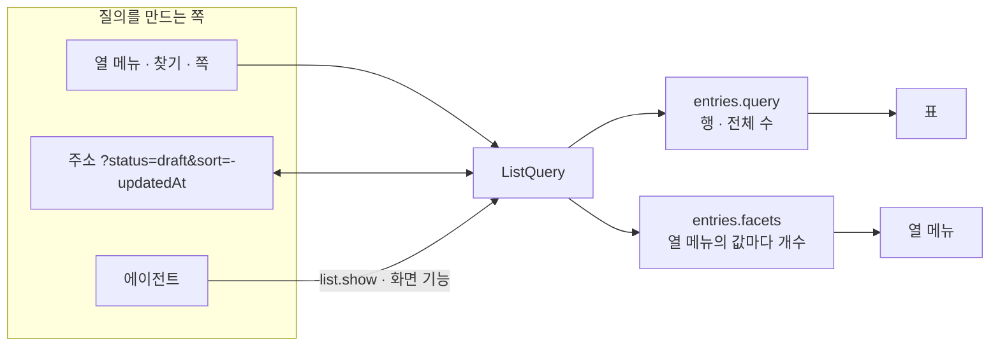
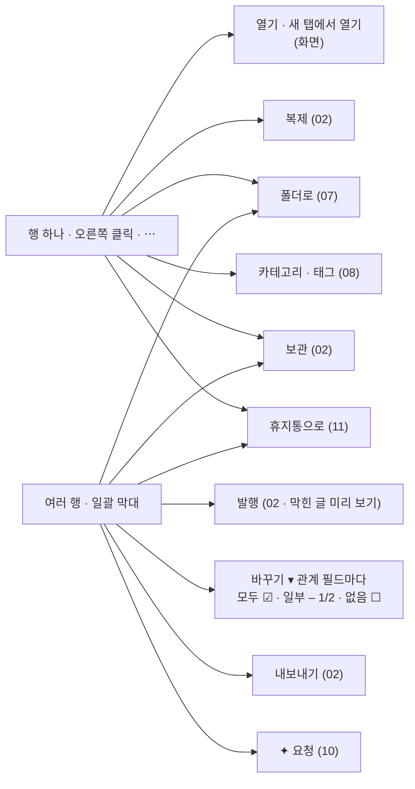

# 06 목록

상태: 초안 (2026-11-05). 결정은 모두 정해졌다.

## 한 문장

목록은 **목록 질의** 하나로 그린다. 찾기, 거르기, 정렬, 쪽이 모두 이 질의에 담기고, 화면의 주소, 에이전트의 `entries.query`, 열 메뉴의 개수가 같은 질의를 쓴다.

## 원칙

1. **질의 하나.** 사람이 열 메뉴로 거른 것과 에이전트가 거른 것이 같은 모양이다. 에이전트가 찾은 결과를 목록에 그대로 띄울 수 있고, 사람이 보고 있는 목록을 에이전트가 그대로 읽을 수 있다.
2. **열은 스키마에서 나온다.** 시스템 열(상태, 제목, 날짜, 언어)과 필드 열(카테고리, 태그, 요약)은 스키마(01)가 정한다. 화면에 열을 손으로 적지 않는다.
3. **모든 컬렉션이 같은 목록이다.** 게시글, 메모, 카테고리 목록이 같은 질의, 같은 열 메뉴, 같은 일괄 막대를 쓴다. 다른 것은 열뿐이다.
4. **묶음 하나가 한 줄이다.** 번역이 있는 글도 목록에는 한 줄이고, 원문 글이 그 줄을 대표한다. 언어 칸이 "KO +1"로 번역 수를 보인다.
5. **행에서 하는 일은 다른 기능을 부른다.** 행 메뉴와 일괄 막대는 02(발행, 보관), 07(폴더), 08(관계), 11(휴지통)의 기능을 부를 뿐 목록만의 쓰기가 없다.

## 쓰는 화면과 흐름

- 기준 화면: `Screens/Reference/Lists` › Main, MainRowMenu, Empty, `Screens/Reference/Assistant` › Assistant(어시스턴트가 고른 행).
- 흐름: [흐름 7 · 목록 정리](../admin/flows/07-list-tidy-up.md)의 01~05, 10단계, [흐름 3](../admin/flows/03-translation.md)의 12단계, [흐름 5](../admin/flows/05-trash.md)의 행 메뉴 단계, [흐름 2](../admin/flows/02-assistant.md)의 목록 단계.
- 폴더 행과 폴더 안 찾기는 07번 문서, 태그 합치기는 08번 문서.

## 목록 질의

```ts
type ListQuery = {
  collection: string;
  folder?: string | null;            // null = top level; omitted = every folder
  scope?: "here" | "all";            // inside a folder: this folder or every folder
  search?: { text: string; in: "fields" | "all" };   // fields = title and address; all = and the body's text
  filters: Filter[];                 // all must match
  sort: { by: "title" | "slug" | "updatedAt" | "publishedAt" | "createdAt"; dir: "asc" | "desc" };
  page: number;
  pageSize: number;                  // the screen offers 25 · 50 · 100; the agent reads up to 500
  timeZone: string;                  // the admin's, for "today" and date ranges
};

type Filter =
  | { on: "status"; any: ("published" | "changed" | "draft" | "archived")[] }
  | { on: "relation"; field: string; any: (string | null)[] }        // translation group ids; null = 없음
  | { on: "select"; field: string; any: (string | null)[] }          // null = 없음
  | { on: "locale"; any: string[] }                                  // the group has these languages
  | { on: "date"; field: "updatedAt" | "publishedAt" | "createdAt"; range: "today" | "7d" | "30d" | { from: string; to: string } }
  | { on: "empty"; field: string };                                  // "비어 있음"
```



- 질의는 화면 주소에 들어 있다. 뒤로 가기, 새 탭에서 열기, 새로 고침이 같은 목록을 보인다.
- `entries.facets`는 열 메뉴를 열 때 그 열의 값마다 개수를 센다. 다른 거르기는 걸린 채로 센다("발행됨 130 · 초안 12").
- 찾기는 "제목·주소"나 "전체"(본문 글자까지)에서 찾는다. 본문 글자는 데이터베이스가 블록에서 뽑아 따로 둔다(`body_text`, 저장하면 따라 바뀌는 열). 한국어도 찾을 수 있게 Postgres의 trigram 색인을 쓴다.
- 상태 거르기가 없으면 보관된 글은 빠진다. 상태 메뉴의 "보관됨"을 고르면 보인다.
- 번역 거르기(번역 없음 · 원문 바뀜 · 최신)는 04번 문서가 원문과 번역의 짝을 만든 뒤에 더한다(진행 기록 T52).

## 열

| 열 | 어디서 | 정렬 | 거르기 |
|---|---|---|---|
| 상태 | 시스템 | | 발행됨 · 수정 중 · 초안 · 보관됨 |
| 제목 + 주소 | 시스템 | 오름 · 내림 | |
| 수정일 · 발행일 · 만든 날 | 시스템 | 최근부터 · 오래전부터 | 오늘 · 7일 · 30일 · 기간 |
| 언어 | 시스템 (번역을 켰을 때) | | 언어들 · 번역 없음 · 원문 바뀜 · 최신 |
| 관계 필드 (카테고리, 태그) | 스키마 | | 값들 · 없음 |
| 고르기 필드 | 스키마 | | 선택지들 |
| 글자 필드 (요약) | 스키마 | | 비어 있음 |
| 미디어 필드 (대표 이미지) | 스키마 | | 비어 있음 |
| 플러그인 열 (검색 제목, 공유 이미지) | 플러그인 | | 비어 있음 |

- 처음에는 상태, 제목, 관계 필드, 언어, 수정일이 보인다. 나머지는 "열 추가 +"에 숨어 있다.
- 열의 순서와 숨김, 쪽마다 개수는 컬렉션마다 저장한다(관리자 값). 열을 끌어 놓으면 바로 저장된다(흐름 7·02b).
- 열 너비는 종류마다 정해져 있다. 사람이 너비를 바꾸지 않는다.

## 행에서 하는 일



- 일괄 막대의 "바꾸기"는 관계 필드마다 값을 더하고 뺀다. 일부 글에만 있는 값은 "–"와 "1/2"로 보이고, 누르면 모두에게 더해진다(08번 문서의 `relations.edit`).
- "발행"은 고른 행에 발행할 것(초안, 수정 중)이 있을 때만 보인다. 누르면 `entries.publish`의 미리 보기로 막힌 글을 먼저 보인다.
- 지금 쪽만 "모두 선택"한다. 쪽을 넘는 일괄 작업은 에이전트에게 시킨다.

## 제목 행

- 제목(컬렉션 이름과 주소 규칙), 찾기, 나뉜 검은 알약 "+ 새 글 쓰기 ▾".
- 알약의 ▾ 메뉴에 "새 폴더"(07)와 "가져오기"(14)가 있다. 셋 다 무언가를 더하는 일이라 한 알약에 묶고, 드문 둘은 메뉴에 둔다. Google Drive의 "+ 새로 만들기"와 같은 묶음이다(2026-11-05 소유자).

## 빈 목록

- 컬렉션에 글이 하나도 없으면 표 대신 "아직 {컬렉션}이 없어요." 한 줄과 그 아래 세 시작(`EmptyStep`: 첫 글 쓰기, 쓰던 글 가져오기, 템플릿으로 쓰기)이 보인다. 둘째 줄 설명은 없다. 같은 길이 머리의 "+ 새 글 쓰기 ▾" 나뉜 알약에도 있다(2026-11-05 소유자: 한 줄만 두니 화면이 비어 보였다).
- 거르기나 찾기 때문에 행이 없으면 빈 목록이 아니다. "맞는 글이 없어요"와 "거르기 풀기"를 보인다.

## 기능 목록

| 기능 | 종류 | 하는 일 |
|---|---|---|
| `entries.query` | read | 목록 질의로 행과 전체 수. 행은 묶음마다 하나, 원문 글이 대표 |
| `entries.facets` | read | 열 하나의 값마다 개수 |
| `list.columns` | read | 컬렉션의 열 목록(스키마와 플러그인에서), 저장된 순서와 숨김 |
| `list.savePrefs` | write | 열 순서와 숨김, 쪽마다 개수 |
| `list.show` | screen | 화면의 목록을 질의로 바꾼다. 에이전트가 건 거르기는 파란 칩으로 보인다 |
| `list.select` | screen | 행을 고른다. 에이전트가 고른 행은 파랗다 |

## 에이전트

- **읽기:** `entries.query`가 에이전트의 글 찾기다. 사람과 같은 거르기를 쓰므로 "요약이 빈 초안", "원문이 바뀐 번역"을 질의 하나로 찾는다. 쪽 크기에 묶이지 않고 필요한 만큼 읽는다.
- **지금 화면:** 목록은 맥락으로 지금 질의와 고른 행을 보낸다. "이 목록에서", "고른 글들"이 무엇인지 여기서 안다.
- **화면 움직이기:** `list.show`로 찾은 결과를 사람에게 띄우고, `list.select`로 고른다. 데이터는 바뀌지 않는다. 사람이 칩을 바꾸거나 체크를 건드리면 파란 표시가 끝난다.
- **쓰기:** 목록만의 쓰기는 없다. 고른 글로 하는 일은 02, 07, 08, 11의 기능을 제안으로 부른다.

## 화면 쪽 조각

- `useListQuery(collection)`: 주소와 질의를 잇는다. 열 메뉴, 찾기, 쪽 나누기가 이것을 바꾼다.
- `useListColumns(collection)`: 열 목록, 순서, 숨김, 너비.
- `useSelection()`: 고른 행, 지금 쪽 모두 선택, AI가 고른 표시.
- `ListHead`, `BulkBar`, `RowMenu`: 이미 있는 부품. 열과 동작을 위의 훅에서 받는다.

## 결정 기록

- 2026-11-05, 소유자: 거르기, 찾기, 정렬은 주소에만 있다. 사이드바에서 컬렉션을 다시 누르면 처음 목록(수정일 최근부터)이다. 뒤로 가기와 새 탭은 같은 목록을 보인다. 저장하는 것은 열 순서와 숨김, 쪽마다 개수뿐이다.

- 2026-11-05: 목록은 번역 묶음마다 한 줄이고 원문 글이 대표한다. 언어 거르기는 "그 언어의 글이 있는 묶음"이다.
- 2026-11-05: 찾기는 Postgres trigram 색인으로 한다. 본문 글자는 저장할 때 뽑아 둔다.
- 2026-11-05: 열 너비는 종류마다 정하고 사람이 바꾸지 않는다.
- 2026-11-05: 찾을 곳은 기준 화면(`Screens/Reference/Lists` › Main)대로 "제목·주소"와 "전체" 둘이다. 이 문서의 처음 초안은 전체 · 제목 · 주소 · 본문 넷이었다.
- 2026-11-05: 상태 이름은 02의 `EntryState`(`changed`)를 그대로 쓴다. 한 상태에 이름 둘을 두지 않는다.
- 2026-11-05: 제목 정렬은 데이터베이스에 ICU 정렬(`und-x-icu`)이 있으면 그것을 쓴다. macOS의 `en_US.UTF-8` 같은 libc 정렬은 "첫 번째"를 "리액트" 앞에 둔다.
- 2026-11-05: 저장하는 열 순서는 그때의 모든 열이다. 순서에 없는 열은 그 뒤에 생긴 열이라 맨 뒤에 기본 보이기로 온다.
- 2026-11-05: 관리자 화면의 주소는 해시(`#/c/post?status=draft`)다. 사이트는 관리자 경로 하나만 걸면 되고, 새로 고침과 새 탭이 같은 화면을 연다(T37).

## 끝 조건

- **06-1** 흐름 7의 01~05, 10단계와 흐름 3·12가 `entries.query`, `entries.facets`, `list.*`만으로 된다. 흐름 3·12의 번역 거르기는 04에서(T52).
- **06-2** 게시글, 메모, 카테고리 목록이 같은 코드로 그려지고, 다른 것은 스키마에서 온 열뿐이다.
- **06-3** 에이전트가 `list.show`로 띄운 목록과 사람이 같은 거르기를 건 목록이 같은 행을 보인다.
