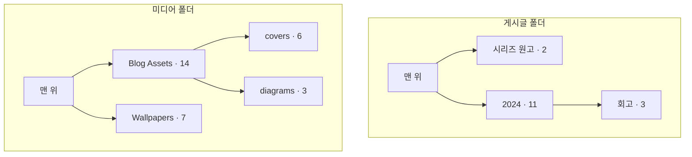
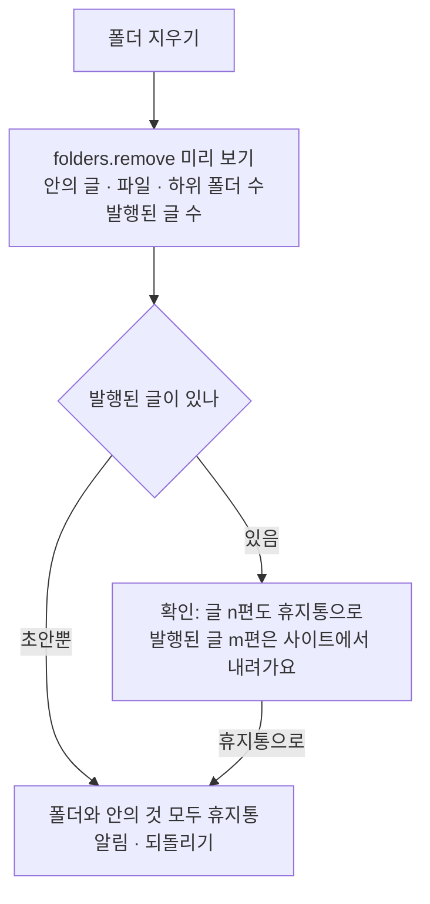

# 07 폴더

상태: 초안 (2026-11-05). 정할 것이 없다.

## 한 문장

폴더는 관리자 화면에서 글과 미디어를 정리하는 상자다. 글 폴더와 미디어 폴더는 같은 모양이고, 폴더 안에 폴더를 둘 수 있다. 사이트의 주소와 읽기 API에는 나오지 않는다.

## 원칙

1. **정리용이다.** 폴더는 글의 주소, 발행, 관계를 바꾸지 않는다. 사이트가 글을 묶어야 하면 관계 필드(시리즈, 카테고리)를 쓴다.
2. **글 폴더와 미디어 폴더는 하나의 모양이다.** 만들기, 이름 바꾸기, 옮기기, 지우기, 사이드바 트리, 휴지통이 같다. 다른 것은 담는 것뿐이다.
3. **번역은 함께 움직인다.** 폴더는 번역 묶음에 붙는다. 원문을 폴더로 옮기면 번역도 같은 폴더에 있다.
4. **폴더를 지우면 안의 것도 휴지통으로 간다.** 영구히 지우는 것은 휴지통에서만 한다. 미디어는 하나 다르다. 글에서 쓰이는 파일은 휴지통에 가지 않으므로, 그런 파일이 든 폴더는 쓰이는 파일과 함께 남는다(09번 문서).

## 쓰는 화면과 흐름

- 기준 화면: `Screens/Reference/Lists` › Main(폴더 행), Media(폴더 카드), Sidebar(폴더 트리), Trash(지운 폴더).
- 흐름: [흐름 5](../admin/flows/05-trash.md)의 01~07, 11~14, 17단계, [흐름 6](../admin/flows/06-media.md)의 01, 02, 07~10, 13단계.
- 폴더를 쓸지는 컬렉션의 "폴더 사용"(01번 문서의 관리자 값)이 정한다. 미디어는 늘 폴더를 쓴다.

## 모양



```ts
type Folder = {
  id: string;
  scope: { collection: string } | "media";
  parentId: string | null;     // null = top level
  name: string;                // unique among siblings
  position: number;
  version: number;
  trashedAt: Date | null;
};
```

- 글은 `entries.folder_id`, 미디어는 `media.folder_id`로 폴더를 가리킨다. 번역 묶음의 글들은 같은 `folder_id`를 가진다. 폴더를 바꾸는 기능은 묶음 전체를 바꾼다.
- 개수는 그 폴더와 하위 폴더 안의 모든 항목이다("Blog Assets 14" = 바로 든 파일 5 + covers 6 + diagrams 3). 휴지통에 든 것은 세지 않는다.
- 같은 부모 아래에서 이름이 겹치면 " 2"를 붙인다. 새 폴더의 처음 이름은 "새 폴더"이고 골라진 채로 열린다.

## 폴더 지우기

아래는 글 폴더다. 미디어 폴더는 확인을 묻지 않고, 쓰이는 파일이 있으면 그 파일과 폴더가 남는다(흐름 6·11, 12, [09-media.md](09-media.md#지우기)).



- 휴지통에서 지운 폴더는 한 줄로 보이고, 누르면 안으로 들어간다(흐름 5·12).
- 지운 폴더 안의 항목 하나만 복원하면 폴더를 다시 만들고 그 항목을 원래 자리로 돌린다(흐름 5·13). 다시 만든 폴더는 휴지통의 폴더와 같은 id다.
- 폴더를 통째로 복원하면 안의 것이 모두 돌아온다. 그 사이 같은 이름의 폴더가 생겼으면 " 2"를 붙인다.

## 폴더 안에서

- 목록은 폴더 안에 들어가면 그 폴더의 하위 폴더와 글만 보인다. 맨 위에 "상위 폴더로" 행이 있고, 제목 자리에 경로가 있다.
- 폴더 안에서 찾으면 처음에는 그 폴더 안에서만 찾고, "모든 폴더"로 넓힐 수 있다(06번 문서의 `scope`).
- 거르기를 걸면 폴더 행은 숨는다. 거르기는 글에만 걸린다.
- 미디어는 파일을 폴더 카드나 사이드바의 폴더 행 위로 끌어 옮기고, 밖에서 끌어 온 파일은 그 폴더에 올린다(09번 문서).

## 사이드바

- 열린 컬렉션 아래에 그 컬렉션의 폴더 트리가 보인다. 미디어를 열면 미디어 폴더 트리가 보인다.
- 트리의 행을 누르면 그 폴더로 간다. 열린 폴더는 고른 상태다.
- 새 폴더는 목록 제목 행의 검은 알약 "+ 새 글 쓰기 ▾"의 메뉴 › "새 폴더"로 만든다(미디어는 "올리기 ▾"). 드물게 쓰는 일이라 버튼으로 두지 않는다(2026-11-05 소유자).
- 컬렉션의 "폴더 사용"을 끄면 트리와 "새 폴더"가 사라진다. 폴더와 `folder_id`는 남는다. 다시 켜면 그대로 돌아온다.

## 기능 목록

| 기능 | 종류 | 하는 일 |
|---|---|---|
| `folders.tree` | read | 범위 하나의 폴더 트리와 개수 |
| `folders.create` | write | 새 폴더(부모, 이름) |
| `folders.rename` | write | 이름 바꾸기 |
| `folders.move` | write · preview | 다른 부모로. 자기 안으로는 옮길 수 없다 |
| `folders.remove` | write · preview | 폴더와 안의 것을 휴지통으로. 미리 보기는 안의 수와 내려갈 글 수 |
| `entries.moveToFolder` | write | 글(묶음)들을 폴더로 |

파일들을 폴더로 옮기는 `media.moveToFolder`는 09번 문서의 기능 목록에 있다(T99).

## 에이전트

- **읽기:** `folders.tree`로 폴더 구조를 알고, `entries.query`의 `folder`로 폴더 안의 글을 찾는다.
- **쓰기:** "작년 글은 2024 폴더로 옮겨 줘"는 제안 하나에 두 항목이다. `folders.create`(2024)와 `entries.moveToFolder`(글 9편 → 그 폴더). 뒤 항목은 앞 항목이 만들 폴더를 **임시 id**로 가리킨다. 적용 엔진은 앞 항목을 실행해 얻은 진짜 id로 바꿔 넣는다. 앞 항목을 빼면 그것을 가리키는 뒤 항목도 함께 빠진다.
- 에이전트가 폴더를 지우면 휴지통으로 가므로 되돌릴 수 있다(00번 문서의 원칙 4).

## 화면 쪽 조각

- `useFolderTree(scope)`: 트리, 개수, 지금 폴더, 경로.
- `FolderRow`, `RenameField`, 사이드바의 `SidebarMenuSub`: 이미 있는 부품.

## 결정 기록

- 2026-11-06, 소유자: 글 목록에서 폴더나 글을 끌어 옮기거나 순서를 바꾸지 않는다. 폴더를 끌어 순서를 바꿀 수 있으면 글도 손으로 순서를 정하는 것처럼 읽히는데, 목록은 정렬 기준(수정일 등)으로 보인다. 옮기기는 행 메뉴 "옮기기 ▸" · "폴더로 ▸"와 일괄 막대로 한다. 미디어의 파일 끌어 옮기기(09)는 따로다.
- 2026-11-05: 폴더는 사이트에 나오지 않는다. 사이트가 묶어야 할 것은 관계 필드로 한다.
- 2026-11-05: 폴더 안에 폴더를 둘 수 있고, 깊이에 한도를 두지 않는다. 사이드바의 `depth`와 미디어 기준 화면이 그렇게 그렸다.
- 2026-11-05: 폴더는 번역 묶음에 붙는다. 묶음의 글들이 늘 같은 폴더에 있다.
- 2026-11-05: 개수는 하위 폴더까지 센다(미디어 기준 화면의 "Blog Assets 14").
- 2026-11-05: 제안의 한 항목은 같은 제안 안 앞 항목이 만들 것을 임시 id로 가리킬 수 있다. 00번 문서의 제안 저장소가 이 규칙을 따른다.

## 끝 조건

- **07-1** 글 폴더와 미디어 폴더가 같은 기능과 같은 부품으로 된다.
- **07-2** 흐름 5의 01~07, 11~14단계와 흐름 6의 폴더 단계가 이 기능 목록과 11번 문서만으로 된다.
- **07-3** 폴더를 옮기거나 지워도 글의 주소와 발행 상태는 바뀌지 않는다. 지운 폴더 안에 든 발행된 글만 사이트에서 내려간다(휴지통이 하는 일).
- **07-4** "폴더를 만들고 거기로 옮겨"가 제안 하나로 되고, 앞 항목을 빼면 뒤 항목도 빠진다.
