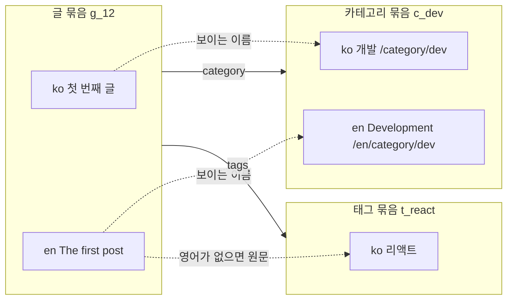
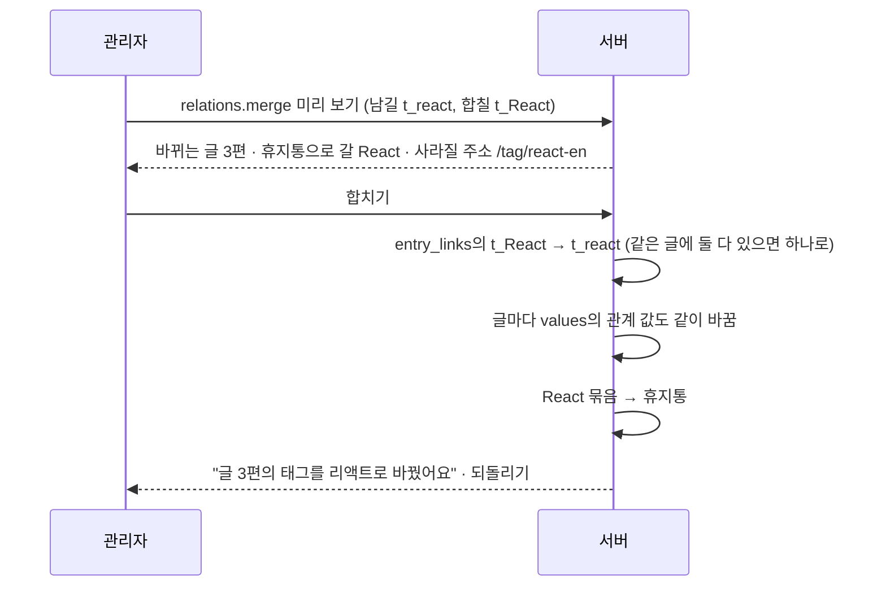

# 08 관계와 분류

상태: 초안 (2026-11-05). 결정은 모두 정해졌다.

## 한 문장

관계 필드는 다른 글을 가리킨다(카테고리, 태그, 시리즈). 관계는 언어가 아니라 **번역 묶음**을 가리키므로, 한국어 글과 영어 글이 같은 카테고리를 가리키고 사이트는 그 언어의 이름을 보인다.

## 원칙

1. **묶음을 가리킨다.** 관계 값은 대상의 번역 묶음 id다. 사이트와 관리자 화면은 보고 있는 언어의 대상 글을 보이고, 없으면 원문 글을 보인다.
2. **쓰인 곳을 늘 안다.** 관계는 `entry_links`에도 적힌다. "글 3", 거르기, 합치기, 지울 때 끊기가 모두 이 표를 쓴다.
3. **카테고리와 태그는 그냥 항목 컬렉션이다.** 특별한 "분류" 기능이 따로 없다. 항목 컬렉션의 목록과 옆 패널, 그리고 관계 기능이 있을 뿐이다.
4. **없으면 그 자리에서 만든다.** "목록에 없으면 새로 만들기"를 켠 관계 필드는 고르는 칸에서 새 이름을 치면 저장할 때 그 항목이 생긴다.

## 쓰는 화면과 흐름

- 기준 화면: `Screens/Reference/Lists` › Taxonomy, Main(카테고리 · 태그 열, 행 메뉴), `Screens/Reference/Editor` › EditorNotion(속성 패널의 카테고리 · 태그 · 시리즈).
- 흐름: [흐름 7](../admin/flows/07-list-tidy-up.md)의 04b, 06~10단계, [흐름 1](../admin/flows/01-write-and-publish.md)의 07단계.
- 관계 필드의 설정(가리킬 컬렉션, 여러 개, 새로 만들기, 발행 안 된 대상)은 01번 문서에 있다.

## 모양



```ts
// values of a post (01): relation values are group ids
values: { category: "c_dev", tags: ["t_react", "t_perf"] }

type EntryLink = {
  fromGroup: string;   // the post's translation group
  field: string;       // "tags"
  toGroup: string;     // the item's translation group
  position: number;    // order inside a many-value field
};
```

- 관계 필드는 보통 "모두 같음"(01)이라 묶음의 모든 언어가 같은 값을 쓴다. 그래서 `entry_links`는 글이 아니라 묶음끼리 잇는다.
- 항목 컬렉션도 글과 같이 언어마다 글이 하나다(04). 카테고리 옆 패널의 언어 탭은 그 묶음의 글들을 한 번에 고친다. 그 언어의 글이 없으면 목록에 "영어 이름 없음"이 보인다.

## 대상이 사라지면

| 대상에 생긴 일 | 관계 값 | 사이트 | 관리자 화면 |
|---|---|---|---|
| 발행 안 됨(문서 컬렉션인 대상만. 항목은 발행이 없다) | 남는다 | 관계 필드 설정대로: 고를 수 있지만 사이트에는 안 보임 · 고를 수 없음 | 흐린 이름과 상태 |
| 휴지통에 들어감 | 남는다 | 안 보임 | "휴지통에 있음" |
| 휴지통에서 복원 | 그대로 | 다시 보임 | 그대로 |
| 영구 삭제 | 막힌다. 가리키는 글마다 "연결 끊기"를 골라야 지워지고, 그때 끊긴다(11) | 안 보임 | 값에서 빠짐 |
| 컬렉션 지움 | 그 컬렉션을 가리키는 관계 필드는 먼저 스키마에서 고쳐야 한다(01의 검사). 남은 연결은 지울 때 함께 지운다 | 안 보임 | 값에서 빠짐 |
| 합쳐짐 | 남길 대상으로 바뀐다 | 남길 대상 | 남길 대상 |

## 합치기



- 처음 남길 이름은 글이 더 많은 쪽이다.
- 되돌리면 글들의 관계 값과 합쳐진 항목이 함께 돌아온다(00번 문서의 스냅숏).
- 합쳐진 항목의 주소는 남기지 않는다(흐름 7·08 "사라져요"). 글의 옛 주소(02)와 다르게, 항목 주소는 넘겨 주지 않는다.

## 고르는 칸

- 관계 하나(카테고리, 시리즈)는 콤보박스, 여럿(태그)은 칩이다. 치면 거르고, 목록은 그 컬렉션의 항목을 이름순으로 보인다.
- "목록에 없으면 새로 만들기"를 켰으면 목록 끝에 "새로 만들기: 프론트엔드"가 있다. 고르면 칩이 생기고, 글을 저장할 때 항목이 함께 만들어진다. 저장하지 않고 나가면 항목도 생기지 않는다.
- 원문 언어로 만들어지고, 다른 언어의 이름은 비어 있다("영어 이름 없음").

## 기능 목록

| 기능 | 종류 | 하는 일 |
|---|---|---|
| `relations.options` | read | 관계 필드 하나에 고를 수 있는 대상(찾기, 발행 상태 포함) |
| `relations.usage` | read · 여러 항목 | 항목마다 쓰는 글 수. 목록의 "글 3"과 "쓰는 글 없음" |
| `relations.edit` | write | 여러 글의 관계 필드 하나에 값을 더하고 뺀다(일괄 막대의 "바꾸기") |
| `relations.merge` | write · preview | 항목 여럿을 하나로 합친다 |
| `items.saveGroup` | write | 항목 묶음의 언어별 이름 · 주소 · 설명을 한 번에 저장(옆 패널). 없는 언어는 새로 만든다 |
| `items.reorder` | write | 항목의 손 순서(카테고리 목록의 손잡이) |

- 글을 저장할 때 새로 만들 항목은 `entries.save`가 함께 받는다. 저장 하나가 항목을 만들고 관계를 잇는다.

## 에이전트

- **읽기:** `relations.usage`로 "쓰지 않는 태그"를 찾고, `entries.query`의 관계 거르기로 "리액트 태그가 붙은 글"을 찾는다. `relations.options`로 고를 수 있는 값과 없는 값을 안다.
- **쓰기:** 태그 붙이기, 바꾸기, 합치기는 제안이다. 새 태그를 만들어 붙이는 일은 제안 하나에 `items.saveGroup`과 `relations.edit`이 함께 들고, 뒤 항목이 새 태그를 임시 id로 가리킨다(07번 문서).
- 시키지 않은 휴지통 보내기를 제안하지 않는다(00번 문서). "쓰지 않는 태그 정리해 줘"라고 했을 때만 휴지통 제안을 만든다.

## 화면 쪽 조각

- `useRelationField(field)`: 고르는 칸의 목록, 찾기, 새로 만들기, 보고 있는 언어의 이름.
- `useItemPanel(group)`: 옆 패널. 언어 탭마다 05번 문서의 초안을 쓰고, 저장은 `items.saveGroup` 한 번이다.
- `MergeDialog`: 합치기 창.

## 결정 기록

- 2026-11-05, 소유자: 항목 컬렉션(카테고리, 태그)은 발행이 없다. 저장하면 바로 사이트에 반영된다. 발행 상태가 필요한 대상(소개 글이 있는 시리즈 같은 것)은 문서 컬렉션으로 만든다. "발행 안 된 대상" 설정은 문서 컬렉션을 가리키는 관계 필드에만 있다.

- 2026-11-05: 관계 값은 대상의 번역 묶음 id다. 보이는 이름은 보고 있는 언어의 대상 글, 없으면 원문 글이다.
- 2026-11-05: 항목 컬렉션도 언어마다 글이 하나다(04와 같은 모양). 옆 패널이 묶음을 한 번에 저장한다.
- 2026-11-05: 합쳐진 항목의 주소는 넘겨 주지 않는다(흐름 7·08).
- 2026-11-05: 대상이 휴지통에 있는 동안 관계 값은 남고 사이트에서만 숨는다. 영구 삭제될 때 끊긴다.

## 끝 조건

- 흐름 7의 04b, 06~10단계가 이 기능 목록과 06번 문서만으로 된다.
- 한국어 글과 영어 글이 같은 카테고리를 가리키고, 각 언어의 사이트가 그 언어의 이름을 보인다.
- "글 3", 관계 거르기, 합치기, 영구 삭제의 끊기가 모두 `entry_links` 하나에서 나온다.
- 글을 저장하지 않으면 그 글에서 새로 만들려던 항목도 생기지 않는다.
