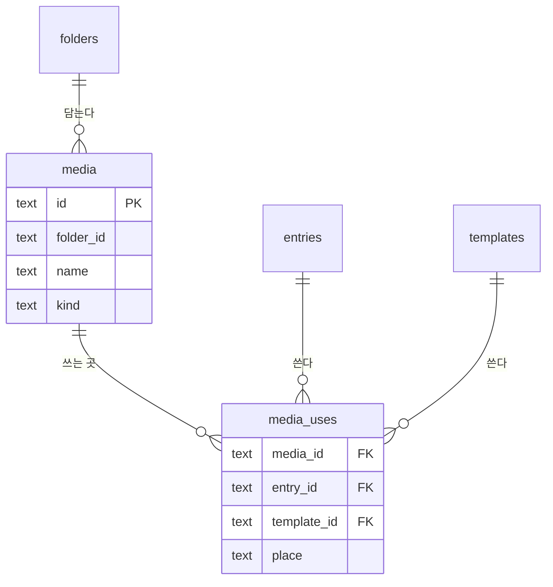
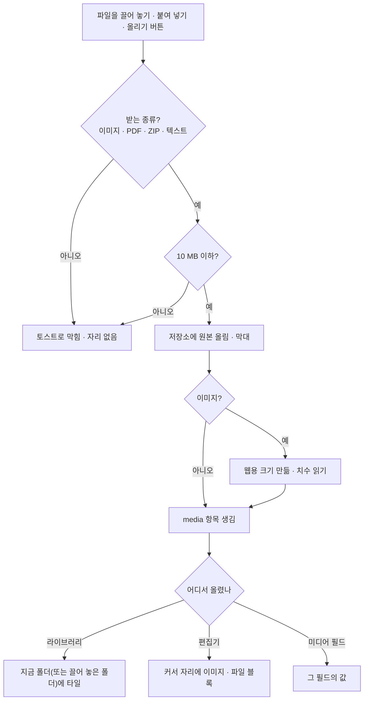
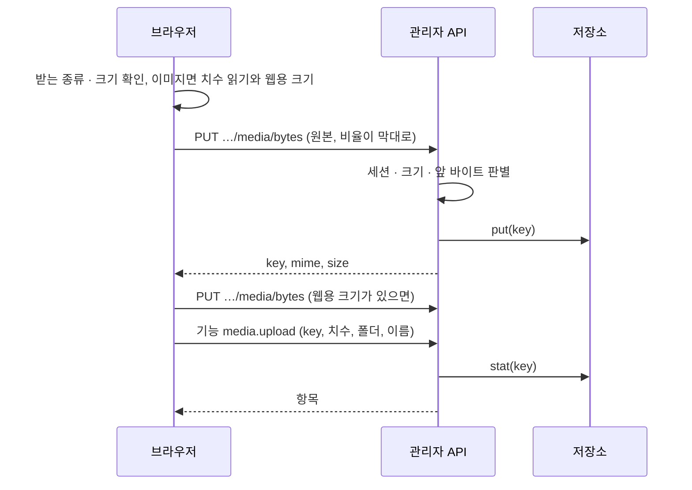

# 09 미디어

상태: 초안 (2026-11-05). 결정은 모두 정해졌다.

## 한 문장

미디어는 올린 파일 하나가 한 항목이다. 라이브러리는 파일 그 자체만 다룬다. 대체 텍스트와 캡션은 그 파일을 쓰는 글에 있다. 이미지는 원본과 웹용 크기를 함께 두고, 파일마다 어느 글의 어느 자리에서 쓰이는지 늘 안다. 쓰이는 파일은 지워지지 않는다.

## 원칙

1. **쓰는 곳을 늘 안다.** 글을 저장할 때 미디어 필드와 본문의 이미지 · 파일 블록에서 쓰는 곳을 다시 적는다. "사용 2", 옆 패널의 쓰는 곳, 지우기 막기가 이것을 쓴다.
2. **쓰이는 파일은 지우지 않는다.** 휴지통으로 보내면 쓰이는 파일은 남기고 알린다. 폴더를 지워도 쓰이는 파일은 폴더째 남는다.
3. **파일을 바꿔도 쓰는 곳은 그대로다.** "파일 바꾸기"는 같은 항목의 파일만 바꾼다. 쓰던 곳의 대체 텍스트와 캡션은 그대로다.
4. **올리는 일은 창 없이 그 자리에서.** 라이브러리에 끌어 놓으면 지금 폴더에, 편집기에 붙여 넣으면 커서 자리에 바로 들어가고 막대가 흐른다. 받지 않는 파일은 토스트로 바로 막히고, 네트워크로 끊긴 파일만 그 자리에 남아 다시 올린다.
5. **대체 텍스트는 글에 있다.** 대체 텍스트는 그 그림이 그 글에서 무엇을 말하는지다. 같은 그림도 글마다 다르게 쓴다. 그래서 라이브러리에는 대체 텍스트와 캡션이 없고, 이미지 블록과 미디어 필드의 값에만 있다.
6. **저장소는 꽂는 것이다.** 파일은 저장소 플러그인(S3 호환, 개발용 로컬 폴더)에 있다. 저장소가 없으면 미디어 화면이 그렇게 말하고 연결 방법을 보인다.

## 쓰는 화면과 흐름

- 기준 화면: `Screens/Reference/Lists` › Media, `Screens/Reference/Editor` › ImageInsert, EditorNotion(이미지 도구, 대표 이미지).
- 흐름: [흐름 6 · 미디어](../admin/flows/06-media.md) 전부. 휴지통의 미디어는 [흐름 5](../admin/flows/05-trash.md)의 17단계와 그 뒤.
- 폴더는 07번 문서, 휴지통은 11번 문서, 본문의 이미지 · 파일 블록은 03번 문서.

## 모양

```ts
type Media = {
  id: string;
  folderId: string | null;
  name: string;                       // "desk-morning.jpg", editable
  kind: "image" | "file";
  mime: string;                       // "image/jpeg", "application/pdf"
  size: number;                       // bytes of the original
  original: { key: string; width?: number; height?: number };
  web?: { key: string; width: number; height: number };   // images: longest side ≤ 2400
  uploadedAt: Date;
  version: number;
  trashedAt: Date | null;
};

type MediaUse = {
  mediaId: string;
  // whose: an entry, or a template (2026-11-09, owner: a template's image is a use too)
  entryId: string | null;
  templateId: string | null;
  place: { field: string } | { block: string };  // "cover" field, or body block b_5
};
```



- `media_uses`는 글이나 템플릿을 쓸 때마다 그 줄을 지우고 다시 적는다. 고치는 본과 발행본 어느 쪽이든 쓰면 "쓰인다"로 센다.
- 다시 적는 곳은 엔진 하나다. 어떤 쓰기든 건드리거나 만든 글과 템플릿을 쓰기가 끝날 때 다시 적고, 되돌리기와 스키마 적용 뒤에도 다시 적는다. 글을 고치는 기능마다 적지 않는다.
- 없는 파일을 가리키는 값은 줄을 만들지 않는다. 휴지통의 파일을 다시 쓰게 되면(되돌리기) 그 파일은 휴지통에서 나온다.
- 휴지통에 든 글이 쓰는 것도 쓰는 것으로 센다. 그 글이 영구히 지워질 때 줄이 빠진다.

## 올리기



- 받지 못한 파일은 토스트로 막히므로, 줄이거나 바꾼 파일을 새로 올린다. 관리자가 대신 줄여 주지 않는다(2026-11-09 소유자).
- 올리기는 사람만 한다. 에이전트에게는 올릴 파일이 없다.
- 받는 종류는 JPEG, PNG, WebP, GIF, AVIF, PDF, ZIP, txt, md, csv다. HEIC, SVG, HTML은 받지 않는다. 브라우저가 먼저 거르고 서버가 앞 바이트로 다시 판별한다. HEIC도 다른 형식과 같은 토스트로 막힌다(2026-11-09 소유자).

### 올리는 길

파일 바이트와 기능은 따로 간다. 기능은 JSON 한 가지 길이고, 막대에는 올린 비율이 있어야 하고, 쓰기 트랜잭션이 파일을 올리는 동안 잡혀 있으면 안 되기 때문이다.



- 웹용 크기와 치수는 브라우저가 만든다(`createImageBitmap`과 캔버스). 긴 변이 2400 이하면 웹용을 따로 두지 않고 사이트는 원본을 쓴다. GIF는 움직임을 지키려고 웹용을 만들지 않는다.
- `key`는 서버가 정한다. 한 번 쓴 `key`는 다시 쓰지 않고, 파일을 바꾸면 새 `key`를 받는다. 그래서 캐시가 옛 그림을 내놓지 않는다.
- `media.upload`와 `media.replace`는 없는 `key`와 다른 항목이 쓰는 `key`를 거절한다.
- 파일을 내보낼 때 `X-Content-Type-Options: nosniff`와 `Content-Security-Policy: sandbox`를 붙이고, 이미지가 아니면 내려받기로 준다.

### 저장소 접점

```ts
type Storage = {
  put(key: string, bytes: Uint8Array, meta: { mime: string }): Promise<void>;
  stat(key: string): Promise<{ size: number; mime: string } | null>;
  read(key: string): Promise<{ bytes: Uint8Array; mime: string } | null>;
  remove(key: string): Promise<void>;
  url(key: string): string;
};
```

- 저장소는 플러그인이 건넨다(`definePlugin({ name, storage })`). 둘 이상이면 시작할 때 오류다. 없으면 미디어 화면이 "저장소 없음"을 말하고 올리기 기능이 거절한다.
- 개발용 로컬 폴더 어댑터(`localFolderStorage`)는 core에 있다. S3 호환 어댑터는 T102다.

## 지우기

| 무엇을 | 쓰이지 않으면 | 쓰이면 |
|---|---|---|
| 파일 하나 · 여럿 | 휴지통으로 · 되돌리기 | 남김. 알림 "1개를 옮겼고 1개는 쓰는 곳이 있어 남겼어요 · 보기" |
| 폴더 | 폴더째 휴지통으로 · 확인 없이 · 되돌리기 | 쓰이지 않는 파일만 옮기고 폴더는 쓰이는 파일과 함께 남김 · 보기 |

- 휴지통에서 30일이 지나면 저장소의 파일도 지운다(11번 문서).
- 쓰이는 파일을 꼭 지우려면 쓰는 곳에서 먼저 빼야 한다. "보기"가 쓰는 곳 목록으로 간다.

## 고르기

- 편집기의 `/` › 이미지 › 라이브러리, 이미지 블록, 대표 이미지 칸은 같은 라이브러리 창(`MediaPicker`)을 연다. 왼쪽에 폴더, 위에 이름 찾기, 아래에 올리기.
- 창은 파일 탐색기처럼 보인다. 최상위("미디어")에서 열리고, 연 곳의 폴더와 그 곳에 바로 든 파일이 보인다. 이름 찾기는 라이브러리 화면과 같다. 폴더 안에서는 그 폴더와 하위에서 찾고, "모든 폴더"로 넓힌다.
- 파일 블록에서 열면 파일만, 이미지 자리에서 열면 이미지만 보인다. 이 제한은 찾기가 아니다(`media.query`의 `only`). 폴더는 여전히 자기 파일만 보인다.
- 창에서 올리면 연 폴더로 올라간다.
- 고르면 바로 들어간다. 이미지 블록은 `media` id를 들고, 대체 텍스트와 캡션은 빈 채로 들어간다. 채우는 것은 그 글에서 한다.

## 글 속 이미지

```ts
// an image block in a post's doc (03)
{ id: "b_5", type: "image", attrs: { media: "m_desk", alt: "아침 책상 위 노트북과 커피", caption: "", width: null, align: "center", decorative: false, crop: { x: 0, y: 0.1, width: 1, height: 0.8 }, rotate: 0 } }

// a media field value in a post's values (01)
values: { cover: { media: "m_desk", alt: "아침 책상 위 노트북과 커피" } }
```

- 대체 텍스트는 이미지 블록의 설정 카드와 캡션 줄, 미디어 필드(대표 이미지)의 설정 카드에서 쓴다. 칸마다 "✦ 채우기"가 있다(바로 넣기).
- "장식 이미지"를 켜면 대체 텍스트가 비어도 된다. 사이트는 빈 대체 텍스트로 그린다.
- 발행 검사(02)는 이 값을 본다. 장식이 아닌데 대체 텍스트가 빈 이미지가 "대체 텍스트 없는 이미지 n개"다.
- 번역(04)에서 본문 이미지는 같은 파일을 쓰고 대체 텍스트와 캡션만 번역한다.
- 미디어 필드에서 다른 파일을 고르면 대체 텍스트는 비운다. 대체 텍스트는 그 그림이 말하는 것이어서, 옛 글이 새 그림에 붙어 나가면 안 된다. 같은 파일을 다시 고르면 그대로다. 올려서 고른 파일은 올라간 뒤에 비우고, 올라가는 동안 쓴 글은 새 그림의 것으로 둔다. 올리다 실패하면 전의 그림과 대체 텍스트가 그대로다. 라이브러리의 "파일 바꾸기"는 같은 항목이므로 그대로다(09-5).
- 번역에서 미디어 필드는 그대로 쓸 수도, 바꿀 수도 있다. 기본 언어 방식이 "원문 따름"(`fromSource`)이다. 번역의 값이 비어 있으면 원문의 파일과 대체 텍스트를 따른다. 파일을 고르거나 대체 텍스트를 쓰면 그 번역의 값이 되고, 지우면 다시 따른다. 새 번역은 값을 복사하지 않고 비어서 시작한다.
- 자르기와 돌리기는 원본을 건드리지 않고 블록의 `crop`(비율)과 `rotate`에 둔다. 편집기와 사이트가 같은 값으로 그린다.

## 기능 목록

| 기능 | 종류 | 하는 일 |
|---|---|---|
| `media.upload` | write · 사람만 | 파일을 올려 항목을 만든다 |
| `media.query` | read | 폴더, 찾기(이름), 종류, 사용 여부, 정렬(최근 올린순, 이름, 크기). `only`는 창이 받을 수 있는 종류로, 찾기처럼 하위 폴더로 내려가지 않는다 |
| `media.get` | read | 항목 하나와 쓰는 곳 |
| `media.update` | write | 이름과 폴더. 옆 패널의 저장 한 번이 쓰기 하나다 |
| `entries.missingAlt` | read | 대체 텍스트가 빈 이미지를 글마다(자리, 파일) 찾는다 |
| `media.replace` | write · 사람만 | 파일을 바꾼다. 쓰는 곳 수를 미리 보인다 |
| `media.moveToFolder` | write | 여러 파일을 폴더로(07) |
| `media.trash` | write · preview | 쓰이지 않는 것만 휴지통으로. 미리 보기는 옮길 것과 남길 것 |

## 에이전트

- **읽기:** `media.query`로 "안 쓰는 파일"을 찾고, `media.get`으로 쓰는 곳을 안다. 대체 텍스트가 빈 이미지는 `entries.missingAlt`로 글마다 찾는다.
- **보기:** 대체 텍스트와 캡션을 쓰려면 그림과 그 둘레의 글을 함께 봐야 한다. 이미지 입력을 받는 모델에게 웹용 크기와 앞뒤 블록을 보낸다. 받지 못하는 모델이면 "✦ 채우기"가 없다.
- **쓰기:** 글 속 이미지 한 장의 "✦ 채우기"는 바로 넣기다. "글 속 대체 텍스트 없는 이미지 채워 줘"처럼 여러 장을 시키면 제안이다. 한 글 안이면 편집기에 파란 표시로, 여러 글이면 제안 검토 화면에 글마다 보인다(10번 문서).
- "안 쓰는 파일 정리해 줘"라고 했을 때만 휴지통 제안을 만든다. 쓰이는 파일은 제안에 들지 않는다.

## 화면 쪽 조각

- `useUpload`: 올리는 줄과 막대, 끊긴 파일 다시 올리기, 나갈 때 묻기. 끌어 놓기는 `useFileDrop`이다. 라이브러리, 편집기, 미디어 필드가 같은 것을 쓴다.
- `MediaPicker`: 라이브러리 창.
- `MediaPanel`: 옆 패널(미리보기, 이름, 폴더, 형식, 크기, 치수, 올린 날, 쓰는 곳).

## 결정 기록

- 2026-11-09, 소유자: 미디어의 격자는 그대로 두고, 목록 보기만 게시글 표 부품으로 바꾼다. 필터와 정렬은 두 보기 모두 위쪽 도구 행에 두고, 걸린 표시는 칩 대신 버튼의 점이다. 게시글은 필터가 열 메뉴에 있지만, 격자에는 열 이름이 없고, 같은 화면에서 오가는 두 보기의 필터 자리가 달라지는 것이 더 헷갈리므로 이 차이를 예외로 둔다. 만드는 것은 다음 PR이다(T113).
- 2026-11-09, 소유자: 번역이 대체 텍스트를 쓴 미디어 필드는 본문 이미지처럼 옛 그림을 그대로 두고, 원문의 그림이 바뀌면 원문 변경 표시를 한다. 표시는 지금 본문 블록에만 있어 다음 PR에서 필드로 넓힌다(T111).
- 2026-11-09, 소유자: 미디어 필드에서 다른 파일을 고르면 대체 텍스트를 비운다. 그 글이 새 그림을 설명하지 않고, 남겨 두면 발행 검사를 그대로 지나간다.
- 2026-11-09, 소유자: 라이브러리 창은 파일 탐색기다. 폴더를 누르면 어느 창에서든 그 폴더 파일만 보인다. 전에 이미지 창만 하위 폴더 파일을 섞어 보이던 것을 고쳤다(T117). 전의 "모든 이미지"에서 시작한다는 결정을 대신한다. 창에는 형식 필터를 두지 않는다. 폴더와 이름 검색으로 찾는다. 검색은 라이브러리 화면의 것을 가져온다.
- 2026-11-09, 소유자: 템플릿이 쓰는 이미지도 쓰는 곳이다. 안 세면 템플릿이 쓰는 파일이 휴지통에 들어간다.
- 2026-11-09, 소유자: 자르기와 돌리기 표시는 09에서 만든다. 저장한 자르기가 사이트에 안 보이면 거짓 화면이다(T81에서 옮김).
- 2026-11-09, 소유자: 번역에서 미디어 필드는 그대로 쓸 수도, 바꿀 수도 있다. 새 방식을 만들지 않고 "원문 따름"을 기본값으로 한다. 본문 이미지는 04대로 같은 파일이다.
- 2026-11-09, 소유자: "휴지통으로"를 09에 넣는다. 흐름 6의 단계이고, 지워지지는 않으며, 휴지통 화면은 11에서 곧 온다. 글의 "휴지통으로"(T72)는 그대로 11이다.
- 2026-11-09: 파일 바이트는 기능이 아닌 경로로 올린다(올리는 길). 저장소는 플러그인이 건넨다. 웹용 크기는 브라우저가 만든다. `media.trash`는 11에서 `trash.move` 아래로 들어간다(T101).
- 2026-11-05, 소유자: 대체 텍스트와 캡션은 글(이미지 블록, 미디어 필드 값)에서만 쓴다. 미디어 라이브러리는 파일 그 자체만 다룬다. 라이브러리의 대체 텍스트 칸, 대체 텍스트 거르기, 라이브러리에서 여러 장 채우기(흐름 6의 16단계 일부와 22~26단계, 흐름 2·19)는 빠진다. 여러 장 채우기는 글 쪽의 일이 된다.

- 2026-11-05: 쓰는 곳은 글을 저장할 때 다시 적는다. 휴지통에 든 글도 쓰는 곳이다.
- 2026-11-05: 이미지는 원본과 웹용 크기(긴 변 2400px 이하)를 함께 둔다. 사이트와 모델에는 웹용 크기를 쓴다.
- 2026-11-05: 올리기와 파일 바꾸기는 사람만 한다.
- 흐름 6: 쓰이는 파일은 휴지통으로 가지 않는다. 미디어 폴더 지우기는 확인을 묻지 않고, 쓰이는 파일은 폴더째 남긴다.

## 끝 조건

- **09-1** 흐름 6의 단계(22~26단계는 빠짐)가 이 기능 목록과 03, 07, 11번 문서만으로 된다.
- **09-2** 라이브러리 어디에도 대체 텍스트가 없고, 글의 대체 텍스트는 그 글에만 있다.
- **09-3** 라이브러리, 편집기, 미디어 필드가 같은 올리기와 같은 라이브러리 창을 쓴다.
- **09-4** 어떤 길로도 쓰이는 파일이 휴지통에 들어가지 않는다.
- **09-5** 파일을 바꿔도 쓰는 곳의 대체 텍스트와 캡션이 그대로다.
