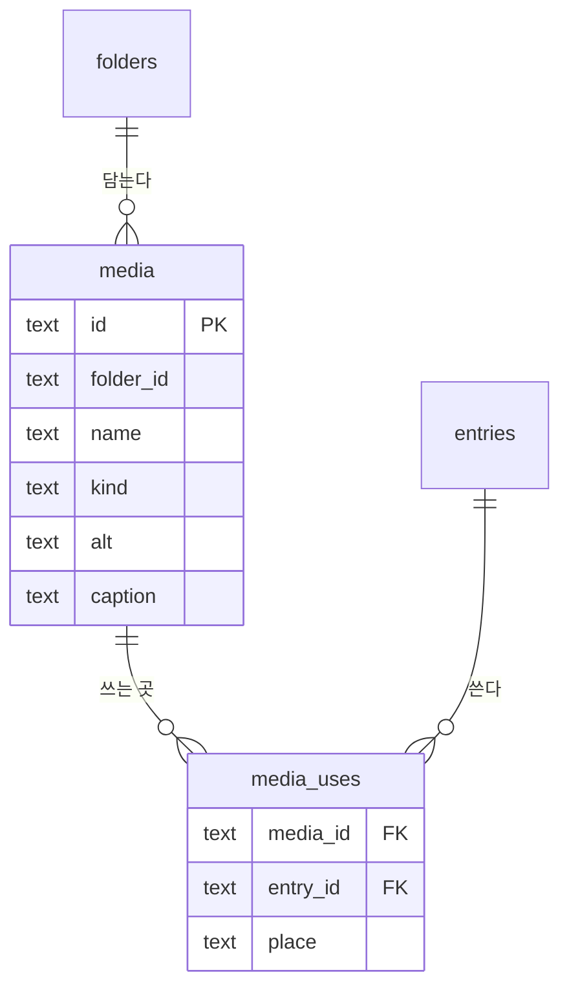
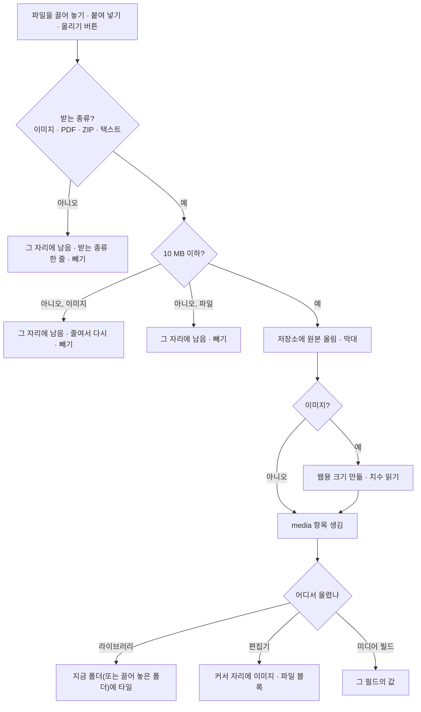

# 09 미디어

상태: 초안 (2026-11-05). D1이 소유자 확인을 기다린다.

## 한 문장

미디어는 올린 파일 하나가 한 항목이다. 이미지는 원본과 웹용 크기를 함께 두고, 파일마다 어느 글의 어느 자리에서 쓰이는지 늘 안다. 쓰이는 파일은 지워지지 않는다.

## 원칙

1. **쓰는 곳을 늘 안다.** 글을 저장할 때 미디어 필드와 본문의 이미지 · 파일 블록에서 쓰는 곳을 다시 적는다. "사용 2", 옆 패널의 쓰는 곳, 지우기 막기가 이것을 쓴다.
2. **쓰이는 파일은 지우지 않는다.** 휴지통으로 보내면 쓰이는 파일은 남기고 알린다. 폴더를 지워도 쓰이는 파일은 폴더째 남는다.
3. **파일을 바꿔도 쓰는 곳은 그대로다.** "파일 바꾸기"는 같은 항목의 파일만 바꾼다. 쓰던 곳의 대체 텍스트와 캡션은 그대로다.
4. **올리는 일은 창 없이 그 자리에서.** 라이브러리에 끌어 놓으면 지금 폴더에, 편집기에 붙여 넣으면 커서 자리에 바로 들어가고 막대가 흐른다. 실패한 파일은 이유와 함께 그 자리에 남는다.
5. **저장소는 꽂는 것이다.** 파일은 저장소 플러그인(S3 호환, 개발용 로컬 폴더)에 있다. 저장소가 없으면 미디어 화면이 그렇게 말하고 연결 방법을 보인다.

## 쓰는 화면과 흐름

- 기준 화면: `Screens/Reference/Lists` › Media, `Screens/Reference/Editor` › ImageInsert, EditorNotion(이미지 도구, 대표 이미지).
- 흐름: [흐름 6 · 미디어](../admin/flows/06-media.md) 전부. 휴지통의 미디어는 [흐름 5](../admin/flows/05-trash.md)의 17단계와 그 뒤.
- 폴더는 07번 문서, 휴지통은 11번 문서, 본문의 이미지 · 파일 블록은 03번 문서.

## 모양

```ts
type Media = {
  id: string;
  folderId: string | null;
  name: string;                       // "desk-morning.jpg", editable
  kind: "image" | "file";
  mime: string;                       // "image/jpeg", "application/pdf"
  size: number;                       // bytes of the original
  original: { key: string; width?: number; height?: number };
  web?: { key: string; width: number; height: number };   // images: longest side ≤ 2400
  alt: string;                        // default alt text (images)
  caption: string;                    // default caption (images)
  uploadedAt: Date;
  version: number;
  trashedAt: Date | null;
};

type MediaUse = {
  mediaId: string;
  entryId: string;
  place: { field: string } | { block: string };  // "cover" field, or body block b_5
};
```



- `media_uses`는 글을 저장할 때마다 그 글의 줄을 지우고 다시 적는다. 고치는 본과 발행본 어느 쪽이든 쓰면 "쓰인다"로 센다.
- 휴지통에 든 글이 쓰는 것도 쓰는 것으로 센다. 그 글이 영구히 지워질 때 줄이 빠진다.

## 올리기



- "줄여서 다시"는 브라우저에서 긴 변을 줄여 한도 아래로 만든 뒤 다시 올린다.
- 올리기는 사람만 한다. 에이전트에게는 올릴 파일이 없다.

## 지우기

| 무엇을 | 쓰이지 않으면 | 쓰이면 |
|---|---|---|
| 파일 하나 · 여럿 | 휴지통으로 · 되돌리기 | 남김. 알림 "1개를 옮겼고 1개는 쓰이고 있어 남겼어요 · 보기" |
| 폴더 | 폴더째 휴지통으로 · 확인 없이 · 되돌리기 | 쓰이지 않는 파일만 옮기고 폴더는 쓰이는 파일과 함께 남김 · 보기 |

- 휴지통에서 30일이 지나면 저장소의 파일도 지운다(11번 문서).
- 쓰이는 파일을 꼭 지우려면 쓰는 곳에서 먼저 빼야 한다. "보기"가 쓰는 곳 목록으로 간다.

## 고르기

- 편집기의 `/` › 이미지 › 라이브러리, 이미지 블록, 대표 이미지 칸은 같은 라이브러리 창(`MediaPicker`)을 연다. 왼쪽에 폴더, 위에 이름 찾기, 아래에 올리기.
- 파일 블록에서 열면 파일만, 이미지 자리에서 열면 이미지만 보인다.
- 고르면 바로 들어간다. 이미지 블록은 `media` id를 들고, 대체 텍스트와 캡션은 D1을 따른다.

## 기능 목록

| 기능 | 종류 | 하는 일 |
|---|---|---|
| `media.upload` | write · 사람만 | 파일을 올려 항목을 만든다 |
| `media.query` | read | 폴더, 찾기(이름), 종류, 사용 여부, 대체 텍스트 있음 · 없음, 정렬(최근 올린순, 이름, 크기) |
| `media.get` | read | 항목 하나와 쓰는 곳 |
| `media.update` | write | 이름, 기본 대체 텍스트, 기본 캡션 |
| `media.replace` | write · 사람만 | 파일을 바꾼다. 쓰는 곳 수를 미리 보인다 |
| `media.moveToFolder` | write | 여러 파일을 폴더로(07) |
| `media.trash` | write · preview | 쓰이지 않는 것만 휴지통으로. 미리 보기는 옮길 것과 남길 것 |

## 에이전트

- **읽기:** `media.query`로 "대체 텍스트가 없는 이미지", "안 쓰는 파일"을 찾고, `media.get`으로 쓰는 곳을 안다.
- **보기:** 대체 텍스트와 캡션을 쓰려면 그림을 봐야 한다. 이미지 입력을 받는 모델에게는 웹용 크기를 보낸다. 받지 못하는 모델이면 "✦ 채우기"가 없다.
- **쓰기:** 한 장의 "✦ 채우기"는 바로 넣기다. 여러 장을 고르고 "✦ 대체 텍스트"를 누르거나 채팅으로 시키면 제안이다. 타일마다 파란 값이 보이고, 위에 "제안 3 · 모두 버리기 · 모두 받기" 막대가 뜬다(흐름 6·25). 타일을 누르면 그 자리에서 다시 묻는 카드가 열린다.
- "안 쓰는 파일 정리해 줘"라고 했을 때만 휴지통 제안을 만든다. 쓰이는 파일은 제안에 들지 않는다.

## 화면 쪽 조각

- `useUpload(target)`: 끌어 놓기, 붙여 넣기, 막대, 실패 줄. 라이브러리, 편집기, 미디어 필드가 같은 것을 쓴다.
- `MediaPicker`: 라이브러리 창.
- `MediaPanel`: 옆 패널(미리보기, 이름, 폴더, 기본 대체 텍스트와 캡션, 형식, 크기, 쓰는 곳).

## 결정

### D1. 글 속 이미지의 대체 텍스트는 어디 것을 쓸까 (추천: 비어 있으면 라이브러리 값, 소유자 확인 기다림)

라이브러리의 파일에는 기본 대체 텍스트가 있고(흐름 6·16, 22~26), 편집기의 이미지 설정 카드에도 대체 텍스트가 있다(흐름 6·06).

- **A. 이미지 블록이 비어 있으면 라이브러리 값을 쓴다 (추천).** 블록의 대체 텍스트는 처음에 비어 있고 라이브러리 값이 흐린 글자로 보인다. 블록에서 쓰면 그 글에서만 그 값이 된다. 라이브러리에서 나중에 채운 값도 블록이 비어 있는 모든 글에 반영된다. 발행 검사(02)는 블록 값이나 라이브러리 값 중 하나가 있으면 지나간다.
- **B. 넣을 때 복사한다.** 이미지를 넣는 순간 라이브러리 값이 블록에 복사된다. 그 뒤로 둘은 따로다. 라이브러리에서 나중에 채운 값은 이미 넣은 글에 가지 않는다.

```ts
// A
const alt = block.attrs.alt || media.alt; // what the site renders and the publish check reads
```

## 결정 기록

- 2026-11-05: 쓰는 곳은 글을 저장할 때 다시 적는다. 휴지통에 든 글도 쓰는 곳이다.
- 2026-11-05: 이미지는 원본과 웹용 크기(긴 변 2400px 이하)를 함께 둔다. 사이트와 모델에는 웹용 크기를 쓴다.
- 2026-11-05: 올리기와 파일 바꾸기는 사람만 한다.
- 흐름 6: 쓰이는 파일은 휴지통으로 가지 않는다. 미디어 폴더 지우기는 확인을 묻지 않고, 쓰이는 파일은 폴더째 남긴다.

## 끝 조건

- 흐름 6의 38단계가 이 기능 목록과 03, 07, 11번 문서만으로 된다.
- 라이브러리, 편집기, 미디어 필드가 같은 올리기와 같은 라이브러리 창을 쓴다.
- 어떤 길로도 쓰이는 파일이 휴지통에 들어가지 않는다.
- 파일을 바꿔도 쓰는 곳의 대체 텍스트와 캡션이 그대로다.
