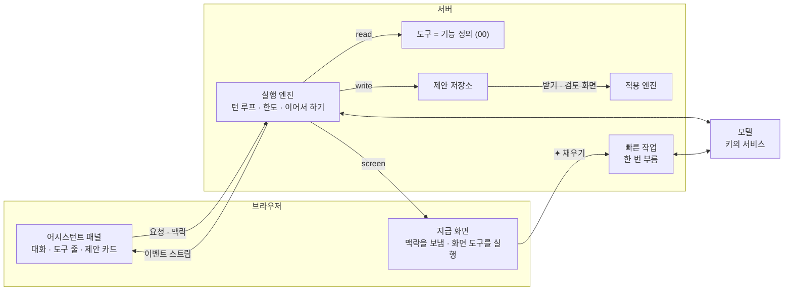
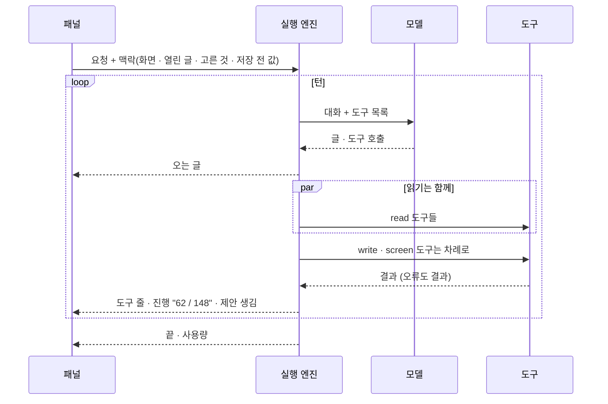
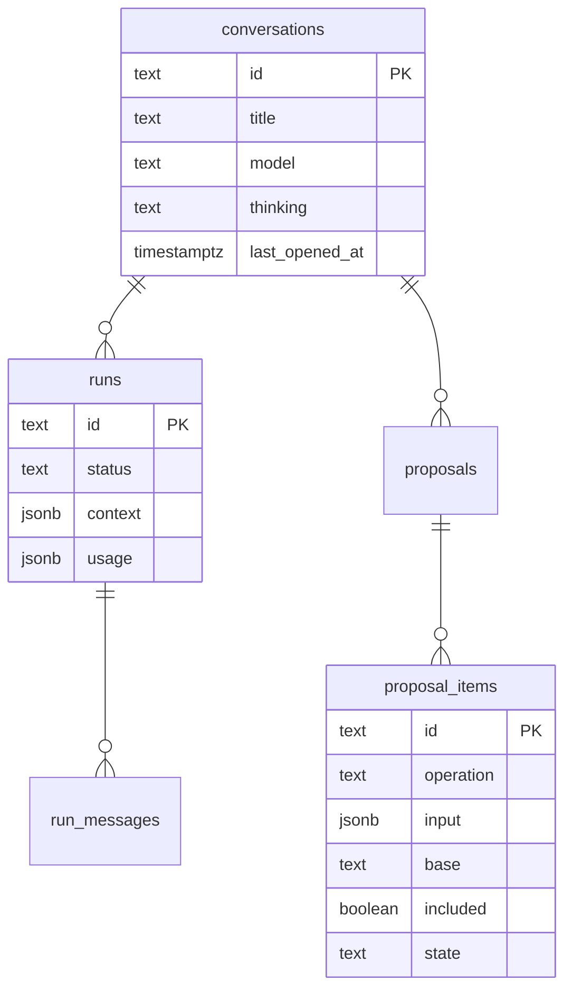

# 10 어시스턴트

상태: 초안 (2026-11-05). 정할 것이 없다. [agent.md](../agent.md)를 이 틀로 다시 썼고, 그 뒤의 결정(05, 09, 01의 PR 빼기)을 반영했다.

## 한 문장

관리자는 어느 화면에서든 ✦로 어시스턴트에게 일을 시킨다. 에이전트는 00번 문서의 기능을 도구로 써서 사이트를 마음대로 읽고 화면을 움직이고, 바꾸는 일은 모두 제안으로 쌓는다. 칸 하나를 채우는 "✦ 채우기"만 루프 없이 빠른 작업 모델을 한 번 부른다.

## 원칙

1. **바로 넣기와 제안, 두 가지뿐이다.** 칸 하나의 "✦ 채우기"는 그 칸에 바로 넣는다. 그 밖의 모든 쓰기(채팅, 여러 곳, 번역)는 제안이다(00, 05).
2. **도구는 기능이다.** 에이전트만의 쓰기 코드가 없다. 기능을 정의하면 도구가 생기고, 플러그인 기능도 그대로 도구다(00).
3. **사람만 하는 일이 있다.** 영구 삭제, 비우기, 올리기, 파일 바꾸기, 키와 비밀값, 관리자 계정. 이것들은 도구로 나가지 않는다.
4. **읽은 글은 명령이 아니다.** 글과 파일에 적힌 지시는 따르지 않는다. 따라도 최대치는 제안이고, 사람이 받지 않으면 아무 일도 없다.
5. **돈은 세지 않는다.** 키마다 이번 달 토큰만 센다. 서비스가 거절하면 대화 안에 알린다.

## 쓰는 화면과 흐름

- 기준 화면: `Screens/Reference/Assistant` › Assistant, AssistantFirst, AssistantPanel, AssistantWorking, ProposalReview, ProposalReviewSide, `Screens/Reference/Editor` › EditorProposal.
- 흐름: [흐름 2 · 어시스턴트](../admin/flows/02-assistant.md) 전부(19단계는 09번 결정으로 바뀜), 다른 흐름의 ✦ 단계.
- 제안 표시는 05번 문서, 활동 기록의 ✦ 줄은 13번 문서, 키와 모델 목록은 14번 문서.

## 전체 구조



- 실행 엔진, 제안 저장소, 빠른 작업은 `@monti-cms/ai`에 있다. 기능 정의와 적용 엔진은 core에 있다. core는 AI를 모른다.
- 모델 호출은 AI SDK의 공급자 추상으로 한다. 루프는 직접 돈다.

## 실행



- **턴과 실행.** 턴은 모델 요청 한 번과 그 응답이 부른 도구들이다. 도구 호출이 없는 응답이 오면 실행이 끝난다. 대화는 실행이 이어진 것이다.
- **도구 순서.** 읽기는 한 턴 안에서 함께, 쓰기와 화면은 차례로 돈다. 쓰기의 순서가 제안 항목의 순서다.
- **도구 전후.** 전에는 입력 검사와 막기(사람만 하는 일, 열린 글 밖의 편집기 도구), 뒤에는 결과 줄이기(너무 길면 앞부분과 "질의를 좁혀요").
- **한도.** 실행마다 턴 수, 토큰, 시간 한도가 있다. 시간 한도에 닿으면 지금 턴을 마치고 멈춘다. 패널은 끊긴 것과 같이 보이고 "이어서 하기"를 준다. 서버리스의 시간 제한 안에서도 긴 일을 이어 간다(흐름 2·06).
- **더 말하기.** 실행 중에 더 보낸 말은 줄에 쌓인다(AssistantWorking). 줄마다 ↑(지금 끼워 넣기: 다음 턴에 들어간다), 고치기, 지우기가 있다. 실행이 끝나면 쌓인 말이 차례로 다음 실행이 된다.
- **멈추기.** 지금 실행을 멈춘다. 그때까지 만든 제안 항목은 남는다.
- **화면 옮기기.** 화면 도구(글 열기, 목록 거르기, 고르기)는 브라우저가 실행한다. 지금 화면에 저장 전 변경이 있으면 옮기지 않고 "저장하고 열기"를 보인다(흐름 2·05).

## 맥락

실행마다 네 가지를 받는다.

| 맥락 | 어디서 |
|---|---|
| 사이트의 모양 | 스키마, 필드의 도움말과 제한(01), 켠 블록(03), 언어(04) |
| 글 쓰는 방식 | 설정 › 사이트의 텍스트 하나(12) |
| 지금 화면 | 화면 종류, 열린 글과 버전, 고른 행과 글자, 걸린 목록 질의(06) |
| 저장 전 값 | 지금 화면 초안의 `mine`(05) |

- 패널 입력란 위에 지금 맥락이 칩으로 보인다("이 글", "고른 2편"). 칩을 빼면 그 맥락은 가지 않는다.

## 모델

- 모델은 대화마다 입력란의 모델 버튼에서 고른다. 메뉴는 키마다 묶여 있고 찾기가 있다. 생각할 수 있는 모델은 "생각 ›"(끔 · 낮음 · 보통 · 높음)이 있다(흐름 2·23).
- 새 대화는 기본 모델로 시작한다. 생각할 수 있으면 "보통"이다.
- 도구를 못 쓰는 모델은 메뉴에 없다. 이미지를 받지 못하는 모델로는 그림을 보는 일(대체 텍스트)을 하지 않고 그렇게 답한다.
- 키가 없으면 패널은 "AI 연결이 없어요 · API 키 넣기"만 보인다(흐름 2·22).

## 제안

00번 문서의 제안에 어시스턴트 쪽 모양이 더해진다.

```ts
type Proposal = {
  id: string;
  conversationId: string;
  request: string;                 // the admin's words, quoted in the card, review page and activity log
  status: "pending" | "applying" | "applied" | "partial" | "reverted" | "discarded";
  groups: { label: string; itemIds: string[] }[];   // "다듬기 · 발행 후 고친 글 · 3곳"
  items: ProposalItem[];           // 00: operation, input, base version, included, state, reason
};
```


- **카드.** "4묶음 · 19건 · 검토 대기", 상세 보기 · 버리기 · [n건 적용]. 건수는 뺀 항목과 그 사이 고쳐진 항목을 따라 줄어든다.
- **검토 화면.** 요청 인용, 묶음마다 항목과 체크, "한 줄 · 나란히", 본문 묶음의 "편집기에서 보기". 보고 넣고 빼는 곳이라 다시 묻는 카드는 없다.
- **그 사이 고쳐짐.** 검토를 열 때와 적용할 때 항목마다 버전을 비교한다. 다르면 "이 사이에 고쳐짐 · 다시 만들기". 다시 만들기는 그 항목만 지금 상태로 다시 만드는 작은 실행이다.
- **적용.** 항목을 차례로 실행하고 결과를 바로 남긴다. 묶는 트랜잭션은 없다. 하나가 실패해도 계속하고, 실패는 이유와 남는다. 끊기면 남은 것만 이어서 한다.
- **되돌리기.** 카드의 "모두 되돌리기", 활동 기록, 편집기 ⋯ › "AI가 바꾼 기록"이 같은 동작이다(00의 스냅숏). 그 사이 고쳐진 자리는 건너뛴다.
- **버리기.** 아무것도 바뀌지 않으므로 활동 기록에 남지 않는다. 카드와 지난 대화 줄에 "버림".

## 자리 요청

- 화면의 파란 표시를 누르면 열리는 카드에서, 그 자리에 대고 다시 고쳐 달라고 한다("끝은 원래대로 두고 앞만 줄여 줘"). 고른 글자에서 서식 카드의 "✦ 요청"(⌘J)으로도 시작한다.
- 자리 요청 하나는 작은 실행 하나다. 맥락은 그 자리, 그 항목, 그 카드의 대화다. 새 항목이 옛 항목을 그 자리에서 바꾼다.
- 여러 자리 요청이 함께 돌 수 있다. 상태 줄에 "요청 1 · 고치는 중 1".

## 빠른 작업

| 작업 | 칸 |
|---|---|
| 요약 · 글자 채우기 | 모든 글자 필드. 그 필드의 도움말을 채우는 규칙으로 읽는다 |
| 태그 · 시리즈 추천 | 관계 필드 |
| 대체 텍스트 · 캡션 | 글 속 이미지 블록, 미디어 필드(09) |
| 주소 | 주소 칸 |

- API 키 화면의 "빠른 작업" 모델을 한 번 부르고 정해진 모양의 답을 받는다. 루프, 도구, 대화 저장이 없다.
- 맥락은 그 칸의 정의(도움말, 제한), 글의 내용(이미지면 그림과 앞뒤 블록), 글 쓰는 방식이다.
- 작업 목록은 정해져 있다. 관리자가 고치는 프롬프트나 사용자 작업은 없다.
- 번역 채우기는 여러 블록을 바꾸므로 빠른 작업이 아니라 제안이다(04).

## 처음 화면과 지난 대화

- **처음 화면.** 빈 패널은 지금 화면에 맞는 기본 요청("이 목록에서 · 요약이 비어 있는 글 찾아 줘", "이 글에서 · 영어로 옮겨 줘")과 최근 요청을 보인다. 기본 요청은 화면마다 정해진 문장이다.
- **지난 대화.** 날짜별로 묶이고, 줄마다 시각과 한 일("받음 5곳", "적용 16건", "되돌림", "검토 대기", "버림"), 지우기가 있다. 다시 열면 그때 제안이 그대로 있다.
- **지우기.** 30일 동안 열지 않은 대화는 지운다(관리자 값). 대화를 지우면 그 대화의 대기 제안도 지워진다. 적용된 일은 활동 기록에 남는다.

## 오류

| 일 | 패널 |
|---|---|
| 키가 없음 | "AI 연결이 없어요 · API 키 넣기" |
| 서비스가 거절(크레딧, 한도) | 대화 안에 키 이름과 이유, "다른 모델로 보내기" |
| 연결 끊김 · 시간 한도 | "연결이 끊겼어요", 어디까지 했는지, "이어서 하기" |
| 도구 오류 | 실행을 멈추지 않는다. 모델이 읽는 결과가 된다 |

## 데이터



## 에이전트가 할 수 있는 일

다른 기능 문서의 "에이전트" 절을 모은 표다. 이 표는 기능이 더해질 때마다 늘어난다.

| 기능 | 읽기 | 제안(쓰기) | 화면 | 사람만 |
|---|---|---|---|---|
| 01 콘텐츠 구조 | 스키마, 필드 도움말 | 스키마 바꾸기(개발 서버만), 관리자 값 | | |
| 02 글의 일생 | 글, 할 일 | 저장, 발행, 보관, 복제 | 글 열기 | |
| 03 본문 | 블록 목록, 본문(블록 id) | 블록 연산 | | |
| 04 다국어 | 번역 상태, 짝 | 번역 만들기, 블록 처리 | | |
| 06 목록 | 목록 질의, 개수 | | 목록 거르기, 고르기 | |
| 07 폴더 | 트리 | 만들기, 옮기기, 지우기(휴지통) | | |
| 08 관계 | 고를 값, 쓰인 수 | 붙이기, 합치기, 항목 저장 | | |
| 09 미디어 | 파일, 쓰는 곳, 빈 대체 텍스트 | 이름, 폴더, 휴지통 | | 올리기, 파일 바꾸기 |
| 11 휴지통 | 휴지통 목록 | 휴지통으로, 복원 | | 영구 삭제, 비우기 |

## 화면 쪽 조각

- `useAssistant()`: 패널 상태, 지금 대화, 이벤트 스트림, 줄에 쌓인 말.
- `useScreenContext()`: 화면마다 맥락을 내놓고 화면 도구를 받는다. 목록, 편집기, 설정, 미디어가 각자 등록한다.
- `ProposalCard`, `ProposalReview`, `MemoCard`, `ModelMenu`: 기준 화면의 부품.

## 결정 기록

- 2026-11-05: 실행 엔진은 `@monti-cms/ai`에 있고 core는 AI를 모른다. 기능 정의와 적용 엔진은 core에 있어서, AI 없이도 화면과 CLI는 같은 기능을 쓴다.
- 2026-11-05: 모델 호출은 AI SDK의 공급자 추상을 쓰고, 턴 루프는 직접 돈다.
- 2026-11-05: 실행 중 더 보낸 말은 줄에 쌓이고, ↑로 지금 끼워 넣을 수 있다(AssistantWorking).
- 2026-11-05, 소유자(05): 화면의 제안은 받으면 저장 전 변경이 되고, 검토 화면의 제안은 받으면 바로 적용된다.
- 2026-11-05, 소유자(09): 미디어 라이브러리에서 여러 장 대체 텍스트 채우기는 없다. 글 속 이미지의 대체 텍스트를 채우는 요청이 된다.
- 2026-11-02(agent.md): 바로 넣기와 제안 두 가지. 여러 곳을 채우는 버튼은 없다. 검토 화면은 보고 넣고 빼는 곳이다. 대기 제안은 만료되지 않는다.

## 끝 조건

- 흐름 2의 단계가 이 문서와 00, 05번 문서만으로 된다.
- 어떤 기능을 더해도 에이전트 쪽 코드를 고치지 않고 도구가 생긴다.
- 어떤 길로도 에이전트가 사람의 받기 없이 데이터를 바꾸지 못한다.
- 끊긴 실행을 "이어서 하기"로 이어 갈 수 있고, 끊긴 적용은 남은 항목만 이어서 한다.
