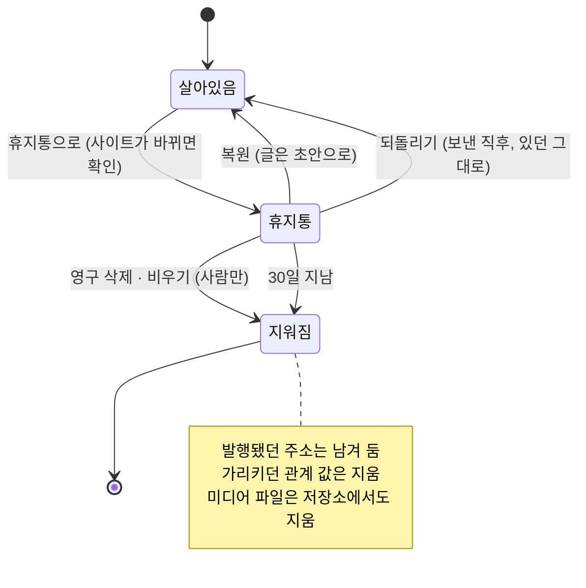
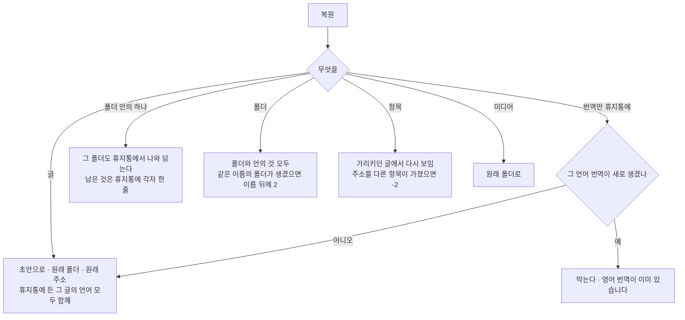

# 11 휴지통

상태: 화면 승인됨 (2026-11-11, 소유자). 아래 "결정 기록"의 2026-11-11 항목이 시안을 보고 정한 것이다.

## 한 문장

지우는 일은 모두 휴지통을 거친다. 휴지통의 것은 30일 동안 복원할 수 있고, 그 뒤에 영구히 지워진다. 영구 삭제와 비우기는 사람만 한다.

## 원칙

1. **바로 사라지는 것은 없다.** 글, 메모, 항목, 폴더, 미디어를 지우면 휴지통으로 간다. 영구 삭제는 휴지통 안에서만 한다. 예외는 컬렉션 지우기 하나다(01번 문서).
2. **사이트가 바뀔 때만, 휴지통으로 보낼 때 묻는다.** 초안과 메모는 묻지 않고 바로 휴지통으로 가고, "되돌리기"를 준다. 발행된 글은 사이트에서 내려가므로 먼저 묻는다. 발행된 글이 가리키는 항목도 그 글들에서 빠지므로 먼저 묻는다.
3. **복원하면 초안이다.** 발행됐던 글도 복원하면 초안으로 돌아온다. 사이트에 다시 나가는 것은 사람이 발행할 때다. 항목은 초안이 없으므로 복원하면 가리키던 글에 바로 다시 보인다.
4. **영구 삭제는 막지 않는다.** 휴지통에 든 것은 이미 사이트에서 빠져 있어서, 영구 삭제해도 사이트가 달라지지 않는다. 그것을 가리키던 관계 값은 그때 함께 지운다(08번 문서). 되돌릴 수 없으므로 매번 묻는다.
5. **주소는 다시 쓰지 않는다.** 한 번이라도 발행된 주소는 영구 삭제 뒤에도 남겨 두어 다른 글이 그 주소로 발행되지 못한다.

## 쓰는 화면과 흐름

- 기준 화면: `Screens/Reference/Lists` › Trash, Main(행 메뉴의 "휴지통으로"), `Screens/Reference/Editor` › EditorNotion(휴지통 글).
- 흐름: [흐름 5 · 휴지통](../admin/flows/05-trash.md)의 08~28단계, [흐름 6](../admin/flows/06-media.md)의 11, 12, 27, 28단계, [흐름 3](../admin/flows/03-translation.md)의 15단계.
- 폴더는 07번 문서, 쓰이는 미디어를 남기는 규칙은 09번 문서.
- 실제 화면의 상태는 Storybook의 `Screens/Trash`에 있다.

## 한 항목의 일생



"되돌리기"와 "복원"은 다르다. 보낸 직후 알림의 "되돌리기"는 방금 한 일을 없던 일로 한다. 발행된 글이었다면 발행된 채로 돌아온다. 휴지통 화면의 "복원"은 초안으로 돌려놓는다.

## 휴지통으로

| 무엇을 | 묻나 | 함께 가는 것 | 사이트 |
|---|---|---|---|
| 초안 · 메모 | 묻지 않는다 · 되돌리기 | 그 묶음의 번역 | 없음 |
| 발행된 글 | 묻는다 "‘첫 번째 글’의 공개가 끝납니다. 영어 번역도 함께 옮깁니다." | 그 묶음의 번역 | 내려간다 |
| 번역 하나 | 묻지 않는다(초안이면) · 묻는다(발행됐으면) | 없음. 원문은 그대로 | 그 언어만 내려간다 |
| 항목(태그 등) | 발행된 글이 가리키면 묻는다 "발행된 글 3편에서 이 태그가 빠집니다." 아니면 묻지 않는다 | 그 항목의 모든 언어 | 가리키던 글에서 숨는다(08) |
| 글 폴더 | 발행된 글이 있으면 묻는다 | 안의 글과 하위 폴더 | 안의 발행된 글이 내려간다 |
| 미디어 · 미디어 폴더 | 묻지 않는다 · 되돌리기 | 쓰이지 않는 파일만. 쓰이는 파일과 그 파일이 든 폴더는 남는다(09) | 없음 |

- 여럿을 함께 보낼 때 발행된 글이 하나라도 있으면 한 번 묻고, 발행된 글만 말한다("발행된 글 2편의 공개가 끝납니다.").
- 원문을 휴지통으로 보내면 번역도 함께 간다. 번역만 보낼 수는 있다(흐름 3·15).
- 글 하나는 휴지통에서 한 줄이다. 휴지통에 든 그 글의 언어가 언제 어떻게 들어왔든 한 줄에 모이고(원문이 있으면 원문의 줄), 언어 칸이 "KO +1"로 말한다. 번역을 먼저 버리고 원문을 나중에 버려도 한 줄이다(2026-11-11 소유자). 지운 폴더도 한 줄이고 누르면 안으로 들어간다.
- 한 줄은 남은 날도 하나다. 글의 다른 언어가 휴지통에 들어오면 먼저 들어와 있던 언어도 그날부터 다시 30일을 센다.
- 발행된 글은 휴지통에 들어갈 때 발행본이 지워지고 상태가 초안이 된다. 그 주소는 `old_paths`에 적어 둔다(영구 삭제할 때 남길 주소).
- 화면은 보내기 전에 `trash.checkMove`로 물을지 정한다. 목록의 행 메뉴와 일괄 막대, 편집기 ⋯, 항목 화면, 폴더, 미디어가 모두 같은 훅(`useTrashMove`)을 쓴다.

## 휴지통 화면

- 줄은 게시글 목록의 줄과 같은 한 줄이다(2026-11-11 소유자). 열: 제목(뒤에 주소, 폴더가 담은 수, 있던 폴더), 언어, 종류(컬렉션 이름, 미디어), 남은 날, ⋯. 버린 날은 남은 날과 같은 것을 두 번 말하므로 두지 않는다(2026-11-05 소유자).
- 행의 동작은 모두 ⋯ 안에 있다: "복원"과 "영구 삭제"(2026-11-11 소유자). 오른쪽 클릭 메뉴도 같다. 고른 행은 일괄 막대에서 복원하거나 영구 삭제한다.
- 남은 날이 7일 아래면 주황이다.
- 표는 다른 표와 같은 열 규칙을 따른다(2026-11-11 소유자): 열 너비를 끌어 바꾸고, 제목은 오름차순 · 내림차순으로, 남은 날은 두 방향으로 정렬하고, 언어와 종류로 거른다. 언어로 거르면 그 언어가 휴지통에 든 글만 남는다.
- 종류로 거르고, 찾으면 지운 폴더 안의 것까지 찾고 어느 폴더 안인지 보인다. 지운 폴더 안에서 찾을 때는 게시글 목록처럼 검색 상자의 칩이 그 폴더와 "모든 폴더" 가운데 고른다.
- 지운 폴더 안에 있는 것은 그 폴더 줄 안에서 보인다. 폴더 안의 첫 줄은 게시글 목록처럼 "상위 폴더로"다(2026-11-11 소유자). 폴더가 휴지통을 떠나면(폴더 안의 하나를 복원해서) 남은 것은 각자 한 줄이 된다.
- 어시스턴트가 버린 것은 남은 날 앞에 ✦가 붙는다. 누르면 그 대화가 열리는 것은 10번 문서에서 한다(T124).
- 글을 열면 편집기가 읽기 전용이다. 위에 "휴지통에 있는 글입니다 · n일 남음" 줄이 있고, 머리의 알약은 "복원" 하나, "영구 삭제"는 ⋯ 안에 있다. 돌아가기는 휴지통으로 간다.
- 항목과 미디어는 읽기 전용 옆 패널로 연다. 미디어 패널은 미디어 화면의 패널과 같은 순서다(미리보기, 이름, 폴더, 형식, 크기, 올린 날, 쓰는 곳). 항목 패널은 컬렉션, 이름, 주소, 가리키는 글이다. 패널의 알약은 "복원" 하나, "영구 삭제"는 ⋯ 안에 있다.

## 복원



- 글의 주소는 바꾸지 않는다. 초안은 주소가 겹쳐도 되고, 겹치면 발행할 때 할 일로 뜬다(02번 문서).
- 항목은 복원하면 바로 사이트에 나가므로 주소가 비어 있어야 한다. 다른 항목이 그 주소를 가졌으면 `-2`를 붙이고 알림이 새 주소를 말한다.

## 영구 삭제

- **확인.** "되돌릴 수 없습니다. 주소 /posts/about-old는 다시 쓸 수 없습니다." 주소 문장은 발행된 적이 있을 때만 있다. 여럿이면 몇 개인지, 폴더면 안의 것도 간다고 먼저 말한다.
- **가리키던 것.** 그것을 가리키던 관계 값을 살아 있는 글과 휴지통의 글 모두에서 지운다(08번 문서). 살아 있는 글은 발행본에서도 지운다. 휴지통에 있는 동안 이미 사이트에서 숨겨져 있었으므로 사이트는 달라지지 않는다.
- **원문과 번역.** 원문을 영구 삭제하면 휴지통에 있는 그 글의 모든 언어가 함께 지워진다. 번역은 원문 없이 남을 수 없다.
- **폴더.** 폴더를 영구 삭제하면 안에 든 휴지통의 것이 모두 지워진다.
- **비우기.** 휴지통의 모든 것을 지운다. "9개를 영구 삭제합니다."
- **30일 정리.** 30일이 지난 것을 같은 규칙으로 지운다. 정리는 관리자 화면을 열 때(한 시간에 한 번까지)와 `monti trash:purge` 명령으로 돈다. 명령은 호스트의 예약 작업에 걸 수 있다. 같은 때에 더는 되돌릴 수 없는 기록의 스냅숏과, 저장소의 주인 없는 파일도 지운다.
- **미디어.** 영구 삭제하면 저장소의 원본과 웹용 크기도 지운다. 파일은 줄이 지워진 뒤에 저장소에서 지운다.

## 사이트가 받는 것

| 상태 | 사이트 |
|---|---|
| 휴지통에 든 글 | 읽기에서 빠진다. 그 주소는 없는 주소다 |
| 휴지통에 든 항목을 가리키는 글 | 그 관계 값에서 그 항목이 빠진 채로 받는다 |
| 영구 삭제된 글의 주소 | 없는 주소다. 다른 글이 그 주소로 발행되지 못한다 |
| 휴지통에 든 미디어 | 쓰이는 파일은 휴지통에 들어가지 않으므로, 사이트가 받는 글에는 없다 |

글이 내려갈 때 `entry.unpublished` 이벤트가 주소와 함께 나간다(13번 문서). 항목을 복원하면 `entry.published`가 나간다.

## 데이터

```ts
// on entries, media, folders (00, 01, 07, 09)
trashedAt: Date | null;
trashedBy: "admin" | "assistant" | "cli" | "plugin" | null;

type ReservedPath = { collection: string; locale: string; slug: string; since: Date };  // once-published paths kept after a purge
type LooseFile = { key: string; removeAfter: Date };                                   // a file in the storage no media row holds
```

- 무엇이 무엇과 함께 갔는지는 적지 않는다. 휴지통에 든 같은 글의 언어는 한 줄이고, 든 폴더가 휴지통에 있으면 그 폴더 줄 안에서 보인다.
- 발행할 때(02) `reserved_paths`에 있는 주소는 다른 글이 이미 쓰는 주소로 본다.
- `loose_files`에는 올렸지만 항목이 되지 못한 파일(하루 뒤), "파일 바꾸기"가 남긴 옛 파일(하루 뒤), 영구 삭제된 파일(바로)의 키가 들어간다. 정리가 저장소에서 지운다. 미디어 줄이 가진 키는 지우지 않는다.

## 기능 목록

| 기능 | 종류 | 하는 일 |
|---|---|---|
| `trash.move` | write · preview | 글 · 항목 · 폴더 · 미디어를 휴지통으로. 미리 보기는 함께 갈 것, 내려갈 글, 남을 미디어 |
| `trash.checkMove` | read | 휴지통으로 보내면 생길 일: 내려갈 글 수, 함께 갈 번역, 가리키는 발행된 글 수, 남을 파일 수 |
| `trash.list` | read | 휴지통 줄(종류 · 언어 거르기, 찾기, 폴더 안, 남은 날이나 제목으로 정렬), 종류마다 · 언어마다 개수 |
| `trash.get` | read | 휴지통의 글이나 항목 하나: 언어마다 이름과 주소, 가리키는 글, 영구 삭제하면 남길 주소 |
| `trash.restore` | write · preview | 복원. 글은 휴지통에 든 그 글의 언어 모두와 함께, 폴더 안의 것은 그 폴더와 함께 |
| `trash.purge` | write · 사람만 · preview | 영구 삭제 |
| `trash.empty` | write · 사람만 · preview | 비우기 |

- 행 메뉴의 "휴지통으로"(06), 폴더 지우기(07), 미디어 지우기(09)는 모두 `trash.move`다. `folders.remove`와 `media.trash`는 없다.
- 사이드바의 휴지통 수(`frame.counts`)는 휴지통 화면 맨 위의 줄 수다. 글, 폴더, 미디어를 모두 센다.

## 에이전트

- **쓰기:** 에이전트의 휴지통 보내기는 제안이고, 시켰을 때만 만든다(00번 문서). 받으면 휴지통으로 가고 `trashedBy`가 어시스턴트다.
- **복원:** 복원은 제안할 수 있다. "어제 지운 글 되돌려 줘"에 `trash.list`로 찾아 `trash.restore` 제안을 만든다.
- **사람만:** `trash.purge`와 `trash.empty`는 도구로 나가지 않는다. 에이전트에게 영구 삭제를 시키면 휴지통 화면으로 안내한다.

## 화면 쪽 조각

- `useTrashMove()`: 휴지통으로 보내기. 물을지 정하고, 확인 창과 "되돌리기" 알림을 낸다. 지우는 화면이 모두 이것을 쓴다.
- `useRestore()`, `usePurge()`: 복원과 그 알림, 영구 삭제와 비우기의 확인 창.
- `TrashScreen`: 휴지통 화면. 주소에 연 폴더, 검색, 종류, 언어, 정렬, 옆에 연 줄이 있다.
- `TrashedFilePanel`, `TrashedItemPanel`: 읽기 전용 옆 패널.

## 결정 기록

- 2026-11-05: 30일 정리는 관리자 화면에 들어올 때와 `monti trash:purge`로 돈다. 따로 늘 도는 작업자는 두지 않는다.
- 2026-11-05: 영구 삭제 뒤에도 한 번 발행된 주소는 남긴다(흐름 5·23).
- 2026-11-05, 소유자(09): 휴지통의 미디어 옆 패널에도 대체 텍스트가 없다. 흐름 5·20의 대체 텍스트는 빠진다.
- 흐름 5: 초안과 메모는 묻지 않고, 발행된 글만 묻는다. 복원하면 초안이다. 영구 삭제와 비우기는 사람만 한다.
- 2026-11-11, 소유자: 코드를 쓰기 전에 문서의 구멍을 시안으로 정했다. 아래가 그 결정이다.
  - 행의 동작은 모두 ⋯ 안에 둔다. 보이는 "복원" 버튼은 없다.
  - 급한 색은 7일 아래다. 화면 문서의 3일은 틀린 것이었다.
  - 영구 삭제는 막지 않는다. 휴지통에서 삭제가 막힐 이유가 없다. "가리키는 것이 있으면 막는다"는 원칙과 글마다 고르는 창, 비운 뒤 남는 줄은 뺐다. 08번 문서의 "영구 삭제될 때 끊긴다"와도 어긋나 있었다.
  - 대신 발행된 글이 가리키는 항목은 휴지통으로 보낼 때 묻는다. 사이트가 바뀌는 것은 그때다.
  - 지운 폴더 안에서 찾을 때의 범위는 게시글 목록과 같은 칩이다.
  - 옆 패널은 미디어 화면과 항목 화면의 패널과 같은 순서의 읽기 전용이다. 영구 삭제는 ⋯, 알약은 복원이다. 휴지통 글의 편집기도 같다.
  - "되돌리기"는 발행 상태 그대로, "복원"은 초안이다.
  - 그 언어 번역이 새로 생긴 번역은 복원을 막는다.
  - 문구는 `~요`를 쓰지 않고 README 원칙 6의 말투를 따른다.
- 2026-11-11, 소유자(화면을 보고): 줄은 두 줄이 아니라 게시글 목록과 같은 한 줄이다. 둘째 줄이 비는 줄이 생기고, 휴지통만 다른 모양일 까닭이 없다. 같은 글의 원문과 번역이 따로 버려졌다고 두 줄로 나뉘지도 않는다. "원문이 휴지통에 있음"과 "원문 복원"은 없어졌다.
- 2026-11-11: 글의 주소는 복원할 때 바꾸지 않는다. 초안의 주소는 겹쳐도 되고 발행할 때 할 일로 뜨기 때문이다(02). `-2`는 바로 사이트에 나가는 항목에만 붙는다.
- 2026-11-11: 폴더와 함께 간 것을 따로 적지 않는다. 든 폴더가 휴지통에 있는지로 안다. 폴더 안의 하나를 복원하면 폴더가 휴지통을 떠나고, 남은 것은 각자 한 줄이 된다.
- 2026-11-11: 저장소의 파일은 `loose_files`에 적힌 키만 지운다. 저장소를 훑어 주인 없는 파일을 찾지 않는다(다른 것이 같은 저장소를 쓸 수 있다).
- 2026-11-11, 코드 리뷰에서 정한 것:
  - 번역 묶음은 한 폴더에 있다. 글을 폴더로 옮기면 휴지통에 든 그 글의 언어도 함께 옮긴다. 그래야 휴지통이 한 글을 두 폴더에서 보이거나 지우지 않는다.
  - 폴더를 영구 삭제하면 휴지통에 든 폴더만 지운다. 그 아래에 살아 있는 폴더가 있으면(되돌리기로 생길 수 있다) 최상위로 나오고, 같은 이름이 있으면 " 2"가 붙는다.
  - 남기는 주소는 지우는 글이 발행됐던 주소 가운데 지금 다른 글이 발행하고 있지 않은 것이다. 휴지통에 있는 동안 다른 글이 그 주소로 발행했으면 그 주소는 그 글의 것이다. 휴지통 줄과 확인 창이 말하는 주소도 같은 규칙이다.
  - 남긴 주소는 항목에도 지켜진다. 같은 이름의 새 항목은 `-2`를 받고, 그 주소를 직접 적으면 거절한다("주소 react는 지운 항목이 쓰던 주소입니다.").
  - `media`는 컬렉션 이름으로 쓸 수 없다. 휴지통이 미디어의 파일과 폴더를 이 종류 이름으로 부른다.
  - 영구 삭제로 관계를 끊을 때 작업본과 발행본을 따로 끊는다. 작업본의 다른 수정이 발행본에 나가지 않는다.
  - 겹치는 요청: 영구 삭제는 가리키는 글을 저장과 같은 잠금으로 쥐고, 폴더를 버릴 때는 폴더를 먼저 쥔 뒤 안의 글을 센다(`entries.moveToFolder`도 폴더를 쥔다). 비우기와 청소는 줄마다 쥐고 다시 읽는다. 청소와 업로드는 저장소 키에 같은 잠금을 쓴다.
  - 관리자 화면을 열 때의 청소가 실패해도 화면은 뜬다. 다음에 열 때 다시 한다.

## 끝 조건

- **11-1** 흐름 5의 08~28단계가 이 기능 목록과 07, 09번 문서만으로 된다.
- **11-2** 지우는 길(행 메뉴, 일괄 막대, 편집기, 폴더, 미디어, 에이전트)이 모두 `trash.move` 하나를 지난다.
- **11-3** 영구 삭제는 막히지 않고, 그것을 가리키던 관계 값은 살아 있는 글과 휴지통의 글 모두에서 빠진다.
- **11-4** 한 번 발행된 주소는 영구 삭제 뒤에도 다른 글이 그 주소로 발행되지 못한다.
- **11-5** 30일이 지난 것은 정리가 지우고, 지운 파일과 주인 없는 파일은 저장소에서도 사라진다.
