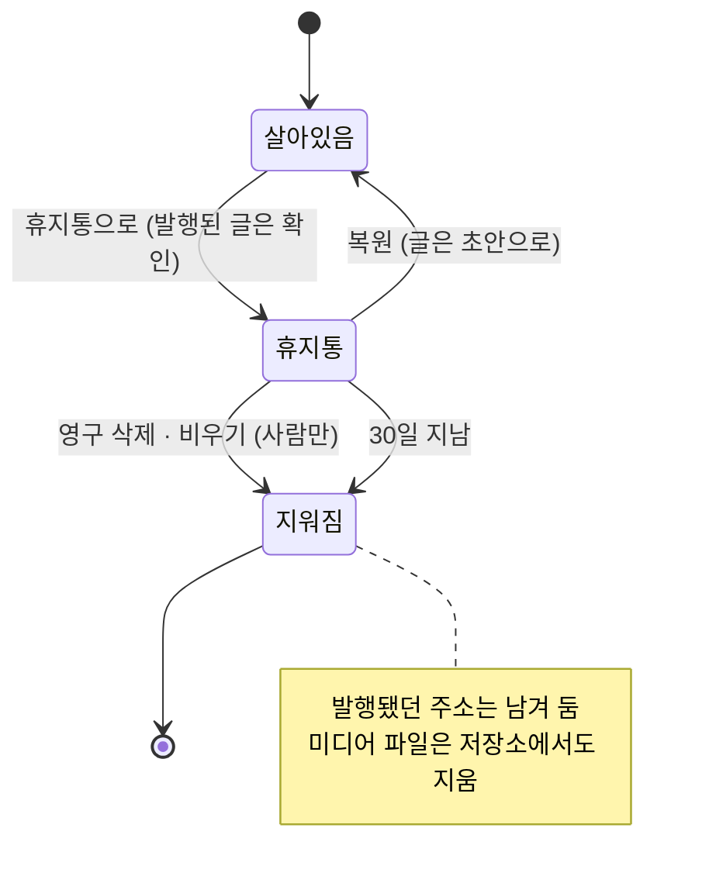
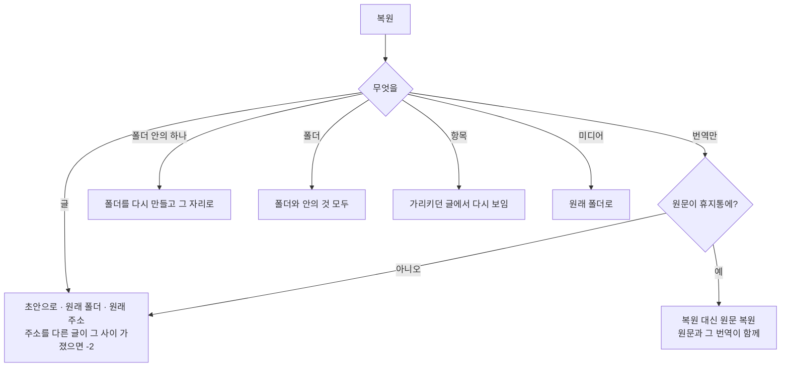

# 11 휴지통

상태: 초안 (2026-11-05). 정할 것이 없다.

## 한 문장

지우는 일은 모두 휴지통을 거친다. 휴지통의 것은 30일 동안 복원할 수 있고, 그 뒤에 영구히 지워진다. 영구 삭제와 비우기는 사람만 한다.

## 원칙

1. **바로 사라지는 것은 없다.** 글, 메모, 항목, 폴더, 미디어를 지우면 휴지통으로 간다. 영구 삭제는 휴지통 안에서만 한다. 예외는 컬렉션 지우기 하나다(01번 문서).
2. **사이트에 미치는 것만 묻는다.** 초안과 메모는 묻지 않고 바로 휴지통으로 가고, "되돌리기"를 준다. 발행된 글은 사이트에서 내려가므로 먼저 묻는다.
3. **복원하면 초안이다.** 발행됐던 글도 복원하면 초안으로 돌아온다. 사이트에 다시 나가는 것은 사람이 발행할 때다.
4. **가리키는 것이 있으면 영구 삭제를 막는다.** 다른 글이 가리키는 항목은 그 연결을 어떻게 할지 정해야 지울 수 있다.
5. **주소는 다시 쓰지 않는다.** 한 번이라도 발행된 주소는 영구 삭제 뒤에도 남겨 두어 다른 글이 그 주소를 갖지 못한다.

## 쓰는 화면과 흐름

- 기준 화면: `Screens/Reference/Lists` › Trash, Main(행 메뉴의 "휴지통으로"), `Screens/Reference/Editor` › EditorNotion(휴지통 글).
- 흐름: [흐름 5 · 휴지통](../admin/flows/05-trash.md)의 08~28단계, [흐름 6](../admin/flows/06-media.md)의 11, 12, 27, 28단계, [흐름 3](../admin/flows/03-translation.md)의 15단계.
- 폴더째 지우기는 07번 문서, 쓰이는 미디어를 남기는 규칙은 09번 문서.

## 한 항목의 일생



## 휴지통으로

| 무엇을 | 묻나 | 함께 가는 것 | 사이트 |
|---|---|---|---|
| 초안 · 메모 | 묻지 않는다 · 되돌리기 | 그 묶음의 번역 | 없음 |
| 발행된 글 | 묻는다 "공개가 끝납니다. English 번역도 함께 옮깁니다." | 그 묶음의 번역 | 내려간다 |
| 번역 하나 | 묻지 않는다(초안이면) · 묻는다(발행됐으면) | 없음. 원문은 그대로 | 그 언어만 내려간다 |
| 항목(태그 등) | 묻지 않는다 · 되돌리기 | 그 묶음의 번역 | 가리키던 글에서 숨는다(08) |
| 글 폴더 | 발행된 글이 있으면 묻는다 | 안의 글과 하위 폴더 | 안의 발행된 글이 내려간다 |
| 미디어 · 미디어 폴더 | 묻지 않는다 · 되돌리기 | 쓰이지 않는 파일만 | 없음 |

- 원문을 휴지통으로 보내면 번역도 함께 간다. 번역만 보낼 수는 있다(흐름 3·15).
- 함께 간 것은 휴지통에서 한 줄이다. 지운 폴더는 한 줄이고 누르면 안으로 들어간다. 원문과 함께 간 번역은 원문 줄에 언어로 보인다("KO · EN").

## 휴지통 화면

- 열: 제목(주소, 언어, 폴더 경로), 종류(글 · 메모 · 태그 · 미디어 · 컬렉션 이름), 남은 날(버린 날은 같은 것을 두 번 말해 두지 않는다, 2026-11-05 소유자), 복원, ⋯.
- 남은 날이 7일 아래면 주황이다.
- 종류로 거르고, 찾으면 지운 폴더 안의 것까지 찾고 경로를 보인다.
- 어시스턴트가 버린 것은 날짜 앞에 ✦가 붙고, 누르면 그 대화가 열린다.
- 글을 열면 편집기가 읽기 전용이다. 머리에 "복원"과 "영구 삭제", 위에 "휴지통에 있는 글입니다 · n일 남음" 줄이 있다. 항목과 미디어는 읽기 전용 옆 패널로 연다. 패널에는 가리키는 글이나 쓰인 곳이 보인다.

## 복원



## 영구 삭제

- **확인.** "되돌릴 수 없습니다. 한 번이라도 발행된 주소(/about-old)는 다른 글이 쓰지 못하게 남겨 둬요."
- **가리키는 글이 있으면 막는다.** 창이 가리키는 글을 보이고, 글마다 고른다. 살아 있는 글은 "연결 끊기"(그 글의 관계 필드에서 이 항목만 뺀다). 휴지통에 있는 글은 "같이 삭제". 모두 정해야 삭제할 수 있다.
- **비우기.** 가리키는 것이 있는 항목은 남기고 나머지를 지운다. 남은 항목마다 이유가 보인다("글 4편이 가리켜요").
- **30일 정리.** 30일이 지난 것은 같은 규칙으로 지운다. 가리키는 것이 있으면 남기고 이유를 단다. 정리는 관리자 화면에 들어올 때(한 시간에 한 번까지)와 `monti trash:purge` 명령으로 돈다. 명령은 호스트의 예약 작업에 걸 수 있다.
- **미디어.** 영구 삭제하면 저장소의 원본과 웹용 크기도 지운다.

## 데이터

```ts
// on entries, media, folders (00, 01, 07, 09)
trashedAt: Date | null;
trashedWith: string | null;   // the folder or source entry this went with; the trash shows one row for them
trashedBy: "admin" | "assistant";
conversationId?: string;      // when the assistant trashed it

type ReservedPath = { path: string; since: Date };  // once-published paths kept after a purge
```

- 주소를 정할 때(02의 주소 만들기, 복원) `old_paths`와 `reserved_paths`에 있는 주소는 쓰지 않는다.

## 기능 목록

| 기능 | 종류 | 하는 일 |
|---|---|---|
| `trash.move` | write · preview | 글 · 항목 · 폴더 · 미디어를 휴지통으로. 미리 보기는 함께 갈 것, 내려갈 글, 남을 미디어 |
| `trash.list` | read | 휴지통 줄(종류 거르기, 찾기, 폴더 안) |
| `trash.restore` | write · preview | 복원. 미리 보기는 "원문 복원"이 필요한지, 주소가 바뀌는지 |
| `trash.purge` | write · 사람만 · preview | 영구 삭제. 미리 보기는 가리키는 글. 고른 처리(연결 끊기 · 같이 삭제)를 받는다 |
| `trash.empty` | write · 사람만 · preview | 비우기 |

- 행 메뉴의 "휴지통으로"(06), 폴더 지우기(07), 미디어 지우기(09)는 모두 `trash.move`다.

## 에이전트

- **쓰기:** 에이전트의 휴지통 보내기는 제안이고, 시켰을 때만 만든다(00번 문서). 받으면 휴지통으로 가고 `trashedBy`가 어시스턴트다.
- **복원:** 복원은 제안할 수 있다. "어제 지운 글 되돌려 줘"에 `trash.list`로 찾아 `trash.restore` 제안을 만든다.
- **사람만:** `trash.purge`와 `trash.empty`는 도구로 나가지 않는다. 에이전트에게 영구 삭제를 시키면 휴지통 화면으로 안내한다.

## 화면 쪽 조각

- `useTrash(query)`: 휴지통 목록, 폴더 안, 거르기.
- `PurgeDialog`: 가리키는 글과 글마다 처리를 고르는 창. 비우기 결과에도 같은 이유 줄을 쓴다.
- `TrashedBanner`: 휴지통 글의 읽기 전용 편집기 위 줄.

## 결정 기록

- 2026-11-05: 30일 정리는 관리자 화면에 들어올 때와 `monti trash:purge`로 돈다. 따로 늘 도는 작업자는 두지 않는다.
- 2026-11-05: 영구 삭제 뒤에도 한 번 발행된 주소는 남긴다(흐름 5·23).
- 2026-11-05, 소유자(09): 휴지통의 미디어 옆 패널에도 대체 텍스트가 없다. 흐름 5·20의 대체 텍스트는 빠진다.
- 흐름 5: 초안과 메모는 묻지 않고, 발행된 글만 묻는다. 복원하면 초안이다. 영구 삭제와 비우기는 사람만 한다.

## 끝 조건

- 흐름 5의 08~28단계가 이 기능 목록과 07, 09번 문서만으로 된다.
- 지우는 길(행 메뉴, 일괄 막대, 폴더, 미디어, 에이전트)이 모두 `trash.move` 하나를 지난다.
- 가리키는 것이 있는 항목은 어떤 길로도 처리를 고르지 않은 채 영구 삭제되지 않는다.
- 한 번 발행된 주소는 영구 삭제 뒤에도 새 글이 갖지 못한다.
