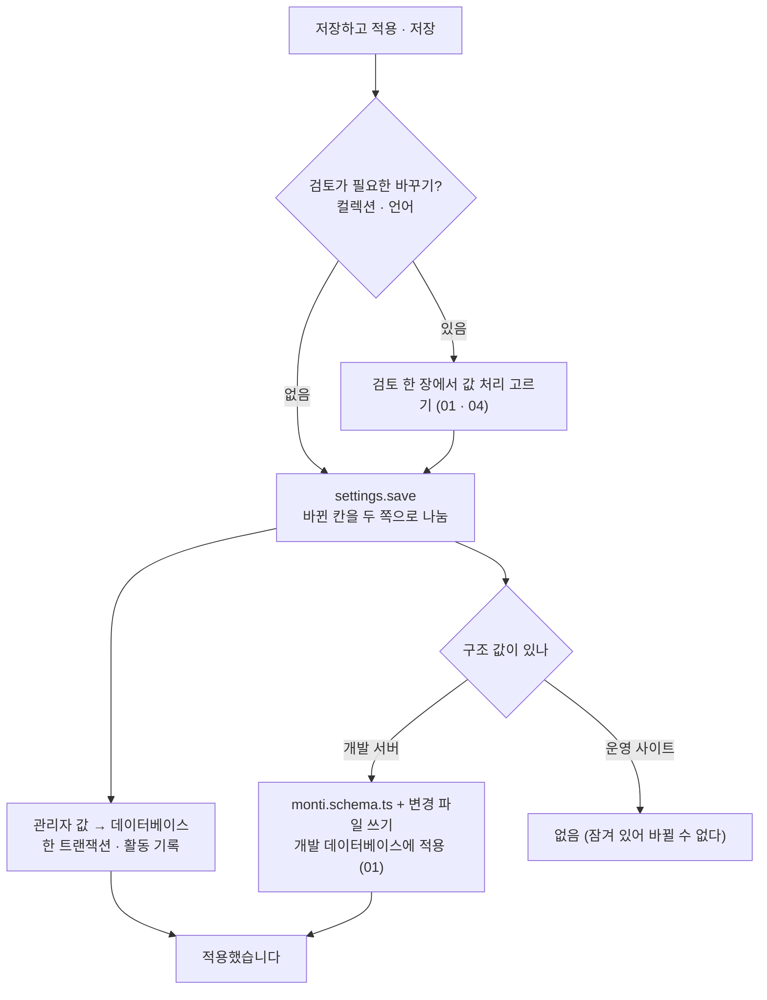

# 12 설정 저장

상태: 승인 (2026-11-11 화면 승인, 2026-11-12 16번 문서의 결정을 옮김). 만드는 중이다.

## 한 문장

설정 화면의 네 탭(사이트, 언어, 컬렉션, 관리자)은 한 초안을 쓰고 한 번에 저장한다. 값마다 구조 값(파일)인지 관리자 값(데이터베이스)인지 정해져 있고, 저장은 그것을 나눠 쓴다. 운영 사이트에서는 구조 값이 잠기고 관리자 값만 고친다.

## 원칙

1. **사이트 코드가 기대는가로 가른다.** 00번 문서의 두 종류의 값을 그대로 따른다. 한 값은 한 곳에만 있다.
2. **네 탭이 한 초안이다.** 탭을 옮겨 다니며 고치고, 머리의 "변경 사항 n"이 모두 센다. 고친 탭 이름에 점이 붙는다(05).
3. **저장 버튼은 하나다.** 개발 서버는 "저장하고 적용", 운영 사이트는 "저장". 저장된 값에 닿는 바꾸기(컬렉션, 언어)는 저장할 때 검토를 거친다(01, 04).
4. **잠긴 것은 잠겼다고 보인다.** 운영 사이트의 구조 값은 그 줄의 자물쇠와 글로 된 값이다. 바꾸려면 개발 서버에서 한다.
5. **읽는 곳이 없는 값은 두지 않는다.** 화면에서 고쳐도 아무것도 바뀌지 않는 값(홈 링크, 다른 호스트 이름, 관리자 주소)은 설정에 없다.

## 쓰는 화면과 흐름

- 기준 화면: `Screens/Reference/Settings` › Settings, SettingsProposal, AdminSettings, Locales, Schema 묶음, `Screens/Reference/Assistant` › CollectionBasics, CollectionEditor.
- 흐름: [흐름 11 · 설정](../admin/flows/11-settings.md)의 04~08, 15~20단계(01~03, 06b, 09~14b, 18은 빠짐), [흐름 2](../admin/flows/02-assistant.md)의 20, 21단계.
- 컬렉션 탭은 01번 문서, 언어 탭은 04번 문서가 정한다. 이 문서는 사이트 탭, 관리자 탭, 그리고 네 탭이 함께 쓰는 저장을 정한다.

## 값마다 어디에

| 탭 | 값 | 어디 | 운영 사이트 |
|---|---|---|---|
| 사이트 | 사이트 이름 | 데이터베이스 | 고친다 |
| 사이트 | 글 쓰는 방식(말투와 규칙) | 데이터베이스 | 고친다 |
| 사이트 | 주소에 언어 표시 | 파일 | 잠김 |
| 언어 | 언어 목록, 원문, 순서 | 파일 | 잠김 |
| 컬렉션 | 01번 문서의 "어디에 사는가" | 둘로 나뉨 | 구조만 잠김 |
| 관리자 | 화면 언어, 본문 템플릿 켜기 | 데이터베이스 | 고친다 |
| 관리자 | 계정(로그인한 이메일, 로그아웃) | 세션 | 늘 있다(15) |

- 사이트 이름은 사이드바 맨 위와 로그인 화면에 보인다. 로그인 화면은 로그인 전에 뜨므로 `auth.state`가 사이트 이름과 화면 언어를 함께 준다.
- 관리자 탭의 화면 언어와 기능 스위치는 고르는 대로 바로 저장된다(기준 화면에 저장 묶음이 없다). 그래서 관리자 탭에는 초안에 드는 값이 없고, 탭 이름에 점이 붙을 일도 없다.
- 본문 템플릿을 끄면 `/` 메뉴의 템플릿 묶음과 도구 › 템플릿이 사라진다. 템플릿은 지워지지 않는다(03).
- 16번 문서가 뺀 값: 미리보기 경로, 경로에 언어 넣기, 언어 쿼리(미리보기는 글의 공개 주소에서 보고, 따로 만든 미리보기 페이지의 주소는 컬렉션의 `previewPath`다), 관리자 주소(관리자 페이지 파일이 놓인 폴더가 정한다).

## 저장

- 관리자 값을 먼저, 구조 값을 다음에 쓴다. 구조 값은 01번 문서의 길(파일 쓰기 → 개발 데이터베이스에 변경 파일 적용)을 그대로 간다.
  - 컬렉션의 관리자 값(라벨, 배치)은 지금 적용된 필드 이름으로 먼저 저장하고, 이름을 바꾸거나 지우는 일은 구조 적용이 함께 옮긴다. 그래서 구조 쪽이 실패해도 관리자 값은 지금 구조와 맞는다.
  - 파일을 쓰지 못하면(권한 등) 구조 값의 바뀐 곳은 초안에 남고 띠에 이유와 "다시 저장"이 보인다. 관리자 값은 저장된 채다.
  - 파일은 썼는데 데이터베이스에 적용하지 못하면 화면 맨 위 띠에 "스키마를 데이터베이스에 적용하지 못했습니다 · 다시 적용"이 보인다(흐름 11·20, `schema.retry`).
- 구조 값이 든 저장은 활동 기록에서 되돌릴 수 없다. 구조는 반대로 고쳐서 되돌린다(00). 관리자 값만 든 저장은 되돌릴 수 있다.
- 화면을 연 뒤에 파일이 바뀌면(흐름 11·19) 검토 맨 위에 "monti.schema.ts가 바뀌었습니다"와 "다시 불러오기"가 뜬다. 관리자 값은 버전으로 충돌을 막는다(00).
- 저장이 거절되면 이유를 토스트로만 알리지 않고 탭 아래 띠에 남긴다. 띠에는 이유 한 줄과 할 일 하나("다시 불러오기", "다시 저장")가 있고 풀릴 때까지 남는다. 검토가 열려 있으면 이유는 검토 맨 위에 보인다(T50).
- 나가기 확인, 칸마다 되돌리기, 변경 사항 목록은 05번 문서의 초안이 한다.

## 개발 서버인지 아는 법

- 서버가 개발 모드로 돌고(`next dev`) 프로젝트의 `monti.schema.ts`에 쓸 수 있으면 개발 서버다. 그 밖은 모두 운영 사이트다(16).
- `monti.schema.ts`는 순수한 값이어야 한다. 개발 서버에서는 구조 값을 늘 고칠 수 있고, 코드가 섞인 파일을 따로 잠그는 상태는 없다.

## 기능 목록

| 기능 | 종류 | 하는 일 |
|---|---|---|
| `settings.read` | read | 네 탭의 값, 값마다 어디에 있는지와 잠겼는지, 파일 해시, 관리자 값 버전 |
| `settings.save` | write | 바뀐 칸을 받아 관리자 값과 구조 값으로 나눠 저장. 검토가 필요한 바꾸기는 그 처리를 함께 받는다 |
| `admin.setPreference` | write | 화면 언어, 기능 스위치. 바로 저장 |

- `settings.save`는 사이트 값(`site`), 언어(`locales`), 컬렉션의 구조(`collections`, `renames`), 검토의 답(`answers`), 컬렉션의 관리자 값(`adminValues`)을 한 번에 받는다. 안에서 `schema.apply`(01)와 `locales.apply`(04)가 쓰는 길을 그대로 간다. 화면은 저장 한 번만 한다.
- 운영 사이트에서 `locales`나 `collections`가 든 `settings.save`는 통째로 거절된다. 관리자 값만 든 저장은 된다.
- `auth.state`(15)가 사이트 이름과 화면 언어를 함께 준다.
- `locales.plan`(04)이 주소의 언어 표시 방식 바꾸기(`changePrefix`)도 변경으로 준다.

## 에이전트

- **읽기:** `settings.read`로 지금 설정과 잠긴 것을 안다. 글 쓰는 방식은 실행마다 맥락으로 들어간다(10).
- **쓰기:** "사이트 이름을 바꿔 줘"는 `settings.save` 제안이다. 설정 화면에 파란 표시로 보이고, 받으면 저장 전 변경이 되어 "저장하고 적용"으로 저장한다(흐름 2·21, 05).
- **운영 사이트:** 잠긴 구조 값의 제안은 만들지 않는다. "개발 서버에서 바꿔야 해요"라고 답한다. 관리자 값은 제안할 수 있다.

## 화면 쪽 조각

- `useSettingsDraft()`: 네 탭이 함께 쓰는 05번 문서의 초안. 탭마다 바뀐 점, 잠긴 칸, 저장 버튼 라벨.
- `LockMark`, `ChangesGroup`, `LanguageRow`: 이미 있는 부품.

## 결정 기록

- 2026-11-05, 소유자(00, 01): 값은 사이트 코드가 기대는가로 가른다. 운영 사이트에서 구조 값은 늘 잠기고 PR 길은 없다.
- 2026-11-05: 사이트 이름은 관리자 값이다. 운영 사이트에서 바로 고친다(흐름 11·15b).
- 2026-11-05: 관리자 탭의 화면 언어와 기능 스위치는 초안 없이 바로 저장된다. 기준 화면에 저장 묶음이 없다.
- 2026-11-05: 한 번의 저장은 관리자 값을 먼저, 구조 값을 다음에 쓴다. 구조 값의 데이터베이스 적용 실패는 "다시 적용"으로 잇는다.
- 2026-11-12, 소유자(16): 미리보기 경로, 경로에 언어 넣기, 언어 쿼리, 관리자 주소를 설정에서 뺀다. 미리보기는 글의 공개 주소에서 보고, 관리자 주소는 폴더가 정한다. 관리자 주소가 빠져 관리자 탭에는 초안에 드는 값이 없다. T28(미리보기 주소에 설정의 미리보기 경로 붙이기)은 그만둔다.
- 2026-11-12: 구조 값이 든 `settings.save`는 통째로 되돌릴 수 없는 저장으로 적는다. 같은 저장의 관리자 값만 되돌리면 이름을 바꾼 필드의 라벨이 옛 이름으로 돌아가 구조와 어긋난다.
- 2026-11-12: 사이드바와 로그인 화면의 사이트 이름, 화면 언어는 `auth.state`가 준다(T36). 로그인 전에도 읽혀야 하기 때문이다.

## 화면 승인 (2026-11-11)

코드를 쓰기 전에 목업으로 빈 곳을 정했다.

정해진 것(소유자):

- 사이트 탭에서 홈 링크, 다른 호스트 이름, 사이트 URL을 뺀다. 읽는 곳이 없다.
- 컬렉션과 언어를 함께 고쳤으면 검토는 한 장이다. 지워지는 것이 있으면 빨간 "지우고 적용", 없으면 "적용". 사이트 이름만 고쳤으면 검토 없이 저장한다.
- 읽기 전용 편집기(보관 글, 휴지통 글)의 미디어 칸은 값을 바꾸는 것이 없다: 줄은 버튼이 아니고 ×가 없으며 손 모양과 호버 색도 없다. 설정 카드는 읽기 전용으로 열려 대체 텍스트를 읽을 수 있다. 버튼을 없앤다는 것이 읽는 길까지 없앤다는 뜻이 아니다(T125).
- 저장이 거절되면 이유를 토스트로만 알리지 않고 탭 아래 띠에 남긴다. 띠에는 이유 한 줄과 할 일 하나("다시 불러오기", "다시 저장", "다시 적용")가 있고 풀릴 때까지 남는다. 컬렉션 탭도 같다(T50).
- 시간대 칸은 두지 않는다. 저장하는 시각은 시간대와 상관없는 한 순간이고(`timestamptz`), 관리자 화면은 지금처럼 보는 사람의 브라우저 시간대로 보인다. 명령과 에이전트는 호출할 때 시간대를 넘기고, 넘기지 않으면 UTC다. 언어 탭에는 언어 목록만 남는다.
- 칸 아래에 결과 주소를 보이는 설명 줄은 두지 않는다.
- "+ 언어 추가"는 코드 찾기만 둔다. 직접 입력 창과 저장하는 표시 이름은 없다. 목록에 없는 코드는 개발자가 `monti.schema.ts`에 적는다.
- "번역" 스위치는 두지 않는다. 언어가 둘 이상이면 번역을 쓰는 것이다(T93을 그만둔다).
- 개발 서버에서는 구조 값을 늘 고칠 수 있다. `monti.schema.ts`에 코드가 섞인 경우를 잠그는 상태는 두지 않고, 그 파일은 순수한 값이어야 한다고 정한다.

그 뒤에 정해진 것:

- 관리자 주소(2026-11-12, 16번 문서): 폴더가 정하고 설정에 두지 않는다.

## 끝 조건

- **12-1** 흐름 11의 04~08, 15~20단계(09~14b, 18 빼고)가 이 기능 목록과 01, 04, 05번 문서만으로 된다.
- **12-2** 어느 값을 고쳐도 그 값이 사는 한 곳에만 쓰인다.
- **12-3** 운영 사이트에서 어떤 입구로도 구조 값이 바뀌지 않는다.
- **12-4** 구조 값 쓰기가 실패해도 관리자 값 저장은 잃지 않고, 데이터베이스 적용 실패는 "다시 적용"으로 이어진다.
