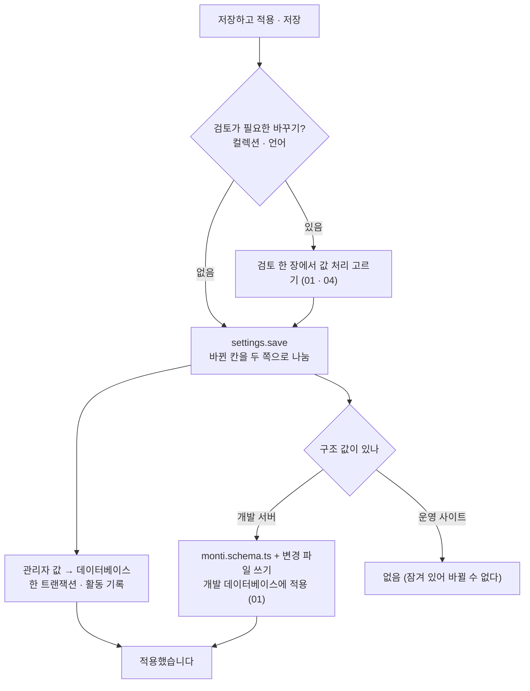

# 12 설정 저장

상태: 승인 (2026-11-11 화면 승인, 2026-11-12 16번 문서의 결정을 옮김). 만드는 중이다.

## 한 문장

설정 화면의 네 탭(사이트, 언어, 컬렉션, 관리자)은 한 초안을 쓰고 한 번에 저장한다. 값마다 구조 값(파일)인지 관리자 값(데이터베이스)인지 정해져 있고, 저장은 그것을 나눠 쓴다. 운영 사이트에서는 구조 값이 잠기고 관리자 값만 고친다.

## 원칙

1. **사이트 코드가 기대는가로 가른다.** 00번 문서의 두 종류의 값을 그대로 따른다. 한 값은 한 곳에만 있다.
2. **네 탭이 한 초안이다.** 탭을 옮겨 다니며 고치고, 머리의 "변경 사항 n"이 모두 센다. 고친 탭 이름에 점이 붙는다(05).
3. **저장 버튼은 하나다.** 개발 서버는 "저장하고 적용", 운영 사이트는 "저장". 저장된 값에 닿는 바꾸기(컬렉션, 언어)는 저장할 때 검토를 거친다(01, 04).
4. **잠긴 것은 잠겼다고 보인다.** 운영 사이트의 구조 값은 그 줄의 자물쇠와 글로 된 값이다. 바꾸려면 개발 서버에서 한다.
5. **읽는 곳이 없는 값은 두지 않는다.** 화면에서 고쳐도 아무것도 바뀌지 않는 값(홈 링크, 다른 호스트 이름, 관리자 주소)은 설정에 없다.

## 쓰는 화면과 흐름

- 기준 화면: `Screens/Reference/Settings` › Settings, SettingsProposal, AdminSettings, Locales, Schema 묶음, `Screens/Reference/Assistant` › CollectionBasics, CollectionEditor.
- 흐름: [흐름 11 · 설정](../admin/flows/11-settings.md)의 04~08, 15~20단계(01~03, 06b, 09~14b, 18은 빠짐), [흐름 2](../admin/flows/02-assistant.md)의 20, 21단계.
- 컬렉션 탭은 01번 문서, 언어 탭은 04번 문서가 정한다. 이 문서는 사이트 탭, 관리자 탭, 그리고 네 탭이 함께 쓰는 저장을 정한다.

## 값마다 어디에

| 탭 | 값 | 어디 | 운영 사이트 |
|---|---|---|---|
| 사이트 | 사이트 이름 | 데이터베이스 | 고친다 |
| 사이트 | 글 쓰는 방식(말투와 규칙) | 데이터베이스 | 고친다 |
| 사이트 | 주소에 언어 표시 | 파일 | 잠김 |
| 언어 | 언어 목록, 원문, 순서 | 파일 | 잠김 |
| 컬렉션 | 01번 문서의 "어디에 사는가" | 둘로 나뉨 | 구조만 잠김 |
| 관리자 | 화면 언어, 본문 템플릿 켜기 | 데이터베이스 | 고친다 |
| 관리자 | 계정(로그인한 이메일, 로그아웃) | 세션 | 로그인한 세션에는 늘 있다(15). 개발 서버가 로그인 없이 들여보낸 세션(16)에는 그리지 않는다 |

- 사이트 이름은 사이드바 맨 위와 로그인 화면에 보인다. 로그인 화면은 로그인 전에 뜨므로 `auth.state`가 사이트 이름과 화면 언어를 함께 준다.
- 관리자 탭의 화면 언어와 기능 스위치는 고르는 대로 바로 저장된다(기준 화면에 저장 묶음이 없다). 그래서 관리자 탭에는 초안에 드는 값이 없고, 탭 이름에 점이 붙을 일도 없다.
- 본문 템플릿을 끄면 `/` 메뉴의 템플릿 묶음과 도구 › 템플릿이 사라진다. 템플릿은 지워지지 않는다(03).
- 16번 문서가 뺀 값: 미리보기 경로, 경로에 언어 넣기, 언어 쿼리(미리보기는 글의 공개 주소에서 보고, 따로 만든 미리보기 페이지의 주소는 컬렉션의 `previewPath`다), 관리자 주소(관리자 페이지 파일이 놓인 폴더가 정한다).

## 저장

- 관리자 값을 먼저, 구조 값을 다음에 쓴다. 구조 값은 01번 문서의 길(파일 쓰기 → 개발 데이터베이스에 변경 파일 적용)을 그대로 간다.
  - 컬렉션의 관리자 값(라벨, 배치)은 지금 적용된 필드 이름으로 먼저 저장하고, 이름을 바꾸거나 지우는 일은 구조 적용이 함께 옮긴다. 그래서 구조 쪽이 실패해도 관리자 값은 지금 구조와 맞는다.
  - 파일을 쓰지 못하면(권한 등) 구조 값의 바뀐 곳은 초안에 남고 띠에 이유와 "다시 저장"이 보인다. 관리자 값은 저장된 채다.
  - 파일은 썼는데 데이터베이스에 적용하지 못하면 화면 맨 위 띠에 "스키마를 데이터베이스에 적용하지 못했습니다 · 다시 적용"이 보인다(흐름 11·20, `schema.retry`).
- 구조를 바꾼 저장은 활동 기록에서 되돌릴 수 없다. 구조는 반대로 고쳐서 되돌린다(00). 구조를 바꾸지 않은 저장은 되돌릴 수 있다: 관리자 값만 든 저장, 구조를 지금 그대로 적어 보낸 저장, 파일을 쓰지 못해 구조가 그대로인 저장이 그렇다. 스키마 레코드는 버전만 있고 되돌리는 대상이 아니다.
- **두 파일은 하나처럼 쓴다.** 변경 파일을 아무도 읽지 않는 이름(`<id>.json.part`)으로 먼저 쓰고(그 변경이 속한 스키마 파일의 지문과 함께), 스키마를 `monti.schema.ts` 옆에 쓴 뒤 한 번에 옮겨 놓고(그래서 파일이 중간에 잘리지 않는다), 변경 파일에 제 이름을 준다. 그 전에 실패하면 스키마 파일을 쓰기 전 글자로 되돌린다. 그래서 "쓰지 못했습니다"는 두 파일 모두 그대로라는 뜻이다. 되돌리지도 못한 드문 경우에는 "쓰지 못함"이라고 하지 않고 저장 전체가 실패한다(서버 로그에 무엇이 남았는지 적힌다). 이름을 옮기는 일만 쓰고 하드 링크는 쓰지 않는다(exFAT나 일부 네트워크 폴더에는 없다). 읽기 전용으로 표시된 스키마 파일은 쓰지 않는다.
  - 쓰는 도중 서버가 죽어 `.part`가 남으면, 다음에 파일을 쓸 때(시작할 때 포함) 정리한다. 스키마 파일이 그 변경이 가리키는 파일이면 변경 파일에 이름을 주어 마저 끝내고, 아니면 지운다. 정리와 쓰기는 데이터베이스의 잠금으로 한 번에 하나만 돈다. 살아 있는 프로세스가 쓰는 중인 `.part`는 아무리 오래 걸려도 남이 정리하지 않는다(01).
  - 파일을 쓴 뒤 저장의 뒤쪽이 실패해 데이터베이스가 되돌아가도 파일은 남는다. 그 상태는 "파일은 저장했고 적용하지 못함"으로 적히고, 화면 맨 위의 "다시 적용"으로 잇는다. 데이터베이스가 따르지 않은 변경 파일은 개발 서버가 시작할 때 그 단계대로 적용한다. 손으로 고친 파일로 읽지 않는다(이름 바꾸기를 지우기와 더하기로 읽으면 검토의 답이 사라진다).
- **처음 저장도 버전을 건다.** 관리자 값이 아직 없는 컬렉션은 버전 0이다. 그 사이 다른 탭이 값을 만들었으면(버전 1) 충돌이고, 덮어쓰지 않는다. 사이트 값과 관리자 설정도 같다.
- **이벤트.** 구조가 데이터베이스에 적용되면 `schema.applied`를 낸다(`schema.retry`로 뒤늦게 적용될 때도). `paths`에는 주소가 바뀐 발행본의 옛 주소와 새 주소, 언어나 컬렉션과 함께 사이트에서 빠진 발행본의 옛 주소가 든다. 주소의 언어 표시나 컬렉션 주소가 바뀌면 사이트가 옛 페이지를 계속 내보내지 않게 하려는 것이다(16). 관리자 값이 저장되면 `settings.saved`를 낸다(`ids`는 `site`와 컬렉션 이름, 주소는 없다). 옮겨진 주소가 1000개를 넘으면 목록 대신 `allPaths: true`를 싣고, 주소가 움직일 수 없는 변경에서는 발행본을 읽지 않는다. 운영 사이트의 `monti db:migrate`는 이 이벤트를 내지 않는다: 배포가 페이지를 새로 만든다(13).
- 화면을 연 뒤에 파일이 바뀌면(흐름 11·19) 검토 맨 위에 "monti.schema.ts가 바뀌었습니다"와 "다시 불러오기"가 뜬다. 관리자 값은 버전으로 충돌을 막는다(00).
- 저장이 거절되면 이유를 토스트로만 알리지 않고 띠에 남긴다. 띠에는 이유 한 줄과 할 일 하나("다시 불러오기", "다시 저장")가 있고 풀릴 때까지 남는다. 검토가 열려 있으면 이유는 검토 맨 위에 보인다(T50). 띠의 자리는 화면 맨 위다: 화면의 띠는 모두 맨 위 한 자리에 선다(common.md, 2026-11-06). 화면 승인(2026-11-11)의 "탭 아래"는 그 규칙과 어긋나 다시 맨 위로 정했다(소유자, 2026-11-12: "우리 정한거 아니었어? 이런 알림은 페이지 최상단에 두는 형태로 쓰겠다고? 왜 그걸 어겨?"). 화면은 `PageBanner`로 그 자리에 놓는다(T138). 띠는 다음 저장의 답이 올 때까지 남는다(2026-11-12): 다시 저장하는 동안 사라졌다가 돌아오지 않고, 답이 오면 그때 새 이유로 바뀌거나 사라진다. 그 사이 페이지가 위아래로 움직이지 않는다. 검토 안에서 한 저장이 거절되면 그 이유는 검토 맨 위에 보이고, 검토를 닫으면 띠로 온다. 검토를 열기 전부터 있던 띠는 검토 아래에 그대로 있다.
- 관리자 탭의 값(화면 언어, 본문 템플릿)은 바로 저장되므로, 저장이 거절되면 띠가 아니라 그 칸 아래 한 줄로 남는다(칸 하나의 문제는 그 옆 한 줄이다, status.md).
- 나가기 확인, 칸마다 되돌리기, 변경 사항 목록은 05번 문서의 초안이 한다.

## 개발 서버인지 아는 법

- 서버가 개발 모드로 돌고(`next dev`) 프로젝트의 `monti.schema.ts`에 쓸 수 있으면 개발 서버다. 그 밖은 모두 운영 사이트다(16).
- `monti.schema.ts`는 순수한 값이어야 한다. 개발 서버에서는 구조 값을 늘 고칠 수 있고, 코드가 섞인 파일을 따로 잠그는 상태는 없다.

## 기능 목록

| 기능 | 종류 | 하는 일 |
|---|---|---|
| `settings.read` | read | 네 탭의 값, 값마다 어디에 있는지와 잠겼는지, 파일 해시, 관리자 값 버전 |
| `settings.save` | write | 바뀐 칸을 받아 관리자 값과 구조 값으로 나눠 저장. 검토가 필요한 바꾸기는 그 처리를 함께 받는다 |
| `admin.setPreference` | write | 화면 언어, 기능 스위치. 바로 저장 |

- `settings.save`는 사이트 값(`site`), 언어(`locales`), 컬렉션의 구조(`collections`, `renames`), 검토의 답(`answers`), 컬렉션의 관리자 값(`adminValues`)을 한 번에 받는다.
- `adminValues`는 바꿀 것만 적는다(`collections.updateAdminValues`도 같다, 01). 준 키만 바뀌고, 주지 않은 키는 저장된 그대로며, `null`은 그 키를 비운다. 필드는 필드마다, 키마다 그렇다. "라벨만 바꿔 줘"는 `{ label }`이고 다른 필드의 설명이나 배치, 편집기 허용은 건드리지 않는다. 화면도 사람이 바꾼 키만 보내므로, 그 사이 다른 탭이 저장한 다른 키를 덮어쓰지 않는다. 제안도 준 키만 파랗게 그린다.
- 바뀌는 것이 없는 저장(저장된 값과 같은 것만 적은 저장, `site: {}`)은 거절한다(`settings.nothingToSave`). 쓰는 것도, 활동 기록 줄도, 이벤트도 없다. 일부만 바뀌면 바뀐 쪽만 쓰고 이벤트에도 그쪽만 든다.
- `admin.setPreference`는 사람만 한다. 관리자 탭의 값은 초안 없이 바로 저장되어 제안을 그릴 자리도 받을 자리도 없고, 관리자 자신의 화면에 대한 설정이다. 어시스턴트 도구에 없다(10). 관리자는 한 명이라(15) 화면 언어와 기능 스위치는 한 줄(`admin`)에 저장한다. 안에서 `schema.apply`(01)와 `locales.apply`(04)가 쓰는 길을 그대로 간다. 화면은 저장 한 번만 한다.
- 운영 사이트에서 `locales`나 `collections`가 든 `settings.save`는 통째로 거절된다. 관리자 값만 든 저장은 된다.
- `auth.state`(15)가 사이트 이름과 화면 언어를 함께 준다.
- `locales.plan`(04)이 주소의 언어 표시 방식 바꾸기(`changePrefix`)도 변경으로 준다.

## 에이전트

- **읽기:** `settings.read`로 지금 설정과 잠긴 것을 안다. 글 쓰는 방식은 실행마다 맥락으로 들어간다(10).
- **쓰기:** "사이트 이름을 바꿔 줘"는 `settings.save` 제안이다. 설정 화면에 파란 표시로 보이고, 받으면 저장 전 변경이 되어 "저장하고 적용"으로 저장한다(흐름 2·21, 05).
- **운영 사이트:** 잠긴 구조 값의 제안은 만들지 않는다. "개발 서버에서 바꿔야 해요"라고 답한다. 관리자 값은 제안할 수 있다.

## 화면 쪽 조각

- `useSettingsDraft()`: 네 탭이 함께 쓰는 05번 문서의 초안. 탭마다 바뀐 점, 잠긴 칸, 저장 버튼 라벨.
- `LockMark`, `ChangesGroup`, `LanguageRow`: 이미 있는 부품.

## 결정 기록

- 2026-11-05, 소유자(00, 01): 값은 사이트 코드가 기대는가로 가른다. 운영 사이트에서 구조 값은 늘 잠기고 PR 길은 없다.
- 2026-11-05: 사이트 이름은 관리자 값이다. 운영 사이트에서 바로 고친다(흐름 11·15b).
- 2026-11-05: 관리자 탭의 화면 언어와 기능 스위치는 초안 없이 바로 저장된다. 기준 화면에 저장 묶음이 없다.
- 2026-11-05: 한 번의 저장은 관리자 값을 먼저, 구조 값을 다음에 쓴다. 구조 값의 데이터베이스 적용 실패는 "다시 적용"으로 잇는다.
- 2026-11-12(16): 미리보기 경로, 경로에 언어 넣기, 언어 쿼리를 설정에서 뺀다. 미리보기는 글의 공개 주소에서 본다(소유자, 2026-11-12: "그렇게 하자. 다만 항목 같은건 빼야겠지 콘텐츠만으로..."). 관리자 주소도 뺀다: 폴더가 정한다(만들며 정함, 2026-11-12). 관리자 주소가 빠져 관리자 탭에는 초안에 드는 값이 없다. T28(미리보기 주소에 설정의 미리보기 경로 붙이기)은 그만둔다.
- 2026-11-12: 구조 값이 든 `settings.save`는 통째로 되돌릴 수 없는 저장으로 적는다. 같은 저장의 관리자 값만 되돌리면 이름을 바꾼 필드의 라벨이 옛 이름으로 돌아가 구조와 어긋난다.
- 2026-11-12: 사이드바와 로그인 화면의 사이트 이름, 화면 언어는 `auth.state`가 준다(T36). 로그인 전에도 읽혀야 하기 때문이다.
- 2026-11-12(#471 리뷰): 원문 언어를 바꾸면서 옛 원문 언어를 빼는 저장은 원문 바꾸기를 먼저 한다. 새 원문 초안은 옛 원문 글에서 만들기 때문이다(04). 변경 파일의 단계도 그 순서라 운영 데이터베이스도 같은 순서로 따른다.
- 2026-11-12(#471 두 번째 리뷰): 단계의 순서는 컬렉션의 단계(필드 이름 바꾸기, 지우기, 채우기) → 원문 바꾸기 → 언어 빼기다. 새 원문은 그 초안에 있는 필드 이름만 가지고 만들어지므로, 이름을 바꾸거나 다른 필드로 옮긴 값이 새 이름 아래 있은 뒤에 원문을 바꿔야 값이 따라온다.
- 2026-11-12(#471 세 번째 리뷰): 저장은 적어 보낸 값의 레코드를 모두 먼저 붙든다(사이트 값, 적은 컬렉션의 관리자 값, 구조). 지금 저장된 값과 같아 쓸 것이 없어 보여도 붙들고 버전을 견준다. 붙든 뒤에 무엇을 쓸지 정하므로, 그 사이 다른 저장이 바꾼 값을 옛 값으로 덮어쓰지 않는다. 구조를 바꾸는 저장은 모든 컬렉션의 관리자 값도 붙든다(00의 `holds`): 필드 이름만 바꾸는 저장이 도는 사이 목록에서 끌어 맞춘 열 너비가 사라지지 않는다.
- 2026-11-12(#471 세 번째 리뷰): 밀린 변경 파일은 그 파일이 적어 둔 스키마까지만 적용한다. 그 뒤 손으로 고친 것은 따로 검토한다(01). 파일을 쓰는 일과 쓰다 만 것을 정리하는 일은 잠금으로 한 번에 하나만 돈다(01).
- 2026-11-12(#471 네 번째 리뷰): 그 잠금을 파일(`monti/changes/.lock`)에서 데이터베이스의 권고 잠금으로 바꿨다. 잠금 파일은 쥔 쪽이 죽었는지를 지난 시간으로 짐작해야 했고, 그래서 멈춰 서 있던 저장의 변경을 남이 마저 끝내거나, 두 프로세스가 같은 죽은 잠금을 넘겨받다가 새 잠금을 지우는 일이 있었다. 데이터베이스의 잠금은 쥔 연결이 끝나야 풀리므로 짐작할 것이 없다. 오래 쥐고 있으면 기다리는 쪽이 "스키마 파일을 다른 곳에서 쓰고 있습니다"로 거절될 뿐, 넘겨받지 않는다(01). 구조를 바꾸는 저장이 이렇게 거절되면 같은 저장의 관리자 값도 저장되지 않는다. 파일을 쓸 수 없는 것이 아니라 잠깐 바쁜 것이어서, "다시 저장"이 그대로 통한다.
- 2026-11-12, 소유자에게 알림: 개발 서버가 로그인 없이 들여보낸 세션(`auth.state`의 `session.bypass`, 16)에서는 관리자 탭의 "계정" 절을 그리지 않는다. 계정이 없어 "dev"라는 이름은 아무것도 알려 주지 않고, 로그아웃해도 곧바로 다시 들어와져 남는 것이 없다. 사이드바에도 건너뛰었다는 줄은 없다(16).
- 2026-11-12(16을 합치며): 컬렉션의 "미리보기 주소"(16)는 설정의 한 초안에 든 구조 값이다. 운영 사이트에서는 잠긴 글로 읽는다. 주소의 문제(겹치는 주소, 모양이 틀린 주소, 공개 주소와 같은 미리보기 주소)는 기본 탭의 그 칸 아래에 까닭이 보이고, 검토 "고칠 곳"의 그 줄에 있는 "열기"가 그 칸으로 간다(T151). 설정의 흐름 테스트는 예제 앱에서 돈다(`testing/e2e/settings.e2e.ts`, 16).
- 2026-11-12(#471 다섯 번째 리뷰): 데이터베이스 잠금만으로는 모자랐다. 연결이 끊기면 잠금은 풀리는데 프로세스는 살아서 파일을 계속 쓴다. 그 사이 다른 쪽이 쓰다 만 변경을 마저 끝내면, 되살아난 쪽이 실패하면서 옛 스키마를 그 위에 되돌려 놓는다. 그래서 파일 옆에 주인 표시(`monti/changes/.owner.<pid>.<토큰>.<호스트>`)를 둔다. 잠금은 세션을 줄 세우고, 표시는 프로세스가 파일에서 일하는 동안 남는다. 표시의 주인이 살아 있으면 다음에 온 쪽은 "스키마 파일을 다른 곳에서 쓰고 있습니다"로 거절되고, 주인의 프로세스가 없을 때만 표시를 지우고 정리한다. 가려내지 못하는 것은 둘이다: 충돌 뒤 같은 프로세스 번호를 받은 다른 프로그램, 그리고 다른 컴퓨터의 표시. 둘 다 "쓰는 중"으로 읽혀 표시 파일을 손으로 지울 때까지 바쁘다고 답한다(서버 로그가 파일 이름을 알려 준다). 잠금의 열쇠는 검색 경로의 첫 스키마가 아니라 구조를 적는 표(`schema_state`)다. 기다리는 10초는 벽시계가 아니라 뒤로 가지 않는 시계로 잰다(01).
- 2026-11-12 만들며 정함(T180): 제안이 남은 채 저장하면 "저장했습니다" 토스트가 제안 말풍선 위에 겹쳐 "모두 받기"를 누를 수 없었다. 말풍선이 보이는 동안 토스트는 말풍선 위 12px에 선다(status.md). 설정만의 일이 아니라 `Toaster`가 한다.
- 2026-11-12(#471 다섯 번째 리뷰): 일하는 중인 버튼은 누름을 내려가는 길에서 막는다. `render`로 넘긴 버튼이나 라우터 링크의 제 핸들러가 먼저 돌던 것을 막으려는 것이다(button.md).
- 2026-11-12(#471 다섯 번째 리뷰): 주소 두 칸(공개 주소, 미리보기 주소)도 다른 칸처럼 제안을 그 칸에 보인다(파란 값, "버리기", 아래에 저장된 값). 바뀐 미리보기 주소의 변경 사항 행과 제안 말풍선은 기본 탭의 그 칸으로 간다. 두 컬렉션이 한 공개 주소나 한 미리보기 주소를 쓸 때 까닭은 두 쪽 칸 모두에 보이고, 검토의 "열기"는 이 초안에서 주소를 바꾼 컬렉션을 연다. 둘 다 바꿨거나 둘 다 안 바꿨으면 목록에서 먼저 나오는 쪽이다.
- 2026-11-12(#473 화면 확인): 틀의 "파일이 바뀌었습니다 · 검토"를 설정 화면에서 누르면 저장하지 않은 것이 있어도 나가기를 묻지 않는다. 검토는 같은 화면에서 열리고 초안은 그대로다.
- 2026-11-13(#472와 합치며, T145): "글 쓰는 방식"의 값 이름은 `writingStyle`이다(`settings.read`의 `site.writingStyle`, `settings.save`의 `site.writingStyle`). 어시스턴트(10)가 그 이름으로 읽는다. 설정의 마이그레이션은 `0018_settings`다(`0016`은 어시스턴트, `0017`은 활동 기록).
- 2026-11-13(#474와 합치며, T156 · T158 · T159): 저장 묶음의 포커스 넘김은 화면의 효과가 아니라 `useFocusHandOff`가 한다. 키보드가 쥔 포커스만 넘기고, 포인터로 누르거나 칸의 "되돌리기"를 눌러 묶음이 사라질 때는 아무것도 옮기지 않는다.
- 2026-11-12 만들며 정함(tokens.md의 상태): 저장 묶음이 통째로 사라질 때("모두 되돌리기", "저장하고 적용", 변경 사항 목록의 마지막 "되돌리기") 포커스는 페이지로 떨어지지 않고 지금 열린 탭의 이름으로 간다. 저장 묶음이 다루던 것이 그 탭들의 초안이고, 묶음 안에는 남는 것이 없기 때문이다. 포커스가 이미 다른 곳(칸)에 있으면 건드리지 않는다.
- 2026-11-12(#471 여섯 번째 리뷰): 저장 거절 띠("다시 저장")는 저장하지 못한 변경에 대한 것이다. 변경을 모두 되돌리면 저장할 것이 없으므로 띠도 함께 사라진다. "다시 불러오기" 띠는 다른 곳에서 저장된 것에 대한 것이라 남는다. 개발 서버의 로그인 건너뛰기에서 표를 내는 호출은 3초를 기다리고, 답이 없으면 로그인 화면을 보인다. 쓰다 실패한 쪽이 제 표시가 있는지는 폴더를 읽지 않고 그 파일을 직접 물어 안다(폴더를 읽지 못해도 제가 남긴 것을 치운다).
- 2026-11-13(#471 화면 확인): 검토에서 "적용"을 키보드로 누르면 시트와 저장 묶음이 함께 사라진다. 포커스는 열린 탭의 이름으로 간다(시트의 `finalFocus`). 칸의 "되돌리기"를 키보드로 눌러 그 줄이 사라지면 포커스는 그 칸으로 간다. 포인터로 누르면 아무것도 옮기지 않는다.
- 2026-11-12(#471 네 번째 리뷰): 관리자 탭에서 저장되지 않은 선택(화면 언어, 기능 스위치)의 까닭은 다른 탭에 다녀와도 그 칸 아래에 남는다. 다음 선택이 저장되어야 사라진다.
- 2026-11-12(#471 네 번째 리뷰): 일하는 중인 버튼(저장 알약, "다시 저장")은 포커스를 그대로 가진다. `Button`, `TextButton`, `SplitButton`이 `loading`인 동안 `disabled` 속성 대신 `aria-disabled`를 쓴다. 저장 묶음의 `saveDisabled`는 쓰는 곳이 없어 없앴다.
- 2026-11-12(#471 세 번째 리뷰): 설정 초안의 버전은 초안이 고치는 자리의 저장된 값으로 잰다. 관리자 값이 아직 없는 컬렉션, 목록의 모양만 있는 컬렉션, 기본값 그대로인 컬렉션은 같은 버전이다.
- 2026-11-12(#471 두 번째 리뷰): 언어의 문제(원문 언어가 목록에 없음 등)도 컬렉션의 문제처럼 검토의 "고칠 곳"에 보이고, 그 줄의 "열기"가 언어 탭으로 간다. 빠진 언어가 원문이 된 행에는 "바꾸기" 대신 "되돌리기"가 있다.
- 2026-11-12(#471 리뷰): 컬렉션 이름으로 쓸 수 없는 이름에 `admin`, `session`, `settings`를 더했다. 컬렉션의 읽기 뷰는 `monti_<컬렉션>`이라 core의 표 `monti_admin`, `monti_session`, `monti_settings`와 부딪친다. 테이블 목록과 이 이름들이 맞는지는 테스트가 본다.
- 2026-11-12(#471 리뷰): 컬렉션의 관리자 값만 바꾸는 제안(`collections.updateAdminValues`, `adminValues`만 든 `settings.save`)도 설정 화면에 보인다. 화면은 컬렉션마다 관리자 값 레코드에 걸린 제안을 함께 읽는다(05의 `proposals.forTarget`).

## 화면 승인 (2026-11-11)

코드를 쓰기 전에 목업으로 빈 곳을 정했다.

정해진 것(소유자):

- 사이트 탭에서 홈 링크, 다른 호스트 이름, 사이트 URL을 뺀다. 읽는 곳이 없다.
- 컬렉션과 언어를 함께 고쳤으면 검토는 한 장이다. 지워지는 것이 있으면 빨간 "지우고 적용", 없으면 "적용". 사이트 이름만 고쳤으면 검토 없이 저장한다.
- 읽기 전용 편집기(보관 글, 휴지통 글)의 미디어 칸은 값을 바꾸는 것이 없다: 줄은 버튼이 아니고 ×가 없으며 손 모양과 호버 색도 없다. 설정 카드는 읽기 전용으로 열려 대체 텍스트를 읽을 수 있다. 버튼을 없앤다는 것이 읽는 길까지 없앤다는 뜻이 아니다(T125).
- 저장이 거절되면 이유를 토스트로만 알리지 않고 탭 아래 띠에 남긴다. 띠에는 이유 한 줄과 할 일 하나("다시 불러오기", "다시 저장", "다시 적용")가 있고 풀릴 때까지 남는다. 컬렉션 탭도 같다(T50). 자리는 2026-11-12에 화면 맨 위로 바뀌었다("저장" 절).
- 시간대 칸은 두지 않는다. 저장하는 시각은 시간대와 상관없는 한 순간이고(`timestamptz`), 관리자 화면은 지금처럼 보는 사람의 브라우저 시간대로 보인다. 명령과 에이전트는 호출할 때 시간대를 넘기고, 넘기지 않으면 UTC다. 언어 탭에는 언어 목록만 남는다.
- 칸 아래에 결과 주소를 보이는 설명 줄은 두지 않는다.
- "+ 언어 추가"는 코드 찾기만 둔다. 직접 입력 창과 저장하는 표시 이름은 없다. 목록에 없는 코드는 개발자가 `monti.schema.ts`에 적는다.
- "번역" 스위치는 두지 않는다. 언어가 둘 이상이면 번역을 쓰는 것이다(T93을 그만둔다).
- 개발 서버에서는 구조 값을 늘 고칠 수 있다. `monti.schema.ts`에 코드가 섞인 경우를 잠그는 상태는 두지 않고, 그 파일은 순수한 값이어야 한다고 정한다.

그 뒤에 정해진 것:

- 관리자 주소(2026-11-12, 16번 문서): 폴더가 정하고 설정에 두지 않는다.

## 소유자 확인을 기다리는 곳 (2026-11-12)

화면 승인이 말하지 않았거나 16번 문서가 값을 빼면서 빈 곳이다. 코드에는 아래의 추천대로 들어가 있고, 소유자가 화면을 보고 정하면 이 절을 "화면 승인"으로 옮긴다. 각각 문구 한 줄이나 갈래 하나라 바꾸기 쉽다.

1. **사이트 탭의 절 이름.** "이름과 링크"에서 링크가 빠졌다. 지금: "이름"(사이트 이름), "글 쓰는 방식"(말투와 규칙), "공개 주소"(주소에 언어 표시).
2. **글 쓰는 방식을 지금 두는가.** 읽는 쪽(어시스턴트)은 10번에서 생긴다. 16번의 "남는 것"에는 없고 이 문서의 표에는 있다. 지금: 둔다.
3. **"주소에 언어 표시"의 값 이름과 검토.** 지금: "항상" · "원문 언어만 빼고" · "안 함". 바꾸면 번역 글의 주소가 모두 바뀌므로 검토에 "주소 변경" 블록("옛 주소는 404가 됩니다.")으로 나온다. 다른 길: 사이트 이름처럼 검토 없이 저장.
4. **검토의 언어 블록 문구.** 추가 "저장된 데이터는 바뀌지 않습니다.", 삭제 "번역이 함께 지워집니다."(화면 지도의 태그 "뺌"은 낱말 표대로 "삭제"), 원문 변경은 전 · 후와 "이 언어 글이 없는 n편에 초안이 생깁니다." 한 장에서 언어가 먼저, 컬렉션이 다음.
5. **순서만 바꾼 저장.** 검토에 올릴 것이 없어 검토 없이 저장한다.
6. **뺀 언어의 행.** 취소선 행 끝에 × 대신 "되돌리기". 이 초안에서 더한 언어를 ×하면 그냥 사라진다.
7. **언어 탭의 제안.** 제안된 언어 행에 파란 점(필드 목록의 "✦ 제안"과 같은 뜻), 제안 버블이 탭을 넘나들며 그 자리를 연다.
8. **저장된 이름과 화면 언어가 없을 때.** 지금: 사이트 코드가 준 이름이 보이고, 이름 칸의 플레이스홀더도 그 이름이다. 16번의 `AdminPage`는 `siteName`만 준다(주지 않으면 "Monti", 예제 앱은 "Monti 블로그"). 화면 언어는 사이트 코드가 주지 않아, 저장된 것이 없으면 한국어다.
9. **데이터베이스 적용 실패의 자리.** 화면 승인은 띠의 할 일로 "다시 적용"도 들었다. 모든 화면 맨 위에 이미 "스키마를 데이터베이스에 적용하지 못했습니다 · 다시 적용" 띠(T16)가 있어, 탭 아래에 같은 말을 또 두지 않았다. 지금: 맨 위 띠 하나.
10. **본문 템플릿을 껐을 때의 범위.** 03번 문서의 두 곳(`/` 메뉴, 도구)에 더해 새 글 메뉴의 "템플릿으로 쓰기"도 숨긴다. 도구에 템플릿뿐인 지금은 끄면 도구 화면에 제목만 남는다. 13번이 탭을 더하면 채워진다. 도구에는 탭이 하나(API 키)만 남으므로 탭 줄이 없고, 사이드바의 "도구"와 템플릿의 주소가 모두 API 키를 연다(03, tools.md의 도구 틀).
11. **언어 찾기.** 빈 결과는 "맞는 언어가 없습니다." 목록은 코드 95개(언어와 흔한 지역 · 문자 변형)이고 이름은 브라우저가 준다. 행은 원어 이름 · 화면 언어로 쓴 이름 · 끝에 코드다(편집기의 "+ 언어" 메뉴와 같은 순서).
12. **사이드바의 "설정"이 여는 탭.** 지금: 첫 탭인 사이트(전에는 탭이 컬렉션 하나였다).

이 문서를 "끝"으로 바꾸려면 "5단계 전"인 일이 먼저 끝나야 한다(`check:operations`): T133(읽기 전용 본문에 키보드로 닿기, #475)과 T181(잘린 글자를 온전히 말하는 부품 하나). T132(좁은 화면)는 그만둔 일로 갔다.

## 끝 조건

- **12-1** 흐름 11의 04~08, 15~20단계(09~14b, 18 빼고)가 이 기능 목록과 01, 04, 05번 문서만으로 된다.
- **12-2** 어느 값을 고쳐도 그 값이 사는 한 곳에만 쓰인다.
- **12-3** 운영 사이트에서 어떤 입구로도 구조 값이 바뀌지 않는다.
- **12-4** 구조 값 쓰기가 실패해도 관리자 값 저장은 잃지 않고, 데이터베이스 적용 실패는 "다시 적용"으로 이어진다.
