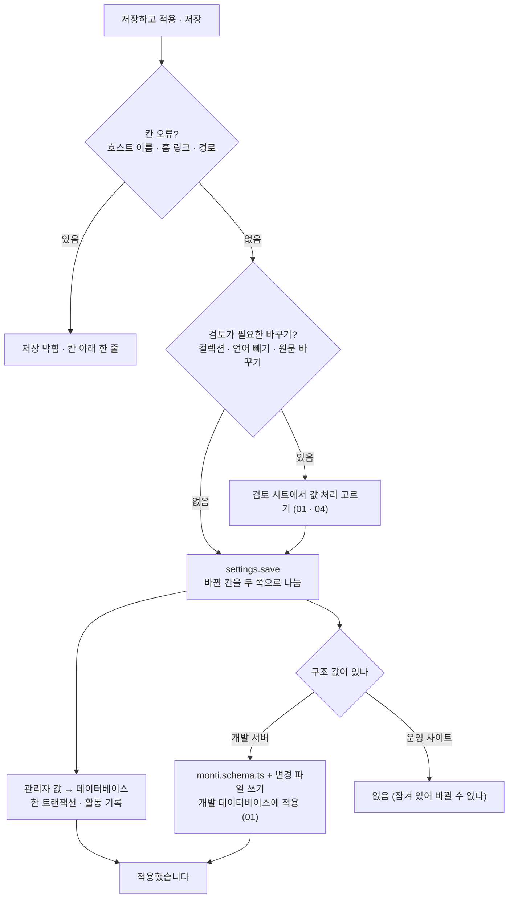

# 12 설정 저장

상태: 초안 (2026-11-05). 정할 것이 없다.

## 한 문장

설정 화면의 네 탭(사이트, 언어, 컬렉션, 관리자)은 한 초안을 쓰고 한 번에 저장한다. 값마다 구조 값(파일)인지 관리자 값(데이터베이스)인지 정해져 있고, 저장은 그것을 나눠 쓴다. 운영 사이트에서는 구조 값이 잠기고 관리자 값만 고친다.

## 원칙

1. **사이트 코드가 기대는가로 가른다.** 00번 문서의 두 종류의 값을 그대로 따른다. 한 값은 한 곳에만 있다.
2. **네 탭이 한 초안이다.** 탭을 옮겨 다니며 고치고, 머리의 "바뀐 곳 n"이 모두 센다. 고친 탭 이름에 점이 붙는다(05).
3. **저장 버튼은 하나다.** 개발 서버는 "저장하고 적용", 운영 사이트는 "저장". 값에 영향이 큰 바꾸기(컬렉션, 언어 빼기)는 저장할 때 검토를 거친다(01, 04).
4. **잠긴 것은 잠겼다고 보인다.** 운영 사이트의 구조 값은 절 제목 뒤 자물쇠와 글로 된 값이다. 바꾸려면 개발 서버에서 한다.

## 쓰는 화면과 흐름

- 기준 화면: `Screens/Reference/Settings` › Settings, SettingsProposal, AdminSettings, Locales, Schema 묶음, `Screens/Reference/Assistant` › CollectionBasics, CollectionEditor.
- 흐름: [흐름 11 · 설정](../admin/flows/11-settings.md)의 01~08, 15~20단계(09~14b는 빠짐), [흐름 2](../admin/flows/02-assistant.md)의 20, 21단계.
- 컬렉션 탭은 01번 문서, 언어 탭은 04번 문서가 정한다. 이 문서는 사이트 탭, 관리자 탭, 그리고 네 탭이 함께 쓰는 저장을 정한다.

## 값마다 어디에

| 탭 | 값 | 어디 | 운영 사이트 |
|---|---|---|---|
| 사이트 | 사이트 이름 | 데이터베이스 | 고친다 |
| 사이트 | 홈 링크 | 데이터베이스 | 고친다 |
| 사이트 | 다른 호스트 이름 | 데이터베이스 | 고친다 |
| 사이트 | 글 쓰는 방식(말투와 규칙) | 데이터베이스 | 고친다 |
| 사이트 | 미리보기 경로, 경로에 언어 넣기, 언어 쿼리 | 파일 | 잠김 |
| 사이트 | 주소에 언어 표시 | 파일 | 잠김 |
| 사이트 | 사이트 URL | 배포 환경의 `SITE_URL` | 보기만 |
| 언어 | 언어 목록, 원문, 순서 | 파일 | 잠김 |
| 언어 | 언어 표시 이름, 시간대 | 데이터베이스 | 고친다 |
| 컬렉션 | 01번 문서의 "어디에 사는가" | 둘로 나뉨 | 구조만 잠김 |
| 관리자 | 화면 언어, 본문 템플릿 켜기, 번역 켜기 | 데이터베이스 | 고친다 |
| 관리자 | 관리자 주소 | 파일 | 잠김 |
| 관리자 | 계정(로그인한 이메일, 로그아웃) | 세션 | 늘 있다(15) |

- 사이트 URL은 배포하는 곳의 환경 변수다. 비어 있으면 "설정되지 않았어요. 배포하는 곳에 `SITE_URL`을 넣어 주세요."만 보인다.
- 관리자 탭의 화면 언어와 기능 스위치는 고르는 대로 바로 저장된다(기준 화면에 저장 묶음이 없다). 관리자 주소만 초안을 거친다.

## 저장

- 관리자 값을 먼저, 구조 값을 다음에 쓴다. 구조 값은 01번 문서의 길(파일 쓰기 → 개발 데이터베이스에 변경 파일 적용)을 그대로 간다.
  - 파일을 쓰지 못하면(권한 등) 구조 값의 바뀐 곳은 초안에 남고 오류 한 줄이 보인다. 관리자 값은 저장된 채다.
  - 파일은 썼는데 데이터베이스에 적용하지 못하면 "파일은 저장했습니다 · 데이터베이스에 적용하지 못했어요 · 다시 적용"이 보인다(흐름 11·20, `schema.retry`).
- 화면을 연 뒤에 파일이 바뀌면(흐름 11·19) 구조 값 쪽 칸 위에 "monti.schema.ts가 바뀌었어요 · 다시 불러오기"가 뜬다. 관리자 값은 버전으로 충돌을 막는다(00).
- 나가기 확인, 칸마다 되돌리기, 바뀐 곳 목록은 05번 문서의 초안이 한다.

## 개발 서버인지 아는 법

- 서버가 개발 모드로 돌고(`next dev`) 프로젝트의 `monti.schema.ts`에 쓸 수 있으면 개발 서버다. 그 밖은 모두 운영 사이트다.
- 개발 서버에서 `monti.schema.ts`가 순수한 값이 아니면(함수나 import로 값을 만들면) 화면이 그 파일을 고칠 수 없다. 그때는 운영 사이트처럼 잠기고, 자물쇠 옆에 "파일을 직접 고쳐 주세요"가 보인다.

## 기능 목록

| 기능 | 종류 | 하는 일 |
|---|---|---|
| `settings.read` | read | 네 탭의 값, 값마다 어디에 있는지와 잠겼는지, 파일 해시, 관리자 값 버전 |
| `settings.save` | write | 바뀐 칸을 받아 관리자 값과 구조 값으로 나눠 저장. 검토가 필요한 바꾸기는 그 처리를 함께 받는다 |
| `admin.setPreference` | write | 화면 언어, 기능 스위치. 바로 저장 |

- 컬렉션 탭의 저장은 `settings.save`가 `schema.apply`(01)를, 언어 빼기는 `locales.apply`(04)를 안에서 부른다. 화면은 저장 한 번만 한다.

## 에이전트

- **읽기:** `settings.read`로 지금 설정과 잠긴 것을 안다. 글 쓰는 방식은 실행마다 맥락으로 들어간다(10).
- **쓰기:** "미리보기 경로를 draft로 바꿔 줘"는 `settings.save` 제안이다. 설정 화면에 파란 표시로 보이고, 받으면 저장 전 변경이 되어 "저장하고 적용"으로 저장한다(흐름 2·21, 05).
- **운영 사이트:** 잠긴 구조 값의 제안은 만들지 않는다. "개발 서버에서 바꿔야 해요"라고 답한다. 관리자 값은 제안할 수 있다.

## 화면 쪽 조각

- `useSettingsDraft()`: 네 탭이 함께 쓰는 05번 문서의 초안. 탭마다 바뀐 점, 잠긴 칸, 저장 버튼 라벨.
- `LockMark`, `Affix`, `ChangesGroup`: 이미 있는 부품.

## 결정 기록

- 2026-11-05, 소유자(00, 01): 값은 사이트 코드가 기대는가로 가른다. 운영 사이트에서 구조 값은 늘 잠기고 PR 길은 없다.
- 2026-11-05: 사이트 이름, 홈 링크, 다른 호스트 이름은 관리자 값이다. 운영 사이트에서 바로 고친다(흐름 11·15, 15b).
- 2026-11-05: 관리자 탭의 화면 언어와 기능 스위치는 초안 없이 바로 저장된다. 기준 화면에 저장 묶음이 없다.
- 2026-11-05: 한 번의 저장은 관리자 값을 먼저, 구조 값을 다음에 쓴다. 구조 값의 데이터베이스 적용 실패는 "다시 적용"으로 잇는다.
- 2026-11-05: `monti.schema.ts`가 순수한 값이 아니면 개발 서버에서도 화면에서 고치지 않는다(2026-10-13 결정을 잇는다).

## 끝 조건

- 흐름 11의 01~08, 15~20단계가 이 기능 목록과 01, 04, 05번 문서만으로 된다.
- 어느 값을 고쳐도 그 값이 사는 한 곳에만 쓰인다.
- 운영 사이트에서 어떤 입구로도 구조 값이 바뀌지 않는다.
- 구조 값 쓰기가 실패해도 관리자 값 저장은 잃지 않고, 데이터베이스 적용 실패는 "다시 적용"으로 이어진다.
