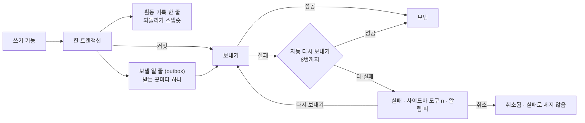

# 13 활동 기록과 전송

상태: 초안 (2026-11-05). 결정은 모두 정해졌다.

## 한 문장

모든 쓰기는 활동 기록에 한 줄을 남기고, 사이트 밖에 알려야 할 일(발행, 휴지통 등)은 커밋된 뒤 받는 곳마다 전송된다. 실패한 전송은 활동 기록에서 보고 다시 보내거나 취소한다.

## 원칙

1. **기록은 쓰기와 같은 트랜잭션에 있다.** 쓰기가 되면 기록도 있고, 쓰기가 안 되면 기록도 없다(00).
2. **전송은 커밋 뒤에만.** 보낼 일은 같은 트랜잭션에서 줄(outbox)에 넣고, 커밋된 뒤에 보낸다. 롤백된 쓰기는 아무 데도 알리지 않는다.
3. **실패는 숨기지 않는다.** 정해진 횟수까지 저절로 다시 보내고, 그래도 안 되면 실패로 남긴다. 사이드바의 "도구 n"과 활동 기록의 알림 띠가 실패 수를 보인다.
4. **받는 곳은 코드에 있다.** 웹훅 주소와 플러그인의 커밋 뒤 고리는 사이트 코드(설정 파일, 플러그인)가 정한다. 받는 곳이 없는 사이트는 기록만 보인다.

## 쓰는 화면과 흐름

- 기준 화면: `Screens/Reference/Lists` › Events, Sidebar(도구 개수).
- 흐름: [흐름 12 · 활동 기록](../admin/flows/12-activity-log.md) 전부, [흐름 2](../admin/flows/02-assistant.md)의 17, 18단계, [흐름 9](../admin/flows/09-data.md)의 가져오기 기록.
- 기록 줄의 모양은 [00-foundation.md](00-foundation.md#활동-기록)의 `ActivityRow`다.

## 모양



```ts
type Delivery = {
  id: string;
  activityId: string;
  destination: string;            // "webhook:https://example.dev/api/revalidate", "plugin:algolia"
  event: MontiEvent;
  state: "pending" | "sent" | "failed" | "canceled";
  attempts: number;
  lastError?: string;
  nextAttemptAt?: Date;
};

type MontiEvent = {
  type: "entry.published" | "entry.unpublished" | "entry.saved" | "entry.trashed" | "entry.restored" | "entry.purged"
      | "media.uploaded" | "media.replaced" | "media.renamed" | "media.trashed" | "media.restored"
      | "settings.saved" | "schema.applied" | "import.done";
  at: string;
  ids: string[];
  collection?: string;
  locale?: string;
  version?: number;
  paths?: string[];               // public paths affected, for the site's cache
};
```

- 발행, 보관(사이트에서 내림), 휴지통, 복원, 영구 삭제처럼 사이트에 보이는 것이 바뀌면 `paths`에 그 주소들이 든다. 사이트는 이것으로 캐시를 새로 만든다.
- 저장(`entry.saved`)은 사이트를 바꾸지 않지만, 미리보기 캐시나 검색 플러그인이 쓰도록 이벤트는 낸다. 받는 곳이 그 이벤트를 고른다.

## 보내기

- 커밋된 요청 안에서 바로 한 번 보낸다(서버리스면 응답 뒤 `waitUntil`).
- 실패하면 1분, 5분, 30분처럼 사이를 늘려 8번까지 다시 보낸다. 다시 보내기는 관리자 화면에 들어올 때와 `monti deliveries:run` 명령으로 돈다. 명령은 호스트의 예약 작업에 걸 수 있다(11의 휴지통 정리와 같은 방법).
- 사람이 누른 "다시 보내기"와 "모두 다시 보내기"는 시도 수를 처음부터 다시 센다. "모두 다시 보내기"는 실패한 것을 모두 보낸다(흐름 12·06).
- 취소는 받는 곳 하나의 전송을 그만둔다. 되돌릴 수 없고 실패로 세지 않는다.

## 활동 기록 화면

- 날짜로 묶인 줄. 줄마다 시각, 무엇(요청 인용이나 "\"첫 번째 글\" 발행"), 어디("어시스턴트 제안 · 첫 번째 글 · 본문 5곳", "글 발행 · post/first-post"), 끝 동작.
- 끝 동작: AI 제안은 "대화" · "되돌리기"(되돌렸으면 "되돌림 · 10:44"), 실패한 전송은 "실패 · n번 실패 · 다시 보내기", 보내는 중은 "보내는 중".
- 거르기: 종류(AI 제안 · 글 저장 · 글 발행 · 휴지통 · 가져오기 · 설정 · 미디어)와 전송(대기 · 보냄 · 실패 · 취소됨), 글 하나(편집기 ⋯ › "AI가 바꾼 기록"이 건다). 거르기는 칩으로 보이고 ×로 하나씩 푼다.
- 줄을 누르면 옆 패널에 이벤트(언제, 누가, ID), 항목(글, 컬렉션, 언어와 버전, 주소), 전송(받는 곳마다 상태, 시도 수, 마지막 오류, 다시 보내기, 취소)이 보인다.

## 기능 목록

| 기능 | 종류 | 하는 일 |
|---|---|---|
| `activity.list` | read | 기록 줄(종류, 전송 상태, 글 하나로 거르기, 쪽) |
| `activity.get` | read | 줄 하나와 그 전송들 |
| `activity.undo` | write · preview | 되돌리기. 미리 보기는 그 사이 고쳐져 건너뛸 것 |
| `deliveries.retry` | write | 전송 하나, 또는 실패 모두를 다시 보낸다 |
| `deliveries.cancel` | write · 사람만 | 전송 하나를 취소 |
| `deliveries.counts` | read | 실패 수(사이드바, 탭 개수, 알림 띠) |

## 에이전트

- **읽기:** `activity.list`로 "어제 뭐 바꿨지?", "AI가 바꾼 것"에 답한다.
- **쓰기:** 되돌리기와 다시 보내기는 제안할 수 있다. 취소는 사람만 한다(되돌릴 수 없다).

## 화면 쪽 조각

- `useActivity(filters)`: 기록 목록, 날짜 묶음, 거르기.
- `useDeliveryCounts()`: 사이드바와 탭의 실패 수.
- `ActivityPanel`: 자세히 옆 패널. 가져오기 기록(14)도 같은 패널이다.

## 만들면서 정한 것 (승인 대기, 2026-11-12)

core를 만들면서 문서가 말하지 않았거나 문서와 다르게 정한 것이다. 코드는 아래대로 되어 있다. 소유자가 바꾸라고 하면 코드와 이 절을 함께 고친다.

1. **실패는 첫 시도부터 실패다.** 한 번 실패한 전송은 바로 "실패"로 보이고 실패 수에 든다. 그 뒤에도 8번까지 저절로 다시 보낸다. 전에는 8번을 다 쓴 뒤에야 실패가 됐는데, 그러면 받는 곳이 죽어도 약 46시간 동안 "도구 n"에 아무것도 뜨지 않는다(원칙 3). 흐름 12의 "3번 실패", "1번 실패"도 이 뜻이다. "대기"는 아직 한 번도 보내지 않았거나 지금 보내는 중인 것이다.
2. **한 번 보내기는 10초까지다.** 첫 전송은 저장 요청 안에서 가므로, 답하지 않는 받는 곳이 저장을 붙잡지 못하게 한다. 10초가 지나면 실패로 적는다.
3. **한 전송은 한 번에 한 곳에서만 보낸다.** 관리자 화면 두 곳이 동시에 열리거나 명령과 화면이 겹쳐도 같은 전송이 두 번 나가지 않는다(13-1의 "한 번만 간다").
4. **관리자 화면을 열 때의 다시 보내기는 기다리지 않는다.** 사이드바 개수를 읽을 때 때가 된 전송을 뒤에서 보낸다. 1분에 한 번까지다(다시 보내기의 가장 짧은 사이). 답 없는 받는 곳 때문에 화면이 늦게 뜨지 않는다.
5. **웹훅은 설정 파일에 `webhook("https://…")`로 적는다.** 이벤트를 JSON으로 POST하고, 2xx가 아니면 실패다. `events`로 받을 이벤트를 고르고 `headers`로 토큰을 보낸다.
6. **이벤트.** 모든 이벤트에 `at`(쓰기가 된 때)이 붙는다. 휴지통에 넣기 · 복원 · 영구 삭제는 `entry.trashed` · `entry.restored` · `entry.purged`를 낸다(글 id만, 컬렉션과 언어마다 한 번). 사이트에서 내려가고 올라오는 주소는 11번이 정한 대로 `entry.unpublished` · `entry.published`의 `paths`에 든다. `settings.saved`는 컬렉션 설정 저장이, `schema.applied`는 스키마 적용이 낸다. `import.done`은 가져오기를 만드는 14번에서 낸다(T142). `paths`는 언제나 공개 주소다(`/posts/first-post`). 항목 컬렉션 쪽은 슬러그만 내던 것을 고쳤다.
7. **기록에 줄로 보이지 않는 쓰기.** 로그인 · 로그아웃 · 첫 관리자 만들기, 목록의 열 설정 저장, 제안 버리기(00: 버린 제안은 기록에 남지 않는다), 되돌리기 그 자체, 전송 다시 보내기와 취소. 표에는 한 줄씩 남지만(원칙 1) 화면의 줄과 `activity.list`에는 나오지 않는다. 되돌리기는 되돌린 줄이 "되돌림 · 시각"으로 말한다.
8. **어시스턴트의 요청 하나는 한 줄이다.** 한 제안에서 적용된 쓰기들은 한 줄로 묶이고, 줄의 첫 줄은 요청을 인용한다. 그 줄의 "되돌리기"는 묶인 쓰기를 새것부터 함께 되돌린다. 같은 글을 여러 번 고친 제안도 처음 모습으로 돌아간다. 그 사이 다른 사람이 고친 것은 건너뛴다. 편집기에서 제안을 받아 저장한 것도 그 제안의 줄에 든다.
9. **되돌릴 것이 하나도 남지 않은 되돌리기는 거절한다.** 줄이 건드린 것이 모두 그 사이 다시 고쳐졌으면 "그 사이 다시 고쳐졌습니다."로 거절하고, 줄은 그대로 둔다. 전에는 아무것도 되돌리지 않고도 "되돌림"이 됐다.
10. **되돌리기가 낸 전송은 되돌린 줄에 붙는다.** 발행을 되돌려 사이트가 바뀌면 그 이벤트의 전송 상태가 그 발행 줄에 보인다(T29의 코드는 이 브랜치에 있고, 16번 PR이 가져간다).
11. **줄의 글.** 줄마다 무엇을 했는지와 어디서인지를 쓰기가 적는다. 무엇: `"첫 번째 글" 발행`, `글 3편 발행`, `"첫 번째 글" 본문 5곳 고침`, `cover-react.png 올림`. 어디: 글은 `post/first-post`(주소가 없으면 컬렉션 이름), 미디어는 `미디어 · Blog Assets`, 스키마는 `설정 · monti.schema.ts`, 템플릿은 `도구 · 템플릿`, 휴지통은 `휴지통`. 그때의 제목을 적어 두므로 이름을 바꾸거나 영구 삭제한 뒤에도 줄은 그때 이름으로 읽힌다.
12. **종류.** 글 저장: 만들기 · 저장 · 복제 · 본문 고치기 · 번역 · 관계 · 항목 저장 · 글 폴더. 글 발행: 발행 · 보관 · 보관 풀기. 휴지통: 넣기 · 복원 · 영구 삭제 · 비우기. 설정: 스키마 · 언어 · 컬렉션 설정 · 템플릿. 미디어: 올리기 · 이름 · 바꾸기 · 옮기기 · 미디어 폴더. AI 제안은 종류가 아니라 대화에서 온 줄이다. core의 쓰기가 종류를 적지 않으면 테스트가 실패한다.
13. **실패 수는 전송의 수다.** 글 하나를 발행해 받는 곳 둘에 실패하면 2건이다. 사이드바, 탭, 띠, 메뉴의 숫자가 같은 셈을 쓴다(13-4).
14. **`deliveries.counts`는 가장 오래된 실패의 날도 준다.** 띠의 날짜 자리에 쓴다.

## 화면 승인 (대기)

상태: 대기 (2026-11-12, 두 번째 그림). 첫 그림은 소유자가 둘을 물렸다: 알림 띠를 탭 아래에 그린 것(화면의 띠는 화면 맨 위 한 자리다, 2026-11-06)과 이 화면만의 두 줄짜리 행(목록은 모두 같은 표다). 아래는 다시 그린 것이다. 그림은 기준 화면 스토리(`Screens/Reference/Lists`의 `Events…`)이고 1440×900이다.

### 화면

활동 기록은 글 목록 · 미디어 목록 · 휴지통과 같은 표다. 이 화면만의 부품은 없다.

| 자리 | 부품 | 다른 목록과 견주어 |
|---|---|---|
| 알림 띠 | 틀의 띠 자리(`SidebarInset banner`)의 `Banner tone="danger"` | 로그인 풀림 · 스키마 띠와 같은 자리, 그 아래에 쌓인다. 페이지 제목보다 위다 |
| 머리 | `PageHeader`("도구") + `SearchToggle` | 휴지통과 같다 |
| 탭 | `PageToolbar` 안 `TabLinks`("템플릿 · 활동 기록 n") | 도구 틀. 필터 버튼과 칩은 없다 |
| 표 | `Table` + `ListHead` + `TableRow`, 행은 한 줄(42px) | 글 목록 · 휴지통과 같은 행 높이와 열 이름 행 |
| 줄의 ⋯ | `RowMore` + `DropdownMenu`: "자세히" · "다시 보내기" · "되돌리기" | 모든 줄에 있다. 글 목록의 메뉴가 "열기"로 시작하듯 "자세히"로 시작한다 |
| 자세히 | `SidePanel width="side"`(머리 ⋯에 줄의 ⋯와 같은 동작) | 미디어 목록 · 휴지통이 여는 옆 패널 |
| 쪽 | `ListFooter`("1–50 / 132") + `Pagination` | 휴지통과 같다(한 쪽 50줄) |
| 빈 목록 | `Empty`("아직 기록이 없습니다.") | 휴지통 · 템플릿과 같다 |
| 맞는 것 없음 | 표의 한 줄 "맞는 것이 없습니다." + "필터 해제" | 휴지통과 같은 말, 같은 줄 |

열과, 사람이 그 열로 하는 일:

| 열 | 칸 | 하는 일 | 열 메뉴 |
|---|---|---|---|
| 한 일 | `RowTitle`: 무엇을 했는지, 그 뒤에 어디서(글 목록의 제목과 주소 자리). 어시스턴트의 줄은 요청 인용, 그 뒤에 한 일. 되돌린 줄은 뒤에 "되돌림 10:44" | 무슨 일이 있었는지 읽고, 눌러서 자세히 연다 | 종류로 거르기(글 저장 · 글 발행 · 휴지통 · 설정 · 미디어, 개수) |
| 한 사람 | 어시스턴트(✦, 파랑) · 명령줄 · 플러그인 이름. 관리자가 한 일은 비운다 | 내가 하지 않은 일을 가려낸다. 어시스턴트가 바꾼 것만 본다 | 값으로 거르기 |
| 전송 | `EntryStatus`: "보내는 중" · "n번 실패" · "취소됨". 잘 간 것과 보낼 것이 없던 줄은 비운다 | 사이트에 닿지 않은 일을 찾는다 | 값으로 거르기(보내는 중 · 보냄 · 실패 · 취소됨) |
| 시각 | mono "10. 26 10:58" | 언제였는지 본다 | 최근부터 · 오래전부터, 날짜 거르기(글 목록의 날짜 열과 같은 행) |

- "종류" 열은 두지 않았다. "한 일"의 문장이 이미 발행인지 저장인지 말하므로 같은 말을 한 번 더 하는 열이다. 거르기는 "한 일"의 메뉴에 둔다.
- 받는 곳이 없는 사이트에는 "전송" 열이 없다(13-5).
- 켜진 거르기는 열 이름 뒤의 점으로 보인다. 칩은 없다(list.md). 그래서 이 문서 "활동 기록 화면" 절의 "거르기는 칩으로 보이고"와 화면 지도의 `FilterButton` · `Chip` 행은 승인 뒤에 고친다.
- 날짜 묶음("오늘 · 10. 26")은 없다. 시각 열이 말한다.
- 줄을 여러 개 골라 하는 일이 없어 행의 체크 상자는 없다(실패 모두 다시 보내기는 띠가 한다).

### 그린 상태

`Events`(기본, 실패 하나), `EventsWhatMenu`("한 일" 메뉴), `EventsDeliveryMenu`("전송" 메뉴), `EventsRowMenu`(줄의 ⋯), `EventsFailedOnly`(실패만), `EventsRetrying`(다시 보내는 중), `EventsRetried`(다시 보냄), `EventsDetail` · `EventsDetailAssistant` · `EventsDetailGone`(자세히), `EventsCancelConfirm`(취소 확인), `EventsCanceled`(취소됨), `EventsThreeFailed`(실패 3건, 맨 위 띠), `EventsRetryingAll`(모두 보내는 중), `EventsAllSent`(모두 보냄), `EventsSomeFailed`(일부 실패), `EventsSearched`(찾기와 거르기), `EventsNoReceivers`(받는 곳 없음), `EventsEmpty`(비어 있음), `EventsPages`(여러 쪽), `EventsLoadFailed`(읽지 못함). 읽기 전용 역할은 없다(관리자는 한 사람이다).

### 소유자가 정할 것

1. 사이드바 "도구"가 여는 탭: 늘 템플릿, 또는 실패 숫자가 보일 때는 활동 기록. 추천: 숫자가 보이면 활동 기록.
2. 실패한 전송의 "다시 보내기" 자리: 줄 끝 ⋯와 자세히 패널(다른 목록과 같다), 또는 줄에 글자 버튼으로 드러내기(이 화면만의 칸). 추천: ⋯와 패널.
3. 맨 위 띠가 뜨는 때: 실패 2건부터(2026-11-05에 정한 대로), 또는 1건부터. 추천: 2건부터. 1건은 그 줄의 빨간 표시가 말한다.
4. 평소 상태를 칸에 적을지: 관리자가 한 일의 "한 사람"과 잘 간 전송의 "전송"을 비우기, 또는 "관리자" · "보냄"을 줄마다 적기. 추천: 비우기.
5. 사람이 한 일의 "되돌리기": 되돌릴 수 있는 모든 줄의 ⋯에 두기, 또는 어시스턴트가 한 줄에만. 추천: 모든 줄.
6. "되돌리기"를 누르면: 바로 되돌리고 알리기, 또는 먼저 묻기. 추천: 바로.
7. 찾기: 글 이름 · 요청 글 · 파일 이름으로 찾는 검색을 두기, 또는 두지 않기. 추천: 두기(다른 목록과 같고, "이 글에 무슨 일이 있었나"를 찾는 길이다).
8. 자세히 패널의 개발자용 줄(기록의 ID, 이벤트 이름 `entry.published`): 보이기, 또는 빼기. 추천: 보이기. 받는 쪽을 고치는 사람이 보는 곳이다.
9. 좁은 창에서 목록: 제목 칸이 일정 너비 아래로 줄지 않고 표가 옆으로 밀리기, 또는 덜 중요한 칸부터 숨기기. 추천: 옆으로 밀리기. 글 목록에도 같은 결함이 있어(T132) 모든 목록에 한 번에 맞춘다.
10. 읽기 전용 글에서 키보드로 이미지에 닿는 길(T133, 이 화면의 일은 아니지만 13을 끝내려면 정해야 한다). 추천: 이미지 · 파일 블록에 Tab으로 닿고, 닿은 블록에 편집 때와 같은 테두리, Enter로 설정.

정하지 않아도 되는 것(문서와 규칙대로 그렸다): 탭은 "템플릿 · 활동 기록" 둘이고 "데이터" · "API 키"는 14번에서 더한다. 어시스턴트 줄의 "대화"는 대화 화면이 생기는 10번에서 ⋯에 더한다(T141). 종류의 "가져오기"는 14번에서 더한다(T142). 토스트는 "보냈습니다" · "3건 보냈습니다" · "2건 보냈습니다 · 1건 실패" · "전송을 취소했습니다" · "되돌렸습니다"이고, 그 사이 저절로 간 전송은 "이미 보냈습니다."다. 취소는 "이 전송을 취소할까요?"로 묻고 "닫기" · "취소하기"다. 읽지 못하면 맨 위 띠 "기록을 불러오지 못했습니다" · "다시 시도"다. 보내는 중인 줄이 보이는 동안 3초마다 다시 읽는다. 주소는 `#/tools/activity`이고 찾는 말 · 거르기 · 정렬 · 쪽 · 열린 줄이 든다.

### 승인 뒤 core에 더할 것

표의 열 메뉴가 쓰는 것이다: `activity.list`의 종류 · 한 사람 · 전송 상태를 여럿 고르기와 값마다 개수, 시각 정렬 두 방향과 날짜 거르기, 찾는 말.

### 써 볼 장면

화면 테스트(`activity.screen.test.tsx`)로 옮길 목록이다. 승인 뒤 `it.todo`로 적고 만들면서 채운다.

1. [flow 12·01] 사이드바 "도구 1"을 누르면 활동 기록이 거르지 않은 채 열린다. 실패한 줄의 전송 칸이 빨간 "n번 실패"이고 띠는 없다.
2. [flow 12·01b] "전송" 열 이름을 눌러 "실패"를 켜면 실패한 줄만 남고 열 이름 뒤에 점이 붙는다. 메뉴는 열린 채이고, 체크를 풀면 풀린다.
3. [flow 12·02] 줄의 ⋯ › "다시 보내기"를 누르면 그 줄의 전송 칸이 "보내는 중"이 되고, 받는 곳이 답할 때까지 메뉴에 "다시 보내기"가 없다.
4. [flow 12·02b] 도착하면 토스트 "보냈습니다", 탭과 사이드바의 숫자가 사라진다. 거른 표는 "맞는 것이 없습니다."이고 "필터 해제"가 전체를 보인다.
5. [flow 12·03] 줄을 누르면 옆 패널에 이벤트 · 항목 · 전송이 보이고, 그 줄이 고른 바탕이 되고, ✦ 버튼이 가려진다. 글 이름이 그 글을 열고, ×가 닫으며 포커스는 그 줄로 돌아간다. ⋯ › "자세히"도 같은 패널을 연다.
6. [flow 12·04] 패널의 "취소"는 먼저 묻는다. "닫기"와 Esc는 아무것도 바꾸지 않는다.
7. [flow 12·04b] "취소하기" 뒤 줄과 패널이 "취소됨"이고 숫자가 사라지며 토스트 "전송을 취소했습니다"가 뜬다.
8. [flow 12·05] 실패가 셋이면 화면 맨 위(페이지 제목 위)에 띠 "전송 실패 3건"이 뜬다. "보기"는 실패로 거르고, 거른 뒤에는 "보기"가 없다.
9. [flow 12·06] "모두 다시 보내기"를 누르면 띠의 그 자리가 "보내는 중…"이고 실패한 줄들의 전송 칸이 "보내는 중"이다.
10. [flow 12·07] 다 가면 띠와 숫자가 함께 사라지고 토스트 "3건 보냈습니다"가 뜬다.
11. [flow 12·08] 하나가 다시 실패하면 그 줄만 "1번 실패"로 남고 띠는 없다. 토스트 "2건 보냈습니다 · 1건 실패".
12. [flow 12·09] 키보드만으로 "한 일" 메뉴를 열어 종류를 켜고, "한 사람"에서 어시스턴트를 켠다. 두 열은 함께(AND) 거른다.
13. [flow 12·10] 받는 곳이 없는 사이트에는 "전송" 열, 띠, 패널의 전송 묶음, ⋯의 "다시 보내기"가 없다.
14. [flow 12·11] 기록이 없으면 "아직 기록이 없습니다." 한 줄이고 표가 없다.
15. [13-4] 실패 → 다시 보내기 → 취소를 거치는 동안 사이드바, 탭, 띠의 숫자가 늘 같다.
16. [flow 2·17] 줄의 ⋯ › "되돌리기"를 누르면 그 줄 뒤에 "되돌림 시각"이 붙고 글이 그 전으로 돌아간다. 다 고쳐진 줄은 이유를 토스트로 말하고 "되돌리기"가 남는다.
17. [flow 2·18] 글 이름을 찾는 말로 넣고 한 사람을 어시스턴트로 거른 주소로 들어오면 검색 상자에 그 말이 있고 "한 사람"에 점이 있다.
18. [amount] 51줄이면 아래 "1–50 / 51"과 쪽이 있고, 2쪽은 제 주소를 가지며 새로 고쳐도 2쪽이다.
19. [amount] 긴 요청과 긴 제목은 제 칸에서 "…"로 잘리고 옆 칸으로 넘치지 않는다. 가리키면 온전히 말한다. 한 표의 행 높이는 하나다.
20. [place] 찾는 말 · 거르기 · 정렬 · 쪽 · 열린 줄이 든 주소로 들어오면 같은 화면이 열린다.
21. [input] Tab만으로 탭, 열 이름, 줄, 줄의 ⋯, 패널의 동작에 차례로 닿고 Enter로 한다.
22. [dragging][dropped] 열 사이를 끌어 너비를 바꾸면 그 열만 포인터를 따라오고, 놓은 너비가 새로 고친 뒤에도 남는다.
23. [after] 그 사이 저절로 간 전송의 "다시 보내기"는 "이미 보냈습니다."를 알리고 목록을 다시 읽는다.
24. [interrupt] 보내는 중에 "템플릿" 탭에 갔다 와도 결과가 맞다. 보내는 중인 줄은 다시 읽어 결과로 바뀐다.
25. [banner] 읽지 못하면 화면 맨 위에 띠 "기록을 불러오지 못했습니다"가 뜨고 "다시 시도"가 다시 읽는다. 로그인이 풀린 띠가 함께 있으면 그 아래에 선다.
26. [tabs] "템플릿"과 "활동 기록"을 오가고, 템플릿 화면에도 같은 탭 줄과 실패 수가 보인다.

## 결정 기록

- 2026-11-05, 소유자: 되돌리기는 30일까지다. 휴지통과 같은 기한이다. 30일이 지난 줄은 기록으로 남고 "되돌리기"만 사라진다. 스냅숏은 30일 정리(11)와 같은 때에 지운다.

- 2026-11-05: 기록 줄은 지우지 않는다. 지우는 것은 되돌리기 스냅숏뿐이다.
- 2026-11-05: 보낼 일은 같은 트랜잭션의 줄(outbox)에 넣고 커밋 뒤에 보낸다. 자동 다시 보내기는 8번까지다.
- 2026-11-05: 다시 보내기 작업은 관리자 화면에 들어올 때와 `monti deliveries:run`으로 돈다. 따로 늘 도는 작업자는 두지 않는다.
- 흐름 12: 사람이 다시 보내면 시도 수를 새로 센다. 모두 다시 보내기는 실패한 것을 모두 보낸다. 취소는 실패로 세지 않는다.

## 끝 조건

- **13-1** 실패한 전송은 정해진 사이를 두고 8번까지 저절로 다시 보내고, 그래도 안 되면 실패로 남는다. 다시 보내기에 성공하면 한 번만 간다.
- **13-2** 롤백된 쓰기의 이벤트는 어디에도 나가지 않는다.
- **13-3** 흐름 12의 단계가 이 기능 목록만으로 된다.
- **13-4** 사이드바의 "도구 n", 탭 개수, 알림 띠가 같은 실패 수를 보인다.
- **13-5** 받는 곳이 없는 사이트에서는 전송 표시 없이 기록만 보인다.
