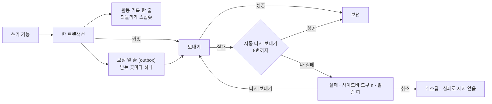

# 13 활동 기록과 전송

상태: 초안 (2026-11-05). 결정은 모두 정해졌다.

## 한 문장

모든 쓰기는 활동 기록에 한 줄을 남기고, 사이트 밖에 알려야 할 일(발행, 휴지통 등)은 커밋된 뒤 받는 곳마다 전송된다. 실패한 전송은 활동 기록에서 보고 다시 보내거나 취소한다.

## 원칙

1. **기록은 쓰기와 같은 트랜잭션에 있다.** 쓰기가 되면 기록도 있고, 쓰기가 안 되면 기록도 없다(00).
2. **전송은 커밋 뒤에만.** 보낼 일은 같은 트랜잭션에서 줄(outbox)에 넣고, 커밋된 뒤에 보낸다. 롤백된 쓰기는 아무 데도 알리지 않는다.
3. **실패는 숨기지 않는다.** 정해진 횟수까지 저절로 다시 보내고, 그래도 안 되면 실패로 남긴다. 사이드바의 "도구 n"과 활동 기록의 알림 띠가 실패 수를 보인다.
4. **받는 곳은 코드에 있다.** 웹훅 주소와 플러그인의 커밋 뒤 고리는 사이트 코드(설정 파일, 플러그인)가 정한다. 받는 곳이 없는 사이트는 기록만 보인다.

## 쓰는 화면과 흐름

- 기준 화면: `Screens/Reference/Lists` › Events, Sidebar(도구 개수).
- 흐름: [흐름 12 · 활동 기록](../admin/flows/12-activity-log.md) 전부, [흐름 2](../admin/flows/02-assistant.md)의 17, 18단계, [흐름 9](../admin/flows/09-data.md)의 가져오기 기록.
- 기록 줄의 모양은 [00-foundation.md](00-foundation.md#활동-기록)의 `ActivityRow`다.

## 모양



```ts
type Delivery = {
  id: string;
  activityId: string;
  destination: string;            // "webhook:https://example.dev/api/revalidate", "plugin:algolia"
  event: MontiEvent;
  state: "pending" | "sent" | "failed" | "canceled";
  attempts: number;
  lastError?: string;
  nextAttemptAt?: Date;
};

type MontiEvent = {
  type: "entry.published" | "entry.unpublished" | "entry.saved" | "entry.trashed" | "entry.restored" | "entry.purged"
      | "media.uploaded" | "media.trashed" | "settings.saved" | "schema.applied" | "import.done";
  at: string;
  ids: string[];
  collection?: string;
  locale?: string;
  version?: number;
  paths?: string[];               // public paths affected, for the site's cache
};
```

- 발행, 보관(사이트에서 내림), 휴지통, 복원, 영구 삭제처럼 사이트에 보이는 것이 바뀌면 `paths`에 그 주소들이 든다. 사이트는 이것으로 캐시를 새로 만든다.
- 저장(`entry.saved`)은 사이트를 바꾸지 않지만, 미리보기 캐시나 검색 플러그인이 쓰도록 이벤트는 낸다. 받는 곳이 그 이벤트를 고른다.

## 보내기

- 커밋된 요청 안에서 바로 한 번 보낸다(서버리스면 응답 뒤 `waitUntil`).
- 실패하면 1분, 5분, 30분처럼 사이를 늘려 8번까지 다시 보낸다. 다시 보내기는 관리자 화면에 들어올 때와 `monti deliveries:run` 명령으로 돈다. 명령은 호스트의 예약 작업에 걸 수 있다(11의 휴지통 정리와 같은 방법).
- 사람이 누른 "다시 보내기"와 "모두 다시 보내기"는 시도 수를 처음부터 다시 센다. "모두 다시 보내기"는 실패한 것을 모두 보낸다(흐름 12·06).
- 취소는 받는 곳 하나의 전송을 그만둔다. 되돌릴 수 없고 실패로 세지 않는다.

## 활동 기록 화면

- 날짜로 묶인 줄. 줄마다 시각, 무엇(요청 인용이나 "\"첫 번째 글\" 발행"), 어디("어시스턴트 제안 · 첫 번째 글 · 본문 5곳", "글 발행 · post/first-post"), 끝 동작.
- 끝 동작: AI 제안은 "대화" · "되돌리기"(되돌렸으면 "되돌림 · 10:44"), 실패한 전송은 "실패 · n번 실패 · 다시 보내기", 보내는 중은 "보내는 중".
- 거르기: 종류(AI 제안 · 글 저장 · 글 발행 · 휴지통 · 가져오기 · 설정 · 미디어)와 전송(대기 · 보냄 · 실패 · 취소됨), 글 하나(편집기 ⋯ › "AI가 바꾼 기록"이 건다). 거르기는 칩으로 보이고 ×로 하나씩 푼다.
- 줄을 누르면 옆 패널에 이벤트(언제, 누가, ID), 항목(글, 컬렉션, 언어와 버전, 주소), 전송(받는 곳마다 상태, 시도 수, 마지막 오류, 다시 보내기, 취소)이 보인다.

## 기능 목록

| 기능 | 종류 | 하는 일 |
|---|---|---|
| `activity.list` | read | 기록 줄(종류, 전송 상태, 글 하나로 거르기, 쪽) |
| `activity.get` | read | 줄 하나와 그 전송들 |
| `activity.undo` | write · preview | 되돌리기. 미리 보기는 그 사이 고쳐져 건너뛸 것 |
| `deliveries.retry` | write | 전송 하나, 또는 실패 모두를 다시 보낸다 |
| `deliveries.cancel` | write · 사람만 | 전송 하나를 취소 |
| `deliveries.counts` | read | 실패 수(사이드바, 탭 개수, 알림 띠) |

## 에이전트

- **읽기:** `activity.list`로 "어제 뭐 바꿨지?", "AI가 바꾼 것"에 답한다.
- **쓰기:** 되돌리기와 다시 보내기는 제안할 수 있다. 취소는 사람만 한다(되돌릴 수 없다).

## 화면 쪽 조각

- `useActivity(filters)`: 기록 목록, 날짜 묶음, 거르기.
- `useDeliveryCounts()`: 사이드바와 탭의 실패 수.
- `ActivityPanel`: 자세히 옆 패널. 가져오기 기록(14)도 같은 패널이다.

## 결정 기록

- 2026-11-05, 소유자: 되돌리기는 30일까지다. 휴지통과 같은 기한이다. 30일이 지난 줄은 기록으로 남고 "되돌리기"만 사라진다. 스냅숏은 30일 정리(11)와 같은 때에 지운다.

- 2026-11-05: 기록 줄은 지우지 않는다. 지우는 것은 되돌리기 스냅숏뿐이다.
- 2026-11-05: 보낼 일은 같은 트랜잭션의 줄(outbox)에 넣고 커밋 뒤에 보낸다. 자동 다시 보내기는 8번까지다.
- 2026-11-05: 다시 보내기 작업은 관리자 화면에 들어올 때와 `monti deliveries:run`으로 돈다. 따로 늘 도는 작업자는 두지 않는다.
- 흐름 12: 사람이 다시 보내면 시도 수를 새로 센다. 모두 다시 보내기는 실패한 것을 모두 보낸다. 취소는 실패로 세지 않는다.

## 끝 조건

- **13-1** 실패한 전송은 정해진 사이를 두고 8번까지 저절로 다시 보내고, 그래도 안 되면 실패로 남는다. 다시 보내기에 성공하면 한 번만 간다.
- **13-2** 롤백된 쓰기의 이벤트는 어디에도 나가지 않는다.
- **13-3** 흐름 12의 단계가 이 기능 목록만으로 된다.
- **13-4** 사이드바의 "도구 n", 탭 개수, 알림 띠가 같은 실패 수를 보인다.
- **13-5** 받는 곳이 없는 사이트에서는 전송 표시 없이 기록만 보인다.
