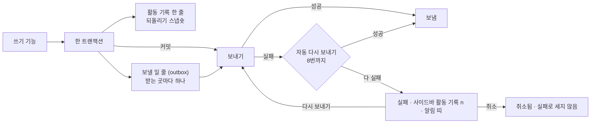

# 13 활동 기록과 전송

상태: 초안 (2026-11-05). 결정은 모두 정해졌다.

## 한 문장

모든 쓰기는 활동 기록에 한 줄을 남기고, 사이트 밖에 알려야 할 일(발행, 휴지통 등)은 커밋된 뒤 받는 곳마다 전송된다. 실패한 전송은 활동 기록에서 보고 다시 보내거나 취소한다.

## 원칙

1. **기록은 쓰기와 같은 트랜잭션에 있다.** 쓰기가 되면 기록도 있고, 쓰기가 안 되면 기록도 없다(00).
2. **전송은 커밋 뒤에만.** 보낼 일은 같은 트랜잭션에서 줄(outbox)에 넣고, 커밋된 뒤에 보낸다. 롤백된 쓰기는 아무 데도 알리지 않는다.
3. **실패는 숨기지 않는다.** 정해진 횟수까지 저절로 다시 보내고, 그래도 안 되면 실패로 남긴다. 사이드바의 "활동 기록 n"과 활동 기록의 알림 띠가 실패 수를 보인다.
4. **받는 곳은 코드에 있다.** 웹훅 주소와 플러그인의 커밋 뒤 고리는 사이트 코드(설정 파일, 플러그인)가 정한다. 받는 곳이 없는 사이트는 기록만 보인다.

## 쓰는 화면과 흐름

- 기준 화면: `Screens/Reference/Lists` › Events…, Sidebar("활동 기록"의 개수). 실제 화면의 상태는 `Screens/Activity`.
- 화면 지도: [screens/activity.md](../admin/screens/activity.md).
- 흐름: [흐름 12 · 활동 기록](../admin/flows/12-activity-log.md) 전부, [흐름 2](../admin/flows/02-assistant.md)의 17, 18단계, [흐름 9](../admin/flows/09-data.md)의 가져오기 기록.
- 기록 줄의 모양은 [00-foundation.md](00-foundation.md#활동-기록)의 `ActivityRow`다.

## 모양



```ts
type Delivery = {
  id: string;
  activityId: string;
  destination: string;            // "webhook:https://example.dev/api/revalidate", "plugin:algolia"
  event: MontiEvent;
  state: "pending" | "sent" | "failed" | "canceled";
  attempts: number;
  lastError?: string;
  nextAttemptAt?: Date;
};

type MontiEvent = {
  type: "entry.published" | "entry.unpublished" | "entry.saved" | "entry.trashed" | "entry.restored" | "entry.purged"
      | "media.uploaded" | "media.replaced" | "media.renamed" | "media.trashed" | "media.restored"
      | "settings.saved" | "schema.applied" | "import.done";
  at: string;
  ids: string[];
  collection?: string;
  locale?: string;
  version?: number;
  paths?: string[];               // public paths affected, for the site's cache
};
```

- 발행, 보관(사이트에서 내림), 휴지통, 복원, 영구 삭제처럼 사이트에 보이는 것이 바뀌면 `paths`에 그 주소들이 든다. 사이트는 이것으로 캐시를 새로 만든다.
- 저장(`entry.saved`)은 사이트를 바꾸지 않지만, 미리보기 캐시나 검색 플러그인이 쓰도록 이벤트는 낸다. 받는 곳이 그 이벤트를 고른다.

## 보내기

- 커밋된 요청 안에서 바로 한 번 보낸다(서버리스면 응답 뒤 `waitUntil`).
- 쓰기가 답하기 전에 기다리는 받는 곳(`beforeAnswer`)에는 쓰기 하나에 마감이 하나다(10초). 이벤트가 몇 개든 마감이 되면 더 시작하지 않고 답하며, 시작하지 못한 것은 답한 뒤에 보낸다. 무슨 이벤트든 하는 일이 같은 받는 곳(`oncePerWrite`. 사이트 전체를 새로 그리는 Next 어댑터의 기본 캐시 갱신)은 쓰기 하나에 한 번만 받는다: 글 50편을 한 번에 발행해도 한 번이다. 사이트가 제 `refresh(event)`를 주면 이벤트마다 받는다. (2026-11-12 만들며 정함)
- 답한 뒤에 하는 보내기는 호스트에게 "시작할 일"로 넘긴다(`waitUntil: (work) => …`). 호스트가 응답 뒤에도 일을 살려 두는 자리에서 그 일을 시작한다. 이미 돌고 있는 일을 넘기지 않는다(16번 문서의 캐시 갱신 참고). (2026-11-12 만들며 정함) 사이트의 페이지를 새로 만드는 받는 곳(Next 어댑터의 캐시 갱신)은 서버리스에서도 쓰기가 답하기 전에 보낸다(`beforeAnswer`). 발행이 답했으면 사이트에 나와 있어야 한다(16-3).
- 실패하면 1분, 5분, 30분처럼 사이를 늘려 8번까지 다시 보낸다. 다시 보내기는 관리자 화면에 들어올 때와 `monti deliveries:run` 명령으로 돈다. 명령은 호스트의 예약 작업에 걸 수 있다(11의 휴지통 정리와 같은 방법).
- 사람이 누른 "다시 보내기"와 "모두 다시 보내기"는 시도 수를 처음부터 다시 센다. "모두 다시 보내기"는 실패한 것을 모두 보낸다(흐름 12·06).
- 취소는 받는 곳 하나의 전송을 그만둔다. 되돌릴 수 없고 실패로 세지 않는다.

## 활동 기록 화면

화면의 큰 틀 아홉 가지는 2026-11-12에 소유자가 정했고(아래 "화면 승인"의 "소유자가 정한 것"), 나머지는 만들며 정했다(같은 절의 "만들며 정함"). 자리와 부품은 [screens/activity.md](../admin/screens/activity.md)에 있다.

- 사이드바에 제 행 "활동 기록"이 있는 화면이다. 도구의 탭이 아니다. 주소는 `#/activity`다.
- 게시글 목록, 휴지통과 같은 표다. 한 줄은 쓰기 하나, 또는 어시스턴트가 요청 하나로 한 일 전부다. 열은 "작업"(한 일과 그 뒤의 어디서. 어시스턴트의 줄은 ✦와 요청 인용, 그 뒤에 한 일), "전송"("보내는 중" · "실패"(전송 여럿이 실패했으면 "n건 실패") · "취소됨", 다 간 줄은 조용한 글자 "보냄". 보낼 것이 없던 줄만 비운다), "시각"이다.
- 찾기: 글 이름, 어시스턴트에게 한 요청, 파일 이름. 거르기: 열 이름의 메뉴에서 종류(AI 제안 · 글 저장 · 글 발행 · 휴지통 · 설정 · 미디어. 가져오기는 14번에서 더한다)와 전송(보내는 중 · 보냄 · 실패 · 취소됨), 날짜. 순서는 최근부터와 오래전부터. 걸린 거르기는 열 이름 뒤의 점이다.
- 줄의 ⋯: "자세히", 실패한 전송이 있으면 "다시 보내기", 되돌릴 수 있으면 "되돌리기"(사람이 한 줄도). 되돌린 줄은 뒤에 "되돌림 10:44"가 붙는다.
- 줄을 누르면 옆 패널에 언제(되돌렸으면 그 시각도), 항목(글, 컬렉션, 언어와 버전, 주소), 전송(받는 곳의 이름, 이벤트 이름, 상태, 마지막 오류, 다음 시도, 이벤트 ID(받는 쪽이 `Monti-Event-Id`로 받은 것), 다시 보내기, 취소)이 보인다. 누가 했는지와 기록 줄의 ID는 보이지 않는다.
- 실패가 둘 이상이면 화면 맨 위에 알림 띠 "전송 실패 n건"이 "보기" · "모두 다시 보내기"와 함께 뜬다. "보기"는 띠가 센 바로 그 전송들을 보인다: 전송을 실패로 거르고, 찾는 말과 종류 · 날짜 거르기는 푼다.

## 기능 목록

| 기능 | 종류 | 하는 일 |
|---|---|---|
| `activity.list` | read | 기록 줄(찾기, 종류 · 전송 상태 여럿, 날짜, 글 하나, 순서, 쪽) |
| `activity.facets` | read | 열 메뉴의 값마다 수(다른 열의 거르기를 적용한). 종류는 줄 수, 전송 상태는 전송 수 |
| `activity.get` | read | 줄 하나와 그 전송들 |
| `activity.undoPlan` | read | 되돌리면 무엇이 되는지: 되돌릴 것, 그 사이 고쳐져 건너뛸 것, 영구 삭제될 것(줄이 만든 것), 다시 휴지통으로 갈 것. 되돌리기가 거절할 것이면 같은 까닭으로 거절한다 |
| `activity.undo` | write · preview | 되돌리기. 미리 보기는 그 사이 고쳐져 건너뛸 것 |
| `deliveries.retry` | write | 전송 하나, 또는 실패 모두를 다시 보낸다 |
| `deliveries.cancel` | write · 사람만 | 전송 하나를 취소 |
| `deliveries.counts` | read | 실패 수(사이드바, 알림 띠) |

## 에이전트

- **읽기:** `activity.list`로 "어제 뭐 바꿨지?", "AI가 바꾼 것"에 답한다.
- **쓰기:** 되돌리기와 다시 보내기는 제안할 수 있다. 취소는 사람만 한다(되돌릴 수 없다).

## 화면 쪽 조각

이 화면만 쓰는 조각은 줄 하나의 옆 패널뿐이다. 나머지는 다른 화면과 함께 쓴다.

- `ActivityPanel`: 자세히 옆 패널. 가져오기 기록(14)도 같은 패널이다.
- `useUndo()`: "되돌리기" 하나. 활동 기록의 줄, 휴지통과 분류의 토스트가 같은 것을 부른다.
- `useSendAgain()`: "다시 보내기"와 "모두 다시 보내기". 남은 것이 없을 때까지 이어 부르고 결과를 토스트로 알린다.
- 사이드바의 실패 수는 틀이 읽는 `frame.counts`에 함께 온다. 화면의 띠는 `deliveries.counts`를 읽는다.
- 목록의 조각(찾는 말, 열 메뉴의 값과 개수, 정렬과 날짜 행, 열 너비, 쪽, 맞는 것 없음 줄)은 게시글 목록과 휴지통의 것이다(아래 "다른 목록에서 가져다 쓴 것").

## 만들면서 정한 것 (승인 대기, 2026-11-12)

core를 만들면서 문서가 말하지 않았거나 문서와 다르게 정한 것이다. 코드는 아래대로 되어 있다. 소유자가 바꾸라고 하면 코드와 이 절을 함께 고친다.

1. **실패는 첫 시도부터 실패다.** 한 번 실패한 전송은 바로 "실패"로 보이고 실패 수에 든다. 그 뒤에도 8번까지 저절로 다시 보낸다. 전에는 8번을 다 쓴 뒤에야 실패가 됐는데, 그러면 받는 곳이 죽어도 약 46시간 동안 사이드바에 아무것도 뜨지 않는다(원칙 3). 흐름 12의 "3번 실패", "1번 실패"도 이 뜻이다. "대기"는 아직 한 번도 보내지 않았거나 지금 보내는 중인 것이다.
2. **한 번 보내기는 10초까지다.** 첫 전송은 저장 요청 안에서 가므로, 답하지 않는 받는 곳이 저장을 붙잡지 못하게 한다. 10초가 지나면 실패로 적는다.
3. **한 전송은 한 번에 한 곳에서만 보낸다.** 관리자 화면 두 곳이 동시에 열리거나 명령과 화면이 겹쳐도 같은 전송이 두 번 나가지 않는다(13-1의 "한 번만 간다"). 사람이 누른 "다시 보내기"는 그 전송을 제 이름으로 잡아 두고 보내므로, 그 사이 저절로 다시 보내기가 끼어들지 않고 누른 사람이 결과를 받는다. "모두 다시 보내기"는 한 번에 10건씩 함께 보내고 남은 수를 답한다(`remaining`, `run`). 화면은 남은 것이 없을 때까지 이어 부르고, 어느 걸음에서 끊겨도 보낸 것은 보낸 것으로 남는다. 한 번의 "모두 다시 보내기"는 전송마다 한 번만 시도한다. 방금 넣은 전송은 그 쓰기가 먼저 보낸다: 다른 요청의 다시 보내기는 30초(보내는 쪽이 전송 하나를 잡아 두는 시간)가 지나야 그것을 집는다. 잡아 둔 시간이 지난 "다시 보내기" 예약을 집으면 사람의 이름을 뗀다. `monti deliveries:run`과 명령줄의 `deliveries.retry`는 이 프로세스가 보낼 수 있는 받는 곳의 전송만 집는다: 돌고 있는 사이트만 보낼 수 있는 전송이 아무리 많이 밀려 있어도 웹훅은 간다. 어시스턴트는 id로 고른 전송만 다시 보내기를 제안하고, "모두"는 사람만 한다. 고른 것 가운데 보낼 수 있는 것이 없으면 까닭을 상태마다 센다.
4. **관리자 화면을 열 때의 다시 보내기는 기다리지 않는다.** 사이드바 개수를 읽을 때 때가 된 전송을 뒤에서 보낸다. 1분에 한 번, 한 번에 50건까지다. 답 없는 받는 곳 때문에 화면이 늦게 뜨지 않는다. 뒤에서 하는 전송은 호스트가 응답 뒤에도 살려 둔다(`waitUntil`. Next 어댑터는 `after`를 넘긴다). `monti deliveries:run`은 돌고 있는 사이트만 보낼 수 있는 전송(Next의 캐시 갱신)을 시도하지 않고 남기며, 몇 건인지 말한다.
5. **웹훅은 설정 파일에 `webhook("https://…")`로 적는다.** 이벤트를 JSON으로 POST하고, 2xx가 아니면 실패다. 리다이렉트는 따라가지 않고 그 상태로 실패다. `events`로 받을 이벤트를 고르고 `headers`로 토큰을 보낸다. 받는 곳에는 이름이 있다(`webhook(url, { name })`. 없으면 주소의 호스트와 경로). 전송은 그 이름으로 저장되고 보인다(`webhook:<이름>`). 주소 자체는 저장하지 않는다: 쿼리에 든 토큰이 표와 화면과 어시스턴트의 읽기에 나가지 않는다. 한 사이트의 받는 곳 둘이 같은 이름이면 사이트를 열 때 거절한다(전에는 둘 다 첫째로 풀려 한쪽이 두 번 받고 다른 쪽은 받지 못했다). `secret`을 주면 보낼 때마다 서명한다: 헤더 `Monti-Signature: t=<초>,v1=<hex>`이고 `v1`은 `<t>.<본문>`을 그 비밀값으로 HMAC-SHA256 한 것이다. 받는 쪽은 같은 값을 만들어 견주고, 오래된 `t`는 거절할 수 있다. `secret`이 없으면 서명하지 않는다. `MONTI_SECRET`은 쓰지 않는다. 풀리지 않는 주소와 사용자 · 비밀번호가 든 주소(`https://user:pass@…`)는 사이트를 열 때 거절한다: 플랫폼의 `fetch`가 보낼 때 둘 다 거절하면서 주소 전체를 오류 글에 적기 때문이다. 거절하는 말은 주소를 옮기지 않는다. 계정은 `headers`(Authorization)로 보내거나 `secret`으로 서명한다. 전송에 남는 실패 까닭은 네 가지 가운데 하나이고, 밖에서 온 글은 저장하지 않는다: 받는 곳의 답(`status:503 Service Unavailable`. 숫자와, 답이 HTTP의 표준 말을 썼을 때만 그 말), 답 없음(`noAnswer`, 네트워크의 코드가 있으면 `noAnswer:ECONNREFUSED`), 받는 곳 없음(`gone`), 그 밖의 실패(`failed`). 오류의 글은 주소와 토큰을 옮길 수 있고, 저장된 것은 활동 기록에 보이며 어시스턴트도 읽는다. (2026-11-12 만들며 정함, #476 두 번째 리뷰와 그 뒤 리뷰)
6. **이벤트.** 모든 이벤트에 `id`와 `at`(쓰기가 된 때)이 붙는다. `id`는 다시 보낼 때마다 같고 받는 곳 모두에게 같다. 웹훅은 헤더 `Monti-Event-Id` · `Monti-Delivery-Id` · `Monti-Attempt`도 받는다. 받는 곳이 처리하고 답이 끊겨 같은 이벤트가 다시 와도 알아볼 수 있다. 휴지통에 넣기 · 복원 · 영구 삭제는 `entry.trashed` · `entry.restored` · `entry.purged`를 낸다(글 id만, 컬렉션과 언어마다 한 번). 30일 정리가 지운 글도 `entry.purged`를 내고, 정리는 기록의 한 줄이 된다("30일 지난 n개 영구 삭제"). 사이트에서 내려가고 올라오는 주소는 11번이 정한 대로 `entry.unpublished` · `entry.published`의 `paths`에 든다. `settings.saved`는 컬렉션 설정 저장이, `schema.applied`는 스키마 적용이(실패했다가 "다시 적용"으로 된 것도) 낸다. `import.done`은 가져오기를 만드는 14번에서 낸다(T142). `paths`는 언제나 공개 주소다(`/posts/first-post`).
7. **기록에 줄로 보이지 않는 쓰기.** 로그인 · 로그아웃 · 첫 관리자 만들기, 목록의 열 설정 저장, 제안 버리기(00: 버린 제안은 기록에 남지 않는다), 되돌리기 그 자체, 전송 다시 보내기와 취소. 표에는 한 줄씩 남지만(원칙 1) 화면의 줄과 `activity.list`에는 나오지 않는다. 되돌리기는 되돌린 줄이 "되돌림 · 시각"으로 말한다. **되돌리기는 다시 돌릴 수 없다**: 제 줄도 제 스냅숏도 남기지 않으므로 되돌리기를 되돌리는 길이 없다. 그래서 활동 기록의 "되돌리기"는 먼저 묻는다(화면 승인의 "만들며 정함" 3).
8. **제안을 한 번 적용한 것이 한 줄이다.** 한 번의 적용에서 된 쓰기들은 한 줄로 묶이고, 줄의 첫 줄은 요청을 인용한다. 줄의 자리와 시각은 그 첫 쓰기의 것이라 뒤에 바뀌지 않는다. 한 제안을 두 번에 나눠 적용하면 두 줄이고 둘 다 같은 요청을 인용한다. 줄의 "되돌리기"는 그 줄의 쓰기를 새것부터 함께 되돌린다. 제안 하나를 통째로 되돌릴 수도 있다(`activity.undo`의 `proposal`). 같은 글을 여러 번 고쳤으면 처음 모습으로 돌아가고, 그 사이 사람이 고친 것이 있으면 그 고침까지만 돌아간다(사람의 고침과 그 아래는 남는다). 편집기에서 제안을 받아 저장한 것은 그 저장이 한 줄이다. 되돌리기는 쓰기처럼 레코드를 붙잡고 하므로, 같은 순간의 저장 위에 덮어쓰지 않는다. 잠그는 순서는 엔진 전체가 하나다: 제안 줄, 활동 기록 줄, 레코드 잠금(정렬한 순서). 되돌리기는 활동 기록 줄을 잡고 그다음 레코드를 잡는다. 한 레코드를 고친 줄들은 새것부터 한 줄씩 차례로 되돌릴 수 있다: 되돌리기가 레코드를 어느 버전으로 돌려놓았는지 적어 두고, 다음 되돌리기가 그 버전을 "그 쓰기가 남긴 버전"으로 읽는다. 그 사이에 사람이 고쳤으면 거기서 끊긴다. 미리 보기와 되돌리기는 같은 방법으로 계획하지만 한 번의 읽기가 아니다: 미리 보기는 잠그지 않고 읽고, 되돌리기는 잠근 뒤 다시 읽는다. 되돌린 것과 건너뛴 것은 되돌리기의 답(`restore` · `skip`)이 말한다. 아무것도 되돌리지 못한 쓰기는 되돌린 것으로 표시하지 않는다(`undone`에 들지 않는다). 제안의 "모두 되돌리기"도 이 길 하나를 쓴다(`{ write }`로 항목마다). "모두 되돌리기"는 항목을 되돌리기 전에 필요한 것을 한 번에, 엔진의 순서대로 잡는다: 제안 줄, 항목들의 활동 기록 줄, 그 스냅숏의 레코드 전부(정렬한 순서). 항목마다 잡으면 뒤 항목의 레코드를 쥔 채 앞 항목의 레코드를 기다리게 되어, 같은 레코드들을 정렬한 순서로 잡는 사람의 쓰기와 서로 기다린다. 활동 기록에서 제안이 한 줄을 되돌리면 그 쓰기를 한 제안 항목도 같은 트랜잭션에서 "되돌림"이 된다(제안 줄을 먼저 잡는다): 대화의 카드와 활동 기록이 같은 말을 하고, 나중의 "모두 되돌리기"는 되돌릴 것이 없다. 되돌리기가 글의 옛 필드 표시를 떼어 버전이 하나 더 오르는 경우(04, T111)에는 그 뒤의 버전을 적는다: 다음 되돌리기가 끊기지 않고, 이벤트의 버전도 글이 끝난 버전이다. (2026-11-12 만들며 정함)
9. **되돌릴 것이 하나도 남지 않은 되돌리기는 거절한다.** 줄이 건드린 것이 모두 그 사이 다시 고쳐졌으면 "그 사이 다시 고쳐졌습니다."로 거절하고, 줄은 그대로 둔다. 전에는 아무것도 되돌리지 않고도 "되돌림"이 됐다.
10. **되돌리기가 낸 전송은 되돌린 줄에 붙는다.** 발행을 되돌려 사이트가 바뀌면 이벤트가 나가고(T29, #470), 그 전송 상태는 되돌린 줄에 보인다. 되돌리기 자체는 줄이 없기 때문이다. 방문자가 보는 것이 바뀌지 않아도 글의 사본을 따로 가진 받는 곳(검색 색인)은 들어야 하므로, 되돌리기는 글이 다시 휴지통에 들어가면 `entry.trashed`, 나오면 `entry.restored`, 만들기를 되돌려 없어지면 `entry.purged`, 저장을 되돌리면 `entry.saved`를 낸다. 같은 글의 발행 · 내림 이벤트가 나가면 `entry.saved`는 따로 내지 않는다. (2026-11-12 만들며 정함, #476 두 번째 리뷰)
11. **줄의 글.** 줄마다 무엇을 했는지와 어디서인지를 쓰기가 적는다. 무엇: `"첫 번째 글" 발행`, `글 3편 발행`, `"첫 번째 글" 본문 5곳 고침`, `cover-react.png 올림`. 어디: 글은 `post/first-post`(주소가 없으면 컬렉션 이름), 미디어는 `미디어 · Blog Assets`, 스키마는 `설정 · monti.schema.ts`, 템플릿은 `도구 · 템플릿`, 휴지통은 `휴지통`. 그때의 제목과 공개 주소를 적어 두므로, 이름을 바꾸거나 컬렉션의 주소를 바꾸거나 영구 삭제한 뒤에도 줄은 그때 이름과 주소로 읽힌다.
12. **종류.** 글 저장: 만들기 · 저장 · 복제 · 본문 고치기 · 번역 · 관계 · 항목 저장 · 글 폴더. 글 발행: 발행 · 보관 · 보관 풀기. 휴지통: 넣기 · 복원 · 영구 삭제 · 비우기. 설정: 스키마 · 언어 · 컬렉션 설정 · 템플릿. 미디어: 올리기 · 이름 · 바꾸기 · 옮기기 · 미디어 폴더. AI 제안은 종류가 아니라 대화에서 온 줄이다. core의 쓰기가 종류를 적지 않으면 테스트가 실패한다.
13. **실패 수는 전송의 수다.** 글 하나를 발행해 받는 곳 둘에 실패하면 2건이다. 사이드바, 띠, 열 메뉴의 숫자가 같은 셈을 쓴다(13-4).
14. **`deliveries.counts`는 가장 오래된 실패의 날과 지금 다시 보내는 수도 준다.** 띠의 날짜 자리와 "보내는 중…"에 쓴다. 한 번에 읽어 수와 날이 어긋나지 않는다.
15. **쪽은 한 번의 훑어보기 동안 흔들리지 않는다.** 첫 쪽이 준 자리(`asOf`)를 다음 쪽에 넘기면 그 뒤에 생긴 줄은 빠진다. 2쪽이 1쪽의 마지막 줄로 시작하지 않는다. 그 자리는 첫 쪽을 읽기 전에 읽고 첫 쪽도 그 안에서 읽는다: 두 읽기 사이에 생긴 줄은 이 훑어보기의 어느 쪽에도 없다. 다음 쪽은 위에서부터 세지 않고 앞 쪽의 마지막 줄 자리에서 이어 읽는다(`from`: 온 쪽의 번호, 그 첫 줄과 마지막 줄의 자리, 훑어보기의 줄 수). 훑어보기를 시작할 때 아직 쓰는 중이던 줄이 그 사이 커밋되면 자리는 경계 안쪽이라, 위에서부터 세면 뒤의 줄이 하나씩 밀려 다음 쪽이 앞 쪽의 마지막 줄로 시작한다. 자리에서 이어 읽으면 겹치지 않는다. 그 늦은 줄은 이 훑어보기에 나오지 않는다(새로 생긴 줄과 같다). 줄 수(`total`)는 첫 쪽을 읽을 때 한 번 세고, 그 쪽에서 이어 간 쪽은 같은 수를 답한다: 쪽을 넘기는 동안 목록 아래의 수가 바뀌지 않는다. (2026-11-12 만들며 정함) 목록은 줄이 건드린 레코드 목록을 읽지 않고(자세히만 읽는다), 줄이 찾아지는 말은 2000자까지만 둔다.

## 화면 승인 (2026-11-12)

첫 그림은 소유자가 둘을 물렸다: 알림 띠를 탭 아래에 그린 것(화면의 띠는 화면 맨 위 한 자리다)과 이 화면만의 두 줄짜리 행(목록은 모두 같은 표다). 두 번째 그림(도구의 탭, 열 넷)을 보고 소유자가 아래 아홉 가지를 정했다(아홉째는 만든 화면의 그림을 보고). 화면의 나머지는 만들며 정했고, 그 아래에 따로 적었다. 기준 화면 스토리(`Screens/Reference/Lists`의 `Events…`)와 실제 화면(`Screens/Activity`)은 아래대로다.

### 소유자가 정한 것 (2026-11-12)

소유자의 말 그대로다. 이 아홉 가지만 소유자가 정했다.

1. **화면의 알림 띠는 화면 맨 위에 선다.** "이런 알림은 페이지 최상단에 두는 형태로 쓰겠다고? 왜 그걸 어겨?"
2. **활동 기록은 다른 목록과 같은 표다.** "활동 기록도 그냥 표로 통일하는게 편하지 않을까?"
3. **활동 기록은 사이드바의 제 행이다.** 도구의 탭이 아니고, 휴지통처럼 서며, 실패한 전송 수가 그 행에 붙는다. 이렇게 하자는 제안에 "사이드바로 빼는게 더 좋아보이네 승인할게."
4. **"도구"는 늘 템플릿을 연다.** "템플릿이 열리는게 낫지. 편의성이 중요한게 아냐. '일관된 사용성이 중요한거지'"
5. **첫 열의 이름은 "작업"이고, "한 사람" 열은 없다.** "'한 일'이란 말도 애매하고 '작업' 같은게 맞지 않아? … 표의 헤더는 그렇지 않잖아. 또 '한 사람' 열을 지금 만들 필요가 있을까? 어차피 혼자 쓰는데...."
6. **되돌릴 수 있는 줄에는 모두 "되돌리기"가 있다.** 사람이 한 줄도 같다. 그렇게 하자는 물음에 "가"("일관된 사용성 -> 일관된 코드 -> 편안한 유지보수").
7. **찾기, 열 거르기, 정렬은 게시글 목록처럼 둔다.** 그렇게 하자는 물음에 "가".
8. **휴대폰 폭은 대상이 아니다.** "이 cms가 모바일 뷰를 이렇게 우선적으로 고려해야해? 우선 타겟층에 모바일은 없는데..."
9. **실패한 전송 하나는 "전송" 칸에 "실패"라고만 적는다.** 시도한 횟수는 칸에 적지 않는다. "1번 실패? 그냥 실패 아냐?"

### 만들며 정함 (2026-11-12)

위 아홉 가지를 화면으로 옮기면서 정한 것이다. 소유자가 정한 것이 아니다.

1. **사이드바.** 아래 묶음의 순서는 "휴지통 · 활동 기록 · 도구 · 설정"이다. 실패한 전송 수는 경고 색이고, 사이드바를 접으면 그 아이콘에 점이 붙는다. "도구"에는 숫자가 없다. 화면은 제목 "활동 기록", 제목 줄의 검색, 그 바로 아래에 표이고 탭 줄이 없다. 주소는 `#/activity`다.
2. **열.** "작업" · "전송" · "시각" 셋이다. 어시스턴트가 한 줄은 글 앞의 ✦로, 명령줄이나 플러그인이 한 줄은 문장 뒤 회색 글("명령줄")로 말한다.
3. **활동 기록의 "되돌리기"는 한 번 묻고, 토스트의 "되돌리기"는 바로 한다.** 토스트의 것은 방금 한 일을, 눈앞의 것에 대해 되돌린다: 묻지 않는다. 활동 기록의 것(줄의 ⋯와 옆 패널)은 며칠 지난 줄일 수 있고, 되돌리기는 줄을 남기지 않아 다시 돌릴 수 없다: 먼저 묻는다. 물음의 제목은 "되돌릴까요?"이고, 글은 되돌리면 무엇이 되는지를 읽어(`activity.undoPlan`) 맨 먼저 맞는 한 문장이다: 줄이 만든 것이 영구 삭제되면 "이 작업으로 만든 것을 영구 삭제합니다."(확인 버튼이 위험 색이다. "영구 삭제"와 같다), 발행된 글이 가리키는 항목이 다시 휴지통으로 가면 손으로 "휴지통으로" 할 때와 같은 문장("발행된 글 n편에서 이 카테고리가 빠집니다."), 그 밖에는 "되돌리면 다시 돌릴 수 없습니다.". 되돌리기가 거절할 것이면(그 사이 고쳐짐, 이미 되돌림) 묻지 않고 그 까닭을 알린다. 닫으면 포커스는 줄의 ⋯로 돌아간다. 되돌린 줄 뒤에 "되돌림 10:44"가 붙는 것이 결과이고, 토스트는 보이지 않는 것만 말한다: 그 사이 고쳐져 그대로 둔 것이 있을 때. (만들며 정함 (2026-11-12, 레퍼런스: Google Docs 버전 복원, WordPress 리비전, Gmail · Polaris의 토스트 되돌리기))
4. **열 메뉴가 거르는 것.** "작업"의 메뉴는 종류로, "전송"의 메뉴는 상태로 거르고(여럿을 함께. 종류는 값마다 줄 수, 전송은 값마다 전송 수), "시각"의 메뉴는 순서 두 방향과 날짜 거르기다. 찾기는 글 이름, 요청 글, 파일 이름을 본다.
5. **"다시 보내기"는 줄의 ⋯와 옆 패널에 있다.** 줄에 드러난 글자 버튼은 없다. 맨 위 띠는 실패 2건부터 뜬다.
6. **옆 패널.** 언제(되돌렸으면 그 시각도), 항목, 전송을 보인다. 전송마다 받는 곳의 이름, 이벤트 이름(`entry.published`), 상태, 마지막 오류, 다음 시도, 이벤트 ID가 있다. "한 사람"은 없다: 소유자의 "어차피 혼자 쓰는데"(표의 열에 대한 말이다)에서 가져와 패널에도 두지 않았다. 기록 줄의 ID도 없다: 그것으로 사람이 하는 일이 없어서 뺐다.
7. **좁은 창의 그림, 상태, 테스트를 두지 않는다.** 소유자의 여덟째 말에 따른 것이다.
8. **다 간 전송은 "전송" 칸에 "보냄"이라고 적는다.** 조용한 글자이고 표시와 색이 없다. 보낼 것이 없던 줄만 칸을 비운다. 처음에는 다 간 줄도 비웠는데, "전송"이라는 열의 빈 칸은 "보내지 않았다"로 읽힌다. (만들며 정함, 2026-11-12, 레퍼런스: Stripe와 GitHub의 전송 목록, Svix 포털)
9. **전송 여럿이 실패한 줄은 "n건 실패"라고 적는다.** 사이드바와 띠가 세는 그 수(전송의 수)다. 시도한 횟수("3번 실패")는 옆 패널에서 그 전송 하나 옆에만 적는다. (만들며 정함, 2026-11-12. 하나일 때 "실패"만 적는 것은 소유자가 정했다)

### 옛 지도에만 있던 것과 바꾼 것

디자인 때 그린 지도(화면 지도의 활동 기록 절, `screens.md`의 Events, 흐름 12, 기준 화면)에는 이 화면만 쓰는 것이 여럿 있었다. 만들기 전에 하나씩 휴지통과 게시글 목록이 이미 쓰는 것으로 바꿨다.

| 옛 지도에 있던 것 | 바꾼 것 |
|---|---|
| 도구의 탭 "활동 기록 n"과 탭 줄 | 사이드바의 제 행과 그 개수. 화면에는 탭 줄이 없다 |
| "종류 ▾" 필터 버튼(`FilterButton`)과 그 안의 "전송" 하위 메뉴 | 열 이름의 메뉴("작업", "전송"). 게시글 목록의 열 메뉴와 같은 행(`ValueRow`) |
| 걸린 필터의 칩(`Chip` "전송: 실패 ×", "글: 첫 번째 글") | 열 이름 뒤의 점. 글 하나는 그 글 이름으로 찾기 |
| 날짜 묶음 줄("오늘 · 10. 26") | "시각" 열과 그 메뉴의 날짜 거르기 |
| 두 줄짜리 행(무엇 / 어디서) | 게시글 목록의 제목 칸(`RowTitle`): 한 일, 그 뒤 회색으로 어디서 |
| 줄 끝에 드러난 "대화" · "되돌리기" · "다시 보내기" 글자 버튼 | 줄의 ⋯(`RowMore`)와 오른쪽 클릭 메뉴. 휴지통의 "복원"과 같다 |
| "한 사람" 열(두 번째 그림) | 없다. 어시스턴트의 줄은 ✦, 명령줄과 플러그인의 줄은 회색 글 |
| 빈 목록의 글 한 줄("실패한 전송이 없습니다" + "필터 끄기") | 기록이 없으면 `Empty`, 거른 것이 없으면 표의 한 줄 "맞는 기록이 없습니다." + "필터 해제". 둘 다 휴지통과 같다 |
| 띠를 탭 아래에 두는 자리 | 화면 맨 위(`PageBanner`) |
| 가져오기 자세히 패널의 바닥 버튼 | 14번에서 가져오기와 함께 정한다(T142) |

### 다른 목록에서 가져다 쓴 것

부품만이 아니라 코드도 함께 쓴다. 활동 기록을 만들면서 게시글 목록과 휴지통에 따로 있던 것 넷을 한 조각으로 모았고, 세 화면이 그것을 쓴다.

| 조각 | 쓰는 곳 |
|---|---|
| `useSearchWords`: 검색 상자의 글과 주소를 맞춘다(치는 동안 기다렸다 찾기, 한글 조합 중에는 기다리기) | 게시글 목록, 휴지통, 활동 기록 |
| `NoMatchRow`: "맞는 기록이 없습니다." + "필터 해제" 한 줄 | 게시글 목록, 휴지통, 활동 기록 |
| `DateRows`: 열 메뉴의 날짜 거르기 행 | 게시글 목록의 날짜 열, 활동 기록의 "시각" |
| `shortDate`(목록의 날짜 표기)와 `clock`(시각 "10:44") | 게시글 목록, 미디어, 템플릿, 편집기, 활동 기록 |
| `useUndo`: "되돌리기" 부르기와 그 결과 토스트 | 휴지통의 토스트, 분류의 합치기와 관계 메뉴, 활동 기록의 줄 |
| `ValueRow` · `toggled`: 열 메뉴의 값 한 줄(체크, 개수) | 게시글 목록, 분류, 활동 기록 |
| `SortRows`: 열 메뉴의 정렬 행 | 게시글 목록, 분류, 미디어, 휴지통, 활동 기록 |
| `useColumnWidths`: 끌어 바꾼 열 너비를 이 브라우저에 남긴다 | 분류, 미디어, 휴지통, 활동 기록 |
| `ListPages`와 `ListFooter`: 쪽 | 게시글 목록, 휴지통, 활동 기록 |
| core의 `likePattern` · `DateRange` · `dateRangeSql`: 찾는 말과 날짜 범위의 조건 | `entries.list`, `trash.list`, `media.list`, `activity.list` |
| 부품: `PageBanner`, `PageHeader`, `SearchToggle`, `Table`, `ListHead`, `RowTitle`, `RowLink`, `RowMore`, `EntryStatus`, `Empty`, `SidePanel`, `DescriptionList`, `AlertDialog` | 모든 목록 |

열 메뉴의 개수는 게시글 목록처럼 메뉴를 열 때 따로 읽는다(`activity.facets`. 게시글 목록은 `entries.facets`).

### 코드 리뷰 뒤에 정한 것 (2026-11-12)

1. **"전송" 메뉴의 수는 전송의 수다.** 한 번의 발행이 받는 곳 둘에 실패하면 사이드바 2, 띠 "2건", 메뉴 "실패 2"다. 줄은 하나다(만들면서 정한 것 13, 13-4).
2. **받는 곳은 사람이 읽는 이름으로 보인다.** 전송은 받는 곳의 이름으로 저장된다(`webhook:<이름>`, `plugin:next`. 웹훅의 이름은 `webhook(url, { name })`, 없으면 주소의 호스트와 경로다). 주소와 그 쿼리의 토큰은 어디에도 저장되지 않는다. 화면은 그 이름을 종류(`webhook:` · `plugin:`) 없이 보이고, 받는 곳이 `label`을 주면 그것을 보인다: Next 어댑터의 캐시 갱신은 "사이트 캐시"다. 저장된 이름 그대로는 화면에도 관리자 API의 답에도 나가지 않는다.
3. **"마지막 오류"는 네 문장 가운데 하나다.** 받는 곳이 답한 상태("503 Service Unavailable". 숫자와 HTTP의 표준 말만 남긴다), "답 없음"(시간 안에 답이 없거나 닿지 못함. 닿지 못한 까닭을 네트워크가 말하면 그 말은 저장해 두고 화면에는 내지 않는다: `noAnswer:ECONNREFUSED`), "받는 곳 없음"(설정에서 빠진 받는 곳), "보내지 못함"(그 밖에 받는 곳이 던진 것). 오류의 글(`Error.message`)은 저장하지도 보이지도 않는다: 주소와 토큰을 옮길 수 있다. 상태를 보이려는 플러그인의 받는 곳은 `ReceiverAnswer`를 던진다.
4. **보내기는 한 번에 하나다.** 보내는 동안에는 띠의 버튼, 다른 줄의 "다시 보내기", 패널의 "다시 보내기"가 모두 보내는 중으로 보이고 눌리지 않는다. 다른 탭에서 시작했거나 새로 고치기 전에 시작한 보내기도 같다(`deliveries.counts`의 `sending`). 되돌리는 동안에는 "되돌리기"가 없다.
5. **거절되면 화면을 다시 읽는다.** 다른 탭에서 이미 되돌렸거나 그 사이 취소된 전송이면 까닭을 알리고 줄과 패널을 다시 읽는다. "모두 다시 보내기"가 중간에 거절되면 그때까지 보낸 수를 까닭과 함께 오류로 알린다.
6. **사이드바의 수는 창으로 돌아올 때와 활동 기록을 열 때도 다시 읽는다.** 쓰기가 답한 뒤에 실패한 전송은 아무 쓰기도 알려 주지 않기 때문이다. 다른 화면을 연 채 창을 떠나지 않으면 다음 쓰기까지 수가 늦을 수 있다(T170).
7. **옆 패널에 "한 사람"과 기록 줄의 ID는 없다.** 만들며 정함. "한 사람"은 소유자의 "어차피 혼자 쓰는데"(표의 열에 대한 말)에서 가져왔고, 줄의 ID는 그것으로 사람이 하는 일이 없어서 뺐다. 받는 쪽 로그와 맞춰 볼 것은 전송마다의 "이벤트 ID"다(받는 쪽이 `Monti-Event-Id` 헤더로 받는 id). 첫 묶음에는 제목이 없다(미디어와 휴지통의 패널과 같다). "이벤트"는 전송의 이벤트 이름 한 가지만 뜻한다.
8. **없는 줄을 여는 주소**(`?open=…`)는 그 줄을 주소에서 빼고 목록만 보인다. 패널이 없는 동안에는 ✦를 가리지 않는다.
9. **옆 패널은 키보드로 닫으면 포커스를 연 줄로 돌려준다.** `SidePanel`이 하는 일이라 미디어, 휴지통, 분류의 패널도 같다. 띠의 동작과 전송의 버튼이 사라질 때의 포커스는 #474의 `useFocusHandOff`가 들어온 뒤 그것으로 맞춘다.

### 정하지 않아도 되던 것

문서와 규칙대로 만들었다. 탭이 있는 도구 화면에 "데이터" · "API 키"는 14번에서 더한다. 어시스턴트 줄의 "대화"는 대화 화면이 생기는 10번에서 ⋯에 더한다(T141). 종류의 "가져오기"는 14번에서 더한다(T142). 편집기 ⋯의 "AI가 바꾼 기록"(T69, 10번)은 활동 기록을 그 글 이름으로 찾고 "AI 제안"으로 거른 주소(`#/activity?q=첫 번째 글&kind=assistant`)로 연다. 토스트는 "보냈습니다" · "3건 보냈습니다" · "2건 보냈습니다 · 1건 실패" · "전송을 취소했습니다"다. 취소는 "이 전송을 취소할까요?"로 묻고 "닫기" · "취소하기"다. 읽지 못하면 맨 위 띠 "기록을 불러오지 못했습니다" · "다시 시도"다. 보내는 중인 줄이 보이는 동안 3초마다 다시 읽는다(목록, 실패 수, 열린 줄, 사이드바의 수만. 다른 화면의 읽기는 건드리지 않는다).

### 써 본 장면

화면 테스트(`activity.screen.test.tsx`)가 실제 화면을 PGlite 사이트 위에서 눌러 본다. 받는 곳은 테스트가 죽였다 살린다.

1. [13-4, flow 12·01] 사이드바의 숫자는 "활동 기록"에 붙고 "도구"에는 없다. 누르면 거르지 않은 채 열리고, 실패한 줄의 전송 칸이 빨간 "실패"이며 띠는 없다.
2. [13-3] 어시스턴트가 요청 하나로 한 일은 한 줄이다. ✦와 요청 인용, 그 뒤에 한 일.
3. [flow 12·01b] "전송" 열의 메뉴에서 "실패"를 켜면 실패한 줄만 남고 열 이름 뒤에 점이 붙는다. 메뉴는 열린 채이고, 체크를 풀면 풀린다.
4. [flow 12·02, 12·02b] 줄의 ⋯ › "다시 보내기": 가는 동안 전송 칸이 "보내는 중"이고 메뉴에 "다시 보내기"가 없다. 도착하면 숫자가 사라지고 토스트가 알린다.
5. [flow 12·02b] 실패로 거른 채 다시 보내면 표는 "맞는 기록이 없습니다." 한 줄이고 "필터 해제"가 전체를 보인다.
6. 다시 실패한 전송은 그 줄에 남는다. 토스트가 보내지 못했다고 알리고 숫자는 그대로다.
7. [flow 12·03] 줄을 누르면 옆 패널에 언제, 누가, 그때의 글, 받는 곳마다의 전송이 보인다. 그 줄이 고른 바탕이 되고 ×가 닫는다.
8. 어시스턴트의 줄을 열면 요청 전체, 한 일 하나하나, 건드린 것들이 보인다.
9. [flow 12·04, 12·04b] 전송 취소는 먼저 묻는다. 닫으면 아무것도 바뀌지 않는다. 취소하면 줄과 패널이 "취소됨"이고 숫자가 사라지며 토스트가 알린다.
10. [13-4, flow 12·05–07] 실패가 셋이면 화면 맨 위에 띠가 사이드바와 같은 수로 뜬다. "보기"는 실패로 거른다. "모두 다시 보내기"가 끝나면 띠와 숫자가 함께 사라지고 몇 건 갔는지 알린다.
11. [13-4, flow 12·08] 셋 중 하나가 다시 실패하면 그 줄만 남고 띠는 사라진다. 토스트가 간 것과 못 간 것을 나눠 말한다.
12. [flow 12·09] 키보드만으로 "작업" 메뉴를 열어 종류를 켠다.
13. "시각" 메뉴가 순서를 양쪽으로 바꾸고 날짜로 거른다.
14. 검색 상자가 글 이름과 요청 글로 줄을 찾는다.
15. [13-5, flow 12·10] 받는 곳이 없는 사이트에는 "전송" 열, 패널의 전송 묶음, 숫자가 없다.
16. [flow 12·11] 기록이 없으면 "아직 기록이 없습니다." 한 줄이고 표와 검색이 없다.
17. 찾기와 거르기에 맞는 것이 없으면 열 이름은 남고 한 줄이 그렇게 말한다.
18. [flow 2·17] 줄의 ⋯ › "되돌리기"는 한 번 묻고, 답하면 되돌린다. 어시스턴트가 한 일이 돌아가고 줄 뒤에 "되돌림 시각"이 붙는다. 사람이 한 발행을 되돌리면 글이 사이트에서 내려간다. 물음의 세 글(다시 돌릴 수 없음, 만든 것의 영구 삭제, 발행된 글이 항목을 잃음)과, 닫으면 포커스가 ⋯로 돌아가는 것도 본다.
19. 되돌릴 것이 남지 않은 되돌리기는 묻지 않고 까닭을 말하며 "되돌리기"가 남는다.
20. [many] 한 쪽보다 줄이 많으면 아래에 범위와 쪽이 있다. 2쪽은 제 주소를 가지고, 1쪽을 읽은 자리에 선다.
21. [many] 모든 줄은 목록과 같은 높이의 한 줄이고, 긴 글은 제 칸에서 잘린다.
22. 찾는 말, 거르기, 순서, 열린 줄이 든 주소로 들어오면 같은 화면이 열린다.
23. Tab만으로 검색, 열 이름, 줄, 줄의 ⋯에 닿고 Enter로 줄을 연다.
24. [dragging][dropped] 열 사이를 끌면 그 경계만 포인터를 따라오고, 놓은 너비가 남는다.

예제 앱에서 도는 흐름 테스트(`testing/e2e/activity.e2e.ts`)는 둘이다: 웹훅의 받는 쪽이 죽은 동안 발행한 글의 전송이 사이드바에 숫자로 보이고, 받는 쪽이 살아난 뒤 줄의 메뉴에서 다시 보내면 한 번 도착하고 숫자가 사라진다. 사람이 한 발행을 활동 기록에서 되돌리면 사이트에서 글이 내려간다. 예제 앱은 `MONTI_WEBHOOK`에 적힌 주소로 이벤트를 보낸다.

## 결정 기록

- 2026-11-12, 소유자: 실패한 전송 하나는 "전송" 칸에 "실패"라고만 적는다("1번 실패? 그냥 실패 아냐?").
- 2026-11-12, 소유자: 알림 띠는 화면 맨 위, 활동 기록은 다른 목록과 같은 표, 사이드바의 제 행(실패 수는 그 행에), "도구"는 늘 템플릿, 첫 열은 "작업"이고 "한 사람" 열은 없음, 되돌릴 수 있는 줄은 사람이 한 것도 되돌림, 찾기와 열 거르기와 정렬은 게시글 목록처럼, 휴대폰 폭은 대상이 아님. 말 그대로는 "화면 승인"의 "소유자가 정한 것"에 있다. 그 밖의 화면 결정은 같은 절의 "만들며 정함"이다.
- 2026-11-05, 소유자: 되돌리기는 30일까지다. 휴지통과 같은 기한이다. 30일이 지난 줄은 기록으로 남고 "되돌리기"만 사라진다. 스냅숏은 30일 정리(11)와 같은 때에 지운다.

- 2026-11-05: 기록 줄은 지우지 않는다. 지우는 것은 되돌리기 스냅숏뿐이다.
- 2026-11-05: 보낼 일은 같은 트랜잭션의 줄(outbox)에 넣고 커밋 뒤에 보낸다. 자동 다시 보내기는 8번까지다.
- 2026-11-05: 다시 보내기 작업은 관리자 화면에 들어올 때와 `monti deliveries:run`으로 돈다. 따로 늘 도는 작업자는 두지 않는다.
- 흐름 12: 사람이 다시 보내면 시도 수를 새로 센다. 모두 다시 보내기는 실패한 것을 모두 보낸다. 취소는 실패로 세지 않는다.

## 끝 조건

- **13-1** 실패한 전송은 정해진 사이를 두고 8번까지 저절로 다시 보내고, 그래도 안 되면 실패로 남는다. 다시 보내기에 성공하면 한 번만 간다.
- **13-2** 롤백된 쓰기의 이벤트는 어디에도 나가지 않는다.
- **13-3** 흐름 12의 단계가 이 기능 목록만으로 된다.
- **13-4** 사이드바의 "활동 기록 n"과 알림 띠가 같은 실패 수를 보인다(2026-11-12: 활동 기록이 사이드바의 제 행이 되어 "도구 n"과 탭 개수는 없다).
- **13-5** 받는 곳이 없는 사이트에서는 전송 표시 없이 기록만 보인다.
