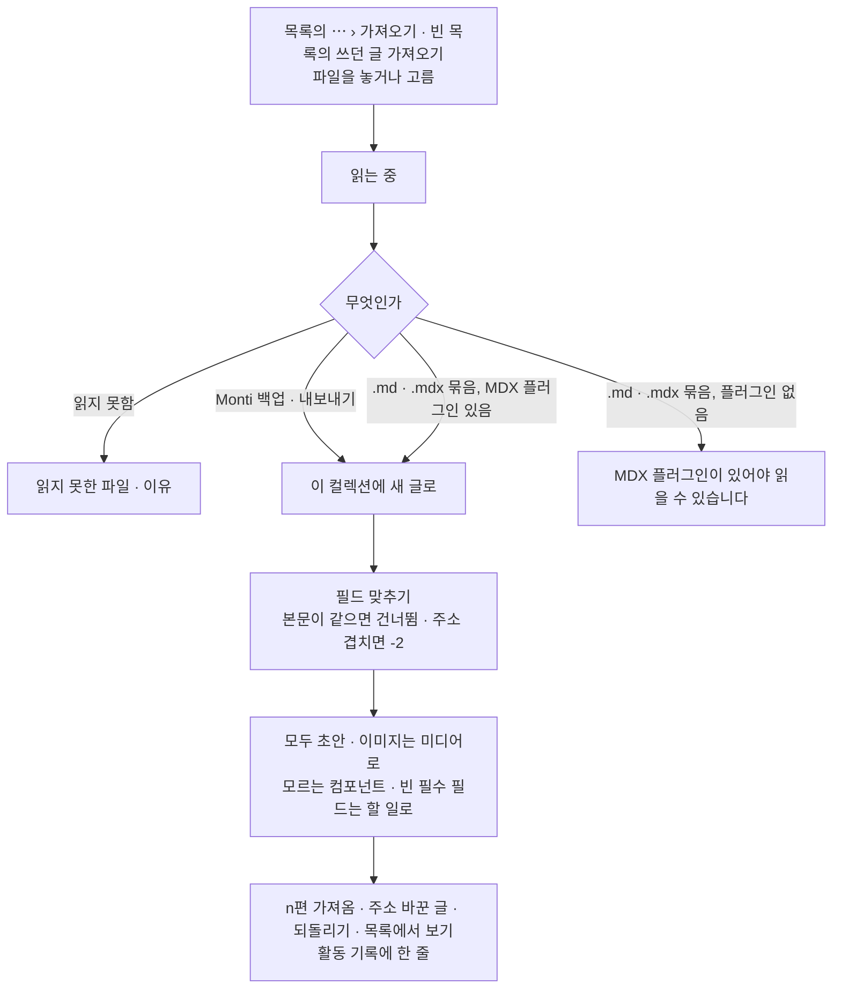

# 14 데이터 · 키 · 플러그인

상태: 초안 (2026-11-05). 키와 모델의 core(#469)와 API 키 화면, 플러그인(틀, 고리, 플러그인 키, SEO 플러그인)은 만들었다. 데이터(백업, 가져오기, MDX)는 아직이다.

## 한 문장

도구 화면과 목록에 걸친 세 가지다. 데이터는 사이트를 통째로 받아 두는 일과 컬렉션 하나에 글을 가져오는 일이고(통째로 되살리기는 CLI의 일이다), 키는 AI와 플러그인이 쓰는 서비스 키를 암호화해 두는 곳이고, 플러그인은 코드로 꽂아 기능 · 블록 · 필드 · 받는 곳을 더하는 방법이다.

## 원칙

1. **받기는 도구에서, 가져오기는 목록에서.** 도구 › 데이터에는 "백업 받기"만 있다. 가져오기는 컬렉션 목록의 "+ 새 글 쓰기 ▾" 메뉴 › "가져오기"에서 그 컬렉션 하나에 한다. 백업 파일로 빈 사이트를 있던 그대로 되살리는 것은 서버를 다루는 일이라 `monti restore` 명령이 한다.
2. **가져오기는 늘 새 글이고, 형식은 플러그인이 더한다.** core는 Monti 백업과 내보내기 파일만 읽는다. `.md`, `.mdx`는 MDX 플러그인이 있을 때만 받는다. 가져온 글은 모두 초안으로 들어가고, 가져오기 한 번이 통째로 되돌릴 수 있는 기록 한 줄이다.
3. **키는 서버만 읽는다.** 키는 `MONTI_SECRET`으로 암호화해 데이터베이스에 둔다. 화면에는 끝 네 자리만 간다. 에이전트는 키를 읽지 못하고, 끝 네 자리도 받지 않는다.
4. **플러그인은 코드다.** 플러그인을 더하고 빼는 것은 사이트 코드(구조)다. 관리자 화면은 플러그인이 쓸 키를 그 자리에 넣는 것만 한다.

## 쓰는 화면과 흐름

- 기준 화면: `Screens/Reference/Lists` › Data, `Screens/Reference/Settings` › ApiKeys, `Screens/Reference/Lists` › Empty("쓰던 글 가져오기").
- 흐름: [흐름 9 · 데이터](../admin/flows/09-data.md) 전부, [흐름 10 · API 키](../admin/flows/10-api-keys.md) 전부, [흐름 2](../admin/flows/02-assistant.md)의 22~24단계.

## 데이터

### 백업

```ts
// monti-backup-2026-11-05.zip
manifest.json        // { format: 1, monti: "x.y.z", createdAt, schemaHash, counts }
schema.json          // the schema the backup was taken under, for checks on restore
entries.jsonl        // working copy, published copy, translation group, folder, relations, versions
folders.jsonl
media.jsonl          // file metadata and uses
media/…              // the files, only with "미디어 파일도 담기"
paths.jsonl          // old paths and reserved paths
templates.jsonl
admin-values.json    // collection admin values, site settings that live in the database
```

- 도구 › 데이터의 "백업 받기"는 고를 것 없이 바로 받는다. "미디어 파일도 담기"는 처음에 꺼져 있다(크기가 크므로).
- 목록에서 고른 글만 받는 "내보내기"(06의 일괄 막대)는 같은 모양에 그 글들만 담는다.
- 휴지통에 든 것, 활동 기록, 대화, 키는 담지 않는다.

### 가져오기



- **필드 맞추기.** 파일의 front matter 키마다 스키마의 필드를 고른다(title → 제목, tags → 태그, layout → 가져오지 않음). 관계 필드에 없는 값은 새 항목이 된다("새 태그 4개가 생깁니다").
- **본문.** `.md`와 `.mdx`는 MDX 플러그인이 JSON 문서로 바꾼다(03). 플러그인이 모르는 컴포넌트는 그대로 둘 수 없으므로 가져오기 전에 목록으로 보이고, 들어간 글에는 할 일이 붙는다.
- **컬렉션 하나에.** 가져오기는 연 목록의 컬렉션에만 넣는다. 들어갈 곳을 고르는 단계가 없다. 필드 맞추기는 그 컬렉션의 필드만 보인다.
- **Monti 백업 · 내보내기 파일.** 그 안에서 이 컬렉션의 글만 가져온다. 폴더 구조와 번역 묶음은 살리고, 상태는 모두 초안이다. 가리키는 카테고리와 태그는 주소로 찾아 잇고, 없으면 새로 만든다.
- **MDX 플러그인.** `.md`, `.mdx`를 읽는 일은 `@monti-cms/mdx`가 가져오기 형식으로 더한다. 플러그인이 없으면 그 파일은 "MDX 플러그인이 있어야 읽을 수 있습니다" 한 줄로 끝난다.

### 통째로 되살리기

```bash
monti restore monti-backup-2026-11-05.zip
```

- 빈 데이터베이스에서만 돈다. 글이 하나라도 있으면 멈춘다.
- 먼저 파일 전체를 검사하고(없는 필드, 겹치는 주소), 문제가 하나라도 있으면 하나도 쓰지 않고 문제 목록을 출력한다.
- 상태, 날짜, 주소, 옛 주소, 폴더, 미디어를 그대로 쓰고, 미디어 파일을 담은 백업이면 저장소에도 올린다.
- 데이터베이스를 잃은 경우, 호스트를 옮기는 경우, 새 서버를 처음 채우는 경우에 쓴다. 데이터베이스 자체의 백업(호스트의 시점 복구 같은 것)은 호스트의 일이다.
- **되돌리기.** 가져오기 한 번은 활동 기록의 한 줄이고, 그 줄에서 통째로 되돌린다(만든 글, 항목, 미디어를 휴지통으로). 30일 기한은 다른 되돌리기와 같다(13).

## 키

```ts
type ApiKey = {
  id: string;
  service: "anthropic" | "openai" | "openrouter" | "gemini" | "openai-compatible" | string; // plugins add services
  name: string;               // "Anthropic 개인"; defaults to the service, " 2" when taken
  baseUrl?: string;           // openai-compatible only
  secret: Encrypted;          // with MONTI_SECRET
  last4: string;
  usage: { month: string; tokens: number };
};
```

- **더하기.** 서비스를 고르면 이름이 채워진다. 키를 넣고 "추가"하면 서비스에 한 번 물어 확인한다. 받아 주지 않으면 창이 열린 채 키 칸 아래에 한 줄.
- **고치기.** 키 칸은 "··· a1b2"와 "바꾸기"다. 바꾸면 다시 확인한다.
- **지우기.** 늘 확인한다(되돌릴 수 없다). 그 키를 쓰는 곳(어시스턴트 기본 모델, 빠른 작업, 플러그인)이 있으면 멈출 곳을 나열한다.
- **비밀값.** `MONTI_SECRET`이 없으면 키를 저장할 수 없고 알림 띠가 보인다. 비밀값이 바뀌어 읽을 수 없는 키는 줄마다 "읽을 수 없음"과 편집이 있다.
- **모델.** 모델 목록은 키의 서비스에서 받아 키마다 묶는다. 어시스턴트의 모델은 대화마다 고르고(10), "빠른 작업" 모델 하나만 이 화면에서 고른다(관리자 값).
- **사용량.** 키마다 이번 달 토큰. 금액과 한도는 세지 않는다(10).

만들면서 정한 것(2026-11-12, core):

- **서비스.** AI 서비스 다섯(`anthropic`, `openai`, `openrouter`, `gemini`, `openai-compatible`)은 core가 안다(`packages/core/src/keys/services.ts`). 서비스 하나는 이름, 키 창이 물을 것(주소가 필요한지, 키 없이도 되는지, 키 자리 글자), 그리고 "이 키를 받아 주는가"를 묻는 요청 하나(`check`)다. 플러그인은 `keyServices`로 서비스를 더한다. core는 모델을 부르지 않는다. 모델 목록을 받아 올 뿐이다.
- **확인.** `check`는 서비스의 모델 목록을 한 번 받아 온다. 그래서 확인과 모델 목록이 같은 요청이다. 답은 셋이다: 받아 줌(모델 목록), 받아 주지 않음(`keys.refused` "맞지 않는 키입니다."), 닿지 못함(`keys.unreachable` "서비스가 답하지 않습니다."). 키는 그 서비스의 주소에만, 주소 줄이 아니라 헤더로 보낸다.
- **서비스의 답은 믿지 않는다.** 확인은 늘 `checkKey`를 거친다(core의 서비스도 플러그인의 서비스도). 아래는 모두 "닿지 못함"이고, 저장된 키의 지난 목록은 그대로 남는다.
  - 확인 전체에 10초다. 요청이 둘인 서비스(OpenRouter)도 합쳐서 10초다.
  - 다른 주소로 넘기는 답(리디렉션)은 따라가지 않는다. 키가 든 헤더가 다른 곳이나 서버 안쪽 망으로 따라가기 때문이다.
  - 답은 8 MB까지만 읽는다. 성공이 아닌 답의 본문은 읽지 않는다.
  - 서비스가 문서에 적은 모양이 아닌 답(HTML, 깨진 JSON, 목록이 없는 객체, id 없는 줄)은 "모델 없음"이 아니라 읽지 못한 답이다. 정말 빈 목록(`{ "data": [] }`)만 모델 없는 키가 된다.
  - 모델 이름에 키 값이 들어 있는 답은 통째로 버린다. 모델 이름은 어시스턴트와 활동 기록으로 나가기 때문이다. 12자보다 짧은 키("x", "ollama" 같은 자리 채움)는 견주지 않는다: 어느 모델 이름에나 들어 있을 수 있다. 모델은 아는 네 값(id, 이름, 생각, 그림)만 저장한다.
  - 플러그인의 `check`가 던지거나 엉뚱한 값(`null`, 글자)을 돌려줘도 닿지 못한 것이다.
- **묻는 동안 데이터베이스를 잡지 않는다.** `keys.add`와 `keys.update`는 트랜잭션을 열기 전에 서비스에 묻는다(기능의 `prepare`, 00). 연결이 하나뿐인 배포에서도 그 10초 동안 다른 요청이 돈다. 쓸 때는 물어보기 전에 읽은 것이 그대로인지 다시 본다: 이름이 아직 비어 있는지, 키의 버전이 그대로인지(아니면 충돌). 화면이 읽은 버전이 이미 옛것이면 묻기도 전에 충돌이다: 그 사이 바뀐 키를 옛 화면이 적은 주소로 보내지 않는다.
- **서비스가 죽어 있을 때.** 목록을 받지 못한 키는 15분 동안 다시 묻지 않는다(`models_failed_at`). 그동안은 지난 목록을 쓴다. 그러지 않으면 모델 메뉴를 열 때마다 10초를 기다린다. `refresh`는 바로 묻는다. 같은 키의 목록을 동시에 찾는 요청들은 확인 하나를 함께 기다린다. 함께 기다리는 것은 서비스의 답만이 아니라 그 답을 적는 데까지다.
- **주소.** OpenAI 호환 주소는 출처와 경로만 받는다. `?`, `#`, 사용자 이름과 비밀번호가 든 주소는 "http 주소를 적어 주세요."로 거절한다. 확인이 뒤에 `/models`를 붙이는데, 그런 주소에서는 요청이 적힌 곳과 다른 곳으로 간다.
- **Anthropic의 버전 헤더.** 모델 목록은 `anthropic-version: 2026-10-21`로 받는다. Anthropic API 문서의 Models 예시가 쓰는 값이고, 문서는 Models 끝점이 이 값과 `2023-06-01`에 똑같이 답한다고 적는다. 진짜 키로 불러 보지는 못했다(키 없이 부르면 버전을 보기 전에 401이 온다).
- **모델 목록.** 받은 목록은 키와 함께 저장하고 하루가 지나면 `models.list`가 다시 받는다(`refresh`를 주면 바로). 서비스가 답하지 않으면 지난 목록을 그대로 쓴다. 도구를 쓸 수 있는 모델만 담고, 모델마다 생각할 수 있는지와 그림을 읽는지를 적는다. 그것을 알려 주지 않는 서비스(OpenAI, OpenAI 호환)는 이름으로 가늠한다.
- **처음 모델.** 아무도 고르지 않았을 때의 모델은 읽을 수 있는 첫 키(먼저 넣은 키)의 서비스가 정한다. 서비스가 사라진 키(뺀 플러그인의 키)는 모델을 내지 않는다. 서비스마다 어시스턴트용과 빠른 작업용 모델을 좋은 순서로 적어 두고, 키가 쓸 수 있는 첫 모델을 쓴다. 적어 둔 모델이 하나도 없으면(서비스가 이름을 바꿨으면) 그 키의 첫 모델을 쓴다. `models.list`가 둘 다 돌려준다(`assistant`, `quick`). "빠른 작업"을 고르면 `quick`만 바뀐다. 고른 모델이 목록에서 사라지면 다시 서비스의 모델로 돌아간다.
- **쓰는 곳.** `keys.list`의 `uses`는 그 키가 지금 내고 있는 모델이다: 어시스턴트의 처음 모델, 빠른 작업 모델. 지우기 확인이 이것을 보인다.
- **끝 네 자리.** 12자보다 짧은 키는 끝자리를 보이지 않는다(네 자리가 키의 대부분이다). 키 없이 쓰는 서비스도 끝자리가 없다.
- **줄에 묶인 키.** 암호화할 때 그 줄의 id, 서비스, 주소를 함께 묶는다(AES-GCM의 덧붙임 값). 데이터베이스에 쓸 수 있지만 `MONTI_SECRET`은 모르는 사람이 줄의 주소나 서비스를 바꾸거나 암호문을 다른 줄로 옮기면 그 키는 열리지 않는다("읽을 수 없음"). 서버가 키를 엉뚱한 곳으로 보내지 않는다. 주인이 주소를 바꾸면 `keys.update`가 새 주소로 다시 묶는다.
- **명령줄.** `monti keys.add --secret sk-…`처럼 키를 인자로 주면 셸 기록과 프로세스 목록에 남는다. 그래서 인자로는 받지 않는다: `--secret -`라고 쓰면 키를 표준 입력에서 읽는다(`admin:reset-password`가 비밀번호를 읽는 방식). 파이프로 준 키는 끝까지 읽으므로 줄 끝 문자가 없어도 된다(`printf '%s' "$KEY" | monti keys.add … --secret -`). 묻는 말은 터미널에서만, 표준 오류로 나간다: 표준 출력에는 결과 JSON만 있다. `--secret -` 말고 키가 든 인자는 합치기 전에 날것 그대로 보고 거절한다(`--input` 안의 키, 두 번 준 `--secret`). 인자 오류는 몇 번째 인자인지만 말하고 적힌 글자를 되풀이하지 않는다. 키 기능을 명령에서 빼지 않은 것은 "기능 하나, 입구 여럿"(00)을 지키려는 것이다. 기능이 `secretInputs`로 비밀인 입력을 알리고, 명령줄은 그 입력을 인자나 `--input`의 JSON으로 받지 않는다.
- **저장.** 키는 `MONTI_SECRET`에서 만든 키로 AES-256-GCM 암호화해 `api_keys.secret`에 둔다. 서버만 `monti.keys.open(id)`로 연다. 기능의 답, 활동 기록, 오류, 제안 저장소에는 키가 없다(14-4). 사람만 하는 기능은 제안으로 쌓이지 않는다: 입력을 읽기도 전에 거절한다(키뿐 아니라 사람만 하는 기능 모두).
- **빈 비밀값.** `MONTI_SECRET`이 빈 글자이거나 공백뿐이면 없는 것이다. 비어 있지 않은 비밀값은 앞뒤 공백까지 적힌 그대로 쓴다(설정 파일의 값도 환경 변수의 값도). 다듬으면 전에 서명하고 잠근 것이 열리지 않는다. 사이트가 비밀값을 읽는 한 곳(`createSite`)에서 그렇게 정하므로 키도 미리보기 링크도 같다. 빈 비밀값으로 잠근 키는 데이터베이스만 가진 사람이 연다.
- **사용량.** 쓴 토큰은 `monti.keys.addUsage(id, tokens, at)`가 키와 달(UTC)마다 따로 센다(`api_key_usage`). 지난달 것이 늦게 와도 이번 달 수는 그대로다. 수가 아닌 값(서비스가 사용량을 주지 않음)은 세지 않는다.
- **버전.** 키도 버전이 있는 레코드다(`key`). 고치는 요청은 서비스에 묻기 전에 읽은 버전 위에만 쓴다. 그 사이 키가 바뀌었으면 충돌이고 아무것도 쓰지 않는다(00). 그래서 주소만 바꾸는 요청과 키를 바꾸는 요청이 겹쳐도, 저장된 키는 늘 함께 확인한 주소와 짝이다. 모델 목록을 새로 받는 일도 물어본 키와 주소가 그대로일 때만 목록을 쓴다.
- **되돌리기.** 키를 더하고 고치고 지우는 일은 활동 기록에 남지만 되돌리기가 없다.

## 플러그인

```ts
// monti.config.ts
import { algolia } from "@monti-cms/plugin-algolia";
import { seo } from "@monti-cms/seo";

export default defineConfig({
  plugins: [seo(), algolia({ index: "posts" })],
});

// app/admin/page.tsx: the browser halves of the plugins that draw something
<AdminPage plugins={[seoAdmin]} />

// a plugin
export const algolia = (options: AlgoliaOptions) =>
  definePlugin({
    name: "algolia",              // code name: keys, deliveries and the log name it by this
    label: "Algolia 검색",        // what a person reads
    keyServices: [algoliaService],
    keys: [
      { id: "search", label: "검색 키", service: "algolia" },
      { id: "admin", label: "관리 키", service: "algolia" },
    ],
    receivers: [{ destination: "plugin:algolia", accepts: (event) => event.type.startsWith("entry."), send: indexEntries }],
    operations: [reindex],      // become admin API, agent tools and CLI (00)
  });
```

| 플러그인이 더할 수 있는 것 | 어디에 보이나 |
|---|---|
| 기능(`operations`, 레코드 종류 `recordKinds`, 흐름 `streams`) | 관리자 API, 에이전트 도구, CLI(00) |
| 블록과 서식(`blocks`, `marks`) | 편집기의 `/` 메뉴, 사이트 그리기(03) |
| 필드와 속성 패널 탭(`fields`) | 잠긴 탭(SEO)(01) |
| 목록 열(`fields`의 `columns`) | 열 추가 메뉴(06) |
| 발행 검사(`publishChecks`) | 할 일(02) |
| 저장 전 고리(`beforeSave`) | 저장되는 값, 저장의 거절 |
| 본문 검사(`textCheck`) | 상태 줄의 플러그인 칸(03) |
| 받는 곳(`receivers`) | 전송(13) |
| 가져오기 형식(`importers`) | 가져오기가 읽는 파일(MDX 플러그인의 `.md`, `.mdx`) |
| 도구 페이지(`toolPages`) | 도구 탭 |
| 키 서비스(`keyServices`)와 키 자리(`keys`) | API 키 화면의 서비스 목록, 플러그인 줄 |
| 미디어 저장소(`storage`) | 미디어(09) |

플러그인은 두 쪽이다. 서버 쪽(`definePlugin`)은 `monti.config.ts`에 적고, 화면에 무언가를 그리는 플러그인은 브라우저 쪽(`defineAdminPlugin`)을 관리자 페이지에 넘긴다(`<AdminPage plugins={[…]} />`). 브라우저 쪽이 가져오는 것은 셋이다: 필드의 입력(`inputs`), 값 없는 화면(`views`), 도구 페이지의 화면(`toolPages`). 서버 쪽이 이름으로 가리키고, 브라우저 쪽이 그 이름의 컴포넌트를 준다. 브라우저 쪽이 없어도 사이트는 돈다: 필드는 종류의 기본 입력으로 그려지고, 화면 필드와 도구 탭은 보이지 않는다.

필드의 입력은 그 값이 어시스턴트의 제안인지도 받는다(`FieldInputProps`의 `proposal`. 2026-11-13 만들며 정함, #490과 #492가 만나는 곳): 아무도 받거나 고치지 않은 제안이면 입력은 제 부품의 `proposal`로 파랗게 그린다(`Input`, `Textarea`, `Switch`). 라벨 줄의 파란 점과 "버리기", 말풍선은 다른 필드와 같이 편집기가 그린다. 그 값을 모르는 입력(사이트가 직접 만든 것)도 제안된 값을 받고, 라벨 줄에서 버릴 수 있다. 값 없는 화면(`views`)에는 제안이 걸리지 않는다: 글이 지금 가진 값을 보인다.

### 만들며 정함 (2026-11-13) · 플러그인

소유자의 결정이 아니다. 플러그인 쪽을 만들며 정한 것이다.

- **플러그인의 이름.** `name`은 소문자, 숫자, 하이픈이다(`definePlugin`이 거절한다). 같은 이름의 플러그인 둘은 사이트를 만들 때 거절한다. `label`은 사람이 읽는 이름이고 없으면 `name`이다.
- **플러그인의 필드는 파일에 없다(T75).** `fields`는 탭 하나와 그 탭의 필드들이다(`{ tab, collections?, fields, columns? }`). 문서 컬렉션에만 붙는다(`collections`가 없으면 모든 문서 컬렉션). 사이트가 도는 스키마(`site.schema()`)는 파일의 스키마에 플러그인의 값 필드를 더한 것이고, 구조를 다루는 기능(`schema.*`, `settings.save`)은 파일의 스키마(`site.fileSchema()`)만 계획하고 쓴다. 그래서 글 저장, 목록, 번역, 미디어 쓰임, 사이트의 읽기는 플러그인의 필드를 파일의 필드와 똑같이 다루고, `monti.schema.ts`에는 한 글자도 적히지 않는다. `schema.read`가 준 스키마로 만든 초안(어시스턴트의 것)에 플러그인 필드가 들어 있어도 구조 기능이 다시 뺀다: 플러그인이 정의한 그대로인 필드만 뺀다. 이름은 같고 내용이 다른 필드는 초안이 더하려는 파일의 필드다. 설정 화면도 제안을 읽을 때 같은 것을 빼서 "필드 추가"로 보이지 않게 한다. 언어를 바꾸는 기능(`locales.*`)도 파일의 스키마로 초안을 만든다.
- **값은 글에 남는다.** 플러그인을 빼면 탭과 필드가 사라지고, 글의 `values`에 든 값은 그대로 남는다. 사이트와 목록은 스키마에 없는 값을 주지 않으므로 보이지 않고, 플러그인을 다시 꽂으면 돌아온다. 지우는 단계는 없다(구조 변경이 아니다).
- **이름이 겹치면 파일이 이긴다.** 파일의 스키마에 같은 이름의 필드가 있으면 그 필드가 서고 플러그인의 것은 빠진다. 두 플러그인이 한 컬렉션에 같은 이름을 더하면 사이트를 만들 때 거절한다.
- **읽기용 뷰.** 데이터베이스의 `monti_<컬렉션>` 뷰는 파일의 필드만 열로 둔다(뷰는 파일의 스키마가 바뀔 때 다시 만든다). 플러그인의 값은 `entries.values`에서 읽는다.
- **필드의 입력 바꾸기(T75).** 어느 필드든 `input`(이름)과 `inputOptions`를 가질 수 있다. 파일의 필드도 같다(`monti.schema.ts`에 적는다. 값이라 파일에 적힌다). 속성 패널은 그 이름의 입력을 브라우저 쪽에서 찾아 값 자리에 그린다. 입력은 값 자리의 부품만 그린다(`@monti-cms/ui`의 부품으로): 행과 라벨은 패널의 것이다. 라벨 줄 끝에 한마디(`Note`: 글자 수)를 둘 수 있다. 미디어 필드의 입력은 바꾸지 않는다(파일 창, 올리기, 대체 텍스트가 한 몸이다). 스위치로 고르는 조건부 필드(19)도 입력을 가리키면 스위치 대신 그 입력으로 그린다. 번역 글에서 원문의 것인 필드(`same`)는 원문 값을 읽기만 하므로 입력을 그리지 않는다.
- **값 없는 화면 필드(T75).** `{ kind: "view", view, options? }`는 플러그인의 탭에만 선다. 값이 없어 저장도 목록도 모른다. 사이트 자신의 화면이 필요하면 설정 파일에 플러그인 하나를 적는다(`definePlugin`, `files` 플러그인처럼). 화면은 지금 편집기가 든 값(저장 전 값 포함)을 받는다. 고르지 않은 선택지의 값(저장이 지울 값, 19)은 받지 않는다.
- **목록 열(T53).** 플러그인의 필드 가운데 `columns`에 적은 것만 열이 된다. 처음에는 숨어 있고 "열 추가"에 나온다. 거르기는 종류를 따른다(글자와 미디어는 "비어 있음"). 따로 만든 것이 없다: 열은 스키마의 필드에서 나오므로 플러그인 필드도 같은 길이다.
- **이름은 플러그인이 준다.** 플러그인 필드의 라벨, 에이전트용 설명, 선택지 이름은 플러그인의 글자다. 관리자 값에 같은 필드의 이름이 있으면 그것이 이긴다(`schema.read`가 플러그인의 것을 아래에 깐다). 설정 화면은 플러그인의 탭을 잠가 보여 주므로 지금은 고칠 길이 없다.
- **저장 전 고리(T85).** `beforeSave(entry, { db, schema, previous, actor })`는 `entries.create`와 `entries.save`의 쓰기 안에서, 초안을 얹은 작업본을 받고 돈다. 바꿀 것을 돌려주면(`{ title?, slug?, values? }`) 그 값이 저장된다. 돌려준 값 가운데 바뀐 것만 고리의 말이고(받은 값을 그대로 돌려주면 아무것도 바꾸지 않은 것이다), 그것은 사람의 값과 같은 검사를 지난다(없는 필드, 없는 선택지, 없는 파일은 거절. 번역 글에서 원문의 것인 필드는 `entries.sameField`). 반대쪽에서 고치는 관계(`via`)는 고리가 정할 수 없다: 그 쓰기가 미리 잡지 않은 다른 글을 고치게 된다(플러그인의 오류로 던진다). 새 글은 템플릿의 본문이 들어간 뒤에 고리를 지난다. 막으려면 `CheckError`를 던진다(`says("…")`로 사이트 말을 그대로 실을 수 있다): 저장은 거절되고 아무것도 쓰이지 않는다. 플러그인이 여럿이면 적힌 순서로 돌고 앞의 것이 남긴 값을 본다. 본문은 바꾸지 않는다(본문은 블록 연산과 블록의 검사가 다룬다). 본문만 고치는 기능(`body.edit`), 번역의 결정, 관계 일괄 바꾸기는 이 고리를 지나지 않는다: 값이 아니라 본문이나 묶음을 다루는 다른 쓰기다.
- **본문 검사(T70).** `textCheck: { label, locales?, check(blocks, { collection, locale }) }`. 편집기가 본문 블록의 글자를 보내고(`plugins.checkText`, 읽기) 플러그인이 고칠 곳(블록, 글자 자리 `from`~`to`, 바꿀 말)을 돌려준다. 받은 블록 밖을 가리키는 답은 버린다. 블록의 글자에서 줄 바꿈은 줄 바꿈으로, 각주 표시 같은 글자 아닌 것은 기호 하나(U+FFFC)로 선다: 양옆의 말이 한 낱말로 붙지 않는다. 그것을 걸치는 답은 고칠 수 없으므로 줄로 보이지 않는다(고치면 줄 바꿈이나 각주 표시가 지워진다). 코드 블록은 보내지 않고, 표의 칸은 제 블록이 없어 검사하지 않는다. 한 번에 2,000블록까지 보낸다. 편집기는 열 때 한 번, 그 뒤로는 고친 뒤 0.8초 쉬면 다시 묻는다. 다시 물을 때는 그 사이 바뀐 블록만 보내고, 나머지 블록에서 찾았던 것은 그대로 둔다(긴 글 전체를 쉴 때마다 플러그인의 서비스에 보내지 않는다). 그 글의 언어를 읽는 검사가 없으면 묻지 않는다. 상태 표시줄의 칸은 찾은 것이 있을 때만 보인다(칸 이름과 수, 줄마다 "틀린 말 → 바꿀 말"과 "고치기", 아래 "모두 고치기"). 고치기는 사람이 누르는 것이라 제안이 아니라 본문에 바로 들어가고, 한 번의 실행 취소로 돌아온다. 읽기 전용 글에는 칸이 없다. 검사가 실패하면 칸이 없고 서버 콘솔에 오류가 남는다: 화면에서 사람이 할 일이 없다. 패널의 "설정"은 두지 않는다: 플러그인의 설정은 코드에 있다(원칙 4).
- **받는 곳의 답(T172).** 플러그인의 받는 곳은 상대에게 `receiverFetch(url, init)`로 보낸다(웹훅이 쓰는 것과 같은 것). 성공이 아닌 답은 `ReceiverAnswer`("503 Service Unavailable")로, 닿지 못한 것은 "답 없음"(네트워크의 말과 함께)으로 던져지고, 리디렉션은 따라가지 않는다. 그래서 활동 기록이 "보내지 못함" 대신 상대가 한 말을 보인다. 받는 곳의 코드가 던진 다른 오류는 전처럼 글자 없이 `failed`로 저장하고, 원래 오류는 서버 콘솔에 남긴다(`console.error`). 저장소와 화면과 어시스턴트에는 주소와 토큰이 실릴 수 있어 싣지 않지만, 서버 콘솔은 사이트 주인의 것이고 다른 실패(전송 묶음, 플러그인의 정리)도 이미 거기에 원래 오류를 찍는다.
- **도구 페이지.** `toolPages: [{ id, label }]`가 도구의 탭이 되고(`#/tools/p/<플러그인>/<id>`), 화면은 브라우저 쪽의 같은 id 컴포넌트다. 브라우저 쪽이 그 화면을 주지 않으면 탭이 없다(빈 탭을 만들지 않는다).
- **가져오기 형식.** `importers: [{ id, label, extensions, read(file) }]`는 자리만 있다. 가져오기(`data.inspect`, `data.import`)가 만들어질 때 읽는다(T57, T34).
- **플러그인 목록.** `plugins.list`(읽기)가 플러그인마다 이름, 더하는 것의 종류, 키 자리가 찼는지, 도구 페이지, 본문 검사, 가져오기 형식을 준다. 에이전트의 도구이기도 하다. 설정 화면에 플러그인 목록은 두지 않는다: 더하고 빼는 것은 코드이고(원칙 4), 화면에서 할 일은 키를 넣는 것뿐이며 그것은 API 키 화면에 있다.
- **플러그인 키(T144).** 키 자리의 키는 `api_keys`의 한 줄이고 그 줄의 id가 자리의 이름이다(`slot:<플러그인>/<자리>`). 키는 줄의 id에 묶여 암호화되므로 다른 자리로 옮기면 열리지 않는다. 표를 더하지 않았다. 이 줄은 "AI 키" 목록과 모델 목록에 나오지 않고, `keys.update`와 `keys.remove`는 이 줄을 모른다(`keys.unknown`): 넣기, 바꾸기, 빼기는 모두 `plugins.setKey`다. 빼기는 키 없이 `remove: true`다: 명령줄은 비밀값을 인자로 받지 않으므로(`--secret -`) 빼기를 키의 값으로 말할 수 없다(`monti plugins.setKey --plugin algolia --slot search --remove true`). 빼기는 `MONTI_SECRET`이 없어도 된다. 넣고 바꿀 때는 자리의 서비스에 한 번 묻고, 묻는 동안 데이터베이스를 잡지 않는 것과 그 사이 바뀌었으면 충돌인 것은 다른 키와 같다. 서버는 `monti.plugins.key(플러그인, 자리)`로 연다. 사람이 이름 붙이는 키는 `slot:`으로 시작하는 이름을 가질 수 없다. 플러그인과 자리의 id는 소문자, 숫자, 하이픈이다.
- **주인이 사라진 자리의 키.** 플러그인을 빼거나 자리를 없애도 그 키는 저절로 지워지지 않는다: 같은 데이터베이스를 쓰는 다른 배포(미리보기 배포, 바뀌는 중인 옛 인스턴스)가 그 플러그인을 아직 돌릴 수 있고, 지운 키는 되돌릴 수 없다. 대신 "플러그인 키" 목록에 줄로 남는다: 이름은 플러그인과 자리의 코드, 둘째 줄은 "플러그인 없음", ⋯에는 "지우기"만 있다. 사람이 지운다(`plugins.setKey`의 `remove`는 플러그인이 없어도 된다). `keys.list`의 `slots[].orphan`이 이것이다.
- **자리의 서비스.** 자리가 가리키는 서비스는 사이트에 있어야 한다(없으면 사이트를 만들 때 거절). 자리만을 위한 서비스(플러그인이 더했고 자리가 쓰는 서비스)는 "+ 키 추가"의 서비스 목록에도, 키 창의 "서비스" 고르기에도 나오지 않고(`keys.list`의 `services[].addable`), `keys.add`도 받지 않는다(`keys.unknownService`): 그 키는 자리에서 넣고, AI 키 옆에 더해 봐야 쓰는 곳이 없다. core의 AI 서비스를 쓰는 자리(임베딩용 OpenAI 키 같은 것)는 그 서비스를 목록에서 빼지 않는다. 플러그인이 더한 그 밖의 서비스는 목록의 "플러그인" 묶음에 나온다.
- **자리의 키 창에는 이름 칸이 없다.** 기준 그림(`ApiKeysSlot`)은 "이름" 칸에 플러그인 이름을 채워 두었다. 자리의 줄은 플러그인의 이름으로 불리고 그 이름은 코드가 정하므로, 적어도 어디에도 쓰이지 않는 칸이다. 뺐고 기준 그림도 고쳤다. 창은 "서비스"(글)와 "키"뿐이다. 제목은 "키 넣기 · (플러그인)", 키가 있으면 "편집 · (플러그인)"이고, 자리가 여럿인 플러그인은 이름 뒤에 " · 검색 키"가 붙는다.
- **자리의 줄.** 읽을 수 없는 자리의 키는 둘째 줄이 "읽을 수 없음"이고 알림 띠의 수에 든다. 지우기 확인은 늘 "이 키를 쓰는 곳이 멈춥니다"다(자리의 키는 늘 그 플러그인이 쓴다). `MONTI_SECRET`이 없으면 빈 자리는 보이지 않고, 키가 든 자리는 AI 키처럼 남아 ⋯에 "지우기"만 있다. 키보드로 자리의 키를 지우면 줄이 남으므로 포커스는 그 줄의 "키 넣기"로 간다.
- **GitHub 로그인은 core에 남는다(T73).** 플러그인으로 빼지 않는다. 플러그인이 더하는 것은 로그인한 관리자가 쓰는 것들이고(위 표), 로그인은 그 앞에 서는 문이다: 비밀번호 로그인이 core에 있고, 두 방법은 같은 세션과 같은 `auth.state`를 쓴다. 한쪽만 플러그인이면 로그인이 두 곳에 나뉘고, 세션 없이 도는 경로(`…/auth/github`, `…/callback`)를 플러그인에 열어 주는 고리가 하나 더 필요하다(지금 플러그인의 기능은 모두 세션 뒤에 있다). 설정은 `auth: { github }` 한 줄 그대로다.

- API 키 화면은 표 셋이다. "AI 키"(모델 목록이 이 키들에서 나온다), "모델"(빠른 작업 모델 하나), "플러그인 키"(플러그인이 둔 키 자리마다 한 줄). 키 줄은 모두 같은 모양과 같은 방법이다. 이름 뒤에 끝 네 자리, 들어 있으면 "편집 · 지우기", 비었으면 "키 넣기". 넣고 바꾸는 것은 모두 같은 키 창이고, 플러그인 자리의 창은 서비스가 정해져 있다. 자리 하나는 한 서비스의 것이라 저장된 키를 고르지 않는다(2026-11-05 소유자).

### SEO 플러그인 (`@monti-cms/seo`, T84) · 만들며 정함 (2026-11-13)

위의 고리(잠긴 탭, 필드의 입력, 화면 필드, 목록 열)를 쓰는 첫 플러그인이다. 옛 `packages/seo`가 하던 일을 새 고리 위에 다시 만들었다. 소유자의 결정이 아니다.

- **꽂기.** `plugins: [seo()]`와 `<AdminPage plugins={[seoAdmin]} />`(`@monti-cms/seo/admin`). 패키지는 `@monti-cms/core` · `admin` · `ui`를 제 것으로 싣지 않고 사이트의 것을 쓴다(peer): 브라우저 쪽이 관리자 화면의 컨텍스트를 읽으므로 사본이 둘이면 안 된다.
- **필드.** 문서 컬렉션마다 "SEO" 탭: 미리보기(`seoPreview`, 화면), SEO 제목(`seoTitle`), SEO 설명(`seoDescription`), 공유 이미지(`seoImage`), 검색에서 숨기기(`seoNoindex`), 대표 주소(`seoCanonical`). 제목, 설명, 대표 주소는 언어마다 쓴다(`perLocale`: 번역 글이 되풀이하는 원래 페이지는 원문의 것과 다르다). 나머지는 종류의 기본을 따른다(공유 이미지는 비면 원문의 것, 숨기기는 원문과 같다).
- **따르는 값.** 빈 제목은 글의 제목을, 빈 설명은 `summary` 필드를, 빈 공유 이미지는 `cover` 필드를 따른다(`seo({ follows })`로 다른 필드를 가리킨다). 제목과 설명 칸은 비어 있는 동안 자리 글자로 "제목과 같음 · 6/60"처럼 따르는 값과 그 길이를 말한다(흐름 1·08, `Controls/Field/PropertyList`의 SEO 탭). 그 컬렉션에 따를 필드가 없으면 "0/160"만 보인다.
- **글자 수.** 적으면 라벨 줄 끝에 "9/60"이 서고, 권장 길이(제목 60, 설명 160. `seo({ limits })`)를 넘으면 경고 색이다. 막지 않는다: 검색 결과에서 잘릴 뿐 틀린 값이 아니다.
- **검색에서 숨기기.** 스위치다. 값은 선택지 하나짜리 고르기(`noindex`)이고 끄면 값이 없다. 기준 그림의 스위치와 같고, 브라우저 쪽이 없으면 선택지 하나인 고르기로 보인다.
- **공유 이미지.** 다른 미디어 필드와 같은 입력이다(입력을 바꾸지 않는다). 기준 화면의 "표지와 같음"은 칸에 적지 않고, 미리보기의 공유 카드가 따르는 그림을 보인다.
- **미리보기.** 탭 맨 위에 두 장: 검색 결과(사이트 이름 › 주소, 제목, 설명, 숨겼으면 "검색에서 숨김")와 공유 카드(그림 1.91:1, 사이트 이름, 제목, 설명). 편집기가 든 값(저장 전 값)으로 그린다.
- **목록 열.** SEO 제목, SEO 설명, 공유 이미지(T53). "비어 있음"으로 거른다.
- **이름의 언어.** 필드 이름은 서버가 정하는 글자라 관리자 언어를 따라 바뀌지 않는다. `seo({ language })`로 고르고 기본은 관리자와 같은 한국어다. 입력의 자리 글자와 미리보기의 말은 브라우저 쪽이 관리자 언어로 쓴다.
- **사이트에서.** `seoOf(entry, follows?)`가 제목(없으면 글의 제목), 설명, 공유 이미지(`SiteImage`), 대표 주소, `noindex`를 준다. 사이트의 `generateMetadata`가 쓴다.
- **옛 것에서 뺀 것.** 역할(`role`)로 필드 찾기(새 스키마에 역할이 없다. 이름으로 찾는다), 필드 이름 바꾸기(`keys`), AI 제안(어시스턴트의 "✦ 채우기"가 플러그인 필드에도 선다. 필드의 설명이 채우는 법을 말한다).

## 기능 목록

| 기능 | 종류 | 하는 일 |
|---|---|---|
| `data.backup` | read | 백업 파일을 만든다(미디어 담기 여부) |
| `data.export` | read | 고른 글만 같은 모양으로 |
| `data.inspect` | read | 올린 파일을 읽고 요약 · 문제 · 맞출 필드를 돌려준다. 아무것도 쓰지 않는다 |
| `data.import` | write · 사람만 | 컬렉션 하나에 새 글로 가져오기(필드 맞추기) |
| `keys.list` | read | 이름, 서비스, 끝 네 자리, 사용량, 쓰는 곳. 키 값은 없다 |
| `keys.add` · `keys.update` · `keys.remove` | write · 사람만 | 더하기, 고치기, 지우기 |
| `models.list` | read | 키마다 쓸 수 있는 모델 |
| `models.setQuick` | write | 빠른 작업 모델 |
| `plugins.setKey` | write | 플러그인 키 자리에 키를 넣거나 바꾸거나 뺀다(사람만. 키 값이 필요하다) |
| `plugins.list` | read | 플러그인마다 이름, 더하는 것, 키 자리가 찼는지 |
| `plugins.checkText` | read | 본문 블록의 글자에 플러그인의 본문 검사를 돌려 고칠 곳을 돌려준다. 아무것도 쓰지 않는다 |

## 에이전트

- **읽기:** 키 목록(값 없이)과 모델 목록, 플러그인 목록을 안다. "어떤 모델을 쓸 수 있어?"에 답한다. 키에 대해 에이전트가 받는 것은 이름, 서비스, 읽을 수 있는지, 쓰는 곳(어시스턴트 · 빠른 작업의 모델)이다. 끝 네 자리, 서비스 주소(직접 둔 서버의 주소), 이번 달 사용량은 받지 않는다: 에이전트가 하는 일에 필요하지 않고, 받은 것은 대화에 남을 수 있다(2026-11-12).
- **사람만:** 가져오기, 키 더하기 · 고치기 · 지우기. 통째로 되살리기는 CLI 명령이라 도구가 아니다. 파일과 키 값이 필요하거나 되돌릴 수 없는 일이다.
- 에이전트가 쓰는 도구는 플러그인 기능까지 모두 00의 기능 정의에서 나온다. 플러그인을 더하면 에이전트도 그 기능을 쓴다.

## 화면 쪽 조각

- `useImport()`: 파일 읽기, 요약, 필드 맞추기, 진행, 결과.
- `KeyDialog`: 키 더하기와 고치기 창(서비스, 이름, 주소, 키, 확인).
- `ModelMenu`: 어시스턴트 입력란(10)과 빠른 작업 고르기가 같이 쓴다.

## 결정 기록

- 2026-11-12, 소유자: API 키 화면은 그린 대로 좋다. 화면 승인 절과 그림은 화면을 만드는 PR에 있다. 좁은 창의 모양은 만들지 않는다(대상에 모바일이 없다).
- 2026-11-12: 어시스턴트의 도구로서 `keys.list`는 끝 네 자리, 서비스 주소, 사용량을 주지 않는다(위 "에이전트"). 모델 목록에는 서비스가 알려 주면 문맥 크기(`context`)도 둔다: 어시스턴트가 보낼 양을 거기에 맞춘다(10).
- 2026-11-05: 백업은 JSON 줄 파일 묶음이다. 본문은 원본인 JSON 문서 그대로다. `.md`, `.mdx`는 가져올 때만 플러그인이 바꾼다.
- 2026-11-05: 휴지통, 활동 기록, 대화, 키는 백업에 담지 않는다.
- 2026-11-05: 가져오기 한 번은 활동 기록의 한 줄이고 통째로 되돌린다. 기한은 30일이다(13).
- 2026-11-05: 플러그인은 `monti.config.ts`의 코드로 더하고 뺀다. 관리자 화면은 키 자리에 키만 넣는다.
- 2026-11-13: 플러그인 쪽을 만들며 정한 것은 "만들며 정함 (2026-11-13) · 플러그인"에 있다(필드와 잠긴 탭, 저장 전 고리, 본문 검사, 받는 곳의 답, 플러그인 키, GitHub 로그인은 core에 남김). 첫 플러그인은 SEO다(`@monti-cms/seo`).
- 2026-11-05, 소유자: 플러그인 키 자리는 저장된 키를 고르지 않는다. 자리마다 자기 키를 AI 키와 같은 줄 모양, 같은 키 창으로 넣는다. 표는 "AI 키" · "모델" · "플러그인 키" 셋이다. 고르기는 "빠른 작업" 모델에만 있다.
- 2026-11-05, 소유자: 가져오기는 컬렉션 목록의 "+ 새 글 쓰기 ▾" 메뉴 › "가져오기"에서 그 컬렉션 하나에 한다. 일괄로 여러 컬렉션을 가져오는 길은 없다. 도구 › 데이터에는 백업 받기만 남는다.
- 2026-11-05, 소유자: `.md`, `.mdx` 가져오기는 MDX 플러그인이 있어야 한다. MDX는 더하는 플러그인이기 때문이다. core는 Monti 형식만 읽는다.
- 2026-11-05, 소유자: 통째로 되살리기는 관리자 화면에서 빼고 `monti restore` 명령으로 한다. 화면에는 백업 받기와 가져오기만 있다. Monti 백업 파일도 화면에서는 새 글로 가져온다. 흐름 9의 12~15단계는 빠진다.
- 흐름 10: 키는 늘 확인하고 지운다.

## 나중에 할 것

- 정해 둔 때에 저장소로 저절로 백업하기. 기준 화면에 없다. README의 "나중에 할 것"에 적는다.

## 화면 승인 (2026-11-12, 소유자) · API 키 화면

2026-11-12. 코드를 쓰기 전에 빈 곳을 찾아 답과 그림을 붙였다. 소유자에게 물은 것은 하나다: "이 모양으로 만들어도 될까요? 옆 탭 '템플릿'과 같은 표이고, '편집'과 '지우기'는 줄 끝 ⋯ 안에 있습니다." 소유자의 답은 "api key 설정 화면은 좋아"였다. 화면은 그 그림대로 만들었고(`packages/admin/src/screens/keys`), 무엇이 어느 자리에 오는지는 [화면 지도](../admin/screens/tools.md)에 있다.

그림은 `Screens/Reference/Settings`의 `ApiKeys…` 이야기다(진짜 부품으로 그렸다, 1440×900). 흐름 10의 단계마다 하나씩 있고, 이름 옆에 적었다.

### 소유자가 승인한 것

- 그림에 그려진 화면의 모양.
- 좁은 창의 모양은 만들지 않는다: 대상에 모바일이 없다.
- 알림 띠의 자리(아래 13번의 자리 쪽): 띠는 화면 맨 위, 제목보다 위에 가장자리에서 가장자리까지 선다([common.md](../admin/screens/common.md)의 "화면의 알림 띠", 2026-11-06 소유자). 처음 그림은 탭 아래 목록 위에 그렸고, 2026-11-12에 맨 위로 다시 그렸다.

1. **줄 끝의 "편집" · "지우기".** 줄 끝에 버튼을 두지 않는다. 24번대로 둘 다 줄 끝 ⋯ 메뉴에 든다("편집", 선, 빨간 "지우기"). 템플릿 탭의 줄과 같다. 그림: `ApiKeysRowMenu`.
24. **줄의 부품.** 키 목록("AI 키", 나중의 "플러그인 키")은 같은 페이지의 "템플릿" 탭과 같은 공용 표로 그린다(`Table`, 두 줄 행 `TableRow twoLine`, 끝의 ⋯ `RowMore`). 같은 종류는 같은 부품으로 그린다는 규칙이다. 첫 줄에 이름과 끝 네 자리, 둘째 줄에 사용량, "편집"과 "지우기"는 줄 끝 ⋯에 든다. 키가 없는 플러그인 자리는 ⋯ 대신 "키 넣기" 하나다. 목록이 "AI 키" 하나뿐인 동안은 탭 이름이 이미 말하므로 목록 이름을 두지 않는다. 키가 하나도 없으면 템플릿 탭처럼 "아직 키가 없습니다." 한 줄이다. "모델 › 빠른 작업"은 목록이 아니라 설정 한 줄이라 이름, 쓰는 곳, 끝의 칸이 있는 줄 그대로 둔다(`ListSection`과 `ListSectionRow`). 처음 그림은 세 묶음을 모두 `ListSectionRow`로 그렸고, 2026-11-12에 모든 상태를 공용 표로 다시 그렸다. 그림: `ApiKeysBuilt`, `ApiKeysRowMenu`, `ApiKeysEmpty`.

### 만들며 정함 (2026-11-12)

소유자의 결정이 아니다. 그림에 붙였던 답(2~23번, "권함"이라 적힌 것)과 만든 화면을 리뷰하며 정한 것(25번부터)이다. 소유자는 이 항목들에 하나씩 답하지 않았다.

2. **서비스 목록의 Ollama.** 흐름 10·01은 Ollama를 따로 적었고 이 문서의 서비스에는 없다. 권함: 줄을 따로 두지 않는다. Ollama는 "OpenAI 호환 주소"에 주소(`http://localhost:11434/v1`)를 넣어 쓴다. 목록은 Anthropic · OpenAI · OpenRouter · Google · OpenAI 호환 주소다. 그림: `ApiKeysPickService`, `ApiKeysAddAddress`. (소유자에게 권했고, 이 항목에 따로 답은 없었다.)
3. **서비스 목록의 "플러그인" 묶음.** 권함: 플러그인이 자기 서비스를 더했을 때만 보인다(지금은 없다). 플러그인 키 자리는 "+ 키 추가"가 아니라 자기 줄의 "키 넣기"로 채운다.
4. **"플러그인 키" 목록.** 플러그인이 키 자리를 둔 사이트는 목록이 둘이고 목록마다 이름("AI 키", "플러그인 키")이 위에 붙는다. 자리가 없는 사이트는 키 목록 하나와 "모델" 한 줄이다. 흐름 10의 12, 12b는 플러그인 쪽과 함께 만들었다(2026-11-13, 위 "만들며 정함 · 플러그인"). 그림: `ApiKeysBuilt`(지금), `ApiKeys` · `ApiKeysSlot` · `ApiKeysSlotFilled`(그때). (소유자에게 권했고, 이 항목에 따로 답은 없었다.)
5. **서비스에 닿지 못함.** 흐름에는 "받아 주지 않음"만 있다. 권함: 같은 자리(키 칸 아래)에 "서비스가 답하지 않습니다." 호환 주소는 주소 칸 아래에 둔다. 다시 누르면 다시 묻는다. 그림: `ApiKeysNoAnswer`. (소유자에게 권했고, 이 항목에 따로 답은 없었다.)
6. **"빠른 작업" 줄의 덧말.** 기준 화면은 "요약 · 태그 · 대체 텍스트 · 번역 채우기"다. 10번 문서는 번역 채우기를 빠른 작업이 아니라 제안으로 정했다. 권함: "요약 · 태그 · 대체 텍스트". 그림: `ApiKeysBuilt`.
7. **지우기 확인의 쓰는 곳.** 흐름은 "빠른 작업: 기본"이라 적었다. 권함: 두 줄 다 멈추는 모델 이름을 적는다("어시스턴트 claude-sonnet-5-5", "빠른 작업 claude-haiku-5-5"). "기본"은 무엇이 멈추는지 말하지 않는다. 그림: `ApiKeysRemove`.
8. **필수 별표.** 지도는 이름과 키에 늘 별표를 단다. 라벨 부품의 규칙은 "모든 칸이 필수인 창에는 별표가 없다"다. 권함: 부품의 규칙대로. 별표는 키를 비울 수 있는 호환 주소 창에만 있다(주소 · 이름). 그림: `ApiKeysAdd`, `ApiKeysAddAddress`.
9. **창이 열릴 때 포커스.** 지도는 "첫 글자 칸"과 "키 칸"을 둘 다 적었다. 권함: 비어 있는 첫 칸이다. 추가 창은 키 칸(이름은 채워져 있다), 호환 주소 창은 주소 칸, 편집 창은 이름 칸, 읽을 수 없는 키의 편집은 키 칸.
10. **끝자리가 없는 키.** 12자보다 짧은 키와 키 없이 쓰는 주소는 끝 네 자리가 없다. 줄에는 이름만 보이고, 편집 창의 키 자리는 짧은 키면 "···", 키가 없으면 "없음"이다. 둘 다 "바꾸기"가 붙는다. 둘을 가리려고 `keys.list`가 키마다 저장된 키가 있는지(`hasKey`)를 준다(화면이 부를 때만. 에이전트의 도구는 받지 않는다).
11. **지운 뒤.** 흐름에 없다. 권함: 줄이 사라지고 토스트 "키를 지웠습니다". 그림: `ApiKeysRemoved`.
12. **비밀값이 없는데 키가 있는 사이트.** 지도는 "AI 키"가 "없음"이라고만 적었다(새 사이트). 있던 키는 "읽을 수 없음"으로 보이고 ⋯ 메뉴에는 "지우기"만 있다. 저장할 수 없으니 "편집"은 없다. 키가 하나도 없으면 띠만 있고 목록도 "모델"도 없다. 그림: `ApiKeysNoSecret`, `ApiKeysNoSecretWithKeys`.
13. **알림 띠의 문구.** 권함: "키를 저장할 수 없습니다" 뒤에 `MONTI_SECRET 없음`, "키 3개를 읽을 수 없습니다" 뒤에 `MONTI_SECRET 변경`. 흐름의 긴 문장(서버를 다시 시작하라는 안내)은 두지 않는다(원칙 6). 자리는 위 "소유자가 승인한 것"에 있다. 그림: `ApiKeysNoSecret`, `ApiKeysNoSecretWithKeys`, `ApiKeysUnreadable`, `ApiKeysEnterAgain`.
14. **읽을 수 없는 키만 있을 때의 "빠른 작업".** 권함: 키가 없을 때와 같이 "키 없음"이고, 누르면 "키 추가" 창이 열린다. 그림: `ApiKeysUnreadable`, `ApiKeysEmpty`.
15. **사용량 숫자.** 권함: 1,000 아래는 그대로("이번 달 812 토큰"), 그 위는 K, 백만부터 M 소수 둘째 자리까지("312K", "1.24M"), 없으면 "이번 달 사용 없음"(흐리게).
16. **읽는 동안.** 권함: 탭 줄 아래에 아무것도 그리지 않는다(템플릿 탭과 같다). 읽기는 짧다.
17. **도구의 탭.** 이 화면이 들어오면 도구는 "템플릿 · API 키" 둘이다. "데이터"는 이 문서의 데이터 쪽이 더해 셋이 된다(템플릿 · 데이터 · API 키). 활동 기록은 도구의 탭이 아니라 사이드바의 제 행이다(13번. 2026-11-12 소유자: "사이드바로 빼는게 더 좋아보이네 승인할게."). 주소는 `#/tools/keys`.
18. **모델 목록 새로 받기.** 권함: 버튼을 두지 않는다. 목록은 하루에 한 번, 그리고 키를 고칠 때 다시 받는다. (소유자에게 권했고, 이 항목에 따로 답은 없었다.)
19. **키의 순서.** 권함: 넣은 순서다. 새 키는 맨 아래에 생긴다. 처음 모델은 맨 위 키에서 나온다. (소유자에게 권했고, 이 항목에 따로 답은 없었다.)
20. **확인하는 중에 창을 닫기.** 그림의 답은 "창이 닫히고, 그 뒤에 서비스가 받아 주면 키는 더해진다"였다. 바꿨다(만들며 정함, 2026-11-12, 레퍼런스: WAI-ARIA APG의 대화상자, Apple HIG): "취소", Esc, 창 밖 누르기는 어디서나 "하지 않는다"는 뜻이라, 닫은 뒤에 키가 저장되면 안 된다. 그런데 기능은 요청이 끝난 것을 알 길이 없어(스트림만 요청의 신호를 받는다) 서버가 저장을 멈추지 못한다. 그래서 확인하는 동안에는 창을 닫을 수 없다: "취소"는 꺼지고, Esc와 창 밖 누르기는 아무 일도 하지 않는다. 답이 오면(길어야 확인의 10초) 받아 준 키는 더해지며 창이 닫히고, 거절이면 창이 열린 채 다시 닫을 수 있다. 서비스들의 키 창도 대개 이렇게 한다.
21. **빈 칸으로 "추가".** 권함: 버튼은 늘 눌린다. 빈 칸 아래에 "이 칸을 채워 주세요."가 뜨고 포커스가 간다(분류 패널과 같은 말). 서비스에는 묻지 않는다. 그림: `ApiKeysMissingField`.
22. **이름이 겹칠 때.** 서비스를 고르면 이름을 "Anthropic 2"로 채우고 아래에 "이름이 Anthropic인 키가 이미 있습니다."(흐름 10·05). 직접 적은 이름이 겹치면 이름 칸 아래에 같은 말이 오류로 뜬다. 그림: `ApiKeysNameTaken`.
23. **서비스 이름.** 권함: 화면에는 "Anthropic", "OpenAI", "OpenRouter", "Google", "OpenAI 호환 주소"(영어 화면은 "OpenAI-compatible")로 보인다.
25. **지우기 확인의 질문.** "키를 지울까요?"이고 이름을 넣지 않는다(휴지통의 "영구 삭제할까요?"와 같다). "(이름) 키를 지울까요?"는 이름이 "예전 Gemini 키"면 "키 키를"이 된다. 어느 키인지는 창의 첫 줄("이름")이 말하고, 쓰는 곳이 그 아래에 온다. 그림: `ApiKeysRemove`, `ApiKeysRemoveUnused`.
26. **보조 줄의 글꼴.** mono는 적힌 그대로 치거나 복사하는 것에만 쓴다(주소, 식별자, 모델 이름, 키의 끝 글자). 사람이 읽는 말은 sans다. 그래서 "요약 · 태그 · 대체 텍스트"와 모델 칸의 키 이름은 sans이고, 키 줄의 "이번 달 1.24M 토큰"과 같은 글꼴로 선다. 규칙은 [tokens.md](../admin/tokens.md)의 글자 규칙에 있다.
27. **키의 순서.** 넣은 순서는 키를 넣을 때 정해진다: 새 키는 가장 새 키보다 늦은 시각으로 적힌다. 서버의 시계가 멈췄거나 서버마다 달라도 순서가 바뀌지 않는다(같은 시각의 두 키는 전에는 임의의 순서였다).
28. **창은 하나다.** "+ 키 추가"가 연 창이 서비스를 고르면 그대로 키 입력 창이 된다. 닫히고 다시 열리는 것이 없다. 닫을 때는 다른 창처럼 흐려지며 닫히고, 다시 열면 빈 칸에서 시작한다. 창 안에서 서비스를 바꾸면 포커스는 "서비스"에 남는다.
29. **목록을 읽기 전.** "+ 키 추가"는 목록을 읽은 뒤에 선다. 저장할 수 없는 사이트에 잠깐 보였다가 사라지지 않는다.
30. **그 사이 바뀐 키.** 저장하거나 지우려는 키가 다른 곳에서 먼저 바뀌었으면 "다른 곳에서 먼저 저장했습니다"다. 글, 템플릿, 파일 패널이 쓰는 말과 같은 한 문장이다(파일 패널은 "…먼저 바꿨습니다. 지금 값을 불러왔습니다."였고 같은 문장으로 바꿨다).
31. **이름의 길이.** 이름은 60자까지이고 이름 칸이 거기서 멈춘다. 줄에서 이름이 길면 이름이 잘리고 끝 네 글자가 남는다. 모델 칸에서는 키 이름이 잘리고 모델 이름이 남는다.
32. **답은 제 창만 닫는다.** 키 창이 답을 받아 닫힐 때 닫는 것은 그 답을 기다리던 창뿐이다(창마다 번호가 있다). 확인하는 동안에는 창을 닫을 수 없으므로(20번) 화면에서 이 일이 생기지는 않는다. 화면을 떠난 뒤에 온 답은 토스트로 알린다.
33. **지우지 못했을 때.** 그 사이 바뀐 키만 "다른 곳에서 먼저 저장했습니다"다. 다른 까닭이면 그 까닭을 말한다.

### 상태마다 그림

| 상태 | 흐름 | 이야기 |
|---|---|---|
| 기본(플러그인 키 자리가 없는 사이트) | | `ApiKeysBuilt` |
| 줄의 ⋯ 메뉴 | | `ApiKeysRowMenu` |
| 키가 하나도 없음 | | `ApiKeysEmpty` |
| 서비스 고르기 | 10.01 | `ApiKeysPickService` |
| 키 입력 | 10.02 | `ApiKeysAdd` |
| 호환 주소 | 10.02b | `ApiKeysAddAddress` |
| 확인하는 중 | 10.03 | `ApiKeysChecking` |
| 키 거절 | 10.04 | `ApiKeysRefused` |
| 서비스 답 없음 | | `ApiKeysNoAnswer` |
| 이름 겹침 | 10.05 | `ApiKeysNameTaken` |
| 빈 칸 | | `ApiKeysMissingField` |
| 추가됨 | 10.06 | `ApiKeysAdded` |
| 편집 | 10.07 | `ApiKeysEdit` |
| 편집 키 열기 | 10.08 | `ApiKeysEditKey` |
| 편집 확인 중 | 10.09 | `ApiKeysEditChecking` |
| 편집 저장됨 | 10.10 | `ApiKeysEdited` |
| 지우기 확인 | 10.11 | `ApiKeysRemove` |
| 쓰는 곳 없이 지우기 | 10.11b | `ApiKeysRemoveUnused` |
| 지움 | | `ApiKeysRemoved` |
| 모델 고르기 | 10.13 | `ApiKeysPickModel` |
| 모델 바뀜 | 10.13b | `ApiKeysModelChanged` |
| 읽을 수 없음 | 10.14 | `ApiKeysUnreadable` |
| 다시 넣기 | 10.14b | `ApiKeysEnterAgain` |
| 비밀값 없음 | 10.15 | `ApiKeysNoSecret` |
| 비밀값 없음 · 키 있음 | | `ApiKeysNoSecretWithKeys` |
| 플러그인 키 넣기 · 넣음 | 10.12, 10.12b | `ApiKeysSlot`, `ApiKeysSlotFilled` |

키가 아주 많을 때는 따로 그리지 않았다. 표는 페이지와 함께 아래로 길어진다.

만든 화면의 상태는 `Screens/Tools/ApiKeys`의 이야기다(진짜 사이트 위에서 돈다): `Keys`, `NoKeys`, `LongName`, `RowMenu`, `PickService`, `AddKey`, `AddAddress`, `Checking`, `Refused`, `NoAnswer`, `NameTaken`, `MissingField`, `EditKey`, `ReplaceKey`, `RemoveKey`, `RemoveUnusedKey`, `PickModel`, `Unreadable`, `EnterAgain`, `NoSecret`, `NoSecretWithKeys`, 그리고 플러그인 키의 `PluginKeys`, `SlotAdd`, `SlotEdit`, `SlotRemove`, `PluginKeysNoKeys`, `PluginKeysUnreadable`, `PluginKeysOrphan`, `SlotWithAddress`.

플러그인이 그리는 자리의 상태는 `Screens/Plugins`의 이야기다(SEO 플러그인, 맞춤법 검사, 도구 페이지를 가진 사이트): `SeoTab`, `SeoWritten`, `Spelling`, `SpellingOpen`, `LockedTab`, `ListColumns`, `ToolPage`, `OwnInput`(파일의 필드가 제 입력을 가리키는 사이트). 써 보는 장면은 `packages/admin/src/screens/plugins/plugins.screen.test.tsx`에 있다.

### 써 볼 장면

`packages/admin/src/screens/keys/keys.screen.test.tsx`가 이 장면들을 써 본다.

1. "+ 키 추가" → Anthropic을 고르면 이름이 "Anthropic"이고 포커스가 키 칸에 있다. 키를 적고 Enter → "확인하는 중…" → 줄에 이름과 끝 네 자리, 토스트(10.01~03, 06).
2. 서비스가 거절한 키: 키 칸 아래 한 줄, 창은 열린 채, 적은 키도 그대로다. 고쳐 적으면 더해진다(10.04).
3. 서비스가 답하지 않음: 그 한 줄. 다시 누르면 다시 묻는다.
4. Anthropic 키를 하나 더: 이름이 "Anthropic 2"와 한 줄. 겹치는 이름을 직접 적으면 이름 칸 아래 오류(10.05).
5. OpenAI 호환 주소: 주소 칸이 생기고, 이름은 직접 적기 전까지 주소의 호스트를 따른다. 키를 비워도 더해진다(10.02b).
6. 키를 비우고 "추가": "이 칸을 채워 주세요."와 포커스. 서비스에 묻지 않는다.
7. 키보드만으로 끝까지: Tab으로 "+ 키 추가", Enter, 화살표로 서비스, Enter, 적고 Enter. Esc는 창을 닫고 포커스가 "+ 키 추가"로 돌아온다. 줄의 ⋯도 Tab으로 닿고 Enter로 열리고, 화살표로 "편집"과 "지우기"를 오가고, Esc로 닫으면 포커스가 ⋯에 돌아온다.
8. 줄 끝 ⋯ › "편집": 서비스는 글이고, 이름만 고치면 서비스에 묻지 않고 저장된다(10.07, 10.10).
9. "바꾸기" → 빈 키 칸에 포커스. "그대로" → "··· a1b2"로 돌아오고 아래 버튼이 움직이지 않는다. 새 키 → 확인 → 줄의 끝자리가 바뀐다(10.08~10).
10. 쓰는 키의 ⋯ › "지우기": 멈추는 곳 두 줄. "지우기" → 줄이 사라지고 빠른 작업이 다음 키의 모델로 바뀌고 토스트. 안 쓰는 키는 목록 없이 묻는다. "취소"는 그대로 둔다(10.11, 11b).
11. 빠른 작업 모델: 메뉴가 키마다 묶이고 지금 모델에 ✓. 글자를 치면 걸러진다. 고르면 줄에 모델과 키 이름, 토스트(10.13, 13b).
12. 키가 없으면 그 칸은 "키 없음"이고, 누르면 "키 추가" 창이 열린다.
13. 읽을 수 없는 키: 띠에 개수, 줄마다 "읽을 수 없음". ⋯ › "편집"을 누르면 키 칸에 포커스와 "키를 다시 넣어 주세요.". 넣으면 그 줄이 돌아오고 띠의 수가 준다(10.14, 14b).
14. `MONTI_SECRET`이 없으면: 맨 위의 띠 하나, "+ 키 추가"와 "모델"이 없다. 있던 키의 ⋯에는 "지우기"만 있다(10.15).
15. (14-4) 더한 뒤 화면 어디에도 키가 없다: 화면의 글, 입력 칸의 값, 브라우저 저장소. 눈 버튼은 적는 동안에만 보인다.
16. 도구의 탭: "템플릿"과 "API 키"를 오가고, 주소 `#/tools/keys`로 바로 들어온다.
17. 확인하는 중에는 창을 떠날 수 없다: "취소"가 꺼지고 Esc와 창 밖 누르기가 아무 일도 하지 않는다. 답이 오면 키가 더해지고 창이 닫힌다. 거절이면 "취소"가 다시 켜지고 Esc로 닫으면 아무것도 더해지지 않는다.
18. 서비스를 고르면 같은 창이 키 입력 창이 된다(같은 창, 배경 하나). 닫으면 흐려지며 닫히고, 다시 열면 빈 칸이다.
19. 창 안에서 서비스를 "OpenAI 호환 주소"로 바꾸면 주소 칸이 생기고 포커스는 "서비스"에 남는다. 되돌리면 주소 칸이 사라진다.
20. 다른 곳에서 먼저 바뀐 키를 저장하면 "다른 곳에서 먼저 저장했습니다"와 함께 창이 닫히고 목록이 새 이름을 보인다.
21. 목록을 읽기 전에는 "+ 키 추가"가 없다. 저장할 수 없는 사이트에는 읽은 뒤에도 없다.
22. 가장 긴 이름(60자): 한 줄이고, 좁은 창에서 이름이 잘려도 끝 네 글자가 ⋯ 앞에 남고 줄 높이가 같다. 모델 칸에서는 모델 이름이 온전하고 키 이름이 잘린다. 지우기 창에서는 이름이 창 안에서 줄을 바꾼다.

23. 플러그인 키: 자리가 있는 사이트는 목록이 둘이고 이름이 붙는다. 빈 자리의 "키 넣기" → 서비스는 글이고 이름 칸이 없는 창 → 키를 넣으면 줄에 끝 네 자리와 ⋯, 토스트 "(플러그인)에 키를 넣었습니다", "AI 키"는 그대로(10.12, 12b). 거절된 키는 키 칸 아래 한 줄. ⋯ › "편집"에서 "바꾸기"로 새 키. ⋯ › "지우기"는 묻고, 지우면 "키 넣기"가 돌아온다. "+ 키 추가"는 자리의 서비스를 보이지 않는다.
24. (T163) 답이 오지 않는 호출: "추가"에 답이 없으면 토스트 "서버가 답하지 않았습니다", 알약이 돌아오고 적은 키가 남는다. 다시 누르면 더해진다. "지우기"에 답이 없으면 같은 토스트이고 목록을 다시 읽는다.

끝에서 끝까지(진짜 서버에서 키를 더하고 새로 고쳐도 줄이 남고, 어느 응답에도 키가 없다)는 어시스턴트의 흐름과 함께 16번의 예제 앱 위에서 썼다(`testing/e2e/assistant.e2e.ts`, T146). 키는 이 컴퓨터에 띄운 OpenAI 호환 서버의 주소로 넣는다([testing.md](../../testing.md)).

## 끝 조건

번호는 테스트 이름의 앞머리다(`14-4 …`).

- **14-1** 흐름 9의 01~11단계(가져오기는 목록에서 시작)와 흐름 10의 단계가 이 기능 목록만으로 된다.
- **14-2** MDX 플러그인이 없는 사이트는 `.md`, `.mdx`를 읽지 않는다.
- **14-3** `monti restore`로 빈 데이터베이스를 되살리면 상태, 날짜, 주소, 옛 주소, 폴더, 미디어가 그대로다.
- **14-4** 키 값이 화면, 모델, 로그, 백업 어디에도 나가지 않는다.
- **14-5** 플러그인 하나를 더하면 그 기능, 블록, 필드, 받는 곳, 키 자리가 각 자리에 나타나고, 관리자 화면 코드를 고치지 않는다.
