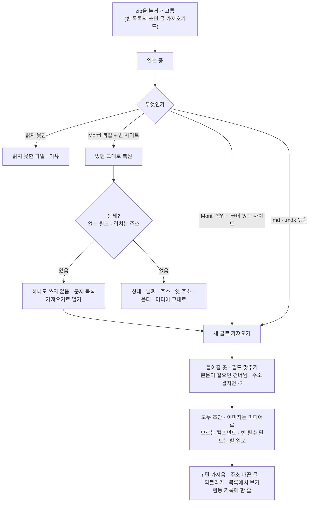

# 14 데이터 · 키 · 플러그인

상태: 초안 (2026-11-05). 정할 것이 없다.

## 한 문장

도구 화면의 세 가지다. 데이터는 사이트를 통째로 받아 두고 되살리거나 다른 글을 가져오는 일이고, 키는 AI와 플러그인이 쓰는 서비스 키를 암호화해 두는 곳이고, 플러그인은 코드로 꽂아 기능 · 블록 · 필드 · 받는 곳을 더하는 방법이다.

## 원칙

1. **백업은 Monti가 다시 읽을 수 있는 모양이다.** 백업 파일 하나로 빈 사이트를 있던 그대로 되살린다. 문제가 하나라도 있으면 하나도 쓰지 않는다.
2. **가져오기는 늘 새 글이다.** 이미 글이 있는 사이트에 넣는 것은 모두 초안으로 들어가고, 가져오기 한 번이 통째로 되돌릴 수 있는 기록 한 줄이다.
3. **키는 서버만 읽는다.** 키는 `MONTI_SECRET`으로 암호화해 데이터베이스에 둔다. 화면과 모델에는 끝 네 자리만 간다. 에이전트는 키를 읽지 못한다.
4. **플러그인은 코드다.** 플러그인을 더하고 빼는 것은 사이트 코드(구조)다. 관리자 화면은 플러그인이 쓸 키를 고르는 것만 한다.

## 쓰는 화면과 흐름

- 기준 화면: `Screens/Reference/Lists` › Data, `Screens/Reference/Settings` › ApiKeys, `Screens/Reference/Lists` › Empty("쓰던 글 가져오기").
- 흐름: [흐름 9 · 데이터](../admin/flows/09-data.md) 전부, [흐름 10 · API 키](../admin/flows/10-api-keys.md) 전부, [흐름 2](../admin/flows/02-assistant.md)의 22~24단계.

## 데이터

### 백업

```ts
// monti-backup-2026-11-05.zip
manifest.json        // { format: 1, monti: "x.y.z", createdAt, schemaHash, counts }
schema.json          // the schema the backup was taken under, for checks on restore
entries.jsonl        // working copy, published copy, translation group, folder, relations, versions
folders.jsonl
media.jsonl          // file metadata and uses
media/…              // the files, only with "미디어 파일도 담기"
paths.jsonl          // old paths and reserved paths
templates.jsonl
admin-values.json    // collection admin values, site settings that live in the database
```

- 도구 › 데이터의 "백업 받기"는 고를 것 없이 바로 받는다. "미디어 파일도 담기"는 처음에 꺼져 있다(크기가 크므로).
- 목록에서 고른 글만 받는 "내보내기"(06의 일괄 막대)는 같은 모양에 그 글들만 담는다.
- 휴지통에 든 것, 활동 기록, 대화, 키는 담지 않는다.

### 가져오기와 복원



- **필드 맞추기.** 파일의 front matter 키마다 스키마의 필드를 고른다(title → 제목, tags → 태그, layout → 가져오지 않음). 관계 필드에 없는 값은 새 항목이 된다("새 태그 4개가 생겨요").
- **본문.** `.md`와 `.mdx`는 MDX 플러그인이 JSON 문서로 바꾼다(03). 플러그인이 모르는 컴포넌트는 그대로 둘 수 없으므로 가져오기 전에 목록으로 보이고, 들어간 글에는 할 일이 붙는다.
- **복원.** 빈 사이트에서만 "있던 그대로"다. 한 트랜잭션으로 쓰고, 미디어 파일을 담은 백업이면 저장소에도 올린다.
- **되돌리기.** 가져오기 한 번은 활동 기록의 한 줄이고, 그 줄에서 통째로 되돌린다(만든 글, 항목, 미디어를 휴지통으로). 30일 기한은 다른 되돌리기와 같다(13).

## 키

```ts
type ApiKey = {
  id: string;
  service: "anthropic" | "openai" | "openrouter" | "gemini" | "openai-compatible" | string; // plugins add services
  name: string;               // "Anthropic 개인"; defaults to the service, " 2" when taken
  baseUrl?: string;           // openai-compatible only
  secret: Encrypted;          // with MONTI_SECRET
  last4: string;
  usage: { month: string; tokens: number };
};
```

- **더하기.** 서비스를 고르면 이름이 채워진다. 키를 넣고 "추가"하면 서비스에 한 번 물어 확인한다. 받아 주지 않으면 창이 열린 채 키 칸 아래에 한 줄.
- **고치기.** 키 칸은 "··· a1b2"와 "바꾸기"다. 바꾸면 다시 확인한다.
- **지우기.** 늘 확인한다(되돌릴 수 없다). 그 키를 쓰는 곳(어시스턴트 기본 모델, 빠른 작업, 플러그인)이 있으면 멈출 곳을 나열한다.
- **비밀값.** `MONTI_SECRET`이 없으면 키를 저장할 수 없고 알림 띠가 보인다. 비밀값이 바뀌어 읽을 수 없는 키는 줄마다 "읽을 수 없어요"와 편집이 있다.
- **모델.** 모델 목록은 키의 서비스에서 받아 키마다 묶는다. 어시스턴트의 모델은 대화마다 고르고(10), "빠른 작업" 모델 하나만 이 화면에서 고른다(관리자 값).
- **사용량.** 키마다 이번 달 토큰. 금액과 한도는 세지 않는다(10).

## 플러그인

```ts
// monti.config.ts
import { algolia } from "@monti-cms/plugin-algolia";
import { seo } from "@monti-cms/seo";

export default defineConfig({
  plugins: [seo(), algolia({ index: "posts" })],
});

// a plugin
export const algolia = (options: AlgoliaOptions) =>
  definePlugin({
    name: "algolia",
    keys: [
      { id: "search", label: "검색 키", service: "algolia" },
      { id: "admin", label: "관리 키", service: "algolia" },
    ],
    receivers: [{ id: "index", events: ["entry.published", "entry.unpublished", "entry.trashed"], send: indexEntries }],
    operations: [reindex],      // become admin API, agent tools and CLI (00)
  });
```

| 플러그인이 더할 수 있는 것 | 어디에 보이나 |
|---|---|
| 기능(`operations`) | 관리자 API, 에이전트 도구, CLI(00) |
| 블록과 서식(`blocks`) | 편집기의 `/` 메뉴, 사이트 그리기(03) |
| 필드와 속성 패널 탭(`fields`) | 잠긴 탭(SEO)(01) |
| 목록 열(`columns`) | 열 추가 메뉴(06) |
| 발행 검사(`checks`) | 할 일(02) |
| 본문 검사(`textCheck`) | 상태 줄의 플러그인 칸(03) |
| 받는 곳(`receivers`) | 전송(13) |
| 도구 페이지(`toolPages`) | 도구 탭 |
| 키 자리(`keys`) | API 키 화면의 플러그인 줄 |

- API 키 화면의 "플러그인" 묶음은 플러그인이 둔 키 자리마다 한 줄이다. 줄의 고르기에서 저장된 키를 고른다. 저장된 키가 없으면 "키 없음"을 누를 때 그 서비스가 골라진 키 추가 창이 열린다.

## 기능 목록

| 기능 | 종류 | 하는 일 |
|---|---|---|
| `data.backup` | read | 백업 파일을 만든다(미디어 담기 여부) |
| `data.export` | read | 고른 글만 같은 모양으로 |
| `data.inspect` | read | 올린 파일을 읽고 요약 · 문제 · 맞출 필드를 돌려준다. 아무것도 쓰지 않는다 |
| `data.import` | write · 사람만 | 새 글로 가져오기(들어갈 곳, 필드 맞추기) |
| `data.restore` | write · 사람만 | 빈 사이트에 있던 그대로 |
| `keys.list` | read | 이름, 서비스, 끝 네 자리, 사용량, 쓰는 곳. 키 값은 없다 |
| `keys.add` · `keys.update` · `keys.remove` | write · 사람만 | 더하기, 고치기, 지우기 |
| `models.list` | read | 키마다 쓸 수 있는 모델 |
| `models.setQuick` | write | 빠른 작업 모델 |
| `plugins.setKey` | write | 플러그인 키 자리에 저장된 키를 잇는다 |

## 에이전트

- **읽기:** 키 목록(값 없이)과 모델 목록, 플러그인 목록을 안다. "어떤 모델을 쓸 수 있어?"에 답한다.
- **사람만:** 가져오기, 복원, 키 더하기 · 고치기 · 지우기. 파일과 키 값이 필요하거나 되돌릴 수 없는 일이다.
- 에이전트가 쓰는 도구는 플러그인 기능까지 모두 00의 기능 정의에서 나온다. 플러그인을 더하면 에이전트도 그 기능을 쓴다.

## 화면 쪽 조각

- `useImport()`: 파일 읽기, 요약, 필드 맞추기, 진행, 결과.
- `KeyDialog`: 키 더하기와 고치기 창(서비스, 이름, 주소, 키, 확인).
- `ModelMenu`: 어시스턴트 입력란(10)과 빠른 작업 고르기가 같이 쓴다.

## 결정 기록

- 2026-11-05: 백업은 JSON 줄 파일 묶음이다. 본문은 원본인 JSON 문서 그대로다. `.md`, `.mdx`는 가져올 때만 플러그인이 바꾼다.
- 2026-11-05: 휴지통, 활동 기록, 대화, 키는 백업에 담지 않는다.
- 2026-11-05: 가져오기 한 번은 활동 기록의 한 줄이고 통째로 되돌린다. 기한은 30일이다(13).
- 2026-11-05: 플러그인은 `monti.config.ts`의 코드로 더하고 뺀다. 관리자 화면은 키 자리만 고른다.
- 흐름 9 · 10: 복원은 빈 사이트에서만, 문제가 있으면 하나도 쓰지 않는다. 키는 늘 확인하고 지운다.

## 나중에 할 것

- 정해 둔 때에 저장소로 저절로 백업하기. 기준 화면에 없다. README의 "나중에 할 것"에 적는다.

## 끝 조건

- 흐름 9, 10의 단계가 이 기능 목록만으로 된다.
- 받은 백업으로 빈 사이트를 되살리면 상태, 날짜, 주소, 옛 주소, 폴더, 미디어가 그대로다.
- 키 값이 화면, 모델, 로그, 백업 어디에도 나가지 않는다.
- 플러그인 하나를 더하면 그 기능, 블록, 필드, 받는 곳, 키 자리가 각 자리에 나타나고, 관리자 화면 코드를 고치지 않는다.
