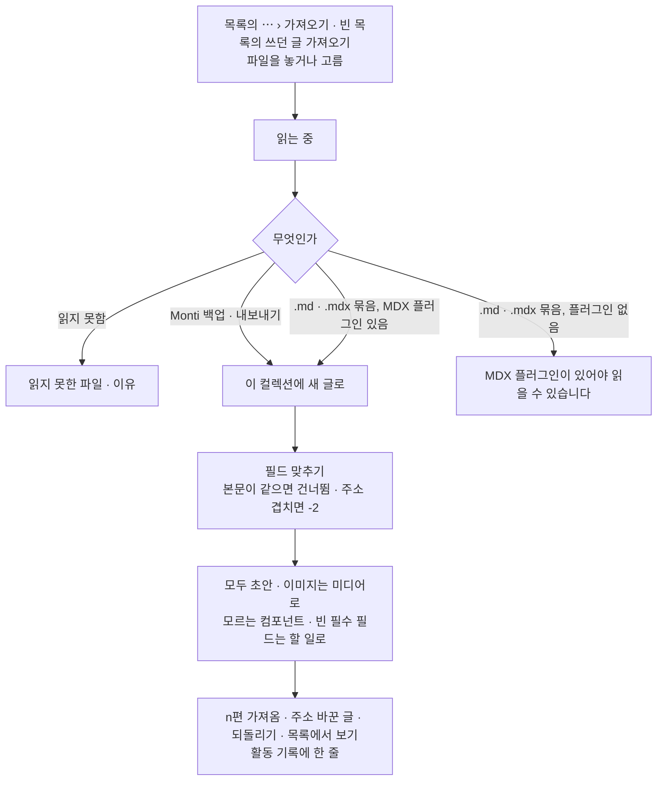

# 14 데이터 · 키 · 플러그인

상태: 초안 (2026-11-05). 정할 것이 없다.

## 한 문장

도구 화면과 목록에 걸친 세 가지다. 데이터는 사이트를 통째로 받아 두는 일과 컬렉션 하나에 글을 가져오는 일이고(통째로 되살리기는 CLI의 일이다), 키는 AI와 플러그인이 쓰는 서비스 키를 암호화해 두는 곳이고, 플러그인은 코드로 꽂아 기능 · 블록 · 필드 · 받는 곳을 더하는 방법이다.

## 원칙

1. **받기는 도구에서, 가져오기는 목록에서.** 도구 › 데이터에는 "백업 받기"만 있다. 가져오기는 컬렉션 목록의 "+ 새 글 쓰기 ▾" 메뉴 › "가져오기"에서 그 컬렉션 하나에 한다. 백업 파일로 빈 사이트를 있던 그대로 되살리는 것은 서버를 다루는 일이라 `monti restore` 명령이 한다.
2. **가져오기는 늘 새 글이고, 형식은 플러그인이 더한다.** core는 Monti 백업과 내보내기 파일만 읽는다. `.md`, `.mdx`는 MDX 플러그인이 있을 때만 받는다. 가져온 글은 모두 초안으로 들어가고, 가져오기 한 번이 통째로 되돌릴 수 있는 기록 한 줄이다.
3. **키는 서버만 읽는다.** 키는 `MONTI_SECRET`으로 암호화해 데이터베이스에 둔다. 화면과 모델에는 끝 네 자리만 간다. 에이전트는 키를 읽지 못한다.
4. **플러그인은 코드다.** 플러그인을 더하고 빼는 것은 사이트 코드(구조)다. 관리자 화면은 플러그인이 쓸 키를 그 자리에 넣는 것만 한다.

## 쓰는 화면과 흐름

- 기준 화면: `Screens/Reference/Lists` › Data, `Screens/Reference/Settings` › ApiKeys, `Screens/Reference/Lists` › Empty("쓰던 글 가져오기").
- 흐름: [흐름 9 · 데이터](../admin/flows/09-data.md) 전부, [흐름 10 · API 키](../admin/flows/10-api-keys.md) 전부, [흐름 2](../admin/flows/02-assistant.md)의 22~24단계.

## 데이터

### 백업

```ts
// monti-backup-2026-11-05.zip
manifest.json        // { format: 1, monti: "x.y.z", createdAt, schemaHash, counts }
schema.json          // the schema the backup was taken under, for checks on restore
entries.jsonl        // working copy, published copy, translation group, folder, relations, versions
folders.jsonl
media.jsonl          // file metadata and uses
media/…              // the files, only with "미디어 파일도 담기"
paths.jsonl          // old paths and reserved paths
templates.jsonl
admin-values.json    // collection admin values, site settings that live in the database
```

- 도구 › 데이터의 "백업 받기"는 고를 것 없이 바로 받는다. "미디어 파일도 담기"는 처음에 꺼져 있다(크기가 크므로).
- 목록에서 고른 글만 받는 "내보내기"(06의 일괄 막대)는 같은 모양에 그 글들만 담는다.
- 휴지통에 든 것, 활동 기록, 대화, 키는 담지 않는다.

### 가져오기



- **필드 맞추기.** 파일의 front matter 키마다 스키마의 필드를 고른다(title → 제목, tags → 태그, layout → 가져오지 않음). 관계 필드에 없는 값은 새 항목이 된다("새 태그 4개가 생깁니다").
- **본문.** `.md`와 `.mdx`는 MDX 플러그인이 JSON 문서로 바꾼다(03). 플러그인이 모르는 컴포넌트는 그대로 둘 수 없으므로 가져오기 전에 목록으로 보이고, 들어간 글에는 할 일이 붙는다.
- **컬렉션 하나에.** 가져오기는 연 목록의 컬렉션에만 넣는다. 들어갈 곳을 고르는 단계가 없다. 필드 맞추기는 그 컬렉션의 필드만 보인다.
- **Monti 백업 · 내보내기 파일.** 그 안에서 이 컬렉션의 글만 가져온다. 폴더 구조와 번역 묶음은 살리고, 상태는 모두 초안이다. 가리키는 카테고리와 태그는 주소로 찾아 잇고, 없으면 새로 만든다.
- **MDX 플러그인.** `.md`, `.mdx`를 읽는 일은 `@monti-cms/mdx`가 가져오기 형식으로 더한다. 플러그인이 없으면 그 파일은 "MDX 플러그인이 있어야 읽을 수 있습니다" 한 줄로 끝난다.

### 통째로 되살리기

```bash
monti restore monti-backup-2026-11-05.zip
```

- 빈 데이터베이스에서만 돈다. 글이 하나라도 있으면 멈춘다.
- 먼저 파일 전체를 검사하고(없는 필드, 겹치는 주소), 문제가 하나라도 있으면 하나도 쓰지 않고 문제 목록을 출력한다.
- 상태, 날짜, 주소, 옛 주소, 폴더, 미디어를 그대로 쓰고, 미디어 파일을 담은 백업이면 저장소에도 올린다.
- 데이터베이스를 잃은 경우, 호스트를 옮기는 경우, 새 서버를 처음 채우는 경우에 쓴다. 데이터베이스 자체의 백업(호스트의 시점 복구 같은 것)은 호스트의 일이다.
- **되돌리기.** 가져오기 한 번은 활동 기록의 한 줄이고, 그 줄에서 통째로 되돌린다(만든 글, 항목, 미디어를 휴지통으로). 30일 기한은 다른 되돌리기와 같다(13).

## 키

```ts
type ApiKey = {
  id: string;
  service: "anthropic" | "openai" | "openrouter" | "gemini" | "openai-compatible" | string; // plugins add services
  name: string;               // "Anthropic 개인"; defaults to the service, " 2" when taken
  baseUrl?: string;           // openai-compatible only
  secret: Encrypted;          // with MONTI_SECRET
  last4: string;
  usage: { month: string; tokens: number };
};
```

- **더하기.** 서비스를 고르면 이름이 채워진다. 키를 넣고 "추가"하면 서비스에 한 번 물어 확인한다. 받아 주지 않으면 창이 열린 채 키 칸 아래에 한 줄.
- **고치기.** 키 칸은 "··· a1b2"와 "바꾸기"다. 바꾸면 다시 확인한다.
- **지우기.** 늘 확인한다(되돌릴 수 없다). 그 키를 쓰는 곳(어시스턴트 기본 모델, 빠른 작업, 플러그인)이 있으면 멈출 곳을 나열한다.
- **비밀값.** `MONTI_SECRET`이 없으면 키를 저장할 수 없고 알림 띠가 보인다. 비밀값이 바뀌어 읽을 수 없는 키는 줄마다 "읽을 수 없음"과 편집이 있다.
- **모델.** 모델 목록은 키의 서비스에서 받아 키마다 묶는다. 어시스턴트의 모델은 대화마다 고르고(10), "빠른 작업" 모델 하나만 이 화면에서 고른다(관리자 값).
- **사용량.** 키마다 이번 달 토큰. 금액과 한도는 세지 않는다(10).

만들면서 정한 것(2026-11-12, core):

- **서비스.** AI 서비스 다섯(`anthropic`, `openai`, `openrouter`, `gemini`, `openai-compatible`)은 core가 안다(`packages/core/src/keys/services.ts`). 서비스 하나는 이름, 키 창이 물을 것(주소가 필요한지, 키 없이도 되는지, 키 자리 글자), 그리고 "이 키를 받아 주는가"를 묻는 요청 하나(`check`)다. 플러그인은 `keyServices`로 서비스를 더한다. core는 모델을 부르지 않는다. 모델 목록을 받아 올 뿐이다.
- **확인.** `check`는 서비스의 모델 목록을 한 번 받아 온다. 그래서 확인과 모델 목록이 같은 요청이다. 답은 셋이다: 받아 줌(모델 목록), 받아 주지 않음(`keys.refused` "맞지 않는 키입니다."), 닿지 못함(`keys.unreachable` "서비스가 답하지 않습니다."). 10초 안에 답이 없으면 닿지 못한 것이다. 키는 그 서비스의 주소에만, 주소 줄이 아니라 헤더로 보낸다.
- **모델 목록.** 받은 목록은 키와 함께 저장하고 하루가 지나면 `models.list`가 다시 받는다(`refresh`를 주면 바로). 서비스가 답하지 않으면 지난 목록을 그대로 쓴다. 도구를 쓸 수 있는 모델만 담고, 모델마다 생각할 수 있는지와 그림을 읽는지를 적는다. 그것을 알려 주지 않는 서비스(OpenAI, OpenAI 호환)는 이름으로 가늠한다.
- **처음 모델.** 아무도 고르지 않았을 때의 모델은 읽을 수 있는 첫 키(먼저 넣은 키)의 서비스가 정한다. 서비스마다 어시스턴트용과 빠른 작업용 모델을 좋은 순서로 적어 두고, 키가 쓸 수 있는 첫 모델을 쓴다. 적어 둔 모델이 하나도 없으면(서비스가 이름을 바꿨으면) 그 키의 첫 모델을 쓴다. `models.list`가 둘 다 돌려준다(`assistant`, `quick`). "빠른 작업"을 고르면 `quick`만 바뀐다. 고른 모델이 목록에서 사라지면 다시 서비스의 모델로 돌아간다.
- **쓰는 곳.** `keys.list`의 `uses`는 그 키가 지금 내고 있는 모델이다: 어시스턴트의 처음 모델, 빠른 작업 모델. 지우기 확인이 이것을 보인다.
- **끝 네 자리.** 12자보다 짧은 키는 끝자리를 보이지 않는다(네 자리가 키의 대부분이다). 키 없이 쓰는 서비스도 끝자리가 없다.
- **저장.** 키는 `MONTI_SECRET`에서 만든 키로 AES-256-GCM 암호화해 `api_keys.secret`에 둔다. 서버만 `monti.keys.open(id)`로 연다. 기능의 답, 활동 기록, 오류에는 키가 없다(14-4). 쓴 토큰은 `monti.keys.addUsage(id, tokens)`가 달마다(UTC) 센다.
- **되돌리기.** 키를 더하고 고치고 지우는 일은 활동 기록에 남지만 되돌리기가 없다.

## 플러그인

```ts
// monti.config.ts
import { algolia } from "@monti-cms/plugin-algolia";
import { seo } from "@monti-cms/seo";

export default defineConfig({
  plugins: [seo(), algolia({ index: "posts" })],
});

// a plugin
export const algolia = (options: AlgoliaOptions) =>
  definePlugin({
    name: "algolia",
    keys: [
      { id: "search", label: "검색 키", service: "algolia" },
      { id: "admin", label: "관리 키", service: "algolia" },
    ],
    receivers: [{ id: "index", events: ["entry.published", "entry.unpublished", "entry.trashed"], send: indexEntries }],
    operations: [reindex],      // become admin API, agent tools and CLI (00)
  });
```

| 플러그인이 더할 수 있는 것 | 어디에 보이나 |
|---|---|
| 기능(`operations`) | 관리자 API, 에이전트 도구, CLI(00) |
| 블록과 서식(`blocks`) | 편집기의 `/` 메뉴, 사이트 그리기(03) |
| 필드와 속성 패널 탭(`fields`) | 잠긴 탭(SEO)(01) |
| 목록 열(`columns`) | 열 추가 메뉴(06) |
| 발행 검사(`checks`) | 할 일(02) |
| 본문 검사(`textCheck`) | 상태 줄의 플러그인 칸(03) |
| 받는 곳(`receivers`) | 전송(13) |
| 가져오기 형식(`importers`) | 가져오기가 읽는 파일(MDX 플러그인의 `.md`, `.mdx`) |
| 도구 페이지(`toolPages`) | 도구 탭 |
| 키 자리(`keys`) | API 키 화면의 플러그인 줄 |

- API 키 화면은 표 셋이다. "AI 키"(모델 목록이 이 키들에서 나온다), "모델"(빠른 작업 모델 하나), "플러그인 키"(플러그인이 둔 키 자리마다 한 줄). 키 줄은 모두 같은 모양과 같은 방법이다. 이름 뒤에 끝 네 자리, 들어 있으면 "편집 · 지우기", 비었으면 "키 넣기". 넣고 바꾸는 것은 모두 같은 키 창이고, 플러그인 자리의 창은 서비스가 정해져 있다. 자리 하나는 한 서비스의 것이라 저장된 키를 고르지 않는다(2026-11-05 소유자).

## 기능 목록

| 기능 | 종류 | 하는 일 |
|---|---|---|
| `data.backup` | read | 백업 파일을 만든다(미디어 담기 여부) |
| `data.export` | read | 고른 글만 같은 모양으로 |
| `data.inspect` | read | 올린 파일을 읽고 요약 · 문제 · 맞출 필드를 돌려준다. 아무것도 쓰지 않는다 |
| `data.import` | write · 사람만 | 컬렉션 하나에 새 글로 가져오기(필드 맞추기) |
| `keys.list` | read | 이름, 서비스, 끝 네 자리, 사용량, 쓰는 곳. 키 값은 없다 |
| `keys.add` · `keys.update` · `keys.remove` | write · 사람만 | 더하기, 고치기, 지우기 |
| `models.list` | read | 키마다 쓸 수 있는 모델 |
| `models.setQuick` | write | 빠른 작업 모델 |
| `plugins.setKey` | write | 플러그인 키 자리에 키를 넣거나 바꾸거나 뺀다(사람만. 키 값이 필요하다) |

## 에이전트

- **읽기:** 키 목록(값 없이)과 모델 목록, 플러그인 목록을 안다. "어떤 모델을 쓸 수 있어?"에 답한다.
- **사람만:** 가져오기, 키 더하기 · 고치기 · 지우기. 통째로 되살리기는 CLI 명령이라 도구가 아니다. 파일과 키 값이 필요하거나 되돌릴 수 없는 일이다.
- 에이전트가 쓰는 도구는 플러그인 기능까지 모두 00의 기능 정의에서 나온다. 플러그인을 더하면 에이전트도 그 기능을 쓴다.

## 화면 쪽 조각

- `useImport()`: 파일 읽기, 요약, 필드 맞추기, 진행, 결과.
- `KeyDialog`: 키 더하기와 고치기 창(서비스, 이름, 주소, 키, 확인).
- `ModelMenu`: 어시스턴트 입력란(10)과 빠른 작업 고르기가 같이 쓴다.

## 결정 기록

- 2026-11-05: 백업은 JSON 줄 파일 묶음이다. 본문은 원본인 JSON 문서 그대로다. `.md`, `.mdx`는 가져올 때만 플러그인이 바꾼다.
- 2026-11-05: 휴지통, 활동 기록, 대화, 키는 백업에 담지 않는다.
- 2026-11-05: 가져오기 한 번은 활동 기록의 한 줄이고 통째로 되돌린다. 기한은 30일이다(13).
- 2026-11-05: 플러그인은 `monti.config.ts`의 코드로 더하고 뺀다. 관리자 화면은 키 자리에 키만 넣는다.
- 2026-11-05, 소유자: 플러그인 키 자리는 저장된 키를 고르지 않는다. 자리마다 자기 키를 AI 키와 같은 줄 모양, 같은 키 창으로 넣는다. 표는 "AI 키" · "모델" · "플러그인 키" 셋이다. 고르기는 "빠른 작업" 모델에만 있다.
- 2026-11-05, 소유자: 가져오기는 컬렉션 목록의 "+ 새 글 쓰기 ▾" 메뉴 › "가져오기"에서 그 컬렉션 하나에 한다. 일괄로 여러 컬렉션을 가져오는 길은 없다. 도구 › 데이터에는 백업 받기만 남는다.
- 2026-11-05, 소유자: `.md`, `.mdx` 가져오기는 MDX 플러그인이 있어야 한다. MDX는 더하는 플러그인이기 때문이다. core는 Monti 형식만 읽는다.
- 2026-11-05, 소유자: 통째로 되살리기는 관리자 화면에서 빼고 `monti restore` 명령으로 한다. 화면에는 백업 받기와 가져오기만 있다. Monti 백업 파일도 화면에서는 새 글로 가져온다. 흐름 9의 12~15단계는 빠진다.
- 흐름 10: 키는 늘 확인하고 지운다.

## 나중에 할 것

- 정해 둔 때에 저장소로 저절로 백업하기. 기준 화면에 없다. README의 "나중에 할 것"에 적는다.

## 끝 조건

번호는 테스트 이름의 앞머리다(`14-4 …`).

- **14-1** 흐름 9의 01~11단계(가져오기는 목록에서 시작)와 흐름 10의 단계가 이 기능 목록만으로 된다.
- **14-2** MDX 플러그인이 없는 사이트는 `.md`, `.mdx`를 읽지 않는다.
- **14-3** `monti restore`로 빈 데이터베이스를 되살리면 상태, 날짜, 주소, 옛 주소, 폴더, 미디어가 그대로다.
- **14-4** 키 값이 화면, 모델, 로그, 백업 어디에도 나가지 않는다.
- **14-5** 플러그인 하나를 더하면 그 기능, 블록, 필드, 받는 곳, 키 자리가 각 자리에 나타나고, 관리자 화면 코드를 고치지 않는다.
