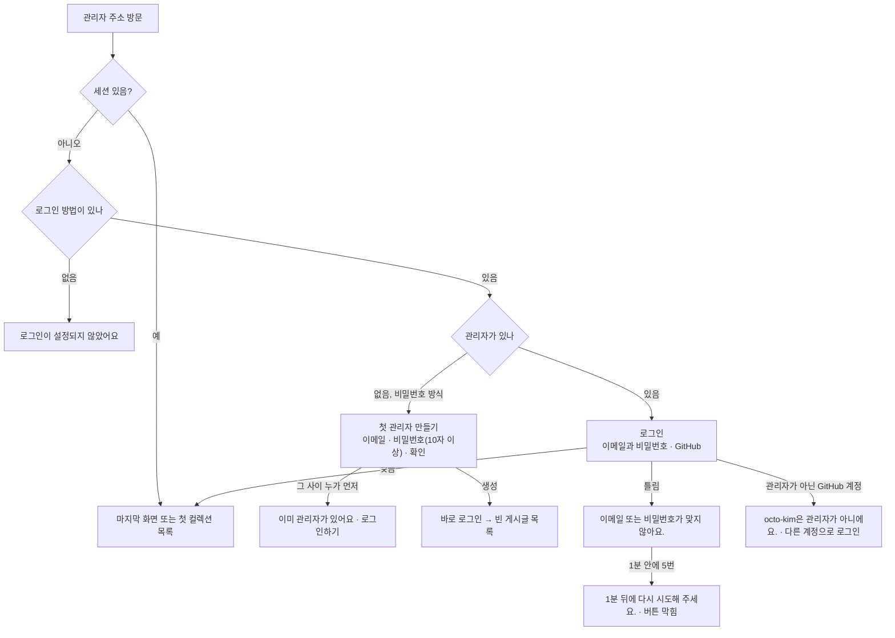
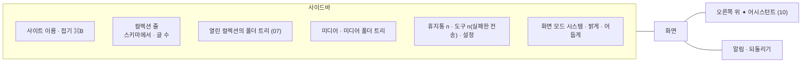

# 15 로그인과 틀

상태: 초안 (2026-11-05). D1이 소유자 확인을 기다린다.

## 한 문장

관리자는 한 명이고, 이메일과 비밀번호나 GitHub로 들어온다. 들어오면 모든 화면이 같은 틀(사이드바, ✦, 알림)을 쓰고, 사이드바는 스키마와 개수에서 그려진다.

## 원칙

1. **관리자는 한 명이다.** 여러 계정, 역할, 계정별 보기는 없다. 버전 확인은 여전히 한다(같은 사람의 두 탭, 에이전트)(00).
2. **고르지 않은 로그인은 켜지 않는다.** 로그인 방법은 `monti init`에서 사람이 고른다(이메일과 비밀번호 · GitHub). 아무것도 없으면 "로그인이 설정되지 않았어요"만 보인다.
3. **첫 관리자는 첫 방문에서.** 관리자가 없을 때 관리자 주소에 처음 들어오면 "첫 관리자 만들기"가 나온다. 설치 코드는 없다.
4. **비밀번호 찾기는 서버에서.** 메일은 보내지 않는다. 잊으면 서버에서 `monti admin:reset-password`를 돌린다. 로그인 화면에는 안내하지 않는다.
5. **틀은 스키마를 따른다.** 사이드바의 컬렉션 줄은 스키마의 컬렉션마다 하나다. 화면에 컬렉션을 손으로 적지 않는다.

## 쓰는 화면과 흐름

- 기준 화면: `Screens/Reference/Login` 9가지, `Screens/Reference/Lists` › Sidebar, SidebarRail, SidebarTheme, SidebarThemeRail, Empty.
- 흐름: [흐름 8 · 처음 설치](../admin/flows/08-first-install.md) 전부. 사이드바 개수는 모든 흐름에 걸친다.

## 로그인

- **GitHub만 쓰는 사이트**는 이메일 칸이 없다. 관리자는 설정 파일에 적은 GitHub 아이디 하나다. 첫 관리자 화면이 없다.
- **틀림 막기**는 이메일마다 센다. 남은 횟수는 보이지 않는다.
- **세션**은 서버의 세션 표와 `httpOnly` 쿠키다. 30일 동안 쓰지 않으면 끝난다. 쓰면 늘어난다.
- **바깥 에이전트**(MCP, 나중에)는 세션이 아니라 따로 만든 토큰으로 들어온다. 지금은 열어 두기만 한다(00).

## 틀

| 자리 | 어디서 오나 |
|---|---|
| 사이트 이름 | 설정 › 사이트(12) |
| 컬렉션 줄과 순서 | 스키마의 컬렉션(01). 표시 이름은 관리자 값 |
| 글 수 | 그 컬렉션의 휴지통 밖 번역 묶음 수 |
| 폴더 트리 | 07 |
| 휴지통 n | 휴지통의 줄 수(11) |
| 도구 n | 실패한 전송 수, 경고 색(13) |
| 접힘, 폭(200–400px), 화면 모드 | 이 브라우저에 기억한다 |
| 화면 언어 | 관리자 값(12) |

- 새로 설치한 사이트(`fresh`)는 개수와 폴더 트리가 없다.
- 개수는 화면이 열려 있는 동안 저장, 휴지통, 전송이 일어날 때 함께 새로 고친다.
- 템플릿 편집기처럼 사이드바 밖의 페이지에서는 어느 줄도 골라지지 않는다.
- 관리자 화면의 말은 화면 언어(ko · en)의 말 사전에서 온다. 글의 언어(04)와 상관없다.

## 기능 목록

| 기능 | 종류 | 하는 일 |
|---|---|---|
| `auth.state` | read | 로그인 방법, 관리자가 있는지, 지금 세션 |
| `auth.createFirstAdmin` | write · 사람만 | 관리자가 없을 때만. 만들고 바로 로그인 |
| `auth.signIn` · `auth.signOut` | write · 사람만 | 로그인, 로그아웃(D1) |
| `frame.counts` | read | 컬렉션마다 글 수, 휴지통 수, 실패한 전송 수 |

- `monti admin:reset-password`는 서버 관리 명령이다(00). 기능이 아니다.
- 로그인과 계정은 에이전트 도구로 나가지 않는다(10).

## 에이전트

- 이 기능의 쓰기는 모두 사람만 한다. 에이전트는 `frame.counts`로 "글이 몇 편이야?"에 답할 수 있을 뿐이다.

## 화면 쪽 조각

- `useSession()`: 세션, 로그인 화면으로 보내기, 세션이 끝났을 때 편집기의 저장 칸이 "로그인이 풀렸어요"로 바뀌게 하기(02).
- `useFrameCounts()`: 사이드바 개수.
- `Sidebar`, `SidebarScreenMode`, `LoginScreen`: 이미 있는 부품.

## 결정

### D1. 로그아웃은 어디에 둘까 (추천: 설정 › 관리자, 소유자 확인 기다림)

기준 화면 어디에도 로그아웃이 없다. 관리자가 한 명이라도, 공용 컴퓨터에서 나가거나 다른 GitHub 계정으로 바꾸려면 필요하다.

- **A. 설정 › 관리자 탭에 "계정" 절 (추천).** 로그인한 이메일(또는 GitHub 아이디) 한 줄과 "로그아웃" 글자 버튼. 자주 쓰지 않는 일이라 사이드바를 늘리지 않는다.
- **B. 사이드바 머리의 사이트 이름을 누르면 메뉴.** 메뉴에 이메일과 "로그아웃". 어디서나 두 번에 닿지만, 지금 사이트 이름은 누를 수 없는 글자다.

## 결정 기록

- 2026-10-09, 소유자: 로그인 방법은 init에서 고른다(이메일과 비밀번호 · GitHub). 첫 관리자는 첫 방문 화면에서 만든다. 비밀번호 재설정은 CLI다.
- 2026-10-26, 소유자: 관리자는 한 명이다.
- 2026-10-27, 소유자: 로그인 화면에 설명 줄과 남은 횟수, "비밀번호 찾기"가 없다. 오류는 짧은 한 문장이다.
- 2026-11-05: 세션은 서버의 세션 표와 `httpOnly` 쿠키, 쓰지 않으면 30일 뒤 끝난다.
- 2026-11-05: 사이드바의 접힘, 폭, 화면 모드는 브라우저에 기억하고, 화면 언어는 관리자 값이다.

## 끝 조건

- 흐름 8의 10단계와 로그인 기준 화면 9가지가 이 기능 목록만으로 된다.
- 컬렉션을 더하거나 빼면 사이드바가 화면 코드를 고치지 않고 따라간다.
- 사이드바의 휴지통 n, 도구 n이 휴지통 화면과 활동 기록의 수와 같다.
