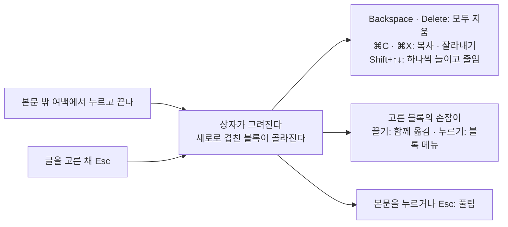

# 18 블록 패키지

상태: 만드는 중 (2026-11-14). 화면 없는 core는 만들었다(아래 "만든 것"). 화면은 "화면 승인"의 목업으로 소유자와 정한 뒤 만든다. 아래의 결정은 모두 만들며 정함(2026-11-13 · 14)이다.

## 한 문장

core에 없는 블록과 서식을 `@monti-cms/blocks`로 내놓고, `monti add`가 그 소스를 사이트에 넣어 사이트가 고쳐 쓴다. 편집기는 여러 블록을 상자로 끌어 한꺼번에 고르고 옮기며, 비교와 검토는 값만 가진 블록도 보이고 견준다.

## 범위

[진행 기록](../../tracker.md)의 남은 일이다.

| 번호 | 무엇 | 이 문서의 절 |
|---|---|---|
| T35 | 콜아웃, 탭, 단 나누기, 접기, 코드 탐색기, 수식, 차트, 다이어그램, 툴팁, 글자 색을 `defineBlock`으로 다시 만들고 `monti add`로 사이트 소스에 넣는다([03](03-body-editor.md#어떤-블록이-어디에-있나)) | 블록과 서식, 정의가 더 가지는 것, `monti add`, MDX, 편집기 |
| T80 | 여러 블록을 상자로 끌어 고르고, 고른 블록을 함께 옮기고 지운다(옛 `editor/drag/block-selection.ts`) | 여러 블록 고르기 |
| T197 | 편집기 비교(`shownBlocks`)와 어시스턴트 검토 화면(10)이 블록의 글자만 읽는다. 값만 가진 블록은 빈 줄로 보이고 값이 바뀌어도 잡히지 않는다 | 비교와 검토 |

## 원칙

1. **사이트가 고쳐 쓰는 소스다.** `monti add`는 블록의 소스를 사이트 폴더에 복사한다. 그다음부터 그 파일은 사이트의 것이다. 패키지를 올려도 복사한 파일은 바뀌지 않는다(shadcn/ui와 같은 방식). 그래서 사이트는 모양, 낱말, 값을 마음대로 바꾼다.
2. **블록 하나가 폴더 하나다.** 값, 사이트 그리기, 편집기 화면, 자기 도구 행과 설정, 말, 모양이 모두 블록의 폴더에 있다. 사이트는 그 어느 것이든 고치고, 폴더 하나와 목록의 한 줄로 블록을 빼고 넣는다(아래 "블록 폴더와 꽂는 곳", 2026-11-14 다시 정함).
3. **MDX로 나갔다 들어와도 같다.** 모든 블록과 서식은 MDX 플러그인(14)이 쓰고 읽는 표기를 가진다. 쓰고 다시 읽으면 같은 본문이다.
4. **값만 가진 블록도 글처럼 보인다.** 비교와 검토는 블록의 값을 이름과 함께 한 줄로 보이고, 바뀐 값은 바뀐 글자처럼 표시한다.

## 블록과 서식

모든 블록의 값(`attrs`)은 글자, 수, 참 · 거짓뿐이다. 목록이 필요한 것(탭, 단, 코드 탐색기의 파일, 차트의 자료)은 자식 블록이다. MDX 지시문의 속성은 낱값만 담기 때문이다(아래 "MDX").

| 블록 | `type` | 담는 것 | 값 | MDX 표기 |
|---|---|---|---|---|
| 콜아웃 | `callout` | 블록 | `tone`: `note` · `tip` · `info` · `warning` · `danger`(없으면 `note`), `title`(없으면 종류 이름이 제목) | `:::callout{tone="warning" title="알아 두세요"}` … `:::` |
| 탭 | `tabs` | `tab`만 | `defaultValue`(처음 보일 탭의 이름, 없으면 첫 탭) | `::::tabs` … `::::` |
| 탭 하나 | `tab` | 블록 | `label` | `:::tab{label="npm"}` … `:::` |
| 단 나누기 | `columns` | `column`만 | `widths`(단마다 %, 쉼표로: `"60,40"`. 없거나 단 수와 맞지 않으면 고르게) | `::::columns{widths="60,40"}` … `::::` |
| 단 하나 | `column` | 블록 | 없음 | `:::column` … `:::` |
| 접기 | `collapsible` | 블록 | `title`(없으면 "펼치기"), `defaultOpen`(사이트에서 펼친 채 시작) | `:::collapsible{title="자세히" defaultOpen}` … `:::` |
| 코드 탐색기 | `codeExplorer` | `codeBlock`만 | `open`(처음 보일 파일의 경로, 없으면 코드가 있는 첫 파일) | `:::codeExplorer{open="src/app.ts"}` 안에 ```` ```ts title="src/app.ts" ```` |
| 수식 | `math` | 없음 | `source`(LaTeX) | ```` ```math ````. 읽을 때는 `$$ … $$`도 받는다 |
| 다이어그램 | `mermaid` | 없음 | `source`(Mermaid) | ```` ```mermaid ```` |
| 차트 | `chart` | `table` 하나 | `kind`: `bar` · `line` · `area` · `pie`(없으면 `bar`), `title` | `:::chart{kind="line" title="방문"}` 안에 표 |

| 서식 | `type` | 값 | MDX 표기 |
|---|---|---|---|
| 툴팁 | `tooltip` | `text` | `:tooltip[글자]{text="설명"}` |
| 글자 색 | `color` | `color`, `background`(하나 이상): `gray` · `red` · `orange` · `yellow` · `green` · `blue` · `purple` · `pink` | `:color[글자]{color="red"}` |

- **옛 코드를 따랐다(2026-11-14).** 옛 `packages/blocks`가 잘 만든 것은 지금 모양에 맞는 한 그대로 둔다: 콜아웃의 다섯 종류(옛 이름 노트 · 팁 · 정보 · 경고 · 위험)와 제목이 없으면 종류 이름이 제목인 것, 접기의 `collapsible` · `defaultOpen`과 스크립트 없이 여는 `<details>`, 단 나누기의 `widths`(부모 하나에 쉼표로)와 그 읽기 규칙, 탭의 `defaultValue`, 다이어그램의 `mermaid`, 코드 탐색기의 파일 나무 규칙(경로로 만들고, 겹친 경로는 첫 것이 이기고 진 것은 탐색기 뒤에 그대로 그린다), 탭과 코드 탐색기가 모든 내용을 페이지 HTML에 두는 것, 툴팁의 마우스 · 키보드 · 터치 동작, 글자 색의 여덟 색과 그 밝은 · 어두운 색, 글자 바탕색, 독자에게 보이는 말의 영어 · 한국어 · 일본어. 설계 초안(2026-11-13)의 넷인 콜아웃, `toggle` · `open`, 단마다의 `width`, `diagram`, 아홉 색(갈색), "바탕색은 넣지 않는다"는 이것으로 바꿨다. 목업 1과 8도 고쳤다.
- **차트의 자료는 core의 표다.** 차트는 표 하나를 담고 그 표를 그린다. 첫 열이 가로축의 이름, 나머지 열이 계열이고, 머리 행이 계열의 이름이다. 편집기는 표를 고치는 도구(03의 표: 격자, 행 · 열 손잡이, + 띠)를 그대로 쓴다. MDX에서도 그냥 표다. 숫자가 아닌 칸은 그리지 않고 발행 할 일 "숫자가 아닌 칸"(알리기만)이 된다. 칸의 `1,200`, `12.5%`는 숫자이고 빈 칸은 빈자리다. 사이트는 서버에서 SVG로 그리고(더 설치할 패키지가 없다) 표는 그 아래 "자료 보기"에 둔다. 옛 코드의 차트 문법(`chart bar` …)과 recharts는 버린다: 사람이 배울 문법이 하나 늘 뿐이다.
- **수식과 다이어그램은 소스 하나다.** GitHub, GitBook, Obsidian이 같은 표기(```` ```math ````, ```` ```mermaid ````)를 쓴다. 수식은 서버에서 KaTeX가 그리고(스크립트가 필요 없다), 다이어그램은 독자의 브라우저에서 Mermaid가 그린다(그 전에는 소스). 틀린 수식은 소스와 이유 한 줄로 그린다. 둘 다 사이트의 패키지(`katex`, `mermaid`)이고 `monti add`가 무엇을 설치할지 말한다.
- **글자 색은 이름이다.** 색 값(`#dc2626`)을 저장하지 않는다. 사이트가 이름마다 밝은 화면과 어두운 화면의 색을 `color.css`에 정한다(처음 값은 옛 코드의 것). 옛 코드는 밝은 · 어두운 색 값을 짝으로 저장했다: 사이트가 테마를 바꾸면 글마다 고쳐야 했다.
- **독자에게 보이는 말은 글의 언어로.** `renderDocument`가 `locale`을 받아 블록과 서식의 컴포넌트에 넘긴다. 블록은 그 언어의 말(콜아웃 종류 이름, "펼치기", "파일", "자료 보기")을 고르고, 모르는 언어는 영어다. 말은 블록의 `site.tsx`에 있어 사이트가 고친다.
- **넣지 않는 것.** 줄 안의 수식(`$x$`), 콜아웃 아이콘 고르기. 둘 다 이 범위(T35)에 없다. 가져온 글의 `$x$`는 쓴 그대로 글자로 남고, 내보내면 그대로 나간다(잃는 것이 없다).

## 정의가 더 가지는 것

[03](03-body-editor.md#블록-정의)의 `defineBlock`과 `defineMark`에 셋을 더한다. 사이트가 손으로 만드는 블록도 같은 것을 쓴다.

```ts
type Label = string | Message | { ko: string; en: string };   // a name: the site's words, a message key, or both admin languages

type Field = { label: Label; options?: Record<string, Label> };   // the name of a value and of its options (compare, review, assistant)

export const callout = defineBlock({
	type: "callout",
	label: { ko: "콜아웃", en: "Callout" },
	description: "A highlighted box for a note, a tip, information, a warning or a danger (`tone`), with an optional `title`.",
	menu: "insert",
	attrs: z.object({ tone: z.enum(TONES).optional(), title: z.string().optional() }),
	fields: {
		tone: { label: { ko: "종류", en: "Kind" },
			options: { note: { ko: "노트", en: "Note" }, tip: { ko: "팁", en: "Tip" }, info: { ko: "정보", en: "Info" }, warning: { ko: "경고", en: "Warning" }, danger: { ko: "위험", en: "Danger" } } },
		title: { label: { ko: "제목", en: "Title" } },
	},
	holds: "blocks",
	translate: { attrs: ["title"] },
	Site: Callout,
});

export const diagram = defineBlock({
	type: "diagram",
	// …
	attrs: z.object({ source: z.string() }),
	fields: { source: { label: { ko: "소스", en: "Source" } } },
	fence: { language: "mermaid", attr: "source" },   // MDX: a fenced code block of this language
	holds: "nothing",
});
```

- **`label`이 두 말을 받는다.** 관리자는 한국어와 영어이고, 블록 소스는 사이트의 것이라 관리자의 사전에 낱말을 넣을 수 없다. 그래서 정의가 두 말을 함께 가진다(플러그인의 문서 보기 `label: { ko, en }`과 같다). 글자 하나만 주면 어느 말에서나 그것이다.
- **`fields`는 값의 이름이다.** 비교 · 검토 · 어시스턴트가 부르는 이름과 고르는 값의 이름(`options`). 값을 고치는 화면은 블록의 `Editor`가 그린다(아래 "블록 폴더와 꽂는 곳").
- **`fence`는 MDX에서 울타리 코드 블록인 블록이다.** 그 언어의 코드 블록을 읽으면 이 블록이 되고, 쓸 때 그 언어의 코드 블록으로 나간다. 코드는 `attr`이 가리키는 값이다.

## 블록 폴더와 꽂는 곳 (2026-11-14 다시 정함)

소유자(2026-11-14): "블록은 커스텀이 가능해야하니까 그 블록 내에서 모든게 정의되어야하거든? 따로 뗄수도 있어야하고 끼울수도 있어야하고?", "생각해봐 커스텀 컴포넌트를 만들어서 넣는데 드래그 핸들 메뉴에 넣는 것보다는 컴포넌트 자체가 버블을 가지고 거기서 설정하는게 더 맞지 않겠어? 그런 사용성을 먼저 고려하고 개발해." 첫 설계(관리자가 `fields`에서 블록 메뉴 행과 입력 칸을 그린다)는 이것과 맞지 않아 버렸다. 옛 블록(`view.tsx`, `admin.ts`)처럼 블록이 편집기 화면까지 가진다.

```text
monti/blocks/
  index.ts          # the one list: import { callout } from "./callout"; … export const blocks = [callout, …], marks = […]
  admin.ts          # "use client": export { blocks as adminBlocks } — never changes when a block comes or goes
  callout/
    index.ts        # defineBlock({ type, label, description, attrs, fields, holds, translate, check, Site, Editor })
    site.tsx        # the site's component (no "use client"; a part that needs the browser is its own *.client.tsx)
    editor.tsx      # "use client": the editor's view of the block, its own tool row and settings
    words.ts        # its words: for the editor in both admin languages, for readers in en / ko / ja
    style.ts        # its look as CSS text, loaded by site.tsx and editor.tsx with React's <style href precedence>
```

- **블록 하나가 폴더 하나다.** 값(`attrs`), 이름(`fields`), 사이트 그리기, 편집기 화면, 도구 행, 설정, 말, 모양이 모두 그 폴더에 있다. 사이트는 `monti add` 뒤에 그 어느 것이든 고친다.
- **빼기와 넣기는 한 줄이다.** 빼려면 폴더를 지우고 `monti/blocks/index.ts`에서 그 줄을 지운다. 넣으려면 폴더를 두고 그 줄을 쓴다(`monti add`가 하는 일). 다른 파일은 손대지 않는다: `admin.ts`는 목록을 그대로 넘기고, 모양은 블록이 스스로 싣는다(React 19의 `<style href precedence>`는 같은 블록이 여러 번 있어도 한 번만 싣는다). 그래서 첫 설계의 `blocks.css`와 블록마다의 `@import` 줄은 없앤다. 이미 쓴 글에 있는 블록의 폴더를 지우면 그 블록은 지운 플러그인의 블록처럼 글에 남고(03-5), 편집기는 이름을 단 상자로 보인다.
- **관리자가 블록 폴더에서 읽는 것.** `<AdminPage blocks={adminBlocks}>`로 받은 정의의 `Editor`다. 관리자는 그것을 그 블록의 편집기 화면(ProseMirror node view)으로 쓰고, `Editor`가 없으면 `Site`를 고칠 수 있는 자식과 함께 쓴다(03). `Editor`는 관리자가 내놓는 블록용 부품만 가져온다(`@monti-cms/admin/blocks`): `BlockBar`(도구 행: 이미지의 도구 행과 같은 `FloatingBar`, 같은 자리 `BlockBarPlace`), `BlockBarButton`, `BlockBarMenu`(지금 값 오른쪽 ✓), `BlockSettings`(도구 행의 단추가 여는 설정 카드), `BlockTitle`(블록 안에서 바로 치는 이름 칸, 한글 조합 중에는 쓰지 않는다), `BlockContent`(고칠 수 있는 자식 자리), `SourcePanel`(그림 아래 소스 칸), `useBlock()`(값, `setValue`, 자식 더하기 · 빼기 · 옮기기, `editable`, 골라졌는지, 커서가 안에 있는지). 옛 `useBlockEditor` · `ContainerToolbar` · `BlockSettings` · `AttributeInput` · `Content`를 지금의 부품 이름으로 옮긴 것이다. 이 부품이 관리자 디자인 시스템이라서 블록을 사이트가 고쳐도 도구 행과 카드는 다른 곳과 같은 모양이다.
- **손잡이 메뉴는 모든 블록에 같은 것만.** 블록 손잡이의 메뉴에는 위로 · 아래로 · 복제 · 삭제(글 블록에는 03의 "다른 블록으로 바꾸기" · "정렬")만 있다. 블록의 설정(콜아웃의 종류, 접기의 처음 펼침, 차트의 종류, 코드 탐색기의 처음 보일 파일)은 그 블록의 도구 행에 있다. 첫 설계의 "종류 ›", "단 수 ›", "펼쳐 두기", "차트 종류 ›" 행은 없다.
- **`fields`는 이름만이다.** `{ label, options? }`: 비교 · 검토 · 어시스턴트가 값을 부를 이름이다. 화면을 정하지 않는다(첫 설계의 `input: choice | switch | text | source | own`은 뺐다, 2026-11-14).
- **만들었다(2026-11-14).** 패키지와 `monti add`가 위 모양이다. `index.ts`의 `Editor`는 `lazy(() => import("./editor"))`라서 CLI(jiti)와 사이트는 편집기 코드를 읽지 않고, 관리자는 그 블록을 처음 그릴 때 읽는다(그동안은 사이트 그리기). "/" 메뉴의 처음 모양은 정의의 `starter`, 아이콘은 `Icon`이다. 서식은 `MarkDefinition.Editor`가 서식 막대 ⋯에서 여는 카드이고, 관리자 페이지는 `marks={adminMarks}`로 받는다. 편집기는 사이트의 서식을 사이트의 모양(`monti-<이름>` 클래스와 `data-<값>`)으로 그린다.

## `monti add`

```text
$ pnpm monti add callout math
Added callout: monti/blocks/callout/
Added math: monti/blocks/math/
Wired monti.config.ts (blocks, marks)
Wired app/admin/page.tsx (blocks, marks)
math needs katex: pnpm add katex
```

**넣는 파일과 자리.** 사이트 폴더(`package.json`이 있는 곳)의 `monti/blocks/`다(위 "블록 폴더와 꽂는 곳"). `monti/changes/`(01)와 같은 `monti/` 폴더다. 가져오는 길은 모두 상대 경로라 `@/`가 어디를 가리키든 상관없다.

- **목록 한 줄.** 블록 폴더를 복사하고 `monti/blocks/index.ts`에 가져오기 한 줄과 목록의 이름을 더한다. 처음이면 `index.ts`와 `admin.ts`(`adminBlocks`, `adminMarks`)를 만든다. 모양은 블록이 스스로 싣는다(`<style href precedence>`)라 레이아웃에 더할 것이 없다. 수식은 KaTeX의 MathML로 그려 KaTeX 스타일시트도 필요 없다(만들며 정함 2026-11-14).
- **처음 더할 때 잇는다.** 사이트의 파일에서 블록이 없는 곳만 더해서 고친다: `monti.config.ts`에 `blocks`, `marks`(`./monti/blocks`, jiti는 `@/`를 모른다), 관리자 페이지에 `blocks={adminBlocks} marks={adminMarks}`, `renderDocument(…)`를 부르는 곳에 `blocks`, `marks`. 확실하게 고칠 수 없으면 그대로 두고 더할 줄을 "Left for you: …"로 말한다. 한 번 이은 곳은 다시 잇지 않는다.
- **글의 언어는 사이트가 넘긴다.** `renderDocument`의 `locale`은 `monti add`가 넣지 않는다. 넘기지 않으면 블록의 말은 영어다. 예제 앱은 넘긴다.
- **두 번 더하지 않는다.** 그 폴더가 이미 있으면 "callout is already in monti/blocks/callout: it is the site's own now. Remove the folder to add it again."로 그 블록은 쓰지 않는다. 함께 부른 다른 블록은 더한다.
- **함께 오는 것.** `tabs`는 `tab`을, `columns`는 `column`을 같은 폴더에 함께 넣는다. 패키지의 테스트 파일은 복사하지 않는다.
- **설치는 말만 한다.** KaTeX와 Mermaid는 사이트가 설치한다("math needs katex: pnpm add katex", 사이트의 잠금 파일로 패키지 관리자를 고른다). 이미 있으면 말하지 않는다.
- **이름 없이 부르면** 더할 수 있는 블록과 서식을 한 줄씩 보이고, 터미널이면 "Which? (names with commas, or none)"로 묻는다. 모르는 이름은 "There is no carousel. monti add with no name lists what there is."로 아무것도 쓰지 않는다.
- **소스가 오는 곳.** `@monti-cms/blocks`가 블록의 소스(`blocks/`)와 그 목록(`registry.json`: 이름, 내보내는 블록과 서식, 설치할 패키지)을 가진다. 없으면 "Blocks come from @monti-cms/blocks: install it from the same release, then run monti add again."
- **예제 앱(16)에 모두 넣었다.** `examples/blog`의 `monti/blocks/`는 `monti add`로 넣은 열 개이고, 테스트가 패키지의 폴더와 같은지 본다(`add.test.ts`). 흐름 테스트(`site.e2e.ts`)가 블록이 모두 든 글을 발행해 사이트에 그려진 것을 본다.

## MDX

14의 MDX 플러그인(`@monti-cms/mdx`)은 이미 사이트의 블록을 지시문으로 읽고 쓴다(`:::name{…}`, 담는 블록이 있으면 겉의 콜론이 더 길다). 이 문서의 블록은 그 틀에 맞춰 낱값만 가진다. 플러그인에 더하는 것은 넷이다.

1. **울타리 블록.** 정의에 `fence`가 있는 블록은 그 언어의 코드 블록으로 읽고 쓴다(```` ```math ````, ```` ```mermaid ````). 사이트에 그 블록이 없으면 지금처럼 코드 블록이다. `$$ … $$`도 수식으로 읽는다(remark-math를 쓰는 블로그가 많다). 쓸 때는 ```` ```math ````다.
2. **서식은 글자 지시문.** 사이트의 서식은 `:name[글자]{값}`으로 쓰고, 사이트가 아는 서식 이름의 글자 지시문을 그 서식으로 읽는다. 모르는 글자 지시문은 지금처럼 쓴 그대로 글자로 남는다.
3. **따옴표가 든 값.** 지금은 값을 `JSON.stringify`로 써서 `title="그가 "네"라고"` 같은 값이 다시 읽히지 않는다. 지시문이 읽는 방식(`&quot;`)으로 쓴다.
4. **코드 탐색기의 파일 이름.** 울타리 줄의 `title="src/app.ts"`가 코드 블록의 파일 이름이다. 지금 플러그인은 울타리 줄의 나머지를 언어 값에 그대로 둔다(T79). 그 줄을 읽는 일은 17과 만나는 곳이다(아래).

## 17번과 만나는 곳

코드 블록 자체(언어, 줄 효과, 문법 색, 사이트의 코드 블록)는 [17](17-code-tools.md)의 것이다. 코드 탐색기는 그 코드 블록을 담는 블록이다.

- 코드 탐색기의 파일은 core의 `codeBlock`이고, 파일의 경로는 코드 블록의 파일 이름 값(`title`)이다. 17이 코드 블록의 값을 정한다. 이 PR이 먼저 `codeBlock`의 `attrs`에 `title`을 더했고, MDX 울타리 줄의 `title="…"`를 그 값으로 읽고 쓴다(줄의 나머지는 언어 값에 남는다, 2026-11-14). 17이 이름을 다르게 정하면 이 문서가 17을 따른다.
- 옛 코드 탐색기는 코드 링크(T78)가 숨은 파일의 줄을 가리키면 그 파일을 먼저 열었다(`cms:reveal`). 코드 링크가 아직 없어 그 듣는 곳은 옮기지 않았다. 코드 링크를 만드는 17이 함께 한다(진행 기록 T78에 적었다).
- 코드 탐색기 안의 코드는 17의 편집기와 사이트 그리기를 그대로 쓴다(언어 고르기, 줄 효과, 복사 버튼). 탐색기는 파일 나무와 "어느 파일을 보이나"만 더한다.
- 비교와 검토에서 코드 블록의 줄 효과를 그리는 일은 17의 T196이다. 이 문서의 T197은 코드 블록이 아닌 블록의 값을 맡는다. 둘 다 `shownBlocks`를 고치므로, 나중에 들어가는 PR이 앞의 것 위에 맞춘다.

## 옛 화면

옛 코드를 지운 커밋은 `34d5adcd`이고, 그 바로 전 `34d5adcd^`가 옛 편집기의 마지막 모습이다. 경로는 `git show 34d5adcd^:<경로>`로 읽는다. 블록 경로의 앞 `packages/blocks/src/`, 관리자 경로의 앞 `packages/admin/src/editor/blocks/`는 줄였다. 이 절은 다른 리뷰어가 옛 코드와 맞춰 본 것으로 고쳤다(2026-11-14).

**모든 블록이 함께 쓰던 것.**

| 무엇 | 그려진 것과 자리 | 여는 것 | 누르면 | 옛 코드 |
|---|---|---|---|---|
| 블록 도구 줄 (`ContainerToolbar`) | `FloatingBar` 하나, 블록의 오른쪽 위 테두리에 걸쳐(`absolute -top-3.5 right-2`) | 포인터가 블록 위에 있거나 커서가 안에 있을 때 보이고, 그 메뉴가 열린 동안 남는다 | 블록마다 넣은 단추 | `shared.tsx:116-140` |
| 도구 줄 단추 (`ToolbarButton`) | 아이콘 단추, 이름은 가리키면 뜨는 툴팁 | — | 블록마다 | `shared.tsx:143` |
| 설정 단추와 카드 (`BlockSettings`) | 도구 줄의 조절 아이콘, 누르면 그 아래 오른쪽 끝에 맞춘 카드 | 설정 단추 | 카드 안의 칸(이름 위, 칸 아래) | `shared.tsx:151-171`, `177` |
| 블록 안의 이름 칸 (`AttributeInput`) | 블록의 글자 크기 그대로인 줄 칸 | 누르면 바로 친다 | 치는 대로 쓴다(한글 조합 중에는 끝날 때). Enter는 본문으로, Esc는 처음 값으로 되돌리고 본문으로. `required`면 비운 채 떠날 때 처음 값으로 | `shared.tsx:27-113` |
| 고른 블록의 고리 | 테두리를 가진 블록마다 골라지면 진한 고리 | 블록을 고른다 | — | `block-model`의 `SELECTED_RING` |
| 블록의 경고 띠 | 저장 · 발행 뒤 문제가 있는 블록의 아래에 노란 띠 "이 블록의 경고" | 저장 · 발행 | — | `BlockFrame`의 `BlockIssueNotice` |

**블록마다.**

| 블록 | 그려진 것과 자리 | 여는 것 | 누르면 | 옛 코드 |
|---|---|---|---|---|
| 콜아웃 | 종류마다 강조 색이 있는 상자: 노트 회색, 팁 초록, 정보 파랑, 경고 호박색, 위험 빨강. 바탕은 강조 색 10%, 테두리 40%, 아이콘은 강조 색. 첫 줄에 종류 아이콘과 제목 칸(비면 종류 이름 "NOTE" 같은 영어 대문자가 흐리게), 그 아래 본문 | 커서를 넣거나 가리키면 도구 줄에 종류 단추 하나(지금 종류의 아이콘) | 종류 단추 → 다섯 종류의 메뉴(아이콘과 이름, 지금 것에 표시) → 고르면 바뀐다. 제목: 누르고 친다, Enter와 Esc는 본문으로 | `callout/view.tsx:44-57`, `60-80`(바꾸기 69), `callout/style.ts:8-14`(아이콘), `16-22`(빈 제목 글자), 색 `packages/blocks/styles/index.css:20-61` |
| 접기 | 테두리 상자. 머리 줄에 ▸/▾(셰브런) 단추와 제목 칸(비면 "펼치기"), 펼치면 머리 줄이 회색 바탕 | ▸/▾ 단추, 설정 단추 | ▸/▾: 편집기에서도 접고 편다(처음은 "처음부터 펼치기" 값대로. 커서가 안으로 들어가면 저절로 펼친다. 접을 때 커서가 안에 있으면 블록 전체를 고른다. 펼치면 커서가 본문으로). 제목에서 Enter는 펼치고 본문으로. 설정 카드에 한 줄 스위치 "처음부터 펼치기"(이름 왼쪽, 스위치 오른쪽): 처음 상태만 정한다 | `collapsible/view.tsx:26-31`, `34-44`, `46-74`, `75-91` |
| 탭 | 회색 바탕의 둥근 탭 줄, 고른 탭은 흰 바탕에 테두리와 그림자. 그 아래 고른 탭의 본문 상자. 이름 없는 탭은 "이름 없음" | 탭을 누른다. 도구 줄의 + · 연필 · 별 · 휴지통 | 탭: 그 탭으로 바꾸고 커서를 본문에(화살표로 다른 탭 본문에 들어가면 그 탭이 열린다). +: 새 탭 "탭 3"을 끝에 더하고 연다. 연필: 고른 탭의 이름이 그 자리 칸이 되고 Enter · Esc(처음 이름으로) · 바깥 누르기로 끝(비우면 처음 이름으로). 별: 처음 열 탭. 휴지통: 고른 탭과 그 본문을 지우고 앞 탭으로. 탭은 2~8개: 그 끝에서 +와 휴지통은 흐려진다. 순서 바꾸기는 없다 | `tabs/view.tsx:37-42`, `50-79`, `84-126`, `131-148` |
| 단 나누기 | 단이 나란히. 커서가 있는 단에 점선 테두리(가리키면 모든 단에), 단 사이 위 끝에 작은 알약 손잡이와 옅은 세로 선 | 단 사이 손잡이를 끈다(화살표 키도). 도구 줄의 비율 글자 · 고르게 · + · 휴지통 | 끌기: 양옆 두 단만 폭을 주고받는다(10% 아래로 안 간다). 화살표: 5%씩. 고르게: 폭을 지운다. +: 끝에 단 하나, 폭은 고르게. 휴지통 "이 단 삭제"(커서가 있는 단) · "마지막 단 삭제"(없으면): 그 단의 블록과 함께 지우고 폭은 고르게. 단은 2~4개 | `columns/view.tsx:72-77`, `79-110`, `112-131`, `144-178`, `181-200`, `213` |
| 코드 탐색기 | 테두리 상자. 위에 회색 머리(나무 아이콘과 "코드 탐색기", 그 아래 파일과 폴더가 칩으로: 폴더는 폴더 아이콘), 그 아래 모든 파일이 보통 코드 블록으로 차례로 | 칩을 누른다. 도구 줄의 파일 더하기 · 폴더 더하기 · 설정 · 휴지통 | 칩: 그 코드 블록으로 커서. 파일 더하기: `src/new-file.ts`. 폴더 더하기: 제목이 `src/new-folder/`인 빈 코드 블록. 설정 카드: "처음 보여 줄 파일(경로)" 고르기(파일이 없으면 글 칸)와 도움말 "비우면 첫 파일을 보여 줘요". 휴지통: 탐색기 블록 전체를 지운다 | `code-explorer/view.tsx:31-32`, `80-105`, `108`, `111-150` |
| 수식 | 닫혀 있으면 그림(KaTeX)만 얇은 테두리 상자에, 비면 점선 상자 "수식 입력" | 그림을 한 번 누르거나 블록을 고른다 | 블록 안에서 열린다(여는 동안 진한 고리): 이름 줄("수식"과 "편집 중"/"선택됨"), 그림, "원문 코드" 칸(고정폭, 4줄, 비면 "수식을 입력하세요"). 0.4초 쉬면 쓰고 그림이 바뀐다(한글 조합 중에는 끝날 때), 떠나면 바로 쓰고 닫힌다. KaTeX가 읽지 못하면 그림 자리에 빨간 상자와 KaTeX의 말 | `fence-preview/fence-preview-node-view.tsx:98-150`, `165-230`, `fence-preview/math-node-view.tsx:12-17` |
| 다이어그램 | 같은 틀 | 같다 | 같다. 그림은 Mermaid. 틀리면 마지막으로 그린 그림이 남고 그 옆에 빨간 "ERROR : …". 빈 글 "다이어그램 입력" / "Mermaid 다이어그램을 입력하세요", 견본 `graph TD / A --> B` | `added/view.tsx:150-169`, `mermaid/preview.tsx:40-60`, `mermaid/definition.ts` |
| 차트 | 같은 틀. 자기 도구 줄도 설정 카드도 없다. 그림은 recharts(막대 · 선 · 영역 · 원, 범례, 툴팁, 값 보이기, 세로축 범위), 불러오는 동안 "차트 불러오는 중…" | 같다 | 같다. 원문은 차트 글(`chart bar`, `x`, `series`, `label` · `value`(원), `show-values`, `hide-grid`, `hide-y-axis`, `y-range`, `data` 표). 틀리면 그림 자리에 띠 "차트 문법 오류"와 줄마다 까닭. 빈 글 "차트 입력" / "차트 데이터를 입력하세요". "/" 메뉴로 넣으면 견본 막대 차트가 채워져 들어온다 | `chart/dsl.ts`, `chart/view.tsx`, `chart/preview.tsx:18-35`, `chart/definition.ts`, `chart/validate.ts`, `chart/ai.ts` |
| 글자 색 | 서식 막대 ⋯("사이트가 더한 서식")의 행. 누르면 색 카드가 고른 글자 위의 서식 막대 자리를 대신한다: "글자색" 줄과 "배경색" 줄, 줄마다 9칸(기본과 여덟 색), 칸은 그 색의 글자 "가", 지금 것에 ✓, 이름은 툴팁 | 서식 막대 ⋯ | 칸을 누르면 그 색이 걸리고 카드가 닫힌다 | `color/menu.tsx:36-141` |
| 툴팁 | 서식 막대 ⋯의 행. 카드 제목 "툴팁 넣기"/"툴팁 수정", 두 줄 "설명" 칸, 비운 채 보내면 그 말. 툴팁이 걸린 글자에 커서가 있으면 말풍선에 그 글과 수정 · 해제 | 서식 막대 ⋯, 툴팁 글자 위 커서 | 설명을 쓰고 걸기, 수정, 해제 | `tooltip/provider.tsx:26-115` |

**옛 것에 있던, 위 표에 넣지 않았던 것과 이번의 결정(만들며 정함 2026-11-14).**

| 무엇 | 이번 |
|---|---|
| 고른 블록의 고리 | 둔다. 테두리를 가진 블록(수식 · 다이어그램 · 차트의 열린 칸, 코드 탐색기, 접기)이 골라지면 이미지와 같은 고른 선(`BlockBox selected`)이다 |
| 블록 아래의 노란 경고 띠 | 두지 않는다: 띠(`Banner`)는 화면 맨 위에만 선다(status.md). 블록의 경고(읽지 못한 수식, 숫자가 아닌 칸, 이름 없는 탭, 겹친 경로)는 블록의 `check`가 내는 발행 할 일이라 상태 표시줄의 할 일 목록에 그 블록 이름과 함께 있고, 누르면 그 블록으로 간다(02의 할 일) |
| AI 들머리("/" 메뉴의 "차트 만들기" · "다이어그램 만들기", 손잡이 옆 ✦ "고치기") | 10번의 ✦ 들머리로 옮긴다: 블록의 고치기는 그 블록의 도구 행 끝 ✦(글로 쓰는 블록: 수식 · 다이어그램 · 차트)가 10의 요청 카드를 그 블록에 대고 연다. "만들기"는 따로 두지 않는다: 빈 블록을 넣은 뒤 같은 ✦로 청한다. 어시스턴트가 없는 사이트에는 ✦가 없다(10) |
| "/" 메뉴의 "툴팁" | 두지 않는다: 툴팁은 고른 글자에 거는 서식이라 서식 막대 ⋯에서만 건다(글자 색과 같다) |
| 코드 연결(code-ref) | 17번의 것(T78). 탐색기 안 숨은 파일의 줄을 가리키면 그 파일을 연다(T78에 적었다) |
| 원 차트 | 둔다: 차트 가의 글 `chart pie`와 `label` · `value`, 패키지의 그림이 첫 계열로 그린다 |

## 편집기 (2026-11-14 다시 정함)

옛 블록을 바탕으로 했다(소유자: "이거 이전에 만든게 되게 잘 만들었는데 그걸 좀 반영해보는건 어때?", "다른 컴포넌트는 이전에 만든걸 좀 참조해야할 듯? 너무 못만들었다. 사용하기도 불편하고"). 옛 것의 흐름이 쉬웠던 곳은 옛 것이 이기고, 다른 제품의 흐름은 조사(`research-blocks.md`)의 "대부분이 같은 것"에서 가져왔다. 바꾼 것은 지금의 규칙과 부품이 요구하는 것뿐이다. 어느 일도 옛 블록보다 누름이 많지 않다. 화면은 `Screens/Entry/Site blocks`(진짜 편집기)다.

**한 가지 방식.** 블록마다 자기 도구 행을 갖는다. 옛 `ContainerToolbar`처럼 포인터가 블록 위에 있거나 커서가 안에 있으면 뜨고, 그 메뉴가 열린 동안 남는다. 자리와 부품은 지금 이미지의 도구 행이다: 블록 왼쪽 위 바깥(`BlockBarPlace`) · `FloatingBar` · 28px `FloatingBarButton`(이름은 툴팁). 옛 것은 블록 오른쪽 위에 걸쳐 섰다: 이미지와 한 자리로 맞췄다. 값 하나를 고르는 단추는 메뉴를 열고 지금 값 오른쪽에 ✓(menu.md), 켜고 끄는 값 하나는 눌림 단추 하나, 값이 여럿이면 설정 카드(이미지의 설정 카드와 같은 `Popover`, 도구 행에 걸린다)다.

| 블록 | 옛 코드 그대로 | 바뀐 것과 까닭 | 누름(옛 · 다른 제품 · 이번) |
|---|---|---|---|
| 콜아웃 | 종류마다의 강조 색(노트 회색 · 팁 초록 · 정보 파랑 · 경고 호박색 · 위험 빨강, 바탕 10% · 테두리 40% · 아이콘 강조 색), 상자 첫 줄의 바로 치는 제목(비면 종류 이름이 흐리게. 옛 것은 그 앞에 종류 아이콘이 있었으나, 사이트가 그리지 않는 것을 편집기만 그리지 않도록 종류 아이콘은 도구 행의 종류 단추에만 둔다, 디자인 검토 2026-11-14), Enter · Esc는 본문으로, 도구 행의 종류 단추 → 다섯 종류 메뉴 | 도구 행 자리(위). 지금 종류에 ✓. 빈 제목의 흐린 글자는 영어 대문자가 아니라 그 글의 언어의 종류 이름(사이트가 그 이름을 제목으로 그리므로). 색은 블록의 모양(`callout.css`)이고 관리자 토큰을 그대로 쓴다: 노트 `--monti-fg-muted`, 경고 `--monti-fg-warning`, 위험 `--monti-fg-danger`. 팁과 정보는 옛 것처럼 블록의 초록 · 파랑(oklch)이다: 관리자의 파랑 토큰(`proposal`)은 어시스턴트만 쓴다 | 종류 2 · 2(Confluence · GitBook) · 2. 제목 1 · 1 · 1 |
| 탭 | 탭을 눌러 바꾸기, 도구 행의 ★ 처음 열 탭 · 휴지통 탭 지우기, 새 탭 "탭 3" | 탭 줄은 관리자의 폴더 탭(`FolderTabs`): 끝의 +로 더하고(GitBook · Mintlify), 고른 탭의 이름은 처음부터 입력 칸(`FolderTabEdit`, README 규칙 4: 단추를 눌러야 입력 칸이 나오게 하지 않는다)이라 옛 ✎ 단추는 없다, 탭 지우기는 옛 것처럼 도구 행이다(만들며 정함 2026-11-14: 옛 블록처럼 도구 행. 컬렉션 화면의 폴더 탭은 오른쪽 클릭 메뉴지만, 편집기 안의 오른쪽 클릭은 글자의 것이다). 이름 고치기는 Enter · Esc(처음 이름으로) · 바깥 누르기로 끝나고, 비우면 처음 이름으로, 이름 없는 탭은 "이름 없음". 탭은 2~8개: 여덟이면 +가, 둘이면 지우기가 없다(옛 것은 흐렸다. 지금 규칙은 할 수 없는 것을 숨긴다) | 더하기 1 · 1 · 1. 이름 1 · 1 · 1(이름 누르기). 처음 열 탭 1 · (옮겨서) · 1. 지우기 1 · 2 · 1. 옮기기 없음 · 1 · 1 |
| 단 나누기 | 단 사이 경계를 끌어 폭(화살표 키도), 도구 행의 "고르게". 옛 도구 행의 지금 폭("60 : 40")은 끄는 동안만 블록 오른쪽 위에 보인다(만들며 정함 2026-11-14: 이미지의 "420 × 280"과 같은 방식이고, 도구 행 문서에는 단추만 있다) | 소유자(2026-11-14): "단수는 2단 3단 4단 대신 +로 단을 늘리게 하는 것도 방법인듯? 표처럼....". 표의 부품을 그대로 쓴다: 가리키면 오른쪽 가장자리의 + 띠(`TableAddStrip`), 경계의 2px 선(`TableColumnBorder`), 단 위 가장자리의 손잡이(`TableGrip`) → 왼쪽에 단 넣기 · 오른쪽에 단 넣기 · 단 지우기. 손잡이는 커서가 그 단에 있거나 포인터가 그 단 위에 있으면 뜬다(표는 커서만: 단 하나 지우기를 옛 것의 두 번으로 맞추려고). 지운 단의 블록은 옆 단(왼쪽, 첫 단이면 오른쪽) 끝으로 간다(옛 것과 Notion · Coda · Gutenberg는 함께 지운다. Confluence만 옆으로 옮긴다: 글을 잃지 않는 쪽을 골랐다). 단을 더하거나 지우면 폭은 고르게로 돌아간다(옛 것). 옛 것의 커서가 있는 단의 점선 테두리 대신 그 단 위 가장자리의 손잡이가 그 단을 가리킨다(표와 같다: 점선 테두리는 디자인 시스템에 없다). 단은 2~4개: 넷이면 + 띠가 없고, 둘이면 "단 지우기"가 없다(할 수 없는 것은 숨긴다). 넷은 옛 정의의 최대이고, 본문 폭 680px에서 한 단이 160px 아래로 내려가지 않는 수다 | 더하기 1 · 1~2 · 1. 하나 지우기 2 · (블록을 다 옮겨야) · 2. 폭 1 · 1 · 1. 고르게 1 · 없음 · 1 |
| 접기 | ▸/▾로 편집기에서도 접고 펴기(커서가 안으로 가면 저절로 열리고, 펴면 커서가 본문으로), 바로 치는 제목(비면 "펼치기"), 옛 말 "처음부터 펼치기" | 설정 카드의 스위치가 도구 행의 글자 눌림 단추 "처음부터 펼치기" 하나로(값이 하나뿐이다, 누름 2 → 1). 아이콘이 아니라 글자다: 아이콘은 툴팁을 봐야 뜻을 안다. 도구 행 단추는 글자를 담을 수 있다(`FloatingBarButton`, 서식 막대의 "요청"과 같은 줄). 눌린 모양이 값이다 | 처음 펼침 2 · 2(Ghost) · 1. 접고 펴기 1 · 1 · 1 |
| 코드 탐색기 | 파일 더하기 · 폴더 더하기, 처음 열 파일, 파일마다 보통 코드 블록 | 소유자(2026-11-14): "코드 탐색기 ui 자체는 지금이 더 나은 것 같기도?" 첫 목업의 모양을 지킨다: 파일 이름에서 생기는 나무(새 부품 `FileTree`), 나무 끝 "+ 파일" · "+ 폴더"(옛 것에서 가져온 것은 "+ 폴더"), 고른 파일의 코드. 처음 보여 줄 파일(옛 말)은 블록의 설정이라 도구 행의 ★ 메뉴(✓)이고, 첫 행 "첫 파일"이 옛 "비우면 첫 파일"이다(옛 도움말 줄은 그 행이 대신한다). 파일이 없으면 메뉴가 없다(옛 것은 글 칸). "+ 폴더"는 옛 것처럼 제목이 `src/new-folder/`인 빈 코드 블록을 더한다. 파일 줄 끝에는 지우기 단추(첫 목업의 ⋯는 행이 하나뿐이라 단추로, menu.md). "+ 파일" · "+ 폴더"는 목록 아래 "+ 추가"의 고스트 단추(button.md). 나무 줄은 쪽 바탕 위의 알약이다. 나무는 본문처럼 종이 바탕이다(만들며 정함 2026-11-14: 본문 안의 것은 종이, 크림은 도구의 바탕이다. 첫 목업은 크림이었다) | 파일 더하기 1 · 1 · 1. 처음 보일 파일 3 · (보통 첫 탭) · 2. 파일 지우기 2 · 2 · 1. 경로 1 · 1 · 1 |
| 수식 · 다이어그램 | 닫혀 있으면 그림만 얇은 테두리 상자에, 비면 "수식 입력" · "다이어그램 입력". 한 번 누르면 블록 안에서 열리고(고른 선) 그림이 위에 남고 그 아래 "소스" 칸(비면 흐린 자리 글 "LaTeX 수식" · "Mermaid 다이어그램". 옛 말 "원문 코드"와 "~하세요"는 쓰지 않는다: 낱말 표와 README 원칙 6). 0.4초 쉬거나 떠나면 쓴다(한글 조합 중에는 쓰지 않는다). 다이어그램은 틀려도 마지막 그림이 남는다. 다이어그램 견본 `graph TD / A --> B` | 까닭은 칸 아래 줄마다 한 줄(`FormFieldError`, 고치는 법은 붙이지 않는다): 옛 것은 수식의 빨간 상자 · 다이어그램의 "ERROR : …"를 그림 자리에 두었다. 띠(`Banner`)와 상자는 쓰지 않는다: 띠는 화면 맨 위에만 서고, 까닭은 원인 옆 한 줄이다(status.md). 수식은 틀리면 그림 자리가 비고(마지막 그림은 틀린 수식과 헷갈린다), 다이어그램은 옛 것처럼 마지막 그림이 남는다. 열린 칸 위의 이름 줄("수식 · 편집 중")은 자리만 차지해서 뺐다: 고른 선이 열린 것을 말한다 | 고치기 1 · 1(Notion · Obsidian) · 1 |
| 차트 | 가(추천): 옛 것처럼 자기 도구 줄도 설정 카드도 없이 수식과 같은 틀(그림, "소스" 칸). 빈 글 "차트 입력", 자리 글 "chart bar로 시작하는 차트 글", "/" 메뉴로 넣으면 견본 막대 차트가 채워져 들어온다. 원 차트(`label` · `value`)도 있다. 그림은 패키지의 차트(서버에서 그리는 SVG, 더 설치할 것이 없어 "불러오는 중"이 없다)가 그리고, 글은 옛 차트의 글(`chart bar`, `x`, `series key \| 이름 \| chart-1`, `show-values`, `hide-grid`, `y-range`, `data` 표)을 수식과 같은 패널에서 그림을 보며 고친다. 줄마다 오류, 발행 검사, 어시스턴트 안내(옛 `dsl.ts` · `validate.ts` · `ai.ts`) | 나: 이 PR이 처음 만든 표(그림 아래 편집기의 표, 종류는 도구 행 메뉴). 소유자가 고른다 | 가: 자료 1 · 종류 1(첫 줄). 나: 자료 1 · 종류 2. 다른 제품(Coda · Confluence 차트 매크로) 자료 1 · 종류 2 |

- **규칙 바꿈(묻는다).** editor-tools.md는 블록의 카드를 도구 행 아래에 띄운다. 글로 쓰는 블록(수식 · 다이어그램 · 차트)의 소스는 그림 아래, 블록 안에서 연다(옛 블록과 같다): 카드가 그림을 덮으면 그림을 보며 고칠 수 없다. 승인되면 editor-tools.md의 "블록 도구 행"에 이 줄을 더한다.
- **"/" 메뉴의 "넣기" 묶음**에 블록마다 한 행(아이콘과 이름). 넣으면 정의의 `starter`대로 들어간다: 콜아웃 빈 문단 하나, 탭 "첫 번째" · "두 번째", 단 나누기 두 단, 접기 빈 제목과 빈 문단, 코드 탐색기 `src/index.ts` 하나, 수식 · 다이어그램 · 차트는 소스 칸이 열린 채(차트 가는 옛 견본 글).
- **읽기 전용 본문**(보관한 글, 휴지통의 글)에서도 읽는 길은 남는다: 탭을 바꾸고, 접기를 펴고, 코드 탐색기의 파일을 고르고, 글로 쓰는 블록의 소스는 읽기만 하는 칸이다. 도구 행, 이름 칸, 더하기, 지우기가 없다.
- **숨은 탭과 접힌 접기의 제안.** 제안 말풍선의 ↑↓가 그 안의 블록으로 가면 그 탭을 열고 접기를 편다. 나란히 보기와 번역 옆 원문은 모두 펼쳐 보인다.
- **블록 손잡이**(모든 편집기가 쓰는 `BlockHandle`): 소유자 "drag handle 너무 못생겼다". 지난 목업은 부품이 아닌 글자 "⋮⋮"를 그렸다. 지금 부품의 모양(가: 24px 원, 가리키면 점만 진해지고 메뉴가 열려야 바탕. 메뉴가 열린 칸은 진짜 `BlockHandle`)과 둘(나: 노션 · BlockNote의 20 × 24 둥근 네모, 가리키면 바탕. 다: 16 × 24 막대)을 같은 블록 옆에 상태마다 그렸다. 추천은 나: 가리키면 누를 곳이 보인다. 조사(`research-handle.md`): 나는 Notion · BlockNote · AFFiNE · Coda의 모양(가리키면 둥근 회색 네모), 가는 Outline · Linear · Plate의 최소형(바탕 없이 점만 진해짐). 모두 6점, 높이 24px, 첫 줄 가운데, 쉴 때 숨김이다. 나와 다는 button.md의 모양 규칙("쪽 바탕 위 한 줄 높이의 누르는 것은 알약")의 예외라, 고르면 그 규칙과 부품을 함께 바꾼다.

## 여러 블록 고르기 (T80)



- **시작하는 곳.** 본문 단의 왼쪽이나 오른쪽 여백(손잡이가 서는 64px 너머)에서 누르고 끈다. 글 위에서 끌면 지금처럼 글자를 고른다. 노션과 같다. 4px 넘게 움직여야 상자가 생기고, 덜 움직이고 떼면 아무 일도 없다.
- **무엇이 골라지나.** 상자의 세로 범위에 겹친 맨 위 단계의 블록이다. 처음부터 끝까지 사이를 건너뛰지 않는다. 콜아웃 · 탭 · 단 나누기는 통째로 하나다. 그 안의 블록 몇 개만은 글자 고르기로 한다. 상자가 화면 끝에 닿으면 본문이 스크롤된다.
- **보이는 모양.** 상자는 1px 잉크 선이고 바탕이 없다. 골라진 블록은 글에서 시작한 선택이 덮은 그림과 같은 선택 바탕(`bg-selection`, `data-covered`의 모양)이다. 한 가지 "골라짐" 모양만 둔다.
- **키보드로 시작.** 글을 고른 채(또는 커서가 있는 채) Esc를 누르면 그 글이 걸친 블록들이 골라진다. Shift+↑↓가 하나씩 늘이고 줄인다. 마우스가 없어도 같은 일을 한다(노션의 두 단계 Esc: 글 → 블록 → 풀림). 블록이 골라진 채 다른 블록의 손잡이를 Shift+누르면 그 블록까지 늘어난다.
- **할 수 있는 것.** Backspace · Delete는 모두 지운다(빈 본문이면 빈 문단 하나가 남는다). ⌘C · ⌘X는 블록째 복사하고 잘라낸다. 다른 글자를 치면 덮어 쓰지 않고 고른 것만 풀린다. 고른 블록 가운데 하나의 손잡이를 끌면 모두 함께 옮겨지고, 따라오는 카드는 "블록 3개"다. 누르면 블록 메뉴: 이름 줄 "블록 3개" · "위로" · "아래로" · "복제" · "삭제". "다른 블록으로 바꾸기"와 "정렬"은 하나를 고쳤을 때만 있다.
- **풀리는 때.** 본문을 누르거나, Esc를 한 번 더 누르거나, 다른 블록을 끌기 시작하면.
- 옛 코드는 목록 항목도 하나씩 골랐다. 여기서는 맨 위 단계의 블록만 고른다: 목록 항목만 옮기는 일은 손잡이 하나로 이미 된다.

## 비교와 검토 (T197)

`shownBlocks`가 블록마다 이름 줄을 더한다. 이름 줄은 블록의 이름과 `fields`의 값을 한 줄로 보인다: "콜아웃 · 종류 주의 · 제목 알아 두세요". 값을 가진 core 블록도 같다: 이미지("이미지 · cat.png · 대체 텍스트 고양이 · 캡션 …"), 파일, 표(행마다 "칸 | 칸" 한 줄), 구분선. 문단 · 제목 · 목록 · 인용 · 코드 블록에는 이름 줄이 없다(지금 그대로).

```ts
type ShownBlock = {
	id: string;
	look: "heading" | "code" | "text";
	/** The block's name and its values, one line; none for blocks that are only their words. */
	values?: string;
	text: string;   // its words, or a source (math, diagram) with the "code" look
};
```

- **편집기 비교 화면(EditorCompare).** 이름 줄은 블록 위의 작은 흐린 줄이다(편집기의 `data-box-label`과 같은 글자). 이름 줄도 낱말 단위로 견주어 바뀐 값이 바뀐 글자처럼 표시된다. 그래서 "종류 알림 → 주의"는 "알림"과 "주의"가 양쪽에 표시된다. 수식과 다이어그램의 소스는 코드 모양이다. 담는 블록(콜아웃, 탭)은 이름 줄 아래에 자식의 글이 이어진다. 탭은 탭마다 그 탭의 이름 줄("탭 하나 · 탭 이름 npm")이 앞선다.
- **다른 제품.** 노션과 Google Docs의 기록은 값의 바뀜을 따로 보이지 않고 그때의 모양을 그리거나 블록을 지우고 새로 넣은 것으로 보인다. GitBook은 마크다운 보기에서 `style="info"` → `style="danger"`처럼 글자로 견준다. 우리 비교는 글자로 견주는 화면이라 GitBook의 쪽을 따른다: 바뀐 값이 낱말로 표시된다.
- **어시스턴트 검토 화면(10).** 바뀐 곳의 행에 이름 줄의 바뀜이 그대로 든다: 이름 "블록 4 · 콜아웃", 전 "종류 알림", 뒤 "종류 주의". 지금은 글자가 같으면 행이 없다.
- **번역 옆 원문**(translation.tsx)도 같은 `shownBlocks`라 이름 줄이 함께 보인다.
- 값이 바뀌었는지는 이름 줄과 글을 함께 본다. 그래서 값만 바뀐 블록도 "다른 곳"으로 세어진다.

## 만든 것 (2026-11-14)

소유자(2026-11-14): "일단 디자인 변경이 나오면 해당 디자인을 바탕으로 개발을 진행해주길 바람. 일단 기능적인 부분은 개발이 끝나서 실사용이 가능한 수준이 되어야함." 그래서 그림을 다시 승인받지 않고 소유자의 마지막 말을 반영해 바로 만들었다.

- **core**: `defineBlock`의 `fields` · `fence` · `starter` · `Icon` · `Editor`, `defineMark`의 `fields` · `description` · `Editor`, 두 말 `label`, 블록 검사의 두 말 메시지, `blocks.catalog`의 `fields` · `fence`, 코드 블록의 `title`, `renderDocument`의 `locale`, `z`와 `createBlockKit` 내보내기.
- **`@monti-cms/mdx`**: 울타리 블록, `$$`, 글자 지시문 서식, 따옴표 · `&` · 줄바꿈이 든 값, 울타리 줄의 `title`.
- **`@monti-cms/blocks`**: 블록 여덟과 서식 둘, 블록마다 한 폴더. 사이트 그리기 · 검사 · MDX 왕복을 단위 테스트가, 편집기의 흐름을 화면 테스트(`site-blocks.screen.test.tsx`)가 본다.
- **편집기(`@monti-cms/admin/blocks`)**: `useBlock`(값, 자식 더하기 · 빼기 · 옮기기 · 합치기, 커서가 있는 자식, 고른 것, 언어; 바꿈마다 실행 취소 한 걸음), `BlockFrame`(도구 행이 뜨는 틀), `BlockBar` · `BlockBarButton` · `BlockBarMenu`(✓) · `BlockBarToggle`(이름을 단 켜고 끄기), `BlockTitle`, `BlockContent`, `SourceBlock`. UI 부품 `BlockFrameBox` · `SourceBox` · `BlockTitleField` · `CompareValues`와 `FloatingBarButton named`(editor-tools.md).
- **`monti add`**: 복사, 목록 한 줄, 잇기, 설치할 것 말하기, 덮지 않기. 빼기(폴더와 그 줄을 지우면 남는 것이 없다)도 테스트가 본다.
- **비교와 검토(T197)**: 편집기 비교는 블록 위에 이름 줄(`CompareValues`)을 낱말로 견주어 그리고, 검토는 값만 바뀐 블록도 행으로 보이며(이름 줄의 바뀐 낱말이 표시된다), 번역 옆 원문도 이름 줄을 보인다.
- **여러 블록 고르기(T80)와 블록 손잡이의 나 모양**은 다른 갈래가 overhaul에서 만든다(2026-11-14 오케스트레이터).

## 바뀌는 곳

- `@monti-cms/core`: `defineBlock` · `defineMark`의 `fields`, `fence`, 두 말 `label`. 이름 줄을 만드는 `blockValues(block, kit, language)`.
- `@monti-cms/blocks`: 새 패키지(커밋 범위 `blocks`). 블록 열 개와 `registry.json`, 블록마다 단위 테스트(사이트 그리기, 값 검사, 발행 할 일).
- `monti add`: core의 CLI(`db:setup`처럼 기능이 아닌 명령).
- `@monti-cms/mdx`: 울타리 블록, 글자 지시문 서식, 따옴표 든 값, `$$`.
- `@monti-cms/admin`: `fields`에서 그리는 블록 메뉴 행 · 블록 안 입력 칸(`BlockField`) · 소스 카드, `useBlockChildren`, 서식 카드 ⋯의 값 있는 서식, 여러 블록 고르기, `shownBlocks`의 이름 줄과 비교 · 검토 화면.
- `@monti-cms/ui`: 소스 카드, 파일 나무, 탭 줄(편집기 안), 고른 상자 같은 부품이 화면 승인 뒤에 정해진다. 부품 지도(`docs/design/admin/screens/editor.md`)와 `editor-tools.md`를 같은 PR에서 고친다.
- `examples/blog`: `monti add`로 모든 블록을 넣는다.

## 기능 목록

새 기능(`defineOperation`)은 없다. 블록은 `blocks.catalog`, `body.read`, `body.edit`, `entries.save`(03)를 그대로 지난다. `monti add`는 사이트의 파일을 고치는 명령이라 기능이 아니다.

## 설계에서 정할 것 (답)

- **`monti add`가 넣는 파일의 모양과 자리**: `monti/blocks/<이름>/`의 정의 · 사이트 · 편집기 · CSS 네 파일과, 세 묶음 파일(`index.ts`, `admin.ts`, `blocks.css`). 위 "`monti add`". 예제 앱에 넣어 확인한다.
- **MDX 플러그인과 맞추기**: 지시문은 그대로 쓰고 값을 낱값으로 맞췄다. 수식과 다이어그램은 울타리, 서식은 글자 지시문. 위 "MDX".
- **블록마다 편집기 화면**: 위 "편집기"의 표. 그림은 "화면 승인"의 목업.
- **여러 블록 고르기의 모양과 동작**: 위 "여러 블록 고르기".
- **값만 가진 블록의 비교와 검토**: 위 "비교와 검토".

## 화면 승인 (2026-11-14)

소유자가 정한 것:

- **글자 색(목업 8).** 소유자: "글자색은 저런 형태가 맞지 글자색은 제외 툴팁도 뭐 맞는 듯? 컴포넌트가 문제네". 서식 카드 ⋯ → "글자 색 ›"의 글자 색 · 바탕색 두 묶음(여덟 색과 "기본")이다. 목업의 지금 값 표시(앞의 ●)는 디자인 시스템에 없는 모양이었다(소유자: "그런 ui는 디자인 시스템에 존재하지 않잖아 체크 리스트가 엄연히 있지 않나?"): menu.md대로 지금 값 오른쪽 ✓다(`DropdownMenuRadioItem`).
- **툴팁 카드.** 카드 하나에 평범한 입력 칸 하나(돋보기 없음: 툴팁 글은 찾는 것이 아니라 쓰는 것이다. 17번의 툴팁 카드와 같다, 2026-11-14). "툴팁 떼기"는 없다. 소유자: "툴팁 떼기가 필요한가? 툴팁도 일종의 효과 아냐? 효과 제거가 있잖아". 서식 지우기(지우개, ⌘\)가 링크 말고 모든 서식을 떼므로 툴팁과 글자 색도 뗀다(테스트 `clear-formats.test.ts`). 링크만 "링크 떼기"를 가진다: 서식 지우기가 링크를 남기기 때문이다.
- **코드 탐색기의 모양.** 소유자: "코드 탐색기 ui 자체는 지금이 더 나은 것 같기도?" 첫 목업의 나무 모양을 지킨다(위 "편집기").
- **단 나누기의 단 수.** 소유자: "단수는 2단 3단 4단 대신 +로 단을 늘리게 하는 것도 방법인듯? 표처럼...." 표처럼 + 띠와 단 손잡이로 더하고 지운다(위 "편집기").
- **블록의 설정은 블록이 가진다.** 소유자: "생각해봐 커스텀 컴포넌트를 만들어서 넣는데 드래그 핸들 메뉴에 넣는 것보다는 컴포넌트 자체가 버블을 가지고 거기서 설정하는게 더 맞지 않겠어?", "예전 블록이 더 말이 됐던 것 같은건 콜아웃이나 차트, collapsible 쪽인듯? … 차트는 아에 밑에 따로 에디터 입력창을 만들어줬던 기억이 있는데 버블 형태가 아니라....이전 레퍼런스들을 찾아봐봐."(위 "블록 폴더와 꽂는 곳", "편집기")

## 화면 승인 (2026-11-14, 두 번째 답)

소유자의 답(그림 전체에: "정말 실망임.....레퍼런스는 좀 찾고 그린건지 의문")과 반영한 것:

- **차트.** 소유자: "가. 이걸 위해서 언어까지 만들었음". 옛 차트 글과 그 파서(`dsl.ts`)다. 나(표)는 만들지 않았다.
- **블록 손잡이.** 소유자: "나". 노션식 둥근 네모. 손잡이 부품(`BlockHandle`)은 다른 갈래가 바꾼다.
- **코드 탐색기.** 소유자: "전반적으로 그나마 괜찮음....". 그 모양 그대로다.
- **탭.** 소유자: "npm 밑에 선있음". 고른 탭은 아래 선 없이 탭 상자에 붙는다(`FolderTabs`의 고른 탭과 `FolderTabEdit`, 상자 `FolderTabsBody`).
- **단.** 소유자: "drag handle이 이전 값을 모방한 것 같지만 거긴 아에 디자인이 달랐기 때문에 현재 디자인과는 어울리지 않음". 표의 손잡이(`TableGrip`) · 경계(`TableColumnBorder`) · + 띠(`TableAddStrip`) 그대로다.
- **접기.** 소유자: "이런 ui가 진심인가 싶음.... padding도 없고 아이콘도 없고....이게 맞아?". "처음부터 펼치기"는 아이콘과 이름을 단 도구 행 단추(`FloatingBarButton named`: 안쪽 8px)다.
- **수식 · 다이어그램.** 소유자: "preview와 입력 영역이 구분되어있지 않아 레이아웃 가독성이 떨어짐 심각". 그림 칸과 소스 칸을 가로 선과 흐린 바탕으로 나누고 소스 칸 위에 "소스"를 단다(`SourceBox`). 옛 말 "원문 코드"는 쓰지 않는다: "원문"은 번역의 원래 글이다(README 낱말 표, 디자인 검토 2026-11-14).
- **글자 색.** 소유자: "글자색과 바탕색은 별개인데 왜 하나에 들어간건지 잘 이해가 가지 않음. 이전에 좋았던 디자인은 왜 다 갔다버리고 갑자기 이상한 디자인으로 바뀐건지 모르겠음." 옛 색 카드다: "글자색" 줄과 "배경색" 줄, 줄마다 기본과 여덟 색, 칸은 그 색의 글자 "가", 지금 것은 ✓, 이름은 툴팁. 서식 막대 ⋯의 "글자색"이 연다.
- **툴팁.** 소유자: "툴팁도 이게 최선인가...? 최선이니까 이따구로 만든건가...? 이거 맞나...?" 옛 카드다: 제목 "툴팁 넣기" / "툴팁 수정", 두 줄 "설명" 칸, "취소" · "넣기"("저장"). 떼기는 서식 지우기다(앞의 결정).
- **도구 행 하나.** 소유자가 17번에 바란 "코드 블록 컴포넌트에서 관리하는 별도의 툴바"와 이 문서 블록들의 도구 행은 같은 부품이다(editor-tools.md "사이트 블록의 도구 행과 소스 칸"). 17번 갈래가 그것을 쓴다.
- **소스 칸 자리의 규칙 바꿈**은 editor-tools.md에 적었다(소스는 카드가 아니라 그림 아래 블록 안).

## 끝 조건

- **18-1** `monti add callout`이 `monti/blocks/callout/`과 목록 파일(`index.ts`, `admin.ts`)을 만들고 설정 파일, 관리자 페이지, `renderDocument`를 잇는다. 그 뒤 콜아웃이 "/" 메뉴, 사이트 그리기, `blocks.catalog`에 나온다. 이미 있는 폴더는 덮지 않는다. `@monti-cms/blocks`가 없으면 무엇을 설치할지 말하고 아무것도 쓰지 않는다.
- **18-2** 예제 앱에 열 개(블록 여덟, 서식 둘)가 모두 들어가 있고, 사이트가 발행본을 그린다. 탭과 코드 탐색기는 자바스크립트 없이도 모든 내용이 페이지의 HTML에 있다.
- **18-3** 블록과 서식마다 MDX로 쓰고 다시 읽으면 같은 본문이다. `$$ … $$`는 수식으로 읽는다. 따옴표가 든 값도 같다. 사이트에 없는 블록의 표기는 지금처럼 쓴 그대로 남는다.
- **18-4** 블록마다 자기 도구 행이 블록을 가리키거나 커서가 안에 있으면 뜨고, 그 단추와 설정(콜아웃 종류, 탭의 이름 · 처음 열 탭 · 지우기, 단 더하기 · 지우기 · 고르게, 접기의 처음 펼침, 코드 탐색기의 처음 보일 파일)이 값을 바꾸며, 실행 취소가 되돌린다. 손잡이 메뉴에는 위로 · 아래로 · 복제 · 삭제만 있다. 블록 폴더를 지우고 목록의 한 줄을 지우면 그 블록이 사이트와 편집기에서 빠지고, 남는 파일이나 줄이 없다.
- **18-5** 탭을 더하고 이름을 바꾸고 지울 수 있다(옮기기는 옛 블록에도 없었고 이번에도 두지 않는다, 만들며 정함 2026-11-14). 단 수를 줄이면 줄인 단의 블록이 남는 단으로 간다. 코드 탐색기에 파일을 더하고 지우고 처음 보일 파일을 정할 수 있다.
- **18-6** 틀린 수식은 편집기와 발행 할 일에, 틀린 다이어그램은 편집기에 이유 한 줄로 나온다. 차트의 숫자가 아닌 칸은 발행 할 일이 된다.
- **18-7** (T80, 다른 갈래) 여백에서 끈 상자가 겹친 블록을 고르고, Esc로도 고른다. 고른 블록이 함께 지워지고 복사되고 옮겨지며, 실행 취소 한 번에 돌아온다.
- **18-8** 값만 바뀐 블록(콜아웃의 종류, 이미지의 대체 텍스트, 수식의 소스, 표의 칸)이 편집기 비교에서 "다른 곳"으로 세어지고 바뀐 값이 표시되며, 검토 화면에 그 블록의 행이 생긴다.
- **18-9** 읽기 전용 본문에서 탭을 바꾸고, 코드 탐색기의 파일을 고르고, 소스를 읽을 수 있다. 고치는 것은 없다.
- **18-10** 콜아웃의 제목, 접기의 제목, 탭의 이름이 번역에서 옮길 글자가 된다. 수식, 다이어그램, 차트(글로 쓰는 차트, 소유자가 고른 가), 단 나누기는 원문을 따른다.

## 옛 코드

`34d5adcd^`의 `packages/blocks`(블록마다 `definition.ts` · `render.tsx` · `view.tsx`, 차트 문법 `chart/dsl.ts`, 글자 색 `color/colors.ts`), `34d5adcd` 이전의 `packages/admin/src/editor/drag/block-selection.ts`(여백에서 시작하는 상자, 골라진 줄을 칠하기, 손잡이로 함께 옮기기, 덮어 쓰기 막기). 차트 문법(`dsl.ts`, `types.ts`)은 그대로 가져왔다(소유자가 고른 가). 그 밖에는 이름과 생각만 가져온다. 색 값 짝, 목록 항목 하나씩 고르기는 가져오지 않는다(위의 까닭).

## 결정 기록

- 2026-11-14, 만들며 정함: 블록의 도구 행 단추는 모두 이름을 단 단추다(탭의 "★ 처음 열 탭", "탭 지우기", 단 나누기의 "↔ 고르게", 코드 탐색기의 "★ 처음 보일 파일"). 디자인 검토가 물은 두 가지를 같은 쪽으로 정했다.

- 2026-11-13, 만들며 정함: 위의 모든 결정. 화면 승인에서 소유자가 바꾸면 여기에 적는다.
- 2026-11-14, 소유자: 차트는 가, 손잡이는 나, 그림의 거절한 곳(위 "화면 승인, 두 번째 답"). 그 뒤 "디자인 변경이 나오면 해당 디자인을 바탕으로 개발": 그림 승인 없이 만들었다.
