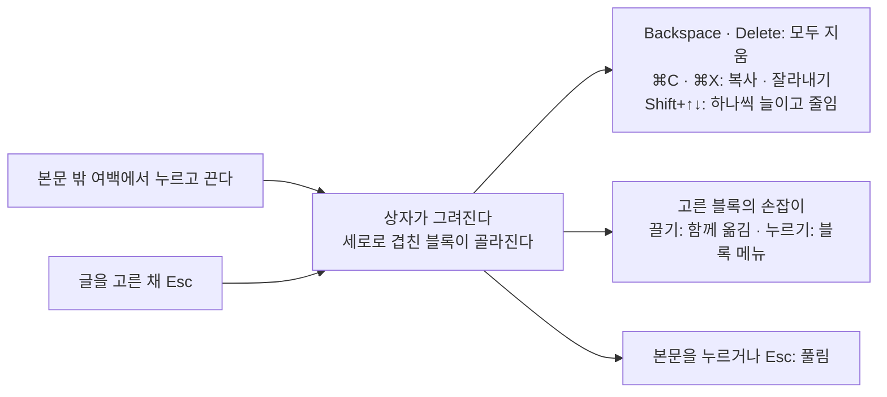

# 18 블록 패키지

상태: 설계 (2026-11-13). 화면 승인 전이다. 아래의 결정은 모두 만들며 정함(2026-11-13)이고, 화면은 "화면 승인"의 목업으로 소유자와 정한다.

## 한 문장

core에 없는 블록과 서식을 `@monti-cms/blocks`로 내놓고, `monti add`가 그 소스를 사이트에 넣어 사이트가 고쳐 쓴다. 편집기는 여러 블록을 상자로 끌어 한꺼번에 고르고 옮기며, 비교와 검토는 값만 가진 블록도 보이고 견준다.

## 범위

[진행 기록](../../tracker.md)의 남은 일이다.

| 번호 | 무엇 | 이 문서의 절 |
|---|---|---|
| T35 | 콜아웃, 탭, 단 나누기, 접기, 코드 탐색기, 수식, 차트, 다이어그램, 툴팁, 글자 색을 `defineBlock`으로 다시 만들고 `monti add`로 사이트 소스에 넣는다([03](03-body-editor.md#어떤-블록이-어디에-있나)) | 블록과 서식, 정의가 더 가지는 것, `monti add`, MDX, 편집기 |
| T80 | 여러 블록을 상자로 끌어 고르고, 고른 블록을 함께 옮기고 지운다(옛 `editor/drag/block-selection.ts`) | 여러 블록 고르기 |
| T197 | 편집기 비교(`shownBlocks`)와 어시스턴트 검토 화면(10)이 블록의 글자만 읽는다. 값만 가진 블록은 빈 줄로 보이고 값이 바뀌어도 잡히지 않는다 | 비교와 검토 |

## 원칙

1. **사이트가 고쳐 쓰는 소스다.** `monti add`는 블록의 소스를 사이트 폴더에 복사한다. 그다음부터 그 파일은 사이트의 것이다. 패키지를 올려도 복사한 파일은 바뀌지 않는다(shadcn/ui와 같은 방식). 그래서 사이트는 모양, 낱말, 값을 마음대로 바꾼다.
2. **정의 하나에서 화면이 나온다.** 블록의 값을 고치는 화면(블록 메뉴의 고르기, 블록 안의 입력 칸, 소스 카드)은 관리자가 정의의 `fields`에서 그린다. 블록 소스에 관리자 화면 코드를 쓰지 않는다. 그래서 사이트가 블록을 고쳐도 관리자 화면은 다른 곳과 같은 모양으로 남는다([03](03-body-editor.md) 원칙 3).
3. **MDX로 나갔다 들어와도 같다.** 모든 블록과 서식은 MDX 플러그인(14)이 쓰고 읽는 표기를 가진다. 쓰고 다시 읽으면 같은 본문이다.
4. **값만 가진 블록도 글처럼 보인다.** 비교와 검토는 블록의 값을 이름과 함께 한 줄로 보이고, 바뀐 값은 바뀐 글자처럼 표시한다.

## 블록과 서식

모든 블록의 값(`attrs`)은 글자, 수, 참 · 거짓뿐이다. 목록이 필요한 것(탭, 단, 코드 탐색기의 파일, 차트의 자료)은 자식 블록이다. MDX 지시문의 속성은 낱값만 담기 때문이다(아래 "MDX").

| 블록 | `type` | 담는 것 | 값 | MDX 표기 |
|---|---|---|---|---|
| 콜아웃 | `callout` | 블록 | `tone`: `note` · `tip` · `warn` · `danger`(없으면 `note`), `title`(없어도 된다) | `:::callout{tone="warn" title="알아 두세요"}` … `:::` |
| 탭 | `tabs` | `tab`만, 1~8개 | 없음 | `::::tabs` … `::::` |
| 탭 하나 | `tab` | 블록 | `label` | `:::tab{label="npm"}` … `:::` |
| 단 나누기 | `columns` | `column`만, 2~4개 | 없음 | `::::columns` … `::::` |
| 단 하나 | `column` | 블록 | `width`(본문 폭의 %, 없으면 고르게) | `:::column{width=60}` … `:::` |
| 접기 | `toggle` | 블록 | `title`, `open`(사이트에서 펼친 채 시작) | `:::toggle{title="자세히" open}` … `:::` |
| 코드 탐색기 | `codeExplorer` | `codeBlock`만, 1개 이상 | `open`(처음 보일 파일의 경로, 없으면 첫 파일) | `:::codeExplorer{open="src/app.ts"}` 안에 ```` ```ts title="src/app.ts" ```` |
| 수식 | `math` | 없음 | `source`(LaTeX) | ```` ```math ````. 읽을 때는 `$$ … $$`도 받는다 |
| 다이어그램 | `diagram` | 없음 | `source`(Mermaid) | ```` ```mermaid ```` |
| 차트 | `chart` | `table` 하나 | `kind`: `bar` · `line` · `area` · `pie`(없으면 `bar`), `title` | `:::chart{kind="line" title="방문"}` 안에 표 |

| 서식 | `type` | 값 | MDX 표기 |
|---|---|---|---|
| 툴팁 | `tooltip` | `text` | `:tooltip[글자]{text="설명"}` |
| 글자 색 | `color` | `color`: `gray` · `brown` · `orange` · `yellow` · `green` · `blue` · `purple` · `pink` · `red` | `:color[글자]{color="red"}` |

- **콜아웃의 종류는 넷이다.** GitHub의 알림은 다섯(NOTE · TIP · IMPORTANT · WARNING · CAUTION)이고 Docusaurus도 다섯이다. 블로그에서 "중요"와 "알림"은 갈리지 않아 넷으로 줄였다. 사이트는 소스에서 더한다.
- **차트의 자료는 core의 표다.** 차트는 표 하나를 담고 그 표를 그린다. 첫 열이 가로축의 이름, 나머지 열이 계열이고, 머리 행이 계열의 이름이다. 편집기는 표를 고치는 도구(03의 표: 격자, 행 · 열 손잡이, + 띠)를 그대로 쓴다. MDX에서도 그냥 표다. 숫자가 아닌 칸은 그리지 않고 발행 할 일 "숫자가 아닌 칸"(알리기만)이 된다. 옛 코드의 차트 문법(`chart bar` …)은 버린다: 사람이 배울 문법이 하나 늘 뿐이다.
- **수식과 다이어그램은 소스 하나다.** GitHub, GitBook, Obsidian이 같은 표기(```` ```math ````, ```` ```mermaid ````)를 쓴다. 수식은 KaTeX, 다이어그램은 Mermaid가 그린다. 둘 다 사이트의 패키지이고 `monti add`가 무엇을 설치할지 말한다.
- **글자 색은 이름이다.** 색 값(`#dc2626`)을 저장하지 않는다. 사이트가 이름마다 밝은 화면과 어두운 화면의 색을 정한다(노션의 아홉 색과 같은 이름). 옛 코드는 밝은 · 어두운 색 값을 짝으로 저장했다: 사이트가 테마를 바꾸면 글마다 고쳐야 했다.
- **넣지 않는 것.** 줄 안의 수식(`$x$`), 글자 바탕색, 콜아웃 아이콘 고르기. 셋 다 이 범위(T35)에 없다. 가져온 글의 `$x$`는 쓴 그대로 글자로 남고, 내보내면 그대로 나간다(잃는 것이 없다).

## 정의가 더 가지는 것

[03](03-body-editor.md#블록-정의)의 `defineBlock`과 `defineMark`에 셋을 더한다. 사이트가 손으로 만드는 블록도 같은 것을 쓴다.

```ts
type Words = string | { ko: string; en: string };   // label, a field's name, an option's name

type Field =
	| { label: Words; input: "choice"; options: Record<string, Words> } // block menu ›, a radio row each
	| { label: Words; input: "switch" }                                  // block menu, a check row
	| { label: Words; input: "text"; placeholder?: Words }               // an input inside the block itself
	| { label: Words; input: "source"; language: string };               // tool row "편집" → the source card

export const callout = defineBlock({
	type: "callout",
	label: { ko: "콜아웃", en: "Callout" },
	description: "A highlighted box for a note, a tip, a warning or a danger, with an optional title.",
	menu: "insert",
	attrs: z.object({ tone: z.enum(["note", "tip", "warn", "danger"]).optional(), title: z.string().optional() }),
	fields: {
		tone: { label: { ko: "종류", en: "Kind" }, input: "choice",
			options: { note: { ko: "알림", en: "Note" }, tip: { ko: "팁", en: "Tip" }, warn: { ko: "주의", en: "Warning" }, danger: { ko: "위험", en: "Danger" } } },
		title: { label: { ko: "제목", en: "Title" }, input: "text", placeholder: { ko: "제목 없음", en: "No title" } },
	},
	holds: "blocks",
	translate: { attrs: ["title"] },
	Site: Callout,
});

export const diagram = defineBlock({
	type: "diagram",
	// …
	attrs: z.object({ source: z.string() }),
	fields: { source: { label: { ko: "소스", en: "Source" }, input: "source", language: "mermaid" } },
	fence: { language: "mermaid", attr: "source" },   // MDX: a fenced code block of this language
	holds: "nothing",
});
```

- **`label`이 두 말을 받는다.** 관리자는 한국어와 영어이고, 블록 소스는 사이트의 것이라 관리자의 사전에 낱말을 넣을 수 없다. 그래서 정의가 두 말을 함께 가진다(플러그인의 문서 보기 `label: { ko, en }`과 같다). 글자 하나만 주면 어느 말에서나 그것이다.
- **`fields`는 관리자가 값을 고치는 곳을 정한다.** `choice`는 블록 메뉴의 둘째 단계(지금의 "정렬"과 같은 모양), `switch`는 블록 메뉴의 체크 행, `text`는 블록 안의 입력 칸, `source`는 블록 도구 행의 "편집"이 여는 소스 카드다. 서식의 `choice`는 서식 카드 ⋯의 둘째 단계, `text`는 링크 칸과 같은 카드다. `fields`에 없는 값은 화면에서 고치지 않는다(코드 탐색기의 `open`은 파일 줄의 메뉴가 정한다, 아래). 비교와 검토도 이 이름으로 값을 읽는다.
- **`fence`는 MDX에서 울타리 코드 블록인 블록이다.** 그 언어의 코드 블록을 읽으면 이 블록이 되고, 쓸 때 그 언어의 코드 블록으로 나간다. 코드는 `attr`이 가리키는 값이다.
- **`Editor` 컴포넌트가 받는 것.** 지금은 `block`, `attrs`, `children`이다. 여기에 `editable`(읽기 전용이면 거짓)을 더하고, 블록 안의 입력 칸은 관리자가 내놓는 `BlockField`(`<BlockField name="title" />`: 그 값의 `text` 칸, 실행 취소에 남는다)로 그린다. 탭과 코드 탐색기처럼 자식을 더하고 빼는 블록은 `useBlockChildren()`(`add` · `remove` · `move` · `select`)을 쓴다. 둘 다 `@monti-cms/admin`이 내놓는다. 블록 소스는 관리자의 부품을 직접 가져오지 않는다.

## `monti add`

```text
$ pnpm monti add callout math
Added callout: monti/blocks/callout/
Added math: monti/blocks/math/
math needs katex: pnpm add katex
```

**넣는 파일과 자리.** `@/` 가 가리키는 사이트 소스(`src/`가 있으면 그 안)의 `monti/blocks/`다. `monti/changes/`(01)와 같은 `monti/` 폴더다.

```text
monti/blocks/
  index.ts          # blocks, marks: the definitions with their Site components (monti.config.ts, renderDocument)
  admin.ts          # "use client": the same with their Editor components (the admin page)
  blocks.css        # @import of each block's css: the site's root layouts and the admin page load it
  callout/
    callout.ts      # defineBlock: type, label, attrs, fields, holds, translate, check
    site.tsx        # the site's component (no "use client"; a part that needs the browser is its own file)
    editor.tsx      # "use client": the editor's view, when it differs from the site's
    callout.css     # its look, under .monti-callout, on the site's colour variables
```

- **정의와 화면을 나눈 까닭.** `monti.config.ts`는 CLI가 jiti로 읽는다. CSS나 `"use client"` 모듈이 정의의 길에 있으면 CLI가 읽지 못하거나 관리자 컴포넌트가 서버로 간다. 그래서 정의 파일은 CSS를 가져오지 않고, 편집기 화면은 `admin.ts`만 가져온다. 이것은 03의 "같은 정의 배열"을 둘로 나눈 것이다: 값과 사이트 컴포넌트는 같고, 관리자 쪽이 `Editor`를 더한다.
- **처음 더할 때 잇는다.** `monti/blocks/`가 없으면 세 파일(`index.ts`, `admin.ts`, `blocks.css`)을 만들고 사이트의 파일 셋을 고친다: `monti.config.ts`에 `blocks`, `marks`(`./monti/blocks`, jiti는 `@/`를 모른다), 관리자 페이지에 `blocks={adminBlocks}`와 `blocks.css`, `<html>`을 그리는 레이아웃마다 `blocks.css`. `monti init`이 설정 파일과 관리자 페이지를 고치는 방식과 같다(14). 사이트의 `renderDocument(…)` 부르는 곳에 `blocks`, `marks`를 더한다. 찾지 못하면 무엇을 어디에 더할지 한 줄로 말한다.
- **두 번 더하지 않는다.** 그 폴더가 이미 있으면 "callout is already in monti/blocks/callout: it is the site's own now. Remove the folder to add it again."로 아무것도 쓰지 않는다. 고친 소스를 덮지 않기 위해서다.
- **함께 오는 것.** `tabs`는 `tab`을, `columns`는 `column`을 같은 폴더에 함께 넣는다. 차트는 core의 표를 쓰므로 더할 것이 없다.
- **설치는 말만 한다.** KaTeX와 Mermaid는 사이트가 설치한다. `monti init`처럼 무엇을 설치할지 말하고 설치하지 않는다(사이트의 패키지 관리자로 쓴 명령을 보인다).
- **이름 없이 부르면** 더할 수 있는 블록과 서식을 한 줄씩 보인다. 터미널이면 고르게 묻는다(`monti init`과 같은 물음).
- **소스가 오는 곳.** `@monti-cms/blocks`가 블록의 소스와 그 목록(`registry.json`: 이름, 파일, 함께 오는 블록, 설치할 패키지)을 가진다. CLI는 사이트에 설치된 그 패키지에서 읽는다. 없으면 "Blocks come from @monti-cms/blocks: install it from the same release, then run monti add again." 패키지 안의 소스가 그대로 테스트를 받는 코드이고, 복사할 때 바뀌는 것은 가져오는 경로뿐이다.
- **예제 앱(16)에 모두 넣는다.** `examples/blog`에 `monti add`로 모든 블록과 서식을 넣어 그 결과를 저장소에 둔다. 흐름 테스트가 그 사이트에서 돈다.

## MDX

14의 MDX 플러그인(`@monti-cms/mdx`)은 이미 사이트의 블록을 지시문으로 읽고 쓴다(`:::name{…}`, 담는 블록이 있으면 겉의 콜론이 더 길다). 이 문서의 블록은 그 틀에 맞춰 낱값만 가진다. 플러그인에 더하는 것은 넷이다.

1. **울타리 블록.** 정의에 `fence`가 있는 블록은 그 언어의 코드 블록으로 읽고 쓴다(```` ```math ````, ```` ```mermaid ````). 사이트에 그 블록이 없으면 지금처럼 코드 블록이다. `$$ … $$`도 수식으로 읽는다(remark-math를 쓰는 블로그가 많다). 쓸 때는 ```` ```math ````다.
2. **서식은 글자 지시문.** 사이트의 서식은 `:name[글자]{값}`으로 쓰고, 사이트가 아는 서식 이름의 글자 지시문을 그 서식으로 읽는다. 모르는 글자 지시문은 지금처럼 쓴 그대로 글자로 남는다.
3. **따옴표가 든 값.** 지금은 값을 `JSON.stringify`로 써서 `title="그가 "네"라고"` 같은 값이 다시 읽히지 않는다. 지시문이 읽는 방식(`&quot;`)으로 쓴다.
4. **코드 탐색기의 파일 이름.** 울타리 줄의 `title="src/app.ts"`가 코드 블록의 파일 이름이다. 지금 플러그인은 울타리 줄의 나머지를 언어 값에 그대로 둔다(T79). 그 줄을 읽는 일은 17과 만나는 곳이다(아래).

## 17번과 만나는 곳

코드 블록 자체(언어, 줄 효과, 문법 색, 사이트의 코드 블록)는 [17](17-code-tools.md)의 것이다. 코드 탐색기는 그 코드 블록을 담는 블록이다.

- 코드 탐색기의 파일은 core의 `codeBlock`이고, 파일의 경로는 코드 블록의 파일 이름 값(`title`)이다. 17이 코드 블록의 값을 정한다. 이 문서는 `title`을 쓴다. 두 PR 가운데 먼저 들어가는 쪽이 `codeBlock`의 `attrs`에 `title`을 더하고, MDX 울타리 줄의 `title="…"`를 그 값으로 읽는다. 이름이 다르게 정해지면 이 문서가 17을 따른다.
- 코드 탐색기 안의 코드는 17의 편집기와 사이트 그리기를 그대로 쓴다(언어 고르기, 줄 효과, 복사 버튼). 탐색기는 파일 나무와 "어느 파일을 보이나"만 더한다.
- 비교와 검토에서 코드 블록의 줄 효과를 그리는 일은 17의 T196이다. 이 문서의 T197은 코드 블록이 아닌 블록의 값을 맡는다. 둘 다 `shownBlocks`를 고치므로, 나중에 들어가는 PR이 앞의 것 위에 맞춘다.

## 편집기

기준 화면이 있는 블록은 없다. 모두 목업으로 정한다(아래 "화면 승인"). 고치는 길은 이미 있는 것을 쓴다.

| 블록 | 편집기에서 | 고치는 길 |
|---|---|---|
| 콜아웃 | 사이트의 상자 모양, 안의 블록은 바로 고친다 | 종류: 블록 메뉴 "종류 ›". 제목: 상자 첫 줄의 입력 칸 |
| 탭 | 탭 줄과 고른 탭의 블록 | 다른 탭을 누르면 바뀐다. 고른 탭의 이름은 그 자리의 입력 칸이다(GitBook, Mintlify처럼 이름을 바로 친다). 줄 끝의 +가 탭을 더하고 그 이름 칸에 커서를 둔다. 탭을 끌어 옮긴다(한 줄로 늘어선 것은 통째로 떠서 자리를 바꾼다, list.md). 고른 탭의 ⋯: 왼쪽으로 · 오른쪽으로 · 지우기(그 탭의 블록과 함께, ⌘Z로 돌아온다) |
| 단 나누기 | 단이 나란히 | 단 사이의 경계를 끌어 폭을 나눈다(표의 열과 같다). 블록 메뉴 "단 수 ›"(2 · 3 · 4). 줄인 단의 블록은 남는 마지막 단의 끝으로 간다 |
| 접기 | 제목 줄과 늘 펼친 안 | 제목: 첫 줄의 입력 칸. 블록 메뉴 체크 행 "펼쳐 두기"(사이트에서 펼친 채 시작) |
| 코드 탐색기 | 왼쪽 파일 나무, 오른쪽 고른 파일의 코드 블록 | 나무 끝의 "+ 파일". 경로는 코드 위 파일 이름 칸(17). 파일 줄의 메뉴: "처음 보일 파일" · 지우기 |
| 수식 · 다이어그램 | 그린 결과 | 누르면 고르고 도구 행 "편집", 소스 카드(고정폭 입력 칸, 치는 대로 블록이 다시 그려진다) |
| 차트 | 위에 그린 차트, 아래에 자료 표 | 표는 03의 표 도구. 블록 메뉴 "차트 종류 ›". 제목: 첫 줄의 입력 칸 |
| 툴팁 | 점선 밑줄 | 서식 카드 ⋯ "툴팁", 링크 칸과 같은 카드 |
| 글자 색 | 그 색의 글자 | 서식 카드 ⋯ "글자 색 ›", 색 이름 행과 "기본" |

- **"/" 메뉴의 "넣기" 묶음**에 블록마다 한 행이 더해진다(아이콘과 이름). 넣으면 처음 모양으로 들어간다: 콜아웃은 빈 문단 하나, 탭은 "탭 1" · "탭 2", 단 나누기는 두 단, 접기는 빈 제목과 빈 문단, 코드 탐색기는 `src/index.ts` 파일 하나, 차트는 2열 3행의 표, 수식과 다이어그램은 소스 카드가 열린 채.
- **소스가 틀리면** 블록은 마지막으로 그린 것을 흐리게 두고, 소스 카드의 칸 아래에 이유 한 줄("3번째 줄을 읽지 못했습니다")이 붙는다. 처음부터 그릴 것이 없으면 블록 자리에 "수식을 그리지 못했습니다"가 선다. 수식은 서버에서도 읽어 보고 발행 할 일 "읽지 못한 수식"(알리기만)이 된다. 다이어그램은 브라우저에서만 그려지므로 편집기만 알린다.
- **읽기 전용 본문**(보관한 글, 휴지통의 글)에서도 읽는 길은 남는다: 탭을 바꾸고, 코드 탐색기의 파일을 고르고, 수식 · 다이어그램의 "편집"은 읽기만 하는 소스 카드다. 고르기, 입력 칸, 더하기, 지우기가 없다.
- **숨은 탭의 제안.** 제안 말풍선의 ↑↓가 숨은 탭 안의 블록으로 가면 그 탭을 연다. 나란히 보기와 번역 옆 원문은 탭을 모두 펼쳐 보인다.

## 여러 블록 고르기 (T80)



- **시작하는 곳.** 본문 단의 왼쪽이나 오른쪽 여백(손잡이가 서는 64px 너머)에서 누르고 끈다. 글 위에서 끌면 지금처럼 글자를 고른다. 노션과 같다. 4px 넘게 움직여야 상자가 생기고, 덜 움직이고 떼면 아무 일도 없다.
- **무엇이 골라지나.** 상자의 세로 범위에 겹친 맨 위 단계의 블록이다. 처음부터 끝까지 사이를 건너뛰지 않는다. 콜아웃 · 탭 · 단 나누기는 통째로 하나다. 그 안의 블록 몇 개만은 글자 고르기로 한다. 상자가 화면 끝에 닿으면 본문이 스크롤된다.
- **보이는 모양.** 상자는 1px 잉크 선이고 바탕이 없다. 골라진 블록은 글에서 시작한 선택이 덮은 그림과 같은 선택 바탕(`bg-selection`, `data-covered`의 모양)이다. 한 가지 "골라짐" 모양만 둔다.
- **키보드로 시작.** 글을 고른 채(또는 커서가 있는 채) Esc를 누르면 그 글이 걸친 블록들이 골라진다. Shift+↑↓가 하나씩 늘이고 줄인다. 마우스가 없어도 같은 일을 한다(노션의 두 단계 Esc: 글 → 블록 → 풀림). 블록이 골라진 채 다른 블록의 손잡이를 Shift+누르면 그 블록까지 늘어난다.
- **할 수 있는 것.** Backspace · Delete는 모두 지운다(빈 본문이면 빈 문단 하나가 남는다). ⌘C · ⌘X는 블록째 복사하고 잘라낸다. 다른 글자를 치면 덮어 쓰지 않고 고른 것만 풀린다. 고른 블록 가운데 하나의 손잡이를 끌면 모두 함께 옮겨지고, 따라오는 카드는 "블록 3개"다. 누르면 블록 메뉴: 이름 줄 "블록 3개" · "위로" · "아래로" · "복제" · "삭제". "다른 블록으로 바꾸기"와 "정렬"은 하나를 고쳤을 때만 있다.
- **풀리는 때.** 본문을 누르거나, Esc를 한 번 더 누르거나, 다른 블록을 끌기 시작하면.
- 옛 코드는 목록 항목도 하나씩 골랐다. 여기서는 맨 위 단계의 블록만 고른다: 목록 항목만 옮기는 일은 손잡이 하나로 이미 된다.

## 비교와 검토 (T197)

`shownBlocks`가 블록마다 이름 줄을 더한다. 이름 줄은 블록의 이름과 `fields`의 값을 한 줄로 보인다: "콜아웃 · 종류 주의 · 제목 알아 두세요". 값을 가진 core 블록도 같다: 이미지("이미지 · cat.png · 대체 텍스트 고양이 · 캡션 …"), 파일, 표(행마다 "칸 | 칸" 한 줄), 구분선. 문단 · 제목 · 목록 · 인용 · 코드 블록에는 이름 줄이 없다(지금 그대로).

```ts
type ShownBlock = {
	id: string;
	look: "heading" | "code" | "text";
	/** The block's name and its values, one line; none for blocks that are only their words. */
	values?: string;
	text: string;   // its words, or a source (math, diagram) with the "code" look
};
```

- **편집기 비교 화면(EditorCompare).** 이름 줄은 블록 위의 작은 흐린 줄이다(편집기의 `data-box-label`과 같은 글자). 이름 줄도 낱말 단위로 견주어 바뀐 값이 바뀐 글자처럼 표시된다. 그래서 "종류 알림 → 주의"는 "알림"과 "주의"가 양쪽에 표시된다. 수식과 다이어그램의 소스는 코드 모양이다. 담는 블록(콜아웃, 탭)은 이름 줄 아래에 자식의 글이 이어진다. 탭은 탭마다 "[npm]" 같은 줄이 앞선다.
- **다른 제품.** 노션과 Google Docs의 기록은 값의 바뀜을 따로 보이지 않고 그때의 모양을 그리거나 블록을 지우고 새로 넣은 것으로 보인다. GitBook은 마크다운 보기에서 `style="info"` → `style="danger"`처럼 글자로 견준다. 우리 비교는 글자로 견주는 화면이라 GitBook의 쪽을 따른다: 바뀐 값이 낱말로 표시된다.
- **어시스턴트 검토 화면(10).** 바뀐 곳의 행에 이름 줄의 바뀜이 그대로 든다: 이름 "블록 4 · 콜아웃", 전 "종류 알림", 뒤 "종류 주의". 지금은 글자가 같으면 행이 없다.
- **번역 옆 원문**(translation.tsx)도 같은 `shownBlocks`라 이름 줄이 함께 보인다.
- 값이 바뀌었는지는 이름 줄과 글을 함께 본다. 그래서 값만 바뀐 블록도 "다른 곳"으로 세어진다.

## 바뀌는 곳

- `@monti-cms/core`: `defineBlock` · `defineMark`의 `fields`, `fence`, 두 말 `label`. 이름 줄을 만드는 `blockValues(block, kit, language)`.
- `@monti-cms/blocks`: 새 패키지(커밋 범위 `blocks`). 블록 열 개와 `registry.json`, 블록마다 단위 테스트(사이트 그리기, 값 검사, 발행 할 일).
- `monti add`: core의 CLI(`db:setup`처럼 기능이 아닌 명령).
- `@monti-cms/mdx`: 울타리 블록, 글자 지시문 서식, 따옴표 든 값, `$$`.
- `@monti-cms/admin`: `fields`에서 그리는 블록 메뉴 행 · 블록 안 입력 칸(`BlockField`) · 소스 카드, `useBlockChildren`, 서식 카드 ⋯의 값 있는 서식, 여러 블록 고르기, `shownBlocks`의 이름 줄과 비교 · 검토 화면.
- `@monti-cms/ui`: 소스 카드, 파일 나무, 탭 줄(편집기 안), 고른 상자 같은 부품이 화면 승인 뒤에 정해진다. 부품 지도(`docs/design/admin/screens/editor.md`)와 `editor-tools.md`를 같은 PR에서 고친다.
- `examples/blog`: `monti add`로 모든 블록을 넣는다.

## 기능 목록

새 기능(`defineOperation`)은 없다. 블록은 `blocks.catalog`, `body.read`, `body.edit`, `entries.save`(03)를 그대로 지난다. `monti add`는 사이트의 파일을 고치는 명령이라 기능이 아니다.

## 설계에서 정할 것 (답)

- **`monti add`가 넣는 파일의 모양과 자리**: `monti/blocks/<이름>/`의 정의 · 사이트 · 편집기 · CSS 네 파일과, 세 묶음 파일(`index.ts`, `admin.ts`, `blocks.css`). 위 "`monti add`". 예제 앱에 넣어 확인한다.
- **MDX 플러그인과 맞추기**: 지시문은 그대로 쓰고 값을 낱값으로 맞췄다. 수식과 다이어그램은 울타리, 서식은 글자 지시문. 위 "MDX".
- **블록마다 편집기 화면**: 위 "편집기"의 표. 그림은 "화면 승인"의 목업.
- **여러 블록 고르기의 모양과 동작**: 위 "여러 블록 고르기".
- **값만 가진 블록의 비교와 검토**: 위 "비교와 검토".

## 화면 승인 (대기)

목업은 소유자가 보고 정한다. 정한 것은 여기에 날짜와 함께 옮겨 적는다.

| 빈 곳 | 물음 | 추천 |
|---|---|---|
| 1 | 콜아웃과 "/" 메뉴: 종류와 제목을 어디서 고치나 | 블록 메뉴 "종류 ›", 상자 첫 줄의 제목 칸 |
| 2 | 탭: 탭을 더하고, 이름을 바꾸고, 지우는 곳 | 탭 줄 끝 +, 탭 자리에서 이름, 탭의 ⋯ 메뉴 |
| 3 | 단 나누기: 폭과 단 수 | 경계를 끌기, 블록 메뉴 "단 수 ›" |
| 4 | 접기: 편집기에서 접히나 | 늘 펼침, "펼쳐 두기"는 블록 메뉴 체크 행 |
| 5 | 수식 · 다이어그램: 소스를 고치는 곳과 틀린 소스 | 도구 행 "편집" → 소스 카드, 이유 한 줄 |
| 6 | 차트: 자료를 넣는 곳 | 차트 아래의 표(03의 표 도구) |
| 7 | 코드 탐색기: 파일을 더하고 고르는 곳 | 나무 끝 "+ 파일", 파일 줄 메뉴 |
| 8 | 툴팁 · 글자 색: 서식 카드에서 | ⋯ "글자 색 ›"의 색 행, "툴팁"은 링크 칸 같은 카드 |
| 9 | 여러 블록 고르기: 상자와 골라진 모양, 손잡이 | 1px 상자, 선택 바탕, "블록 3개" 메뉴 |
| 10 | 비교 · 검토: 값만 가진 블록 | 블록 위 이름 줄, 바뀐 값 표시 |

## 끝 조건

- **18-1** `monti add callout`이 `monti/blocks/callout/`과 묶음 파일을 만들고 설정 파일, 관리자 페이지, 레이아웃, `renderDocument`를 잇는다. 그 뒤 콜아웃이 "/" 메뉴, 사이트 그리기, `blocks.catalog`에 나온다. 이미 있는 폴더는 덮지 않는다. `@monti-cms/blocks`가 없으면 무엇을 설치할지 말하고 아무것도 쓰지 않는다.
- **18-2** 예제 앱에 열 개(블록 여덟, 서식 둘)가 모두 들어가 있고, 사이트가 발행본을 그린다. 탭과 코드 탐색기는 자바스크립트 없이도 모든 내용이 페이지의 HTML에 있다.
- **18-3** 블록과 서식마다 MDX로 쓰고 다시 읽으면 같은 본문이다. `$$ … $$`는 수식으로 읽는다. 따옴표가 든 값도 같다. 사이트에 없는 블록의 표기는 지금처럼 쓴 그대로 남는다.
- **18-4** `fields`의 `choice` · `switch`는 블록 메뉴에, `text`는 블록 안의 칸에, `source`는 도구 행의 소스 카드에 나오고, 고친 값은 저장된다. 실행 취소가 값을 되돌린다.
- **18-5** 탭을 더하고 이름을 바꾸고 옮기고 지울 수 있다. 단 수를 줄이면 줄인 단의 블록이 남는 단으로 간다. 코드 탐색기에 파일을 더하고 지우고 처음 보일 파일을 정할 수 있다.
- **18-6** 틀린 수식은 편집기와 발행 할 일에, 틀린 다이어그램은 편집기에 이유 한 줄로 나온다. 차트의 숫자가 아닌 칸은 발행 할 일이 된다.
- **18-7** 여백에서 끈 상자가 겹친 블록을 고르고, Esc로도 고른다. 고른 블록이 함께 지워지고 복사되고 옮겨지며, 실행 취소 한 번에 돌아온다.
- **18-8** 값만 바뀐 블록(콜아웃의 종류, 이미지의 대체 텍스트, 수식의 소스, 표의 칸)이 편집기 비교에서 "다른 곳"으로 세어지고 바뀐 값이 표시되며, 검토 화면에 그 블록의 행이 생긴다.
- **18-9** 읽기 전용 본문에서 탭을 바꾸고, 코드 탐색기의 파일을 고르고, 소스를 읽을 수 있다. 고치는 것은 없다.
- **18-10** 콜아웃의 제목, 접기의 제목, 탭의 이름, 차트의 제목과 표가 번역에서 옮길 글자가 된다. 수식, 다이어그램, 단 나누기는 원문을 따른다.

## 옛 코드

`9c69629f` 이전의 `packages/blocks`(블록마다 `definition.ts` · `render.tsx` · `view.tsx`, 차트 문법 `chart/dsl.ts`, 글자 색 `color/colors.ts`), `34d5adcd` 이전의 `packages/admin/src/editor/drag/block-selection.ts`(여백에서 시작하는 상자, 골라진 줄을 칠하기, 손잡이로 함께 옮기기, 덮어 쓰기 막기). 이름과 생각만 가져온다. 차트 문법, 색 값 짝, 목록 항목 하나씩 고르기는 가져오지 않는다(위의 까닭).

## 결정 기록

- 2026-11-13, 만들며 정함: 위의 모든 결정. 화면 승인에서 소유자가 바꾸면 여기에 적는다.
