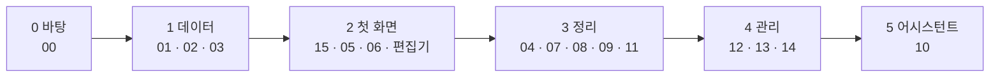

# 만드는 순서

상태: 승인됨 (2026-11-05). 설계 문서(00–15)를 코드로 옮기는 순서와 규칙이다.

## 한 문장

화면이 아니라 기능 문서 순서로, 아래 층부터 만든다. 기능 문서 하나가 PR 하나이고, 그 문서의 기능 목록과 끝 조건이 PR이 할 일이다.

## 규칙

1. **옛 코드는 지웠다.** core, admin, ai, auth, storage-s3, nextjs, mdx, blocks, seo, syntax 패키지와 예제 앱을 지우고 시작했다. 남은 것은 `@monti-cms/ui`(디자인 시스템과 기준 화면), 설계 문서, 도구(biome, check:design, CI)다. 옛 코드에서 쓸 만한 조각은 그 기능의 PR에서 이름을 대고 git 기록(`9c69629f` 이전)에서 되살린다.
2. **기능 하나에 PR 하나.** PR은 그 문서의 기능(`defineOperation`), 데이터베이스 바꿈, 화면 쪽 조각, 화면을 함께 담는다. PR 설명에 그 문서의 끝 조건을 옮겨 적고 하나씩 표시한다.
3. **화면은 기능만 부른다.** 관리자 화면은 `useOperation`으로만 서버에 닿는다. 화면에서 `fetch`나 데이터베이스를 바로 부르지 않는다. 그래서 화면마다 다른 규칙이 생길 수 없다.
4. **문서와 코드는 같은 목록이다.** `pnpm check:operations`가 지킨다.
   - 코드에 정의한 기능은 모두 어느 문서의 기능 목록에 있다.
   - 아래 표에서 "끝"인 문서의 기능 목록은 모두 코드에 있다.
   - 테스트 이름 앞의 번호(`00-1`)는 어느 문서의 끝 조건에 있다.
5. **테스트는 core 기능의 동작만.** 끝 조건을 테스트로 옮긴다. 테스트 이름은 끝 조건 번호로 시작한다. 화면은 테스트하지 않고 기준 화면과 나란히 보아 맞춘다.
6. **Storybook은 진짜 기능으로.** 화면 스토리는 브라우저 안의 Postgres(PGlite)에서 진짜 기능을 돌린다. 기준 화면의 데이터를 넣어 두고 같은 화면이 나오는지 본다. 가짜 응답을 따로 쓰지 않으므로 코드와 어긋날 수 없다.
7. **CLI로 먼저 확인한다.** 기능은 정의하면 CLI 명령이 되므로, 화면이 생기기 전에 명령으로 돌려 본다.
8. **병합.** CI가 초록이면 병합한다. 화면이 든 PR은 소유자가 Storybook을 본 뒤 병합한다.

## 단계

- 0–1단계는 한 세션이 차례로 만든다. 바탕의 모양이 한 머리에서 나와야 한다.
- 2단계부터 서로 파일이 겹치지 않는 문서는 따로 세션을 띄워 함께 만든다.
- 어시스턴트(10)의 도구는 0단계부터 이미 있다. 5단계는 패널, 실행, 검토 화면이다.

## 문서마다 상태

`check:operations`가 이 표를 읽는다. 상태는 대기 · 만드는 중 · 끝이다.

| 문서 | 단계 | 상태 | 비고 |
|---|---|---|---|
| 00 | 0 | 끝 | 기능 정의, 엔진(버전, 스냅숏, 활동 기록, 보낼 일), 제안과 적용, 입구 셋. 화면 쪽 조각(`useOperation`, `useProposals`)은 관리자 패키지와 함께 2단계에서 |
| 01 | 1 | 대기 | |
| 02 | 1 | 대기 | |
| 03 | 1 | 대기 | |
| 15 | 2 | 대기 | |
| 05 | 2 | 대기 | |
| 06 | 2 | 대기 | |
| 04 | 3 | 대기 | |
| 07 | 3 | 대기 | |
| 08 | 3 | 대기 | |
| 09 | 3 | 대기 | |
| 11 | 3 | 대기 | |
| 12 | 4 | 대기 | |
| 13 | 4 | 만드는 중 | `activity.undo`와 보내기 엔진은 0단계에 있다 |
| 14 | 4 | 대기 | |
| 10 | 5 | 대기 | |

## 결정 기록

- 2026-11-05, 소유자: 옛 코드는 처음에 모두 지운다. 나란히 두고 하나씩 바꾸지 않는다.
- 2026-11-05, 소유자: 테스트는 core 기능의 동작만 둔다. 끝 조건을 테스트로 옮긴다. 화면은 기준 화면과 나란히 보는 것으로 맞춘다.
- 2026-11-05, 소유자: Storybook은 PGlite 위의 진짜 기능으로 그린다.
- 2026-11-05: blocks 패키지도 옛 core에 묶여 있어 함께 지웠다. 블록은 03에서 `defineBlock`으로 다시 만들며 옛 코드를 이름으로 되살린다.
- 2026-11-05: `docs/testing/requirements`의 요구 표는 옛 코드의 것이다. 새 코드의 요구는 각 기능 문서의 끝 조건이다.
