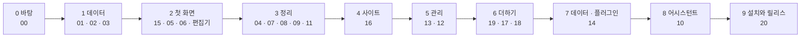

# 만드는 순서

상태: 승인됨 (2026-11-05). 설계 문서(00–15)를 코드로 옮기는 순서와 규칙이다.

## 한 문장

화면이 아니라 기능 문서 순서로, 아래 층부터 만든다. 기능 문서 하나가 PR 하나이고, 그 문서의 기능 목록과 끝 조건이 PR이 할 일이다.

## 규칙

1. **옛 코드는 지웠다.** core, admin, ai, auth, storage-s3, nextjs, mdx, blocks, seo, syntax 패키지와 예제 앱을 지우고 시작했다. 남은 것은 `@monti-cms/ui`(디자인 시스템과 기준 화면), 설계 문서, 도구(biome, check:design, CI)다. 옛 코드에서 쓸 만한 조각은 그 기능의 PR에서 이름을 대고 git 기록(`9c69629f` 이전)에서 되살린다.
2. **기능 하나에 PR 하나.** PR은 그 문서의 기능(`defineOperation`), 데이터베이스 바꿈, 화면 쪽 조각, 화면을 함께 담는다. PR 설명에 그 문서의 끝 조건을 옮겨 적고 하나씩 표시한다.
3. **화면은 기능만 부른다.** 관리자 화면은 `useOperation`으로만 서버에 닿는다. 화면에서 `fetch`나 데이터베이스를 바로 부르지 않는다. 그래서 화면마다 다른 규칙이 생길 수 없다.
4. **문서와 코드는 같은 목록이다.** `pnpm check:operations`가 지킨다.
   - 코드에 정의한 기능은 모두 어느 문서의 기능 목록에 있다.
   - [진행 기록](../../tracker.md)에서 "끝"인 문서의 기능 목록은 모두 코드에 있고, 그 문서로 미룬 일이 남아 있지 않다.
   - 테스트 이름 앞의 번호(`00-1`)는 어느 문서의 끝 조건에 있다.
5. **테스트는 core 기능의 동작과 화면을 써 보는 장면.** 끝 조건을 테스트로 옮긴다. 테스트 이름은 끝 조건 번호로 시작한다. 화면의 모양은 테스트하지 않고 기준 화면과 나란히 보아 맞춘다. 화면을 쓰는 길(마우스로 닿기, 키보드로 끝까지, 문장 중간에서 열기, 더한 뒤 넘침)은 [`testing/scenes.ts`](../../../testing/scenes.ts)의 장면으로 테스트한다. 부품 안의 동작은 ui의 L3(`*.browser.test.tsx`), 화면이 부품을 놓고 잇는 방식은 admin의 L4(`*.screen.test.tsx`, 스토리 장면 위에서 실제 입력)이고, 이름은 장면으로 시작한다(`[reach] …`).
6. **Storybook은 진짜 기능으로.** 화면 스토리는 브라우저 안의 Postgres(PGlite)에서 진짜 기능을 돌린다. 기준 화면의 데이터를 넣어 두고 같은 화면이 나오는지 본다. 가짜 응답을 따로 쓰지 않으므로 코드와 어긋날 수 없다. 화면 스토리(`Screens/`)는 사람이 보고 판단하는 상태가 다른 스토리에 없을 때만 더한다. 새로 쓰는 스토리의 play는 그 상태로 데려다 놓고 거기 닿았는지만 기다린다(전에 쓴 스토리에는 결과까지 보는 play가 남아 있고, 고칠 때 테스트로 옮긴다). 동작이 되는지는 L4 화면 테스트(`*.screen.test.tsx`)가 스토리를 띄워 놓고 실제 입력으로 확인한다. 스토리에 없는 상태는 테스트가 `packages/admin/test/scene.ts`의 `scene`으로 만든다. `Tests/` 스토리(`*.test.stories.tsx`)는 CI에서 돌지 않아 2026-11-12에 모두 화면 테스트로 옮기고 지웠다.
7. **CLI로 먼저 확인한다.** 기능은 정의하면 CLI 명령이 되므로, 화면이 생기기 전에 명령으로 돌려 본다.
8. **늘 최신 모양.** 아직 사용자가 없다. 마이그레이션 단계는 표의 모양만 바꾸고, 저장된 데이터를 옮기거나 옛 버전이 남긴 것을 고치지 않는다. 저장 형식이 바뀌어도 옛 데이터를 읽는 길을 두지 않는다. 데이터베이스는 실행한 단계의 이름을 기록하므로 base 브랜치에 들어간 단계의 이름은 바꾸거나 지우지 않는다(2026-11-10, 소유자).
9. **병합.** CI가 초록이면 병합한다. 화면이 든 PR은 소유자가 Storybook을 본 뒤 병합한다.
10. **화면은 코드 전에 그림으로 정한다(화면 승인).** 화면이 있는 문서는 코드를 쓰기 전에 빈 곳을 찾아 목업으로 소유자와 정한다. 빈 곳은 여섯 가지로 찾는다: 모든 상태의 그림이 있는지, 같은 일을 하는 화면이나 부품이 이미 있는지, 컨트롤마다 단위와 누른 뒤의 결과, 사이트가 받는 값의 모양, 화면의 모든 문구, 넣는 것과 빼는 것. 정한 것은 그 문서의 "화면 승인 (날짜)" 절에 적는다. 그다음 화면을 써 보는 장면을 `it.todo`로 먼저 적어 소유자에게 보이고, 만들면서 채운다. 순서는 스킬 `screen-build`에 있다(2026-11-12. 09번은 글로만 승인해 다시 만드는 데 처음 만든 시간의 다섯 배가 들었고, 11번과 12번에서 이 순서를 써 봤다).
11. **장면은 장치가 지킨다.** `pnpm check:scenes`가 화면 코드가 쓴 부품 종류의 장면 테스트가 그 폴더에 있는지, `it.todo`나 `.only`, 진행 기록 번호 없는 `skip`이 남았는지 본다. push 전(`.husky/pre-push`), PR을 만들기 전(Claude hook), CI에서 돈다. 테스트가 장면이 말한 일을 정말 하는지는 못 본다. 그것은 리뷰가 읽는다.

## 단계

- 0–1단계는 한 세션이 차례로 만든다. 바탕의 모양이 한 머리에서 나와야 한다.
- 2단계부터 서로 파일이 겹치지 않는 문서는 따로 세션을 띄워 함께 만든다.
- 4단계부터의 순서는 쓰는 쪽이 뒤에 오게 놓았다(2026-11-11). 문서 안의 순서도 적힌 대로다.
  - **4 사이트(16).** 예제 앱이 먼저 있어야 뒤의 문서를 진짜 사이트에서 끝까지 돌려 본다. 미리보기, 캐시 갱신, 개발 서버와 운영 사이트의 차이가 여기서 정해진다.
  - **5 관리(13 · 12).** 13은 core가 이미 있어 먼저 끝낸다. 도구 화면의 탭이 13에서 생기고, 12의 설정은 16이 정한 값을 고치는 화면이다.
  - **6 더하기(19 · 17 · 18).** 필드 종류와 블록을 더한다. 가져오기와 어시스턴트가 이것을 읽으므로 그 앞이다. 18의 코드 탐색기는 17의 코드 도구를 쓴다.
  - **7 데이터 · 플러그인(14).** 가져오기는 필드와 블록을 모두 안 뒤에 필드를 맞추고 MDX를 읽는다. 어시스턴트가 쓸 키와 모델도 여기서 나온다.
  - **8 어시스턴트(10).** 도구는 0단계부터 이미 있다. 이 단계는 패널, 실행, 검토 화면이고, 다른 기능이 다 나온 뒤라 한 번에 잇는다.
  - **9 설치와 릴리스(20).** 설정 마법사가 묻는 것(로그인, 저장소, 플러그인, 키)이 다 정해진 뒤다.
- 16~20은 범위만 적은 문서이고, 그 단계를 시작할 때 먼저 설계한다.
- **순서 바꿈 (2026-11-12, 만들며 정함).** 마감(2026-11-15)에 맞춰 6단계(19 · 17 · 18)를 건너뛰고 7단계의 키와 모델(14의 일부), 8단계(10), 9단계(20)를 먼저 만든다. 6단계와 14의 나머지(데이터, 플러그인)는 첫 릴리스 뒤에 만든다. 소유자는 순서를 건너뛴 것을 알고 있고, 먼저 만드는 것은 괜찮다고 했다: "그래도 일단 만드는게 좋긴한뎅....나중에 하면 되니까". 위 순서는 가져오기와 어시스턴트가 필드와 블록을 읽기 때문에 6단계를 앞에 둔 것이었다. 그래서 뒤에 오는 문서는 먼저 만든 것으로 돌아가 맞춰야 하고, 그 일은 진행 기록에 문서마다 한 줄씩 있다(나온 곳 "순서 바꿈").
  - **19 조건 달린 필드 → T195.** 어시스턴트의 제안과 검토, 편집기의 비교가 필드의 조건을 지키는지.
  - **17 코드 도구 → T196.** 비교와 검토가 코드 블록의 줄 효과를 그리는지.
  - **18 블록 패키지 → T197.** 비교와 검토가 글자 없는 블록을 그리는지.
  - **14 데이터 · 플러그인 → T198.** `monti init`이 플러그인과 있던 글을 묻는 것, 결과가 큰 기능을 어시스턴트가 도구로 쓰는 것.
  - 돌아갈 필요가 없는 것도 확인했다. 어시스턴트의 도구는 기능 목록에서 만들어지므로(`assistantTools`) 뒤에 생기는 기능은 그대로 도구가 된다. 어시스턴트가 읽는 사이트의 모양은 `schema.read`가 주는 그대로라 새 필드 종류와 조건이 따라온다. 설정의 편집기 탭은 사이트의 블록 목록(`catalog.blocks`)에서 그리므로 새 블록이 저절로 나온다.
- **단계 앞의 일.** 맞는 문서가 없는 일(도구, 이미 만든 화면의 작은 고침)은 진행 기록에 "4단계 전"처럼 적고, 그 단계의 첫 문서를 끝내기 전에 한다. `pnpm check:operations`가 그 일을 두고 문서를 끝내는 것을 막는다.

## 진행

문서마다 상태와, 만들다 미룬 일은 [진행 기록](../../tracker.md)에 있다. 일을 시작할 때 먼저 읽고, 끝낼 때 고친다.

## 결정 기록

- 2026-11-05, 소유자: 옛 코드는 처음에 모두 지운다. 나란히 두고 하나씩 바꾸지 않는다.
- 2026-11-05, 소유자: 테스트는 core 기능의 동작만 둔다. 끝 조건을 테스트로 옮긴다. 화면은 기준 화면과 나란히 보는 것으로 맞춘다.
- 2026-11-05, 소유자: Storybook은 PGlite 위의 진짜 기능으로 그린다.
- 2026-11-05: blocks 패키지도 옛 core에 묶여 있어 함께 지웠다. 블록은 03에서 `defineBlock`으로 다시 만들며 옛 코드를 이름으로 되살린다.
- 2026-11-05: `docs/testing/requirements`의 요구 표는 옛 코드의 것이다. 새 코드의 요구는 각 기능 문서의 끝 조건이다.
- 2026-11-05, 소유자: 미룬 일은 말이나 PR 설명으로만 두지 않는다. 진행 기록의 "남은 일"에 적고, 그 일을 할 문서를 정해 둔다. 문서를 끝낼 때 검사가 남은 일을 막는다.
- 2026-11-11, 소유자: "4단계 시작하기 전에 출시 전으로 무작정 미뤄둔 것들을 조사해서 적절한 위치로 옮기자". "출시 전"은 언제 할지 없는 자리라 17줄이 쌓였다. 그 자리를 없애고, 미루는 일은 아직 만들지 않은 문서나 단계 앞("N단계 전")에만 적는다. 문서가 없던 일은 범위만 적은 문서 16~20으로 세웠다(자리를 없앤 것과 문서 16~20은 만들며 정함).
- 2026-11-11, 소유자: "너가 개발하기 좋은 순서로 배치해줘." 쓰는 쪽이 뒤에 오게 4 사이트 → 5 관리 → 6 더하기 → 7 데이터 · 플러그인 → 8 어시스턴트 → 9 설치와 릴리스로 바꿨다(이 순서는 만들며 정함). 전에는 4 관리(12 · 13 · 14) → 5 어시스턴트였다.
- 2026-11-12, 소유자: 화면 승인을 규칙으로 올린다(규칙 10). 장면 먼저 적기(규칙 11)는 만들며 정함: 따로 묻지 않았고, 그 규칙이 든 계획에 소유자가 "그래 시작해"라고 답했다. `Tests/` 스토리는 화면 테스트로 옮기고 지운다.
