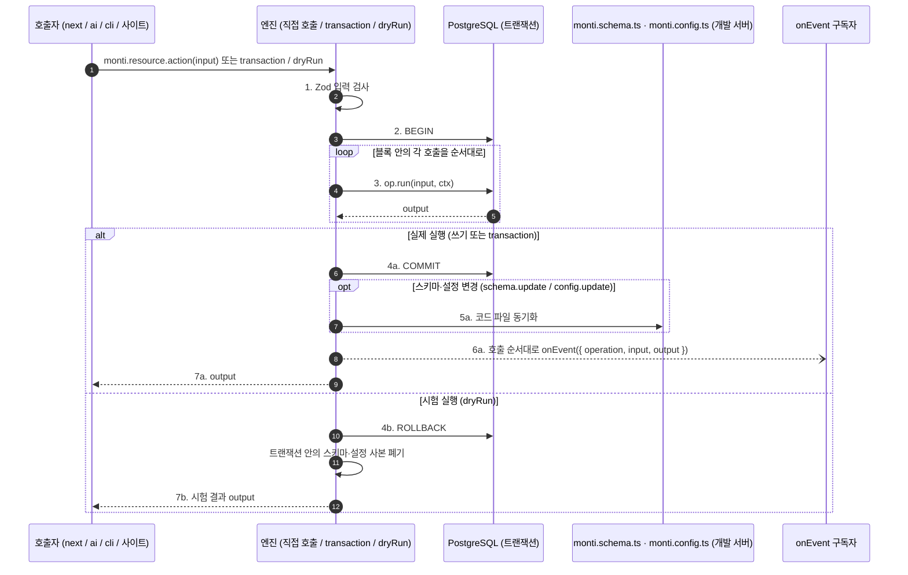
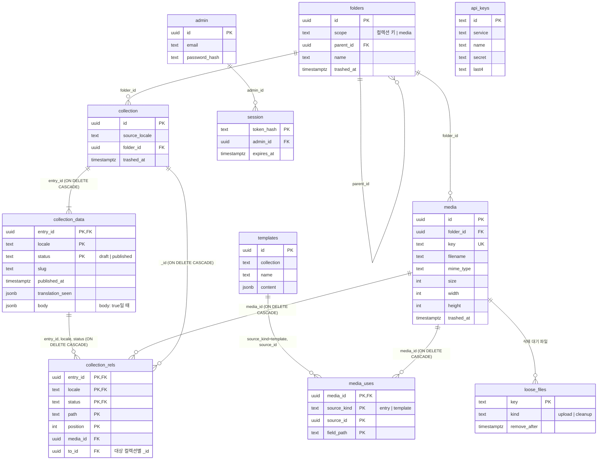

# `@monti-cms/core` 개발 기준

이 문서는 core를 개발할 때 따르는 유일한 기준이다. 결정이 나온 경위와 옛 구조 대응표는 [core_legacy.md](core_legacy.md)에 있다. 아직 정하지 않은 것은 맨 끝 "11. 정하지 않은 것"에만 둔다.

## 1. 설계 기준

모든 결정은 아래 일곱 가지로 판정한다.

1. **개념의 수가 적다**: 기존 개념으로 설명되는 일에 새 용어를 만들지 않는다.
2. **같은 일은 한 가지 방법으로만 한다**: 호출자가 달라도 같은 작업은 같은 파이프라인과 모양을 따른다.
3. **예외는 모델 안에서 흡수한다**: 특정 경우를 위한 `if`와 일회성 플래그를 바깥에 두지 않는다.
4. **의존은 한 방향이다**: core는 `ai`, `admin`, `next`, `cli`를 알지 못한다.
5. **사실 하나는 한 곳에만 있다**: 같은 데이터를 두 곳에 중복 저장하지 않는다.
6. **지금 필요한 것만 둔다**: 쓰는 곳이 없거나 한 곳만을 위한 훅·추상화·옵션을 두지 않는다.
7. **바꾸기 쉽다**: 흔한 변경 하나에 고칠 파일 수가 변경 크기에 비례한다.

## 2. core의 경계

판단 기준은 하나다. **"CMS의 DB와 Operation을 정의하고 실행하는 데 필요한가?"** 필요하면 core, 아니면 외부 패키지나 플러그인이다. core는 누가 어떤 경로(HTTP, CLI, AI, 사이트)로 호출했는지 모른다.

**core가 하는 일**
- 고정 도메인 테이블 8개와 컬렉션별 테이블(`<collection>`, `<collection>_data`, `<collection>_rels`), 마이그레이션 실행, 개발 서버에서의 스키마 테이블 동기화.
- 리소스별 Operation 정의·실행·검증, 트랜잭션, `dryRun`, 커밋 뒤 이벤트 통지.
- 스키마 검사, 개발 서버에서의 `monti.schema.ts`·`monti.config.ts` 파일 갱신.
- 본문(리치 텍스트) JSON 구조 검증(`rich-text/`)과 미디어 사용처 색인(`resources/media/`).
- 외부 서비스 키의 암호화 보관(`keys`).
- 공개 호출(`monti.<resource>.<action>(input)`)과 Operation 명세(이름, 종류, 입력 JSON Schema).

**core가 하지 않는 일**
- HTTP·쿠키·권한 입구(`next`), CLI 입출력과 마이그레이션 파일 생성 명령(`cli`), 관리 화면과 개인 보기 설정(`admin`), AI 대화·제안(`ai`), 콘텐츠 내보내기·가져오기, Markdown/MDX 변환(`mdx`), 본문 화면 렌더링(`rendering`, `blocks`), S3 등 저장소 어댑터 구현(`storage-s3`), SEO(`seo`).

## 3. Operation과 엔진

### 3.1 정의

- Operation은 `defineRead` 또는 `defineWrite`로 정의하고 리소스 객체 트리(`{ entries: { list, get, ... } }`)에 둔다. 키 경로(`entries.get`)가 곧 이름이다.
- 속성은 **`input`**(Zod 스키마)과 **`run`**(`(input, ctx) => Promise<output>`) 둘뿐이다. 모든 입력이 선택인 Operation은 인자를 생략해 호출할 수 있다.
- 읽기는 상태를 바꾸지 않는다. 쓰기는 항상 트랜잭션 안에서 실행된다.
- 다른 쓰기가 참조할 수 있는 생성 액션(`folders.create`, `templates.create`, `media.create`, `entries.create`, `entries.duplicate`)은 선택 입력 `__preset_id`(UUID, 소문자로 저장)를 받아 앞뒤 쓰기를 한 트랜잭션에서 이을 수 있게 한다.

### 3.2 호출 방식

| 호출 | 동작 |
|---|---|
| 읽기 `monti.a.b(input)` | 입력 검사 후 `run` 실행. 트랜잭션 없음. |
| 쓰기 `monti.a.b(input)` | 입력 검사, 트랜잭션 시작, `run`, 커밋, 파일 반영(스키마·설정 변경 시), 이벤트 통지. |
| `monti.transaction(async (tx, trx) => …)` | 콜백 안의 호출들이 한 트랜잭션을 공유한다. 커밋된 뒤 쌓인 이벤트를 호출 순서대로 통지한다. 실패하면 롤백하고 파일 쓰기와 이벤트는 일어나지 않는다. |
| `monti.dryRun(async (tx, trx) => …)` | `tx`에는 쓰기만 보인다. 실제와 같이 실행한 뒤 마지막에 무조건 롤백한다. 파일 쓰기와 이벤트는 일어나지 않으며, 롤백할 수 없는 외부 티켓 발급·삭제(`storage.ticket`·`remove`)는 `BAD_REQUEST`로 거절한다. |
| `monti.withStoredKey({ id, service }, use)` | 서버 전용 메서드. 저장된 키의 복호화한 비밀값을 `use`에 넘기고 `use`의 결과를 돌려준다. Operation이 아니다. |

- **트랜잭션 DB(`trx`)**: `transaction`과 `dryRun`의 콜백은 두 번째 인자로 그 트랜잭션의 Kysely DB(`Transaction<Database>`)를 받는다. 플러그인은 `trx`로 자기 테이블에 쓴 것을 `tx`의 Operation 쓰기와 함께 커밋하거나 함께 롤백한다. 인자를 하나만 받는 콜백은 그대로 동작한다 (소유자 승인 2026-11-23).
- **중단된 트랜잭션 확인**: 콜백이 `trx`로 직접 실행한 쿼리의 DB 오류를 잡고 정상 반환해도 그 `transaction`과 `dryRun`은 실패하고 이벤트를 통지하지 않는다 (소유자 승인 2026-11-23). PostgreSQL은 DB 오류가 난 트랜잭션을 중단시키고 그 뒤의 `COMMIT`에 오류 없이 `ROLLBACK`으로 답해, 콜백이 쓴 것은 하나도 저장되지 않기 때문이다. 엔진은 콜백이 정상 반환한 뒤 커밋 전에 `trx`에 `select 1`을 실행해 확인하고, 중단된 트랜잭션이 내는 PostgreSQL 오류(`25P02`)를 감싸지 않고 그대로 던진다(만들며 정함, 2026-11-23). 커밋하지 않는 `dryRun`은 이 확인이 없으면 성공으로 끝난다. `transaction`은 Kysely 0.29.8이 `COMMIT`의 `ROLLBACK` 응답을 `AbortedTransactionError`로 알리지만, 같은 확인을 거쳐 `dryRun`과 같은 오류로, 스키마·설정 파일 변경을 준비하기 전에 실패한다. Operation 쓰기가 낸 DB 오류가 있으면 3.4절대로 그 첫 오류가 먼저다.
- **`monti.withStoredKey`**: `startMonti`는 엔진에 `withStoredKey`를 더한 새 객체를 돌려준다. Operation이 아니므로 `monti.spec()`에 나오지 않고, 플러그인의 `onEvent`가 받는 `monti`에도 없다 (소유자 승인 2026-11-23). 암호화 비밀값(`secret`)이 없거나 저장된 키의 `service`가 넘긴 `service`와 다르면 `BAD_REQUEST`, 그 `id`의 키가 없으면 `NOT_FOUND`다. `use`가 던진 오류는 core가 감싸지 않고 그대로 내보내므로, 그 오류에 키 원문을 담지 않는 것은 `use`를 쓴 플러그인의 책임이다.



### 3.3 이벤트 (`onEvent`)

- 쓰기가 커밋된 직후 `{ operation, input, output }`을 구독자마다 독립된 값(사본)으로 통지해, 한 구독자가 받은 값을 바꿔도 호출자 반환값이나 다른 구독자에 영향을 주지 않는다. 읽기와 `dryRun`은 통지하지 않는다.
- 비밀번호·세션 토큰·외부 API 키 원문·업로드 티켓(서명된 URL·헤더)이 구독자에게 새어 나가지 않도록 `admin`·`session`·`keys` 리소스의 쓰기와 `media.startUpload`는 `onEvent`로 통지하지 않는다.
- 통지할 이벤트(`input`·`output`)에 함수처럼 복사할 수 없는 값이 있으면 커밋하지 않고 오류를 던진다. 이벤트가 조용히 빠지는 대신 쓰기를 만든 쪽이 바로 알게 한다 (소유자 승인 2026-11-23).
- core는 통지만 발행하고 구독자 완료를 기다리지 않는다. 한 구독자의 실패가 커밋 결과나 다른 구독자의 통지에 영향을 주지 않게 격리해 호출한다.

### 3.4 오류 (`MontiError`)

- 오류는 `MontiError` 하나로 통일하며 코드는 `BAD_REQUEST`, `UNAUTHORIZED`, `FORBIDDEN`, `NOT_FOUND`, `CONFLICT` 다섯 가지다.
- 입력 검사 실패는 `BAD_REQUEST`다.
- 쓰기 중 발생하는 PostgreSQL 고유 제약 위반(`23505`, 중복 `id` 등)은 엔진이 `CONFLICT`로 변환한다. DB 쓰기 오류는 트랜잭션 자체를 중단시키므로 콜백이 잡아도 해당 `transaction`·`dryRun`은 끝에서 그 오류로 실패한다.
- 이것은 의도한 동작이다: `monti.transaction` 안에서는 고유 제약 위반의 `CONFLICT`를 포함해 어떤 DB 오류든 트랜잭션 전체를 실패시킨다. 호출자가 `CONFLICT`를 잡고 같은 트랜잭션에서 이어 갈 수 없다 (소유자 승인 2026-11-23).

### 3.5 주요 타입 계약

```ts
import type { Kysely, Transaction } from "kysely";
import type { z } from "zod";

export interface ReadContext {
  db: Kysely<Database> | Transaction<Database>; // 플러그인은 ctx.db.$extendTables<PluginTables>()로 자기 테이블 타입을 더한다
  schema: Schema;
  config: MontiConfig;
  storage?: StorageAdapter;
}

export interface WriteContext extends ReadContext {
  db: Transaction<Database>;
  setSchema: (schema: Schema) => Promise<Schema>;                  // 개발 서버가 아니면 FORBIDDEN. 차례를 받은 뒤의 이전 스키마를 돌려준다
  setConfig: (config: Pick<MontiConfig, "name">) => Promise<void>; // 개발 서버가 아니면 FORBIDDEN
}

export type ErrorCode = "BAD_REQUEST" | "UNAUTHORIZED" | "FORBIDDEN" | "NOT_FOUND" | "CONFLICT";

export class MontiError extends Error {
  constructor(
    public readonly code: ErrorCode,
    message: string,
    public readonly details?: unknown,
  ) {
    super(message);
  }
}

export interface MontiEvent<TInput = unknown, TOutput = unknown> {
  operation: string;
  input: TInput;
  output: TOutput;
}

export type Monti<R extends ResourceTree = ResourceTree> = MontiClient<R> & {
  transaction<T>(fn: (tx: MontiClient<R>, trx: Transaction<Database>) => Promise<T>): Promise<T>;
  dryRun<T>(fn: (tx: MontiWriteClient<R>, trx: Transaction<Database>) => Promise<T>): Promise<T>;
  onEvent(listener: (event: MontiEvent) => void | Promise<void>): () => void;
};

// startMonti가 돌려주는 것: 엔진(Monti)에 서버 전용 메서드를 더한 새 객체
export function startMonti(options: StartOptions): Monti & {
  withStoredKey<T>(key: { id: string; service: string }, use: (apiKey: string) => Promise<T>): Promise<T>;
};

export interface Migration {
  name: string;
  up: (db: Kysely<any>) => Promise<void>;
}

export interface Plugin<R extends ResourceTree = ResourceTree> {
  name: string;
  operations?: Record<string, Record<string, ReadOperation<any, any> | WriteOperation<any, any>>>;
  keyServices?: KeyServiceDefinition[];
  migrations?: Migration[];
  onEvent?: (event: MontiEvent, ctx: { monti: Monti<R> }) => void | Promise<void>;
}

export interface StorageAdapter {
  ticket(key: string, info: { mime: string; size: number }): Promise<{ url: string; headers: Record<string, string> }>;
  stat(key: string): Promise<{ mime: string; size: number } | null>;
  url(key: string): string;
  remove(key: string): Promise<void>; // 없는 key도 성공으로 끝난다
}

export interface MontiConfig {
  name: string;
  dev?: boolean;
  storage?: StorageAdapter;
  blocks?: BlockDefinition[];
  marks?: MarkDefinition[];
  plugins?: Plugin[];
}
```

## 4. 컨텍스트와 설정

- **개발 서버 판정**: `config.dev === true`일 때만 개발 서버다. 코어는 환경 변수를 직접 읽지 않는다.
- **스키마·설정 수정**: `schema.update`와 `config.update`는 개발 서버에서만 허용되며 운영 서버에서는 `FORBIDDEN`이다. `schema.get`·`config.get`은 내부 상태를 밖에서 고칠 수 없도록 독립 사본을 돌려준다. `schema.update`·`config.update`는 동시 호출을 직렬화하고, 파일 쓰기 가능 여부를 커밋 전에 검증·임시 준비한 뒤 원자적으로 교체해 파일 쓰기에 실패하면 DB 변경과 공유 상태도 남기지 않는다. 롤백이나 `dryRun`이면 버린다.
- **저장소(`storage`)**: 선택 설정이다. `storage`가 없을 때 `media` 리소스를 호출하면 `BAD_REQUEST`로 거절한다.
- **암호화 비밀값(`secret`)**: `MontiConfig`(`ctx.config`)에 두지 않고 `startMonti({ ..., secret })` 시작 옵션으로만 받아 `keys` 리소스 클로저에 격리해 전달한다. `secret`이 없으면 키 생성(`keys.create`), 새 비밀값이 포함된 키 수정(`keys.update`), 저장된 키 ID로 실행하는 연결 확인(`keys.check({ id })`), 저장된 키를 꺼내 쓰는 `monti.withStoredKey`만 `BAD_REQUEST`로 거절하고 나머지 코어는 정상 동작한다.

## 5. 플러그인

서버 플러그인(`Plugin`)은 `name`, `operations`, `keyServices`, `migrations`, `onEvent` 다섯 속성을 가진다.

- **이름·경로 충돌 차단**: 플러그인 Operation 경로는 기존 경로뿐 아니라 엔진 기본 메서드 이름(`spec`, `transaction`, `dryRun`, `onEvent`)과도 겹칠 수 없다(`CONFLICT`). `migrateMonti`에서는 플러그인 이름이 서로 겹치면 `CONFLICT`, 예약된 출처 이름(`"@monti-cms/core"`, `"project"`)이면 `BAD_REQUEST`로 DB를 건드리기 전에 거절한다.
- **마이그레이션(`migrations`)**: DB 준비 함수 `migrateMonti({ db, schema, config })`가 core(`"@monti-cms/core"`) 먼저, 그다음 플러그인(`plugin.name`) 순서로 한 번씩 실행하고 `migrations` 테이블(`(source, name)`)에 기록한다(`config.dev === true`이면 현재 DB 스키마 기준으로 컬렉션 테이블까지 동기화). 동시 `migrate`·`migrateMonti` 호출은 직렬화해 각 단계가 한 번만 실행되게 하며, 한 배열에 이름이 같은 단계가 중복되면 실행 전에 거절한다. `startMonti`는 DB를 변경하지 않고 스키마 검사와 엔진 조립만 수행한다.
- **DB 타입 확장**: core는 플러그인 테이블 타입을 받는 제네릭을 두지 않는다. 플러그인 코드가 Kysely 0.29.8의 `ctx.db.$extendTables<PluginTables>()`(트랜잭션 콜백에서는 `trx.$extendTables<PluginTables>()`)로 자기 테이블 타입을 직접 더해 core 테이블과 함께 조회한다.
- **DB 스키마 분리**: PostgreSQL `public` 스키마는 core의 고정 테이블과 사용자 컬렉션 테이블 전용이다. 플러그인은 자기 전용 PostgreSQL 스키마(예: `ai`)에 테이블을 둔다.

## 6. 데이터베이스와 컬렉션 테이블 구조

DB는 **고정 도메인 테이블 8개**와 스키마의 컬렉션마다 생성되는 **컬렉션별 테이블 세트(최대 3개: `<collection>`, `<collection>_data`, `<collection>_rels`)**로 구성된다.

| 분류 | 테이블 | 역할 |
|---|---|---|
| 콘텐츠 (컬렉션별) | `<collection>` | 해당 컬렉션 글의 공통 정보(`id`, 원문 언어 `source_locale`, `folder_id`, `trashed_at`) |
| | `<collection>_data` | 글의 언어·상태별 데이터(`(entry_id, locale, status)`, `status`는 `'draft'` \| `'published'`, `slug`, `published_at`, `translation_seen`, `body?`, 각 필드 컬럼) |
| | `<collection>_rels` | 다중 참조(`many: true`인 `media`·`relation`) 연결 행(`(entry_id, locale, status, path, position)`, `media_id` 및 대상 컬렉션별 `<to>_id` 외래 키) |
| 콘텐츠 (고정) | `templates` | 재사용 본문 템플릿 |
| 미디어·폴더 | `media` | 파일 정보(`key`, `filename`, `mime_type`, `size`, `width`, `height`) |
| | `media_uses` | 글·템플릿의 미디어 사용처 색인 |
| | `loose_files` | 저장소의 업로드 티켓·삭제 대기 파일 목록(`key`, `kind`, `remove_after`) |
| | `folders` | 글·미디어용 폴더 트리 |
| 인증·키 | `admin` | 관리자 계정 |
| | `session` | 로그인 세션(토큰 해시, 만료 시각) |
| | `api_keys` | 외부 서비스 키의 암호화 보관 |



### 6.1 8종 필드의 DB 매핑 규칙

- **예약어·식별자·관계 대상 차단**: 고정 테이블 이름(`templates`, `folders`, `media`, `media_uses`, `loose_files`, `admin`, `session`, `api_keys`, `migrations`)과 `_data`, `_rels`로 끝나는 이름은 컬렉션 키로 쓸 수 없다. 데이터 테이블의 고정 열 이름(`entry_id`, `locale`, `status`, `slug`, `published_at`, `translation_seen`, `body`)은 필드(하위 필드 포함) 이름으로 쓸 수 없다. 빈 문자열(`""`)은 컬렉션·필드·분기 키로 쓸 수 없고, 컬렉션 키·필드 키·조건부 분기 이름에는 큰따옴표(`"`), 점(`.`), 연속 밑줄(`__`)을 쓸 수 없으며, 모든 키와 만들어질 테이블·열 이름(`<collection>_data`, `<collection>_rels`, `<field>__<option>__<subfield>`, `<to>_id`)은 PostgreSQL 식별자 한도(UTF-8 63바이트)를 넘을 수 없다. 모든 `relation` 필드(조건부 하위 포함)의 `to`는 같은 스키마의 `collections`에 존재하는 키여야 한다.
- **단일 값 필드 (`<collection>_data` 컬럼)**
  - `text` → `text`
  - `number` → `double precision`
  - `boolean` → `boolean`
  - `date` → `timestamptz` (입출력은 타임존을 포함한 ISO 8601 문자열)
  - `select` → 단건은 `text`, 다건(`many: true`)은 `text[]`
  - `media` (단건) → `uuid REFERENCES media(id) ON DELETE SET NULL`
  - `relation` (단건) → `uuid REFERENCES <to>(id) ON DELETE SET NULL`
  - 컬렉션의 `body: true`이면 리치 텍스트 본문을 담는 `body jsonb` 컬럼을 추가한다.
- **조건부 필드 (`conditional`)**
  - 선택한 분기 이름을 `<field>`(`text`) 컬럼에 저장하고, 각 분기의 단건 하위 필드를 같은 테이블의 `<field>__<option>__<subfield>` 컬럼으로 펼친다.
- **다중 참조 필드 (`many: true`인 `media`·`relation`)**
  - `<collection>_rels` 테이블에 순서(`position`)와 필드 경로(`path`, 조건부 하위 필드는 `"<field>.<option>.<subfield>"`)로 한 줄씩 저장한다.
  - 참조 대상(`media.id` 또는 대상 컬렉션 `<to>.id`)에 `ON DELETE CASCADE` 외래 키를 걸어, 대상이 영구 삭제되면 목록에서도 자동으로 빠져나간다.

### 6.2 스키마 변경과 마이그레이션

- **개발 서버 (`config.dev === true`)**: `migrateMonti` 실행 시와 `schema.update` 실행 시 현재 연결의 DB 스키마(`current_schema()`)에서 컬렉션 테이블 구조를 읽어 같은 트랜잭션 안에서 테이블·컬럼·외래 키를 즉시 맞춘다(`CREATE` / `ALTER` / `DROP`). 다건 참조 필드나 컬렉션을 지우면 해당 `<collection>_rels` 행과 `media_uses` 기록도 함께 정리한다. 열의 타입을 바꿀 때 `number`·`boolean`·`date` → `text`는 기존 값을 문자열로 유지하고, `text` → `number`는 숫자 형태의 값만 숫자로 바꾸고 나머지는 `NULL`로 비우며, 단건 `select` → 다건 `select`(`text[]`)는 기존 값을 1개짜리 배열로 감싸고, 다건 `select`(`text[]`) → 단건 `select`는 첫 번째 원소만 남기며, `relation` 필드의 대상 컬렉션(`to`)이 바뀌거나 호환되지 않거나 변환할 수 없는 값은 `NULL`로 비워 변환한다. 변경하지 않은 필드의 기존 값은 그대로 유지한다. 이 스키마 스냅샷·SQL diff 순수 함수(`snapshotOf`, `planSchemaDiff`)는 `index.ts`에서 공개해 개발 서버 동기화와 마이그레이션 CLI가 완전히 동일한 규칙을 공유하며, `planSchemaDiff`는 이전 스냅샷의 식별자도 검증해 허용되지 않은 이름이 있으면 `BAD_REQUEST`로 거절한다.
- **운영 서버 (`config.dev !== true`)**: 서버가 임의로 테이블을 추측해 바꾸지 않고 등록된 마이그레이션 단계만 순서대로 실행한다. 배포 전 마이그레이션 파일 생성과 실행은 CLI가 맡으며, 이를 위해 `index.ts`에서 `migrate`, `specOf`, `snapshotOf`, `planSchemaDiff`를 공개한다.

### 6.3 초안(`draft`)과 발행본(`published`), `slug`와 필수값(`required`)

- `<collection>_data`에서 `status = 'draft'`는 편집자가 작업하는 초안이고, `status = 'published'`는 홈페이지에 노출되는 발행본이다.
- 글 조회(`entries.get`, `entries.list`)는 `status?: "published" | "draft"`로 선택하며 기본값은 `"published"`다.
- **초안 저장과 발행 검사**: `slug`와 `required: true` 필드는 초안(`draft`)을 만들거나 수정할 때 비워 둘 수 있고(`null`), 발행(`entries.publish`)할 때 모두 채워져 있는지 검사한다.
- **번역 언어 추가(`entries.addLocale`)**: 새 번역 언어를 추가할 때 `slug`를 따로 주지 않으면 원문 언어(`source_locale`) 초안의 `slug`를 기본으로 복사한다.
- **슬러그 중복 방지**: 활성 글(`trashed_at IS NULL`)끼리는 같은 컬렉션·같은 언어·같은 `status` 안에서 `slug`(`null` 제외)가 겹칠 수 없다.

### 6.4 참조, 휴지통, 영구 삭제

- **휴지통 이동 (`trash.move`)**: 글·미디어·폴더는 `trashed_at`에 시각을 기록해 휴지통으로 보낸다. 폴더를 휴지통에 보내면 그 안의 활성 하위 폴더·글·미디어가 같은 `trashed_at`을 받고, 휴지통 목록에서는 그 폴더 한 줄로 묶어 보여 준다.
- **휴지통 항목을 가리키는 참조**: 참조된 글이나 미디어가 휴지통에 들어가도 나중에 복원할 수 있도록 DB의 참조 값은 그대로 남겨 둔다.
  - **발행본 조회 (`status: "published"`, 기본값)**: 홈페이지에 노출되는 발행본을 조회(`entries.get`·`list`)할 때는 참조 대상이 휴지통에 들어가 있으면 `fields`에서 빈칸(단일 참조는 생략, 다중 참조는 목록에서 제외)으로 걸러 돌려준다(본문 `body` 블록 트리는 그대로 돌려준다).
  - **초안 조회 (`status: "draft"`)**: 편집자가 작업하는 초안을 조회할 때는 참조 대상이 휴지통에 들어가 있더라도 DB에 저장된 참조 ID를 숨기지 않고 그대로 돌려주어, 편집기에서 휴지통 항목임을 표시하고 다른 필드를 수정·저장할 때 기존 연결이 유실되지 않게 한다.
  - **생성·언어 추가·복제 (`entries.create`·`addLocale`·`duplicate`, `templates.create`)**: 새로 만드는 글·번역 언어·복제본·템플릿의 필드가 없거나 휴지통에 있는 미디어·글을 참조하거나, 본문이 없거나 휴지통에 있는 미디어를 참조하면 `BAD_REQUEST`로 거절한다.
  - **수정 (`entries.update`, `templates.update`)**: 존재하지 않는 대상을 참조하거나 휴지통에 있는 대상을 새로 참조하면 `BAD_REQUEST`로 거절한다. 다만 고치는 작업본(같은 언어)이나 템플릿의 같은 경로에 이미 저장되어 있던 참조 ID는 대상이 휴지통에 있어도 그대로 둔 채 저장할 수 있다. 경로는 `_rels.path`·`media_uses.field_path`와 같은 단위(최상위 필드 `"<field>"`, 조건부 하위 필드 `"<field>.<option>.<subfield>"`, 글 본문 `"body"`, 템플릿 본문 `"content"`)이며, 다건 필드는 순서와 관계없이 그 목록에 이미 있던 ID면 유지로 보고 본문은 블록 위치와 관계없이 그 본문에 이미 있던 미디어 ID면 유지로 본다.
  - **발행 (`entries.publish`)**: 발행할 때는 작업본의 필드(`required` 여부와 무관)나 본문(`body`)이 가리키는 참조 대상(미디어·글) 중 하나라도 존재하지 않거나 휴지통에 들어가 있으면 `BAD_REQUEST`로 거절한다.
- **휴지통 복원 (`trash.restore`)**:
  - 글을 되살리면 모든 언어의 발행본(`status = 'published'`)을 지워 초안 상태로 되살린다.
  - 원래 상위 폴더가 휴지통에 있으면 같은 이름의 활성 폴더를 원래 위치에 새로 만들어(이미 있으면 그 폴더를 써서) 그 안에 되살린다.
  - 되살릴 때 활성 폴더 이름이나 활성 글의 초안 `slug`와 겹치면 거절하지 않고 뒤에 `-2`, `-3`…을 붙인다.
- **영구 삭제 (`trash.delete`)**: 글이나 미디어를 영구 삭제하면 DB 외래 키(`ON DELETE SET NULL` / `ON DELETE CASCADE`)가 다른 글의 참조 컬럼·다중 참조 행과 삭제된 미디어의 `media_uses`를 자동 정리하고, 삭제된 글이 쓰던 `media_uses`도 함께 지운다. 미디어를 영구 삭제하거나 파일을 교체할 때 남는 실제 저장소 파일 키는 `loose_files` 대기열(영구 삭제는 즉시, 파일 교체는 24시간 뒤)에 적재해 정리한다.

### 6.5 번역 상태와 미디어 사용처 색인

- **번역 상태 (`translation_seen`)**: 번역 언어 초안(`status = 'draft'`)의 `translation_seen` 컬럼에 번역자가 확인한 원문 값과 본문 블록 연결·번역 제외 여부를 기록한다. 읽을 때 현재 원문 값과 비교해 `unseen`(미확인)·`seen`(최신)·`outdated`(원문 변경됨)를 계산해 돌려준다.
- **미디어 사용처 (`media_uses`)**: 글이나 템플릿을 저장할 때 같은 트랜잭션 안에서 미디어 필드와 본문(`body`)의 미디어 참조를 모아 갱신한다. 글의 사용처는 모든 언어 초안의 참조 합집합을 `source_id = <collection>.id`로 기록하되, 경로(`field_path`)는 최상위 미디어 필드가 `"<field>"`, 조건부 하위 미디어 필드가 `"<field>.<option>.<subfield>"`, 글 본문이 `"body"`, 템플릿 본문이 `"content"`이며, `media.get`이 해당 미디어의 `uses`(`{ source_kind, source_id, field_path }[]`)를 함께 돌려준다.

## 7. 리소스

`<resource>.<verb>` 이름은 표준 동사 `list`, `get`, `create`, `update`, `delete`와 고유 액션으로 구성한다. `entries.update`, `media.update`, `trash.delete`는 단건과 다건 입력을 함께 처리한다.

| 리소스 | 동사 | 고유 액션 |
|---|---|---|
| `entries` | `list`, `get`, `create`, `update`(필드·본문·폴더·슬러그) | `publish`, `unpublish`, `duplicate`, `replaceReferences`, `addLocale`, `removeLocale`, `setSourceLocale` |
| `translationStatus` | `list`, `get`, `update`(원문 확인·블록 연결·번역 제외) | |
| `templates` | `list`, `get`, `create`, `update`, `delete` | |
| `folders` | `list`, `create`, `update`(이름·이동) | |
| `media` | `list`, `get`, `create`(업로드 등록), `update`(메타·이동·파일 교체) | `startUpload` |
| `trash` | `list`, `get`, `delete`(선택·전체·만료 정리) | `move`, `restore` |
| `schema` | `get`, `update`(개발 서버만) | |
| `config` | `get`, `update`(개발 서버만) | |
| `keys` | `list`, `create`, `update`, `delete` | `check` |
| `session` | `get`, `create`(로그인), `delete` | |
| `admin` | `create`(최초 계정), `update` | |

## 8. 폴더 구조와 코드 규칙

폴더는 층으로 나눈다. 아래 층은 위 층을 import하지 않는다.

```text
packages/core/src/
├── index.ts                    [함수] 엔진·리소스·플러그인 조립, 공개 export
│
├── rich-text/                  층 0: 아무것도 import하지 않는다
│   ├── types.ts                [타입] Doc, Block, BlockDefinition, MarkDefinition
│   └── validate-doc.ts         [함수] 본문 검사(오류를 던지지 않고 문제 목록 반환)
│
├── db/                         층 1: rich-text만 import할 수 있다
│   ├── types.ts                [타입] Database, 고정 테이블 8개의 행 타입, Migration
│   ├── migrate.ts              [함수] migrations 테이블로 마이그레이션 단계를 순서대로 실행
│   └── migrations/
│       └── 0001-initial.ts     [함수] 고정 도메인 테이블 첫 마이그레이션
│
├── engine/                     층 2: db, rich-text만 import한다
│   ├── types.ts                [타입] 컨텍스트, Operation, Plugin, MontiConfig, Schema, StorageAdapter 등
│   ├── errors.ts               [함수] MontiError
│   ├── operation.ts            [함수] defineRead, defineWrite
│   ├── engine.ts               [함수] 직접 호출, transaction, dryRun
│   ├── events.ts               [함수] onEvent 구독 및 통지
│   ├── state.ts                [함수] 현재 schema·config 상태와 트랜잭션 사본 관리
│   ├── schema-file.ts          [함수] 스키마 검증, monti.schema.ts 파일 쓰기
│   ├── config-file.ts          [함수] monti.config.ts의 name 갱신
│   ├── plugins.ts              [함수] 플러그인 Operation·마이그레이션·키 서비스 수집
│   └── spec.ts                 [함수] Operation 명세 생성
│
├── resources/                  층 3: db, rich-text, engine, 다른 리소스(순환 금지)
│   ├── _shared/                공통 입력·본문 오류 변환 도우미
│   ├── entries/  translation-status/  templates/  folders/  trash/
│   ├── media/                  uses.ts(본문·필드 미디어 사용처 갱신) 포함
│   ├── schema/  config/        스키마 테이블 동기화 및 schema·config 조회·수정
│   └── keys/  session/  admin/
│
└── __test__/                   [함수] 테스트용 DB·메모리 저장소 도우미
```

**코드 규칙**
1. **단방향 층 구조**: `rich-text/` → `db/` → `engine/` → `resources/` → `index.ts`.
2. **타입 분리**: `db/`·`rich-text/`·`engine/`에는 타입만 담긴 `types.ts`를 하나씩 둔다.
3. **용어 통일**: `schema`는 사용자 스키마(`monti.schema.ts`)만 가리키고, DB 쪽은 `database`라 부른다.
4. **크기 제한**: 파일 하나에 역할 하나만 두고, 함수 본문은 빈 줄 제외 30줄 이하로 유지한다(린트 강제).
5. **설정 보호**: 에이전트는 린트·테스트·가드 설정 파일(`biome.json`, `.dependency-cruiser.cjs`, `stryker.config.mjs`, `agent-guard/` 등)을 수정하지 않는다.

## 9. 작업 방식

1. **`db/`**: 고정 테이블 마이그레이션, 마이그레이션 실행기, 컬렉션 테이블 동기화 받침.
2. **`engine/`**: Operation 정의·실행, 트랜잭션, `dryRun`, 이벤트, 오류, 플러그인 조립.
3. **`resources/`와 `rich-text/`**: 리소스별 Operation과 본문 검증.
4. **공개 출구(`index.ts`)와 명세**: `startMonti`, `migrateMonti`, `coreMigrations`, `specOf`, `migrate`, `snapshotOf`, `planSchemaDiff`, `defineRead`·`defineWrite`, `MontiError`, `validateDoc`, `removeLooseFiles`와 Operation 명세.

- **인수 조건(AC)**: 단계마다 `docs/acceptance/core/`에 1~2초 안에 읽히는 쉬운 문장으로 규칙 하나당 AC 하나씩 간결하게 적고 소유자의 승인을 받는다. 제목에는 오류 코드나 내부 변수명을 넣지 않는다.
- **테스트와 검증**: 승인된 AC마다 테스트 하나를 작성하며 제목은 AC 번호로 시작하고 각 `expect` 위에 결과 번호(`// DB-3.1`) 주석을 단다. 모든 테스트는 실제 PostgreSQL에서 실행한다.

## 10. 주요 결정 요약

| 날짜 | 결정 |
|---|---|
| 2026-11-18 | 스키마(`monti.schema.ts`)와 설정(`monti.config.ts`)은 파일을 분리하고, 폴더 단방향 의존(`rich-text/` → `db/` → `engine/` → `resources/` → `index.ts`)·함수 30줄 제한·TypeScript 6·Stryker 돌연변이 테스트를 적용한다. |
| 2026-11-19 | 모든 입력이 선택인 Operation은 인자 생략 호출을 허용한다. `storage`가 없으면 `media` 리소스 전체를 `BAD_REQUEST`로 거절한다. |
| 2026-11-20 | 컬렉션은 `{ body?, label?, description?, fields }` 한 모양이고 필드는 8종(`text`·`number`·`boolean`·`date`·`select`·`media`·`relation`·`conditional`)이다. 글 입출력은 `data` 중간 껍데기 없이 `{ id, collection, locale, source_locale, folder_id, slug, fields, body?, published_at }`으로 평탄화하고, `media_uses.field_path`도 `_rels.path`(`"<field>"`, `"<field>.<option>.<subfield>"`, `"body"`, `"content"`)와 통일한다. |
| 2026-11-21 | 내보내기·가져오기는 core 밖에서 맡는다. `keys` 암호화 비밀값(`secret`)은 `MontiConfig`(`ctx.config`)에 두지 않고 `startMonti` 옵션으로만 받아 `keys` 리소스 내부에 격리한다. |
| 2026-11-22 | 글은 단일 JSON 테이블 대신 컬렉션별 테이블(`<collection>`, `<collection>_data`, `<collection>_rels`)에 저장한다. 초안과 발행본은 `<collection>_data`의 `status`(`'draft'` \| `'published'`)로 구분하고 조회는 `status`(기본값 `'published'`)로 선택한다. |
| 2026-11-22 | 스키마 변경은 Kysely 위에 직접 구현해 개발 서버(`dev: true`)에서는 시작 시와 `schema.update` 시 DB 테이블을 즉시 맞추고, 운영 서버에서는 마이그레이션 파일만 실행한다. |
| 2026-11-22 | `slug`도 초안(`draft`)에서는 비워 둘 수 있고(`null`) 발행(`publish`)할 때 `required` 필드와 함께 검사한다. `addLocale`은 원문 언어의 `slug`를 기본으로 복사한다. |
| 2026-11-22 | 영구 삭제 시 참조 정리는 DB 외래 키(`ON DELETE SET NULL` / `CASCADE`)가 맡는다. 휴지통 항목 참조는 복원을 위해 DB에 남기되, 발행본(`status: "published"`) 조회에서만 빈칸으로 걸러 돌려주고 초안(`status: "draft"`) 조회에서는 원래 참조 ID를 그대로 돌려준다. 새로 참조를 넣거나(`create`·`addLocale`·`duplicate` 및 `update`의 신규 참조) 발행(`publish`)할 때는 필드나 본문이 휴지통·없는 대상을 가리키면 `BAD_REQUEST`로 거절하되, 초안·템플릿 수정(`update`)에서 이미 들어 있던 휴지통 참조를 그대로 유지한 채 임시저장하는 것은 허용한다. |
| 2026-11-23 | 미디어 안전성을 위해 `media.key`에 DB 고유 제약을 두고, `media.size` 상한을 PostgreSQL `integer` 최대값(`2_147_483_647`)으로 `startUpload`와 `stat` 검증에 통일 적용한다. `dryRun`에서는 저장소 래퍼로 `storage.ticket`·`remove`를 `BAD_REQUEST`로 차단하며, `media` 등록·교체·영구 삭제·`removeLooseFiles`는 키 단위 트랜잭션 잠금(`pg_advisory_xact_lock`)과 `FOR NO KEY UPDATE` 행 잠금으로 경합을 방지한다. `removeLooseFiles`는 `{ removed, failed }`를 반환한다. |
| 2026-11-23 | 기반 계층 보강: 동시 `migrate`·`migrateMonti`·`schema.update`·`config.update` 직렬화 및 원자적 파일 교체(파일 쓰기 실패 시 DB 롤백), `media_uses` 복합 기본 키, `schema.get`·`config.get`·`onEvent` 값 사본 격리, 콜백 안 모든 DB 오류의 트랜잭션·드라이런 실패 보장, 플러그인 이름·기본 메서드 충돌 차단, `planSchemaDiff` 이전 스냅샷 식별자 검증, `current_schema()` 기준 카탈로그 조회, `media.startUpload` 이벤트 미통지를 확정한다. |
| 2026-11-23 | 쓰기는 기본으로 이벤트를 보내고, 비밀값을 돌려주는 쓰기(admin·session·keys·`media.startUpload`)만 제외 목록으로 뺀다 (소유자 승인 2026-11-23) |
| 2026-11-23 | 인증·키·폴더·템플릿 보강: `0001-initial`에 `admin` 단일 행·`api_keys(name)`·활성 `folders` 위치별 이름·`templates(collection, name)` DB 고유 제약을 추가한다. `session.create`는 미등록 이메일에서도 타이밍 노출을 막기 위해 더미 `verifyPassword`를 실행하고, `admin.update`는 `admin` 행 잠금으로 동시 로그인·수정 경합을 차단한다. `keys.check`는 복호화 실패를 비밀값 노출 없이 `BAD_REQUEST`로 변환한다. `folders.update`와 `templates.update`는 행·범위 잠금으로 순환 이동·휴지통 이동·영구 삭제·동시 필드 편집 경합을 막는다. |
| 2026-11-23 | 글·휴지통·번역 상태·리치 텍스트·미디어 보강: `entries`·`trash`·`translationStatus`의 동시 슬러그/언어/복제/참조 교체/필드·다언어 편집/휴지통 이동·복원·영구 삭제 경합을 잠금으로 차단한다. `rich-text`는 블록 최대 중첩 32단계와 내장 `link` 마크 `href` 허용 스킴(`http:`, `https:`, `mailto:`, `/`, `#`)을 강제한다. `media.create`/`update`는 `media.startUpload`로 발급된 티켓 키만 허용하고(교체·삭제 대기 키는 구분해 차단, 이미 등록된 키는 `CONFLICT` 우선, 동일 키 재전달은 성공 유지) 이미지 `width`·`height` 상한을 PostgreSQL `integer` 최대치(`2_147_483_647`)로 제한한다. |
| 2026-11-23 | 서버 플러그인(`ai`) 선행 변경: `monti.transaction`·`monti.dryRun` 콜백은 두 번째 인자로 그 트랜잭션의 DB(`trx`)를 받고, 콜백이 `trx`의 DB 오류를 잡고 정상 반환해도 엔진이 커밋 전에 중단된 트랜잭션을 확인해 실패시키며 이벤트를 통지하지 않는다. `startMonti`는 서버 전용 `monti.withStoredKey`를 더한 새 객체를 돌려주고, 이 메서드는 명세와 플러그인의 `onEvent`가 받는 `monti`에 없다. 플러그인 테이블 타입은 `TTables` 제네릭 없이 Kysely `$extendTables`로 플러그인이 직접 더하며, `public` 스키마는 core와 사용자 컬렉션 전용이고 플러그인은 자기 PostgreSQL 스키마에 테이블을 둔다 (소유자 승인 2026-11-23) |

## 11. 정하지 않은 것

- **블록 속성 검사를 동기·JSON 값으로 제한할지**: `blocks.md`를 다룰 때 함께 정한다.
- **콜백 안에서 리소스 코드가 던진 쓰기 오류를 잡았을 때 부분 변경 처리**: 세이브포인트 없이 모든 쓰기 오류를 트랜잭션 실패로 볼지 필요할 때 정한다.
- **배포용 npm 빌드 도구**: `exports`는 현재 `./src/index.ts`를 가리키며 배포 단계에서 정한다.
- **표 블록 칸 단위 번역 상태와 컨테이너 블록 자체 속성의 번역 대상 지정**: 블록 정의(`blocks.md`) 단계에서 정한다.
