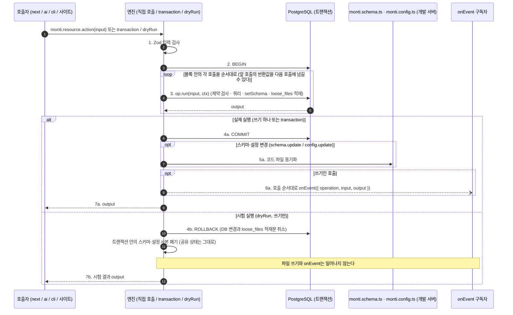
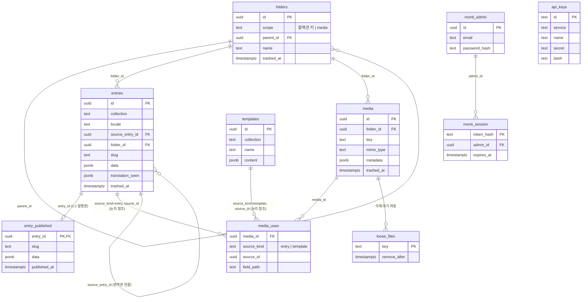
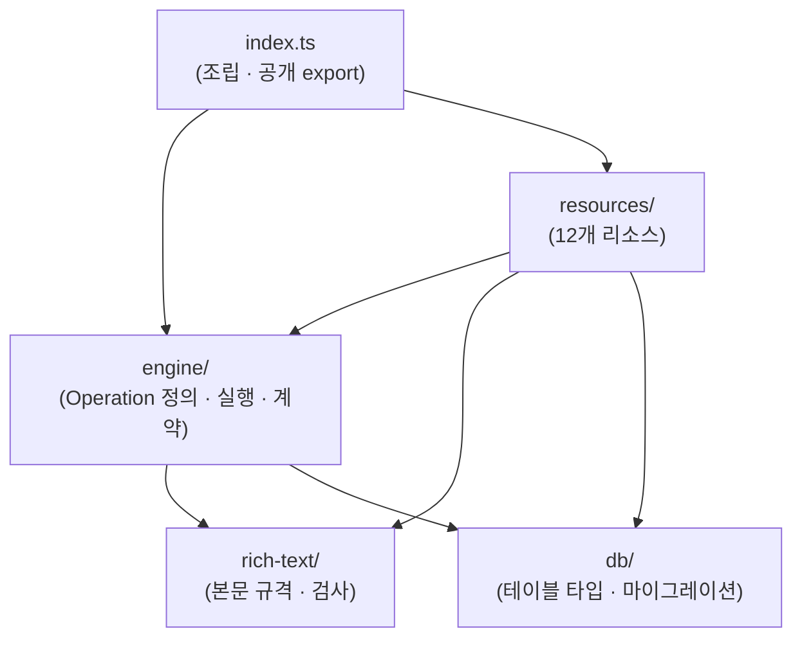

# `@monti-cms/core` 개발 기준

이 문서는 core를 개발할 때 따르는 결정만 적는다. 결정이 나온 경위와 이관 대응표는 [core_legacy.md](core_legacy.md)에 있다. 아직 정하지 않은 것은 맨 끝 "정하지 않은 것"에만 두고, 본문에는 섞지 않는다.

## 1. 설계 기준

모든 결정은 아래 일곱 가지로 판정한다.

1. **개념의 수가 적다**: 기존 개념으로 설명되는 일에 새 용어를 만들지 않는다.
2. **같은 일은 한 가지 방법으로만 한다**: 호출자가 달라도 같은 작업은 같은 파이프라인과 모양을 따른다.
3. **예외는 모델 안에서 흡수한다**: 특정 케이스를 위한 `if`와 일회성 플래그를 바깥에 두지 않는다.
4. **의존은 한 방향이다**: core는 `ai`, `admin`, `next`를 알지 못한다.
5. **사실 하나는 한 곳에만 있다**: 같은 데이터를 두 곳에 저장하거나 합쳤다가 다시 발라내지 않는다.
6. **지금 필요한 것만 둔다**: 쓰는 곳이 없거나 한 곳만을 위한 훅·추상화·옵션을 두지 않는다.
7. **바꾸기 쉽다**: 흔한 변경 하나에 고칠 파일 수가 변경 크기에 비례한다.

## 2. core의 경계

판단 기준은 하나다. **"CMS의 DB와 Operation을 정의하고 실행하는 데 필요한가?"** 필요하면 core, 아니면 외부 패키지나 플러그인이다. CLI나 API에서 쓴다는 이유만으로 core에 넣지 않는다. core는 호출 방식(HTTP, CLI, AI, 사이트)을 모른다. (2026-11-18, 소유자와 정함: core를 얇게 유지한다)

**core가 하는 일**
- 10개 도메인 테이블과 마이그레이션.
- 리소스별 Operation의 정의·실행·검증, 트랜잭션, `dryRun`, 이벤트 통지.
- 스키마(`monti.schema.ts`)와 설정(`monti.config.ts`)의 읽기·검증, 개발 서버에서의 파일 갱신.
- 본문 JSON의 구조 검증(`rich-text/`)과 미디어 사용처 색인(`resources/media/`).
- 외부 서비스 키의 암호화 보관(`keys`).
- 공개 호출(`monti.<resource>.<action>(input)`)과 Operation 명세(이름, 종류, 입력 JSON Schema).

**core가 하지 않는 일**: HTTP·쿠키·CLI 입출력, 화면과 개인 보기 설정, AI 대화·제안·모델과 본문의 블록 단위 읽기·편집, 웹훅 큐와 활동 기록·되돌리기, Markdown/MDX 변환, 본문 렌더링과 코드 블록 전용 기능, 실제 객체 저장소 어댑터, SEO. 받는 문서는 [next](next.md), [plugins-and-cli](plugins-and-cli.md), [ai](ai.md), [admin](admin.md), [mdx](mdx.md), [blocks](blocks.md), [rendering](rendering.md), [storage-s3](storage-s3.md), [seo](seo.md)다.

## 3. Operation과 엔진

### 3.1 정의

- Operation은 `defineRead` 또는 `defineWrite`로 **한 번만** 정의하고, 리소스 객체 트리(`{ entries: { list, get, ... } }`)에 둔다. 키 경로(`entries.get`)가 곧 이름이다. 이름 문자열을 따로 적지 않는다.
- 속성은 둘뿐이다. **`input`**(Zod 스키마, 선택 입력은 `optional()`)과 **`run`**(`(input, ctx) => Promise<output>`).
- 읽기는 상태를 바꾸지 않는다. 쓰기는 트랜잭션 안에서 실행되며, 미디어 사용처 색인(`media_uses`) 갱신은 해당 리소스의 `run`이 같은 트랜잭션 안에서 한다.
- 생성 계열 쓰기(`folders.create`, `entries.create` 등)는 선택 입력 `id`(UUID)를 받는다. 호출자가 미리 정한 id로 앞뒤 쓰기를 잇기 위해서다.
- 같은 Operation을 `next`(HTTP), `cli`, `ai`, 사이트와 백그라운드 작업이 `monti.<resource>.<action>(input)`으로 직접 호출한다. 사이트 조회(`entries.get`, `entries.list` 등)와 휴지통의 만료 정리(`trash.delete`의 조건 입력)도 같은 Operation이다.

### 3.2 호출

| 호출 | 동작 |
|---|---|
| 읽기 `monti.a.b(input)` | 입력 검사, `run`. 트랜잭션 없음. |
| 쓰기 `monti.a.b(input)` | 입력 검사, 트랜잭션 시작, `run`, 커밋, 이벤트 통지. |
| `monti.transaction(async (tx) => …)` | 블록 안의 호출이 한 트랜잭션을 공유한다. 블록이 끝나 커밋된 뒤, 쌓인 이벤트를 호출 순서대로 통지한다. 실패하면 롤백하고 이벤트는 없다. |
| `monti.dryRun(async (tx) => …)` | `tx`에는 쓰기만 보인다. 실제와 같은 `run`을 실행하고 마지막에 롤백한다. 이벤트도 파일 쓰기도 없다. |

외부 패키지는 이 호출과 명세를 쓴다. 쓰기를 미리 시험하는 일(발행할 수 있는지, 옮길 수 있는지, 가져오기 결과)은 해당 쓰기의 `dryRun`으로 한다. 외부 서버 연결을 시험하는 `keys.check`는 별도 액션이다.



### 3.3 이벤트 `onEvent`

- 쓰기가 커밋된 직후 엔진이 `{ operation, input, output }`을 구독자에게 통지한다. 읽기와 `dryRun`은 통지하지 않는다.
- 구독자는 `monti.onEvent(listener)`로 붙이고, 플러그인은 `Plugin.onEvent`로 붙인다.
- core는 발행하고 끝낸다. 구독자 완료를 기다리지 않는다. 한 구독자의 동기 예외나 Promise 실패가 커밋 결과나 다른 구독자의 통지를 바꾸지 않게 각각 따로 호출한다. 전송·재시도·민감 정보 걸러내기와 구독자 안의 오류 처리는 구독자의 몫이다.

### 3.4 오류

`MontiError` 하나로 통일한다. 코드는 `BAD_REQUEST`, `UNAUTHORIZED`, `FORBIDDEN`, `NOT_FOUND`, `CONFLICT`. 입력 검사 실패는 `BAD_REQUEST`다. HTTP 상태로의 변환은 외부 입구가 한다.

### 3.5 타입 명세

```ts
import type { Kysely, Transaction } from "kysely";
import type { z } from "zod";

// 1. 실행 컨텍스트. TTables는 플러그인 테이블의 타입이며 core의 Operation은 비워 둔다.
export interface ReadContext<TTables = {}> {
  db: Kysely<Database & TTables> | Transaction<Database & TTables>;
  schema: Schema;
  config: MontiConfig;
  storage?: StorageAdapter;
}

export interface WriteContext<TTables = {}> extends ReadContext<TTables> {
  db: Transaction<Database & TTables>;                    // 쓰기는 항상 트랜잭션
  setSchema: (schema: Schema) => void;                    // 개발 서버가 아니면 FORBIDDEN
  setConfig: (config: Pick<MontiConfig, "name">) => void; // 개발 서버가 아니면 FORBIDDEN
}

// 2. Operation 정의: input과 run 두 속성이 전부다.
export function defineRead<TSchema extends z.ZodTypeAny, TOutput, TTables = {}>(def: {
  input: TSchema;
  run: (input: z.infer<TSchema>, ctx: ReadContext<TTables>) => Promise<TOutput>;
}): ReadOperation<z.infer<TSchema>, TOutput>;

export function defineWrite<TSchema extends z.ZodTypeAny, TOutput, TTables = {}>(def: {
  input: TSchema;
  run: (input: z.infer<TSchema>, ctx: WriteContext<TTables>) => Promise<TOutput>;
}): WriteOperation<z.infer<TSchema>, TOutput>;

// 3. 표준 오류. HTTP 입구가 코드를 응답 상태(400 · 401 · 403 · 404 · 409)로 바꾼다.
export type ErrorCode = "BAD_REQUEST" | "UNAUTHORIZED" | "FORBIDDEN" | "NOT_FOUND" | "CONFLICT";

export class MontiError extends Error {
  constructor(
    public readonly code: ErrorCode,
    message: string,
    public readonly details?: unknown,
  ) {
    super(message);
  }
}

// 4. 커밋 뒤 이벤트. 커밋된 쓰기만 통지한다.
export interface MontiEvent<TInput = unknown, TOutput = unknown> {
  operation: string;   // 리소스 트리의 키 경로 (예: "entries.publish")
  input: TInput;
  output: TOutput;
}

// 5. 엔진 인스턴스: 직접 호출과 transaction · dryRun 블록
export type Monti<R extends ResourceTree = ResourceTree> = MontiClient<R> & {
  transaction<T>(fn: (tx: MontiClient<R>) => Promise<T>): Promise<T>;
  dryRun<T>(fn: (tx: MontiWriteClient<R>) => Promise<T>): Promise<T>;
  onEvent(listener: (event: MontiEvent) => void | Promise<void>): () => void;
};

// 6. 서버 플러그인과 사이트 설정(monti.config.ts)
export type Migration = (db: Kysely<any>) => Promise<void>;  // 엔진이 Kysely의 Migrator에 맞게 감싼다

export interface Plugin<R extends ResourceTree = ResourceTree> {
  name: string;
  operations?: Record<string, Record<string, ReadOperation<any, any> | WriteOperation<any, any>>>;
  keyServices?: KeyServiceDefinition[];
  migrations?: Record<string, Migration>;   // 키는 단계 이름, 이름순으로 한 번씩 실행
  onEvent?: (event: MontiEvent, ctx: { monti: Monti<R> }) => void | Promise<void>;
}

export interface MontiConfig {
  name: string;
  dev?: boolean;
  storage?: StorageAdapter;
  blocks?: BlockDefinition[];
  plugins?: Plugin[];
}
```

- `ctx.storage`는 `ctx.config.storage`와 같은 어댑터를 가리키는 읽기용 접근 경로다. 저장소 상태를 따로 두지 않는다.
- `Monti<R>`와 `ResourceTree`는 `engine/`의 공통 계약이다. `CoreResources`를 지정한 공개 타입은 `index.ts`의 조립 단계에서 만든다. 엔진과 플러그인 계약은 구체적인 리소스 타입을 import하지 않는다.
- `KeyServiceDefinition`은 `engine/types.ts`에 두고 `resources/keys/`가 사용한다. `Migration`은 `db/types.ts`에 둔다.
- `schema.update`와 `config.update` 같은 구조 변경 Operation은 `setSchema`, `setConfig`로 바꾼 사본을 커밋 직후 파일에 기록한다(4절).

## 4. 컨텍스트와 설정

- `ctx`는 `db`, `schema`, `config`, `storage`다. 쓰기에는 `setSchema`, `setConfig`가 더해지고, 쓰기의 `db`는 항상 트랜잭션이다.
- `monti.config.ts`: `name`, `dev?`, `storage?`, `blocks?`, `plugins?`. 관리자 표시 언어는 admin·Next 연결의 `localStorage`가 맡고, 콘텐츠 언어 목록은 `monti.schema.ts`의 `locales`에 둔다.
- **개발 서버 판정**: `config.dev ?? (process.env.NODE_ENV === "development")`. 환경 변수가 없거나 `test`이면 개발 서버가 아니다.
- **스키마·설정 수정**은 개발 서버에서만 된다(`setSchema`, `setConfig`, `schema.update`, `config.update`). 운영에서는 `FORBIDDEN`이다. 두 함수는 트랜잭션 안의 사본만 바꾸고, 커밋 뒤에 공유 상태와 파일에 반영한다. 롤백이나 `dryRun`이면 사본을 버린다. `setConfig`는 `name`만 받는다.
- **저장소**: `storage`는 선택이다. 저장소가 필요한 기능을 설정 없이 부르면 `MontiError`로 거절한다. 테스트는 `__test__/`의 메모리 저장소를 쓴다.
- 필드의 코드 식별자(`key`)와 원문 언어(`source locale`)는 바꿀 수 없다. 표시 이름(`label`)은 바꿀 수 있다.

## 5. 플러그인

서버 쪽 `Plugin`은 다섯 가지뿐이다.

| 속성 | 뜻 |
|---|---|
| `name` | 식별자 |
| `operations` | 플러그인이 더하는 Operation 트리 |
| `keyServices` | 키 보관함에 등록할 외부 서비스 규격 |
| `migrations` | 플러그인 테이블을 만들고 바꾸는 단계 |
| `onEvent` | 3.3의 구독자 |

화면 쪽 확장은 `admin`의 `AdminPlugin`이 맡는다.

### 5.1 `migrations`

플러그인은 DB 변경 단계를 이름과 함께 적는다. core 자신도 같은 방식이다.

```ts
// 설명용 의사 코드
const createConversations = async (db) => { /* 테이블 만들기 */ };
const addConversationModel = async (db) => { /* 컬럼 더하기 */ };

migrations: {
  "0001_conversations": createConversations,
  "0002_conversation_model": addConversationModel,
}
```

- 객체 안에는 함수를 직접 적지 않고 이름 붙은 함수를 넣는다(린트가 막는다).

- 단계는 이름순으로 **한 번씩만** 실행되고, 나간 단계는 고치지 않는다. 바꿀 일은 새 단계로 쓴다.
- 앱이 시작될 때 core 먼저, 그다음 플러그인을 자동으로 실행한다.
- 실행한 단계는 주인별 장부(이력 테이블)에 적는다: `monti_migration_core`, `monti_migration_<플러그인 이름>`. 이름이 같은 단계가 core와 플러그인에 있어도 섞이지 않는다. 장부는 10개 도메인 테이블에 세지 않는다.
- 플러그인 테이블 이름에는 플러그인 이름을 접두어로 붙인다(문서 규칙이다).
- 마이그레이션은 시작할 때만 실행되고 `dryRun` 안에서는 돌지 않는다.
- 단계의 `db`는 타입을 비워 둔다(옛 시점의 테이블을 다루기 때문이다).

### 5.2 플러그인 안의 db 타입

`defineRead`/`defineWrite`는 선택적 타입 매개변수로 플러그인 테이블의 타입을 받는다. 그러면 `ctx.db`가 core 테이블과 플러그인 테이블을 함께 보여 준다. 런타임 코드는 없고 타입만 늘어난다. 플러그인은 자기 테이블 타입을 직접 적는다. 이 타입이 3.5의 `TTables`다. 호출 형태는 11절에서 정한다.

```ts
// 설명용 의사 코드
type AiTables = { ai_conversations: { id: string; title: string; model: string | null } }

const run = (_input, ctx) => ctx.db.selectFrom("ai_conversations").selectAll().execute();

const list = defineRead<AiTables>({
  input: z.object({}),
  run,
})
```

타입과 마이그레이션이 맞는지는 플러그인 제작자가 지킨다.

## 6. 데이터베이스

10개 도메인 테이블이 전부다. 마이그레이션은 `db/migrations/`의 첫 단계 `0001-initial` 하나로 시작한다.

| 분류 | 테이블 | 역할 |
|---|---|---|
| 콘텐츠 | `entries` | 모든 컬렉션의 작업본과 번역본. 필드 값과 본문은 `data` JSON 하나에 둔다. |
| | `entry_published` | 사이트가 읽는 발행본 |
| | `templates` | 재사용 본문 템플릿 |
| 미디어·폴더 | `media` | 파일 메타데이터와 저장소 키 |
| | `media_uses` | 글·템플릿의 미디어 참조 색인(자동 갱신) |
| | `loose_files` | 저장소의 고아 파일 삭제 대기열(`key`, `remove_after`) |
| | `folders` | 글·미디어용 폴더 트리 |
| 인증·키 | `monti_admin` | 관리자 계정 |
| | `monti_session` | 로그인 세션(토큰 해시, 만료) |
| | `api_keys` | 외부 서비스 키의 암호화 보관 |



**규칙**
- 구조와 설정(컬렉션, 필드, 라벨, 설명, 배치, 편집기 옵션, `locales`, 사이트 이름)은 코드 파일이 유일한 원천이다.
- 개인 화면 상태(열 너비, 숨김 열, 페이지 크기, 표시 언어)는 브라우저에 둔다.
- `entries`(작업본)와 `entry_published`(발행본)는 같은 모양으로 읽힌다. 일반 조회는 발행본, 허용된 미리보기는 작업본이며, 이 선택은 `resources/entries/`의 Operation이 한다.
- 번역의 원문 확인 상태는 필드와 본문 블록 모두 `entries.translation_seen` 하나에 둔다.
- 관계의 순서는 값 JSON에만 둔다. 역방향 관계(태그에서 그 태그가 달린 글)는 글의 관계 값을 조회해서 찾는다.
- `media_uses`는 글·템플릿을 쓸 때 같은 트랜잭션 안에서 갱신한다. 본문과 미디어 필드에서 사용처를 모으는 일은 `resources/media/`가 한다.
- 휴지통은 `trashed_at`만 둔다.

## 7. 리소스

`<resource>.<verb>` 이름은 표준 동사 `list`, `get`, `create`, `update`, `delete`와 꼭 필요한 고유 액션으로 쓴다. `entries.update`, `media.update`, `trash.delete`는 단건 `id`와 다건 `ids`(필요하면 만료·전체 조건)를 같은 Operation이 받는다.

| 리소스 | 동사 | 고유 액션 |
|---|---|---|
| `entries` | `list`, `get`, `create`, `update`(필드·폴더·슬러그·순서·상태) | `publish`, `unpublish`, `duplicate`, `merge`, `preview` |
| `translations` | `list`, `get`, `create`, `update`(블록 연결·건너뛰기·원문 확인) | |
| `templates` | `list`, `get`, `create`, `update`, `delete` | |
| `folders` | `list`, `create`, `update`(이름·이동) | |
| `media` | `list`, `get`, `create`(업로드 등록), `update`(메타·이동·파일 교체) | `startUpload` |
| `trash` | `list`, `get`, `delete`(선택·전체·만료 정리) | `move`, `restore` |
| `schema` | `get`, `update`(개발 서버만) | |
| `config` | `get`, `update`(개발 서버만) | |
| `keys` | `list`, `create`, `update`, `delete` | `check` |
| `data` | | `export`, `import` |
| `session` | `get`, `create`(로그인·개발 우회), `delete` | |
| `admin` | `create`(최초 계정), `update` | |

## 8. 폴더 구조

폴더는 층으로 나눈다. 아래 층은 위 층을 모른다.

```text
packages/core/src/
├── index.ts                    [함수] 엔진·리소스·플러그인 조립, 공개 export
│
├── db/                         층 0: 아무것도 import하지 않는다
│   ├── types.ts                [타입] Database, 테이블 10개의 행 타입, Migration
│   ├── migrate.ts              [함수] 주인(core·플러그인)별 장부로 단계를 한 번씩 실행
│   └── migrations/
│       └── 0001-initial.ts     [함수] 첫 마이그레이션
│
├── rich-text/                  층 0: 아무것도 import하지 않는다
│   ├── types.ts                [타입] Doc, Block, BlockDefinition (검사에 쓰는 부분만)
│   └── validate-doc.ts         [함수] 본문 검사. 오류를 던지지 않고 문제 목록을 돌려준다
│
├── engine/                     층 1: db, rich-text만 import한다. 동력부
│   ├── types.ts                [타입] 상자(ReadContext·WriteContext), Operation, Plugin, MontiConfig,
│   │                                  MontiEvent, ErrorCode, KeyServiceDefinition, Schema(스키마의 모양),
│   │                                  StorageAdapter
│   ├── errors.ts               [함수] MontiError
│   ├── operation.ts            [함수] defineRead, defineWrite
│   ├── engine.ts               [함수] 직접 호출, transaction, dryRun
│   ├── events.ts               [함수] onEvent 구독, 구독자별 통지
│   ├── state.ts                [함수] 현재 schema·config, 트랜잭션 사본, 커밋 뒤 반영
│   ├── schema-file.ts          [함수] monti.schema.ts 읽기·검증·쓰기
│   ├── config-file.ts          [함수] monti.config.ts 검증, name 고쳐 쓰기
│   ├── plugins.ts              [함수] 플러그인의 Operation·마이그레이션·키 서비스를 모은다
│   └── spec.ts                 [함수] Operation 명세 (4단계)
│
├── resources/                  층 2: db, rich-text, engine, 다른 리소스(순환 금지)
│   ├── entries/  translations/  templates/  folders/  trash/
│   ├── media/                  uses.ts [함수] 본문·필드에서 사용처를 모아 media_uses 갱신
│   ├── schema/  config/        schema.get·update, config.get·update
│   └── keys/  data/  session/  admin/
│
└── __test__/                   [함수] 공용 도우미: database.ts, global-setup.ts, memory-storage.ts
```

`[타입]`은 타입만 있는 파일이고 `[함수]`는 실행 코드다. 폴더 사이의 import 방향은 아래와 같다. 화살표는 "A가 B를 import한다"이고, 위 폴더가 아래 폴더를 쓴다.



**규칙**
1. 폴더는 층이다: `db/`·`rich-text/` → `engine/` → `resources/` → `index.ts`. 파일은 자기 층 아래만 import한다. `resources/` 안에서는 리소스끼리 import할 수 있고, 순환은 검사 도구로 막는다.
2. 타입은 그것을 쓰는 가장 낮은 층에 둔다. 한 파일만 쓰는 타입은 그 파일 안에 둔다. 리소스끼리 공유하는 타입은 그것을 소유한 리소스 폴더에 두고 다른 리소스가 import한다.
3. `db/`·`rich-text/`·`engine/`에는 타입만 있는 `types.ts`가 하나씩 있고, 그 밖의 파일은 실행 코드다.
4. 한 단어는 한 개념이다. `schema`는 사용자 스키마(`monti.schema.ts`)만 가리키고, DB 쪽은 `database`라고 부른다.
5. 테스트는 구현 옆에 두고, 공용 도우미만 `__test__/`에 모은다.

- `engine/`은 리소스 트리를 입력으로 받고 구체적인 `resources/`를 import하지 않는다. `index.ts`가 둘을 조립한다.
- `engine/`의 `*-file.ts`와 `state.ts`가 스키마·설정의 상태를 들고 커밋 뒤 파일에 쓴다. `schema.update`·`config.update` 같은 기능은 `resources/schema/`와 `resources/config/`에 두고 `setSchema`·`setConfig`로 요청만 한다.
- `BlockDefinition`의 데이터 계약은 `rich-text/types.ts`에 둔다. `engine/types.ts`의 `MontiConfig`가 이 타입을 쓰는 것은 아래 층을 쓰는 정상 방향이다. 화면 컴포넌트(`Site`, `Editor` 등)는 CMS의 블록 정의에 담지 않는다. 블록을 그리는 일은 사이트가 한다.
- `rich-text/validate-doc.ts`는 오류를 던지지 않는다. 문제 목록을 `BAD_REQUEST`로 바꾸는 일은 부르는 리소스(`entries`, `templates`, `data`)가 한다. 특정 블록의 전용 규칙은 그 블록의 패키지에 둔다.
- `Migration` 타입은 `db/types.ts`에 두고 `Plugin`이 이를 참조한다. `db/migrate.ts`는 `{주인, 단계}`만 받아서 `Plugin`을 모른다.
- 외부 패키지와 사이트는 공개 Operation을 직접 호출한다.
- CLI는 `packages/cli/`, HTTP 입구는 `packages/next/`에 둔다. 두 패키지가 core를 사용한다.
- 파일 하나에 역할 하나를 둔다. 함수 본문은 30줄까지이고(빈 줄 제외) 린트가 검사한다.
- 이 절의 폴더 규칙과 코드 규칙은 린트가 검사한다. 규칙은 `packages/core/biome.json`, `packages/core/biome-plugins/`, `packages/core/.dependency-cruiser.cjs`에 있다. 에이전트는 이 파일들과 `agent-guard/`를 고치지 못하고, 소유자가 고친다.
- 엔진 안의 파일 구성은 2단계, 리소스 폴더 안의 파일 구성은 3단계 테스트 계획에서 확정한다(11절).

## 9. 작업 방식

1. **`db/`**: 테이블 타입, 첫 마이그레이션, 마이그레이션 실행기, 테스트 받침.
2. **`engine/`**: Operation 정의와 실행, 트랜잭션, `dryRun`, 이벤트, 오류, 플러그인 계약.
3. **`resources/`와 `rich-text/`**: 리소스를 하나씩. 본문 규격은 글·템플릿·번역에 필요한 때 함께 만든다.
4. **공개 호출·명세와 마무리**: Operation 명세, 공개 타입·export·빌드 경로.

- 단계마다 PM이 테스트 계획을 보고하고 소유자가 승인한다. 승인된 테스트를 작업 에이전트가 먼저 쓰고, 의도한 이유로 실패하는 것을 확인한 뒤 구현한다. PM은 직접 구현하지 않고 범위·파일 길이·과설계를 검수한다.
- 한 단계를 보고한 뒤 임의로 다음 단계로 가지 않는다. 검증은 `@monti-cms/core` 안에서만 하고, 다른 패키지의 깨진 연결을 고치러 범위를 넓히지 않는다. 미룬 일은 11절 "정하지 않은 것"이나 받는 문서에 적는다.
- 옛 코드와 `db/` 초안은 모두 지웠다. `packages/core`에는 `package.json`뿐이며, 1단계 테스트 계획에서 `db/`부터 새로 쓴다.

## 10. 결정 기록

| 날짜 | 결정 | 근거 |
|---|---|---|
| 2026-11-17 | `@monti-cms/mdx`, `@monti-cms/cli`는 core 밖에 둔다. | 소유자와 정함 |
| 2026-11-18 | core를 얇게 유지한다. HTTP·`Reader`·렌더링·코드 블록 전용 기능은 밖으로 뺀다. | 소유자와 정함 |
| 2026-11-18 | 플러그인 DB 계약은 이름 붙은 단계 `migrations`다. | 소유자와 정함 |
| 2026-11-18 | 마이그레이션은 앱 시작 때 자동 실행한다. | 소유자와 정함 |
| 2026-11-18 | 마이그레이션 장부는 주인(core, 각 플러그인)마다 따로 둔다. | 만들며 정함 |
| 2026-11-18 | 묶음(`transaction`)의 이벤트는 커밋된 뒤 호출 순서대로 통지한다. | 소유자와 정함 |
| 2026-11-18 | 플러그인 안의 `ctx.db`는 타입 매개변수로 core와 플러그인 테이블을 함께 보인다. 플러그인 밖 호출 타입은 쓰는 곳이 생길 때 정한다. | 소유자와 정함 |
| 2026-11-18 | 이벤트 구독자의 오류 처리는 구독자의 몫이다. core는 발행하고 끝낸다. | 소유자와 정함 |
| 2026-11-18 | 관리자 표시 언어는 core 설정에서 뺀다. | 소유자와 정함 |
| 2026-11-18 | 글 간 관계의 반대 방향은 별도 테이블 없이 관계 값을 조회해서 찾는다. 태그별 글과 글별 태그를 모두 조회한다. | 소유자와 정함 |
| 2026-11-18 | 미디어 사용처를 모으는 일은 `resources/media/`의 함수가 한다. | 소유자와 정함 |
| 2026-11-18 | `rich-text/`는 `db/`와 같은 맨 아래 층의 폴더로 둔다. 본문의 모양(`Doc`·`Block`)과 `BlockDefinition`, 본문 검사가 여기에 있다. | 소유자와 정함 |
| 2026-11-18 | 스키마와 설정은 분리를 유지한다: 값만 있는 `monti.schema.ts`와 코드가 있는 `monti.config.ts`, 각자의 타입·파일 처리·리소스. | 소유자와 정함 |
| 2026-11-18 | 타입은 `db/`·`rich-text/`·`engine/`의 `types.ts` 하나에 둔다. `schema`는 사용자 스키마만 가리키고 DB 쪽은 `database`라고 부른다. | 소유자와 정함 |
| 2026-11-18 | 폴더는 층으로 나누고(`db/`·`rich-text/` → `engine/` → `resources/`), 타입은 그것을 쓰는 가장 낮은 층에 둔다. | 만들며 정함 |
| 2026-11-18 | `resources/` 안에서 리소스끼리 import할 수 있고, 순환은 검사 도구로 막는다. | 소유자와 정함 |
| 2026-11-18 | 구조와 코드 규칙은 린트가 검사한다: 폴더 import 방향과 순환(타입만의 순환 포함), `types.ts`는 타입만, 객체 안 함수 금지, 함수 본문 30줄, 이중 단언 금지. 테스트는 뒤의 셋에서 제외한다. 우회는 도구 단계의 거절 스크립트와 CI로 막는다. | 소유자와 정함 |
| 2026-11-18 | 본문 검증은 core가 한다(AI·가져오기도 같은 경로를 지난다). | 소유자와 정함 |
| 2026-11-18 | 본문 검사 함수는 오류를 던지지 않고 문제 목록을 돌려준다. 저장은 목록이 있으면 `BAD_REQUEST`로 멈추고, 가져오기는 틀린 글만 건너뛴다. | 소유자와 정함 |
| 2026-11-18 | 본문 속 글 링크는 색인하지 않는다. | 만들며 정함 |
| 2026-11-18 | 블록 정의에 화면 컴포넌트(`Site`, `Editor` 등)를 담지 않는다. 블록을 그리는 일은 사이트가 하고, CMS는 블록의 데이터 계약만 안다. | 소유자와 정함 |

## 11. 정하지 않은 것

아래는 확정된 동작으로 다루지 않는다.

- **본문 검사의 범위와 `rich-text/`의 파일 구성**. 글 저장·AI·가져오기가 모두 지나는 검사의 최소 목록을 3단계 `entries` 테스트 계획 전에 정한다.
- **본문 검사의 문제 목록을 `BAD_REQUEST`로 바꿔 던지는 도우미의 위치.** 문제 목록 전체를 오류의 `details`에 실어서 던진다(첫 문제만 던지지 않는다). 위치는 3단계 `entries` 테스트 계획에서 정한다.
- **core의 `BlockDefinition`에 담을 범위**. 검사에 쓰는 것만 담고 화면 정보는 담지 않는다. 2단계에서 설정 타입을 정할 때 함께 정한다.
- **엔진 안의 파일 구성**(스키마·설정 파일을 읽고 검증하고 쓰는 코드, 상태 관리, 플러그인 모으기, 명세)과 **리소스 폴더 안의 파일 구성**. 각각 2단계와 3단계 테스트 계획에서 확정한다.
- **죽은 코드 검사**(`knip`). 코어의 공개 출구(`index.ts`)가 생긴 뒤 코어에만 더한다. 그 전에는 아래층 코드가 아직 쓰이지 않아 오류만 난다.
- **Codex의 프로젝트 훅.** 연결된 워크트리에서는 `.codex/hooks.json`이 읽히지 않는다는 보고가 있다. 이 브랜치가 `main`에 합쳐진 뒤 워크트리에서 `git commit --no-verify`가 거절되는지 확인한다. 안 되면 사용자 단위 훅을 정한다.
- **사이트 이름을 스키마로 옮길지**. 옮기면 `config.update`와 `setConfig`가 필요 없어진다. 2단계 전에 정한다.
- **DB 커밋 뒤 스키마·설정 파일 쓰기가 실패하면** 어떤 상태를 돌려줄지, **플러그인 Operation의 경로가 겹치면** 조립 때 거절할지. 2단계 테스트 계획 전.
- **`loose_files`의 실제 삭제** 시점·실행 주체·실패 처리. `dryRun`에서는 외부 삭제가 일어나지 않아야 한다. 3단계 미디어·휴지통 테스트 계획 전.
- **단건 조회에서 없는 항목**을 `NOT_FOUND`로 던질지(해당 Operation의 테스트 계획에서 정한다).
- **플러그인 테이블 타입을 넘기는 호출 형태**(2단계 테스트 계획 전). `defineRead<AiTables>(…)`처럼 타입 매개변수 하나만 직접 지정하면 TypeScript가 나머지(`TSchema`, `TOutput`)를 추론하지 못한다. 3.5의 `TTables`를 어떤 호출 형태로 받을지 정한다.
- **플러그인 밖에서 플러그인 Operation을 호출할 때의 타입.** 쓰는 곳이 생기면 상의한다.
