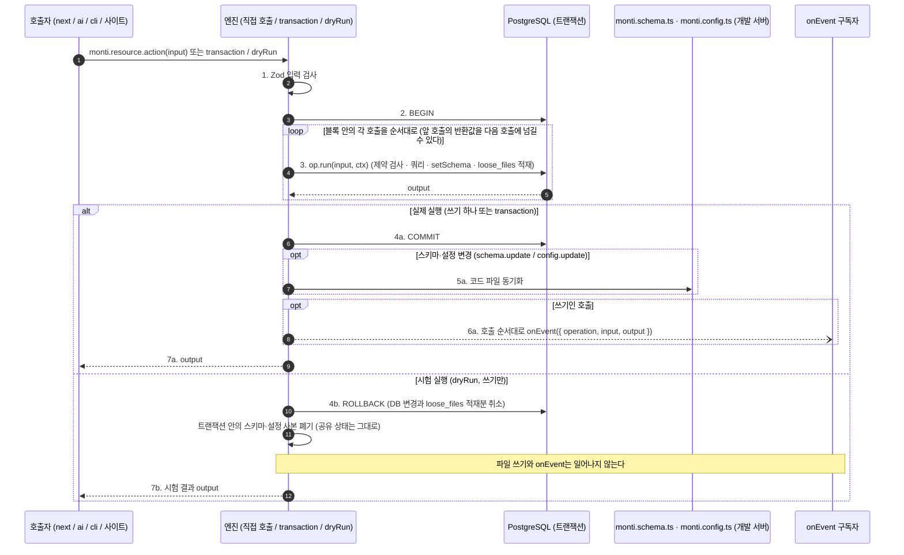
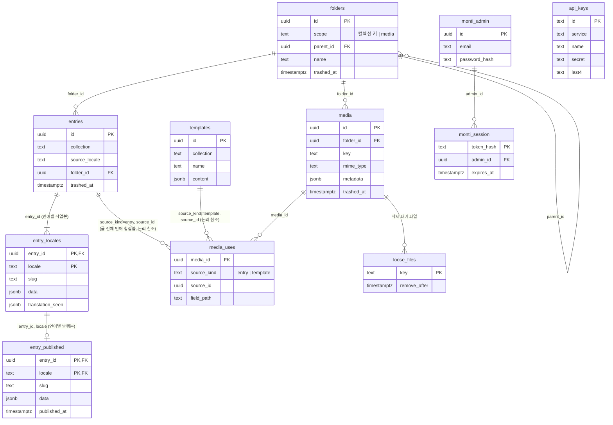

# `@monti-cms/core` 개발 기준

이 문서는 core를 개발할 때 따르는 결정만 적는다. 결정이 나온 경위와 이관 대응표는 [core_legacy.md](core_legacy.md)에 있다. 아직 정하지 않은 것은 맨 끝 "정하지 않은 것"에만 두고, 본문에는 섞지 않는다.

## 1. 설계 기준

모든 결정은 아래 일곱 가지로 판정한다.

1. **개념의 수가 적다**: 기존 개념으로 설명되는 일에 새 용어를 만들지 않는다.
2. **같은 일은 한 가지 방법으로만 한다**: 호출자가 달라도 같은 작업은 같은 파이프라인과 모양을 따른다.
3. **예외는 모델 안에서 흡수한다**: 특정 케이스를 위한 `if`와 일회성 플래그를 바깥에 두지 않는다.
4. **의존은 한 방향이다**: core는 `ai`, `admin`, `next`를 알지 못한다.
5. **사실 하나는 한 곳에만 있다**: 같은 데이터를 두 곳에 저장하거나 합쳤다가 다시 발라내지 않는다.
6. **지금 필요한 것만 둔다**: 쓰는 곳이 없거나 한 곳만을 위한 훅·추상화·옵션을 두지 않는다.
7. **바꾸기 쉽다**: 흔한 변경 하나에 고칠 파일 수가 변경 크기에 비례한다.

## 2. core의 경계

판단 기준은 하나다. **"CMS의 DB와 Operation을 정의하고 실행하는 데 필요한가?"** 필요하면 core, 아니면 외부 패키지나 플러그인이다. CLI나 API에서 쓴다는 이유만으로 core에 넣지 않는다. core는 호출 방식(HTTP, CLI, AI, 사이트)을 모른다. (2026-11-18, 소유자와 정함: core를 얇게 유지한다)

**core가 하는 일**
- 11개 도메인 테이블과 마이그레이션.
- 리소스별 Operation의 정의·실행·검증, 트랜잭션, `dryRun`, 이벤트 통지.
- 스키마 검사, 개발 서버에서의 스키마·설정 파일 갱신(두 파일은 부르는 쪽이 읽어서 넘긴다).
- 본문 JSON의 구조 검증(`rich-text/`)과 미디어 사용처 색인(`resources/media/`).
- 외부 서비스 키의 암호화 보관(`keys`).
- 공개 호출(`monti.<resource>.<action>(input)`)과 Operation 명세(이름, 종류, 입력 JSON Schema).

**core가 하지 않는 일**: HTTP·쿠키·CLI 입출력, 화면과 개인 보기 설정, AI 대화·제안·모델과 본문의 블록 단위 읽기·편집, 웹훅 큐와 활동 기록·되돌리기, 콘텐츠 내보내기·가져오기(코어의 공개 읽기·쓰기를 조합하는 바깥의 일), Markdown/MDX 변환, 본문 렌더링과 코드 블록 전용 기능, 실제 객체 저장소 어댑터, SEO. 받는 문서는 [next](next.md), [plugins-and-cli](plugins-and-cli.md), [ai](ai.md), [admin](admin.md), [mdx](mdx.md), [blocks](blocks.md), [rendering](rendering.md), [storage-s3](storage-s3.md), [seo](seo.md)다.

## 3. Operation과 엔진

### 3.1 정의

- Operation은 `defineRead` 또는 `defineWrite`로 **한 번만** 정의하고, 리소스 객체 트리(`{ entries: { list, get, ... } }`)에 둔다. 키 경로(`entries.get`)가 곧 이름이다. 이름 문자열을 따로 적지 않는다.
- 속성은 둘뿐이다. **`input`**(Zod 스키마, 선택 입력은 `optional()`)과 **`run`**(`(input, ctx) => Promise<output>`).
- 읽기는 상태를 바꾸지 않는다. 쓰기는 트랜잭션 안에서 실행되며, 미디어 사용처 색인(`media_uses`) 갱신은 해당 리소스의 `run`이 같은 트랜잭션 안에서 한다.
- 다른 쓰기가 참조할 수 있는 콘텐츠 생성 계열(`folders.create`, `templates.create`, `media.create`, `entries.create`, `entries.duplicate`의 새 행)은 내부 예약 선택 입력 `__preset_id`(UUID, 소문자로 저장)를 받는다. 호출자가 미리 정한 id로 앞뒤 쓰기를 잇기 위한 용도이며 일반 호출에서는 생략한다(`entries.addLocale`·`keys`·`admin`·`session`·`media.startUpload`는 제외). 이 입력은 우발적인 id 재사용을 막는 장치이며 접근 제어가 아니다. 외부 입구(`next`, `cli`)가 이 입력을 그대로 받을지는 각 패키지 문서에서 정한다.
- 같은 Operation을 `next`(HTTP), `cli`, `ai`, 사이트와 백그라운드 작업이 `monti.<resource>.<action>(input)`으로 직접 호출한다. 사이트 조회(`entries.get`, `entries.list` 등)와 휴지통의 만료 정리(`trash.delete`의 조건 입력)도 같은 Operation이다.

### 3.2 호출

| 호출 | 동작 |
|---|---|
| 읽기 `monti.a.b(input)` | 입력 검사, `run`. 트랜잭션 없음. |
| 쓰기 `monti.a.b(input)` | 입력 검사, 트랜잭션 시작, `run`, 커밋, 이벤트 통지. |
| `monti.transaction(async (tx) => …)` | 콜백 안의 호출이 한 트랜잭션을 공유한다. 콜백이 끝나 커밋된 뒤, 쌓인 이벤트를 호출 순서대로 통지한다. 실패하면 롤백하고 이벤트는 없다. |
| `monti.dryRun(async (tx) => …)` | `tx`에는 쓰기만 보인다. 실제와 같은 `run`을 실행하고 마지막에 롤백한다. 이벤트도 파일 쓰기도 없다. |

외부 패키지는 이 호출과 명세를 쓴다. 쓰기를 미리 시험하는 일(발행할 수 있는지, 옮길 수 있는지)은 해당 쓰기의 `dryRun`으로 한다. 외부 서버 연결을 시험하는 `keys.check`는 별도 액션이다.



### 3.3 이벤트 `onEvent`

- 쓰기가 커밋된 직후 엔진이 `{ operation, input, output }`을 구독자에게 통지한다. 읽기와 `dryRun`은 통지하지 않는다.
- 구독자는 `monti.onEvent(listener)`로 붙이고, 플러그인은 `Plugin.onEvent`로 붙인다.
- core는 발행하고 끝낸다. 구독자 완료를 기다리지 않는다. 한 구독자의 동기 예외나 Promise 실패가 커밋 결과나 다른 구독자의 통지를 바꾸지 않게 각각 따로 호출한다. 전송·재시도·민감 정보 걸러내기와 구독자 안의 오류 처리는 구독자의 몫이다.

### 3.4 오류

`MontiError` 하나로 통일한다. 코드는 `BAD_REQUEST`, `UNAUTHORIZED`, `FORBIDDEN`, `NOT_FOUND`, `CONFLICT`. 입력 검사 실패는 `BAD_REQUEST`이며, 쓰기 중 발생하는 PostgreSQL 고유 제약 위반(`23505`, 중복 `id` 포함)은 엔진이 `CONFLICT`로 변환한다. 이 변환은 직접 호출·`transaction`·`dryRun` 모두에 적용되며, 콜백이 이 `CONFLICT`를 잡고 계속해도 `transaction`과 `dryRun`은 끝에서 그 `CONFLICT`로 실패한다. 리소스 코드가 직접 던진 `CONFLICT`는 콜백이 잡고 계속할 수 있다. HTTP 상태로의 변환은 외부 입구가 한다.

### 3.5 타입 명세

```ts
import type { Kysely, Transaction } from "kysely";
import type { z } from "zod";

// 1. 실행 컨텍스트. TTables는 플러그인 테이블의 타입이며 core의 Operation은 비워 둔다.
export interface ReadContext<TTables = {}> {
  db: Kysely<Database & TTables> | Transaction<Database & TTables>;
  schema: Schema;
  config: MontiConfig;
  storage?: StorageAdapter;
}

export interface WriteContext<TTables = {}> extends ReadContext<TTables> {
  db: Transaction<Database & TTables>;                    // 쓰기는 항상 트랜잭션
  setSchema: (schema: Schema) => void;                    // 개발 서버가 아니면 FORBIDDEN
  setConfig: (config: Pick<MontiConfig, "name">) => void; // 개발 서버가 아니면 FORBIDDEN
}

// 2. Operation 정의: input과 run 두 속성이 전부다.
export function defineRead<TSchema extends z.ZodTypeAny, TOutput, TTables = {}>(def: {
  input: TSchema;
  run: (input: z.infer<TSchema>, ctx: ReadContext<TTables>) => Promise<TOutput>;
}): ReadOperation<z.infer<TSchema>, TOutput>;

export function defineWrite<TSchema extends z.ZodTypeAny, TOutput, TTables = {}>(def: {
  input: TSchema;
  run: (input: z.infer<TSchema>, ctx: WriteContext<TTables>) => Promise<TOutput>;
}): WriteOperation<z.infer<TSchema>, TOutput>;

// 3. 표준 오류. HTTP 입구가 코드를 응답 상태(400 · 401 · 403 · 404 · 409)로 바꾼다.
export type ErrorCode = "BAD_REQUEST" | "UNAUTHORIZED" | "FORBIDDEN" | "NOT_FOUND" | "CONFLICT";

export class MontiError extends Error {
  constructor(
    public readonly code: ErrorCode,
    message: string,
    public readonly details?: unknown,
  ) {
    super(message);
  }
}

// 4. 커밋 뒤 이벤트. 커밋된 쓰기만 통지한다.
export interface MontiEvent<TInput = unknown, TOutput = unknown> {
  operation: string;   // 리소스 트리의 키 경로 (예: "entries.publish")
  input: TInput;
  output: TOutput;
}

// 5. 엔진 인스턴스: 직접 호출과 transaction · dryRun 콜백
export type Monti<R extends ResourceTree = ResourceTree> = MontiClient<R> & {
  transaction<T>(fn: (tx: MontiClient<R>) => Promise<T>): Promise<T>;
  dryRun<T>(fn: (tx: MontiWriteClient<R>) => Promise<T>): Promise<T>;
  onEvent(listener: (event: MontiEvent) => void | Promise<void>): () => void;
};

// 6. 서버 플러그인과 사이트 설정(monti.config.ts)
export interface Migration {
  name: string;
  up: (db: Kysely<any>) => Promise<void>;
}

export interface Plugin<R extends ResourceTree = ResourceTree> {
  name: string;
  operations?: Record<string, Record<string, ReadOperation<any, any> | WriteOperation<any, any>>>;
  keyServices?: KeyServiceDefinition[];
  migrations?: Migration[];                 // 배열 순서대로 한 번씩 실행
  onEvent?: (event: MontiEvent, ctx: { monti: Monti<R> }) => void | Promise<void>;
}

export interface StorageAdapter {
  ticket(key: string, info: { mime: string; size: number }): Promise<{ url: string; headers: Record<string, string> }>;
  stat(key: string): Promise<{ mime: string; size: number } | null>;
  url(key: string): string;
  remove(key: string): Promise<void>;        // 없는 key도 오류 없이 끝난다
}

export interface MontiConfig {
  name: string;
  dev?: boolean;
  storage?: StorageAdapter;
  blocks?: BlockDefinition[];
  marks?: MarkDefinition[];
  plugins?: Plugin[];
}
```

- `ctx.storage`는 `ctx.config.storage`와 같은 어댑터를 가리키는 읽기용 접근 경로다. 저장소 상태를 따로 두지 않는다.
- `StorageAdapter.remove`는 없는 `key`에도 오류 없이 끝난다. 어댑터는 공급자의 정확한 미존재 오류만 성공으로 바꾸고 권한·인증·네트워크 오류는 그대로 올린다.
- `Monti<R>`와 `ResourceTree`는 `engine/`의 공통 계약이다. `CoreResources`를 지정한 공개 타입은 `index.ts`의 조립 단계에서 만든다. 엔진과 플러그인 계약은 구체적인 리소스 타입을 import하지 않는다.
- `KeyServiceDefinition`은 `engine/types.ts`에 두고 `resources/keys/`가 사용한다. `Migration`은 `db/types.ts`에 둔다.
- `schema.update`와 `config.update` 같은 구조 변경 Operation은 `setSchema`, `setConfig`로 바꾼 사본을 커밋 직후 파일에 기록한다(4절).

## 4. 컨텍스트와 설정

- `ctx`는 `db`, `schema`, `config`, `storage`다. 쓰기에는 `setSchema`, `setConfig`가 더해지고, 쓰기의 `db`는 항상 트랜잭션이다.
- `monti.config.ts`: `name`, `dev?`, `storage?`, `blocks?`, `marks?`, `plugins?`. 관리자 표시 언어는 admin·Next 연결의 `localStorage`가 맡고, 콘텐츠 언어 목록은 `monti.schema.ts`의 `locales`에 둔다.
- **개발 서버 판정**: `config.dev`가 `true`일 때만 개발 서버다. 코어는 환경 변수를 읽지 않는다.
- **스키마·설정 수정**은 개발 서버에서만 된다(`setSchema`, `setConfig`, `schema.update`, `config.update`). 운영에서는 `FORBIDDEN`이다. 두 함수는 트랜잭션 안의 사본만 바꾸고, 커밋 뒤에 공유 상태와 파일에 반영한다. 롤백이나 `dryRun`이면 사본을 버린다. `setConfig`는 `name`만 받는다.
- **저장소**: `storage`는 선택이다. 저장소가 필요한 기능을 설정 없이 부르면 `MontiError`로 거절한다. 테스트는 `__test__/`의 메모리 저장소를 쓴다.

## 5. 플러그인

서버 쪽 `Plugin`은 다섯 가지뿐이다.

| 속성 | 뜻 |
|---|---|
| `name` | 식별자(npm 패키지 이름 등 고유 문자열) |
| `operations` | 플러그인이 더하는 Operation 트리 |
| `keyServices` | 키 보관함에 등록할 외부 서비스 규격 |
| `migrations` | 플러그인 테이블을 만들고 바꾸는 단계 배열 |
| `onEvent` | 3.3의 구독자 |

화면 쪽 확장은 `admin`의 `AdminPlugin`이 맡는다.

### 5.1 `migrations`

플러그인은 DB 변경 단계를 `{ name, up }` 배열로 적는다. core 자신도 같은 방식이다.

```ts
// 설명용 의사 코드
const createConversations = async (db) => { /* 테이블 만들기 */ };
const addConversationModel = async (db) => { /* 컬럼 더하기 */ };

migrations: [
  { name: "conversations", up: createConversations },
  { name: "conversation_model", up: addConversationModel },
]
```

- 객체 안에는 함수를 직접 적지 않고 이름 붙은 함수를 넣는다(린트가 막는다).

- 단계는 배열에 정의된 순서대로 **한 번씩만** 실행되고, 나간 단계는 고치지 않는다. 바꿀 일은 새 단계로 쓴다.
- 앱이 시작될 때 core 먼저, 그다음 플러그인을 자동으로 실행한다.
- 실행한 단계는 `monti_migrations` 테이블(`scope`, `name`, 복합 기본키 `(scope, name)`)에 기록한다. `scope`에는 `"core"` 또는 플러그인 이름(`"@monti-cms/ai"` 등)이 들어가며, 단계 이름(`name`)이 같아도 `scope`가 다르면 섞이지 않는다. `monti_migrations`는 11개 도메인 테이블에 세지 않는다.
- 플러그인 테이블 이름에는 플러그인 이름을 접두어로 붙인다(문서 규칙이다).
- 마이그레이션은 시작할 때만 실행되고 `dryRun` 안에서는 돌지 않는다.
- 단계의 `db`는 타입을 비워 둔다(옛 시점의 테이블을 다루기 때문이다).

### 5.2 플러그인 안의 db 타입

`defineRead`/`defineWrite`는 선택적 타입 매개변수로 플러그인 테이블의 타입을 받는다. 그러면 `ctx.db`가 core 테이블과 플러그인 테이블을 함께 보여 준다. 런타임 코드는 없고 타입만 늘어난다. 플러그인은 자기 테이블 타입을 직접 적는다. 이 타입이 3.5의 `TTables`다. 호출 형태는 11절에서 정한다.

```ts
// 설명용 의사 코드
type AiTables = { ai_conversations: { id: string; title: string; model: string | null } }

const run = (_input, ctx) => ctx.db.selectFrom("ai_conversations").selectAll().execute();

const list = defineRead<AiTables>({
  input: z.object({}),
  run,
})
```

타입과 마이그레이션이 맞는지는 플러그인 제작자가 지킨다.

## 6. 데이터베이스

11개 도메인 테이블이 전부다. 마이그레이션은 `db/migrations/`의 첫 단계 `0001-initial` 하나로 시작한다.

| 분류 | 테이블 | 역할 |
|---|---|---|
| 콘텐츠 | `entries` | 글의 공통 정보(`collection`, 원문 언어 `source_locale`, `folder_id`, `trashed_at`) |
| | `entry_locales` | 글의 언어별 작업본(`(entry_id, locale)`, `slug`, `data`, `translation_seen`) |
| | `entry_published` | 사이트가 읽는 언어별 발행본(`(entry_id, locale)`, `slug`, `data`, `published_at`) |
| | `templates` | 재사용 본문 템플릿 |
| 미디어·폴더 | `media` | 파일 메타데이터와 저장소 키 |
| | `media_uses` | 글·템플릿의 미디어 참조 색인(자동 갱신) |
| | `loose_files` | 저장소의 고아 파일 삭제 대기열(`key`, `remove_after`) |
| | `folders` | 글·미디어용 폴더 트리 |
| 인증·키 | `monti_admin` | 관리자 계정 |
| | `monti_session` | 로그인 세션(토큰 해시, 만료) |
| | `api_keys` | 외부 서비스 키의 암호화 보관 |



**규칙**
- 구조와 설정(컬렉션, 필드, 라벨, 설명, 배치, 편집기 옵션, `locales`, 사이트 이름)은 코드 파일이 유일한 원천이다.
- 개인 화면 상태(열 너비, 숨김 열, 페이지 크기, 표시 언어)는 브라우저에 둔다.
- `entry_locales`(언어별 작업본)와 `entry_published`(언어별 발행본)는 `entries`(공통 정보)와 합쳐 같은 모양으로 읽힌다. 일반 조회는 발행본, `draft: true`는 작업본이며, 이 선택은 `resources/entries/`의 Operation이 한다.
- 번역 상태는 번역 언어 작업본의 `entry_locales.translation_seen` 하나에 둔다. 번역하는 사람이 확인한 원문의 값(필드는 키별, 본문은 원문 블록 `id`별)을 값 그대로 기록하고, 본문 블록은 연결한 번역 블록의 `id`나 번역 제외 표시를 함께 기록한다. 연결은 번역 언어 작업본에만 있는 단방향이라 원문 언어 작업본에는 기록하지 않는다. `unseen`(기록 없음)·`seen`(기록한 값이 지금의 원문과 같음)·`outdated`(다름)는 저장하지 않고 읽을 때마다 비교해 계산하며, 화면이 확인한 값과 지금의 원문을 나란히 보여 줄 수 있도록 읽기 결과에 확인한 값도 담는다.
- 번역 상태를 갖는 본문 블록은 글자나 내용을 직접 품는 블록(`holds`가 `text` 또는 `nothing`)이다. 다른 블록을 품는 컨테이너 블록(`holds`가 `blocks`)은 상태를 갖지 않고, 안에 든 블록이 깊이와 관계없이 각자 가진다.
- 관계의 순서는 값 JSON에만 둔다. 역방향 관계(태그에서 그 태그가 달린 글)는 글의 관계 값을 조회해서 찾는다.
- `media_uses`는 글·템플릿을 쓸 때 같은 트랜잭션 안에서 갱신한다. 글의 미디어 사용처는 해당 글의 모든 언어 작업본 참조를 합쳐 `source_id = entries.id`로 기록한다. 본문과 미디어 필드에서 사용처를 모으는 일은 `resources/media/`가 한다.
- 외래 키 `entry_locales → entries`와 `entry_published → entry_locales(entry_id, locale)`는 `ON DELETE CASCADE`로 두어 글이나 비원문 언어를 지울 때 하위 행이 함께 지워지게 한다. `media_uses`는 논리 참조이므로 삭제·갱신하는 Operation이 같은 트랜잭션 안에서 직접 정리한다.
- 휴지통은 `trashed_at`만 둔다. 글은 `entries` 단위로만 휴지통에 들어가고 복원되며, 비원문 언어 1개만 지우는 일은 휴지통 없이 즉시 삭제한다.
- 폴더를 휴지통에 보내면 그 아래 활성 하위 폴더·글·미디어가 같은 `trashed_at`을 받고, 이 시각이 같은 항목은 폴더와 함께 들어간 것으로 보아 목록에서 폴더 한 줄로 묶는다. 먼저 따로 버린 항목은 자기 시각과 자기 줄을 갖는다.
- 글을 되살리면 모든 언어의 발행본을 지워 초안으로 돌아온다. 되살릴 때 이름이 겹치면(폴더 이름, 글의 작업본 `slug`) 거절하지 않고 `-2`, `-3`…을 붙이며 폴더를 합치지 않는다.
- 스키마에서 지워진 필드나 분기의 값, 영구 삭제된 미디어·글의 아이디는 저장된 글 데이터에 남을 수 있다(`schema.update`도 DB를 건드리지 않는다). 쓸 때(`create`·`update`·`addLocale`·`duplicate`)는 지금의 스키마로 엄격히 검사한다. 저장된 데이터를 읽어 처리하는 코드(조회, `media_uses` 다시 계산, `replaceReferences`)는 스키마에 없는 필드·분기의 값과 영구 삭제되어 없는 미디어의 아이디를 무시하고 오류를 내지 않는다(Tolerant Reader). 발행은 지금도 있는 필드의 잘못된 값과 휴지통 대상을 거절하되 지워진 필드에 남은 값 때문에 거절하지 않는다. 남은 값은 그 언어를 다시 저장하면 사라지고(`update`는 데이터를 통째로 교체한다), 나머지를 치우는 일은 개발자가 따로 한다(11절).

## 7. 리소스

`<resource>.<verb>` 이름은 표준 동사 `list`, `get`, `create`, `update`, `delete`와 꼭 필요한 고유 액션으로 쓴다. `entries.update`, `media.update`, `trash.delete`는 단건 `id`와 다건 `ids`(필요하면 만료·전체 조건)를 같은 Operation이 받는다.

| 리소스 | 동사 | 고유 액션 |
|---|---|---|
| `entries` | `list`, `get`, `create`, `update`(필드·본문·폴더·슬러그) | `publish`, `unpublish`, `duplicate`, `replaceReferences`, `addLocale`, `removeLocale`, `setSourceLocale` |
| `translationStatus` | `list`, `get`, `update`(원문 확인·블록 연결·번역 제외) | |
| `templates` | `list`, `get`, `create`, `update`, `delete` | |
| `folders` | `list`, `create`, `update`(이름·이동) | |
| `media` | `list`, `get`, `create`(업로드 등록), `update`(메타·이동·파일 교체) | `startUpload` |
| `trash` | `list`, `get`, `delete`(선택·전체·만료 정리) | `move`, `restore` |
| `schema` | `get`, `update`(개발 서버만) | |
| `config` | `get`, `update`(개발 서버만) | |
| `keys` | `list`, `create`, `update`, `delete` | `check` |
| `session` | `get`, `create`(로그인), `delete` | |
| `admin` | `create`(최초 계정), `update` | |

## 8. 폴더 구조

폴더는 층으로 나눈다. 아래 층은 위 층을 모른다.

```text
packages/core/src/
├── index.ts                    [함수] 엔진·리소스·플러그인 조립, 공개 export
│
├── db/                         층 0: 아무것도 import하지 않는다
│   ├── types.ts                [타입] Database, 테이블 11개의 행 타입, Migration
│   ├── migrate.ts              [함수] monti_migrations 테이블(scope, name)로 단계를 순서대로 한 번씩 실행
│   └── migrations/
│       └── 0001-initial.ts     [함수] 첫 마이그레이션
│
├── rich-text/                  층 0: 아무것도 import하지 않는다
│   ├── types.ts                [타입] Doc, Block, BlockDefinition, MarkDefinition (검사에 쓰는 부분만)
│   └── validate-doc.ts         [함수] 본문 검사. 오류를 던지지 않고 문제 목록을 돌려준다
│
├── engine/                     층 1: db, rich-text만 import한다. 동력부
│   ├── types.ts                [타입] 상자(ReadContext·WriteContext), Operation, Plugin, MontiConfig,
│   │                                  MontiEvent, ErrorCode, KeyServiceDefinition, Schema(스키마의 모양),
│   │                                  StorageAdapter
│   ├── errors.ts               [함수] MontiError
│   ├── operation.ts            [함수] defineRead, defineWrite
│   ├── engine.ts               [함수] 직접 호출, transaction, dryRun
│   ├── events.ts               [함수] onEvent 구독, 구독자별 통지
│   ├── state.ts                [함수] 현재 schema·config, 트랜잭션 사본, 커밋 뒤 반영
│   ├── schema-file.ts          [함수] 스키마 검증, monti.schema.ts 쓰기
│   ├── config-file.ts          [함수] monti.config.ts의 name 고쳐 쓰기
│   ├── plugins.ts              [함수] 플러그인의 Operation·마이그레이션·키 서비스를 모은다
│   └── spec.ts                 [함수] Operation 명세 (4단계)
│
├── resources/                  층 2: db, rich-text, engine, 다른 리소스(순환 금지)
│   ├── _shared/                input.ts(uuid·timestamp 입력), doc.ts(본문 검사 오류 변환)
│   ├── entries/  translation-status/  templates/  folders/  trash/
│   ├── media/                  uses.ts [함수] 본문·필드에서 사용처를 모아 media_uses 갱신
│   ├── schema/  config/        schema.get·update, config.get·update
│   └── keys/  session/  admin/
│
└── __test__/                   [함수] 공용 도우미: database.ts, global-setup.ts, memory-storage.ts
```

`[타입]`은 타입만 있는 파일이고 `[함수]`는 실행 코드다. 폴더 사이의 import 방향은 아래와 같다. 화살표는 "A가 B를 import한다"이고, 위 폴더가 아래 폴더를 쓴다.


**규칙**
1. 폴더는 층이다: `db/`·`rich-text/` → `engine/` → `resources/` → `index.ts`. 파일은 자기 층 아래만 import한다. `resources/` 안에서는 리소스끼리 import할 수 있고, 순환은 검사 도구로 막는다.
2. 타입은 그것을 쓰는 가장 낮은 층에 둔다. 한 파일만 쓰는 타입은 그 파일 안에 둔다. 리소스끼리 공유하는 타입은 그것을 소유한 리소스 폴더에 두고 다른 리소스가 import한다.
3. `db/`·`rich-text/`·`engine/`에는 타입만 있는 `types.ts`가 하나씩 있고, 그 밖의 파일은 실행 코드다.
4. 한 단어는 한 개념이다. `schema`는 사용자 스키마(`monti.schema.ts`)만 가리키고, DB 쪽은 `database`라고 부른다.
5. 테스트는 구현 옆에 두고, 공용 도우미만 `__test__/`에 모은다.

- `engine/`은 리소스 트리를 입력으로 받고 구체적인 `resources/`를 import하지 않는다. `index.ts`가 둘을 조립한다.
- `engine/`의 `*-file.ts`와 `state.ts`가 스키마·설정의 상태를 들고 커밋 뒤 파일에 쓴다. `schema.update`·`config.update` 같은 기능은 `resources/schema/`와 `resources/config/`에 두고 `setSchema`·`setConfig`로 요청만 한다.
- `BlockDefinition`·`MarkDefinition`의 데이터 계약은 `rich-text/types.ts`에 둔다. `engine/types.ts`의 `MontiConfig`가 이 타입들을 쓰는 것은 아래 층을 쓰는 정상 방향이다. 화면 컴포넌트(`Site`, `Editor` 등)는 CMS의 블록·서식 정의에 담지 않는다. 블록과 서식을 그리는 일은 사이트가 한다.
- `rich-text/validate-doc.ts`는 오류를 던지지 않는다. 문제 목록을 `BAD_REQUEST`로 바꾸는 일은 부르는 리소스(`entries`, `templates`)가 한다. 특정 블록의 전용 규칙은 그 블록의 패키지에 둔다.
- `Migration` 타입은 `db/types.ts`에 두고 `Plugin`이 이를 참조한다. `db/migrate.ts`는 `scope`(`"core"` 또는 플러그인 이름)와 `Migration[]` 배열만 받아서 `Plugin`을 모른다.
- 외부 패키지와 사이트는 공개 Operation을 직접 호출한다.
- CLI는 `packages/cli/`, HTTP 입구는 `packages/next/`에 둔다. 두 패키지가 core를 사용한다.
- 파일 하나에 역할 하나를 둔다. 함수 본문은 30줄까지이고(빈 줄 제외) 린트가 검사한다.
- 이 절의 폴더 규칙과 코드 규칙은 린트가 검사한다. 규칙은 `packages/core/biome.json`, `packages/core/biome-plugins/`, `packages/core/.dependency-cruiser.cjs`, `packages/core/knip.jsonc`, `packages/core/.jscpd.json`, `packages/core/env.d.ts`, `packages/core/stryker.config.mjs`, `packages/core/vitest.config.ts`, `.secretlintrc.json`에 있다. 에이전트는 이 파일들과 `agent-guard/`를 고치지 못하고, 소유자가 고친다.

## 9. 작업 방식

1. **`db/`**: 테이블 타입, 첫 마이그레이션, 마이그레이션 실행기, 테스트 받침.
2. **`engine/`**: Operation 정의와 실행, 트랜잭션, `dryRun`, 이벤트, 오류, 플러그인 계약.
3. **`resources/`와 `rich-text/`**: 리소스를 하나씩. 본문 규격은 글·템플릿·번역에 필요한 때 함께 만든다.
4. **공개 호출·명세와 마무리**: Operation 명세, 공개 타입·export·빌드 경로.

- 단계마다 PM이 인수 조건(AC)을 `docs/acceptance/core/`에 적고 소유자가 한 줄씩 승인한다. 쓰는 법은 `docs/acceptance/README.md`에 있다. 작업 에이전트는 이 폴더를 읽기만 한다. PM은 직접 구현하지 않고 범위·파일 길이·과설계를 검수한다.
- 작업 에이전트는 승인된 AC마다 테스트 하나를 먼저 쓰고, 의도한 이유로 실패하는 것을 확인한 뒤 구현한다. 테스트 제목은 AC 번호로 시작하고, 각 `expect` 바로 위에 결과 번호(`// DB-3.1`)를 주석으로 단다. core의 테스트는 진짜 Postgres에서 돌리고 DB를 가짜로 바꾸지 않는다.
- 검증은 세 겹이다. ① 자동 검사: AC마다 테스트 하나, 결과 번호와 `expect` 일치, 건너뛴 테스트 없음, 문서에 없는 테스트 없음(커밋과 CI에서 실행). ② 다른 모델의 코드 리뷰: 구현이 AC대로인지, 테스트가 AC를 제대로 확인하는지. 소유자는 테스트 이름 목록을 훑어본다. ③ 단계가 끝날 때 Stryker로 구현을 일부러 망가뜨려 테스트가 실패하는지 본다. "끝났다"는 작업 에이전트의 말이 아니라 ①의 결과로 판정한다.
- 작업 에이전트는 일을 미루거나 범위를 줄이지 않는다. 막히거나 너무 크면 PM에게 보고하고, 미루기로 한 일은 소유자가 승인해 해당 AC 줄에 `보류`와 사유로 적는다.
- 한 단계를 보고한 뒤 임의로 다음 단계로 가지 않는다. 검증은 `@monti-cms/core` 안에서만 하고, 다른 패키지의 깨진 연결을 고치러 범위를 넓히지 않는다.
- 진행 상황은 `docs/acceptance/core/`의 AC와 git 기록으로 본다.

## 10. 결정 기록

| 날짜 | 결정 | 근거 |
|---|---|---|
| 2026-11-18 | 스키마와 설정은 분리를 유지한다: 값만 있는 `monti.schema.ts`와 코드가 있는 `monti.config.ts`, 각자의 타입·파일 처리·리소스. | 소유자와 정함 |
| 2026-11-18 | 구조·코드 규칙(폴더 import 방향과 타입만의 순환을 포함한 순환, `types.ts`는 타입만, 객체 안 함수 금지, 함수 본문 30줄, 이중 단언 금지)은 린트와 CI가 검사하고, 테스트는 뒤의 셋에서 제외한다. | 소유자와 정함 |
| 2026-11-18 | 본문 속 글 링크는 색인하지 않는다. | 만들며 정함 |
| 2026-11-18 | TypeScript는 6을 쓰고, 돌연변이 테스트는 Stryker만 쓴다. | 소유자와 정함 |
| 2026-11-19 | 모든 입력이 선택인 Operation은 빈 객체 `{}` 없이 인자를 생략해 호출할 수 있다. | 소유자와 정함 |
| 2026-11-19 | 허용 MIME과 최대 크기 정책은 `StorageAdapter`가 정한다. | 소유자와 정함 |
| 2026-11-19 | `storage`가 설정되지 않은 엔진에서는 `media` 리소스 전체를 `BAD_REQUEST`로 거절하고, 미디어 반환값의 `url`은 항상 `string`으로 한다. | 소유자와 정함 |
| 2026-11-19 | 동시 쓰기 경쟁 대비(`FOR UPDATE` 행 잠금, 추가 DB 유니크 인덱스)는 지금 도입하지 않고 필요할 때 다룬다. | 소유자와 정함 |
| 2026-11-20 | 컬렉션은 `kind` 없이 `{ body?, label?, description?, fields }` 한 모양이고, 필드는 8종(`text`·`number`·`boolean`·`date`·`select`·`media`·`relation`·`conditional`)이다. | 소유자와 정함 |
| 2026-11-20 | 글의 `data`는 `{ fields, body? }`이고, `date` 필드 값은 타임존을 포함한 ISO 8601 날짜·시각 문자열이며, `required`는 발행할 때 검사한다. | 소유자와 정함 |
| 2026-11-20 | `entries.list`는 조건에 맞는 글이 없으면 빈 배열을 돌려준다. | 소유자와 정함 |
| 2026-11-20 | 보관(archive) 상태와 `order` 열은 두지 않고, 글 병합은 `entries.replaceReferences({ from_id, into_id })`와 `trash.move`를 `monti.transaction`으로 묶어 한다. | 소유자와 정함 |
| 2026-11-20 | 휴지통 목록은 폴더 안을 펼쳐 보여 주지 않는다. | 소유자와 정함 |
| 2026-11-21 | 내보내기·가져오기(`data`)는 core 밖(플러그인이나 `cli`)이 맡는다. | 소유자와 정함 |
| 2026-11-21 | `config.get`은 설정 전체(`ctx.config`)를 돌려준다. | 소유자와 정함 |
| 2026-11-21 | 코어의 공개 출구(`index.ts`)는 `startMonti`, `defineRead`·`defineWrite`, `MontiError`, `validateDoc`, `removeLooseFiles`와 그 타입을 내보낸다. | 소유자와 정함 |

## 11. 정하지 않은 것

아래는 확정된 동작으로 다루지 않는다.

- **스키마가 바뀐 뒤 글에 남은 지워진 필드·분기의 값을 개발자가 치우는 방법.** 지운 필드 이름을 다른 종류로 다시 만들면 남은 값이 되살아나는 점도 함께 본다. 코어 밖 `data` 기능을 설계할 때 정한다.
- **블록 속성 검사를 동기·JSON 값으로 제한할지.** 비동기 검사는 `safeParse`가 예외를 던지고, `z.date()`처럼 JSON에 저장되지 않는 값은 다시 읽으면 검사를 통과하지 못한다. `blocks.md`와 함께 정한다.
- **콜백이 DB 고유 제약 위반 외의 쓰기 오류(리소스 코드의 `CONFLICT` 포함)를 잡고 계속하면 그 쓰기가 한 변경이 남는 점.** 세이브포인트가 없다. 모든 쓰기 오류를 콜백 실패로 볼지 정한다.
- **배포용 빌드.** `exports`는 소스(`./src/index.ts`)를 가리키고, npm에 올릴 때 도구를 정한다.
- **DB 커밋 뒤 스키마·설정 파일 쓰기가 실패하면** 어떤 상태를 돌려줄지. 지금은 파일 오류를 그대로 던지고 커밋된 DB 변경은 남는다(개발 서버 전용).
- **플러그인 테이블 타입을 넘기는 호출 형태.** `defineRead<AiTables>(…)`처럼 타입 매개변수 하나만 지정하면 나머지(`TSchema`, `TOutput`)를 추론하지 못한다. 3.5의 `TTables`를 어떤 형태로 받을지 정한다.
- **플러그인 밖에서 플러그인 Operation을 호출할 때의 타입.** 쓰는 곳이 생기면 상의한다.
- **표 안의 칸 단위 번역 상태와 컨테이너 블록 자체 속성에 든 글자.** 표는 한 덩어리로 보고 칸 단위는 표 규격이 바뀔 때 정한다. 컨테이너 블록 자체의 속성에 글자가 있는 경우는 core가 어느 속성이 번역 대상인지 모르므로 블록 정의 쪽에서 정한다.
