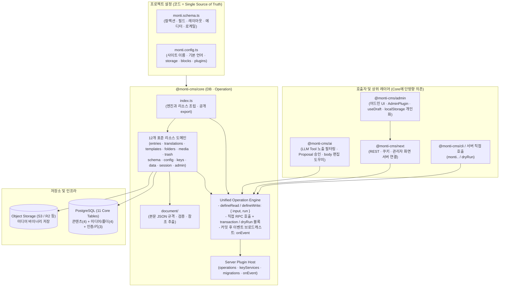
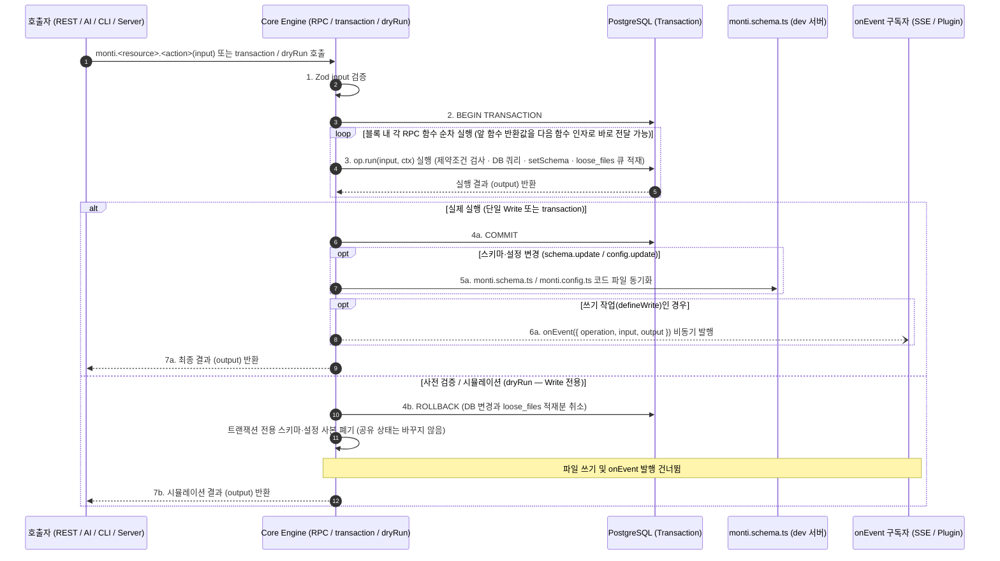
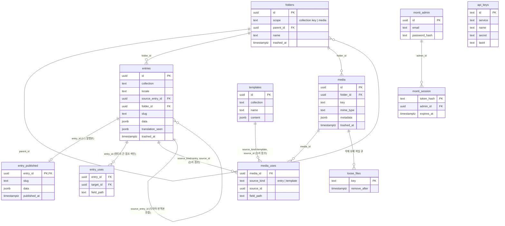

> **보존용 이전 문서다.** 새로 개발할 때는 [core.md](core.md)만 따른다. 이 문서는 결정이 나온 경위와 이관 대응표(13절)를 찾아볼 때만 읽는다. (2026-11-18)

# Monti CMS 설계 원칙 및 `@monti-cms/core` 아키텍처 정의

## 1. 7대 설계 기준

모든 코드와 아키텍처 결정은 아래의 예/아니오 판정 기준을 따른다.

1. **개념의 수가 적다**: 기존 개념으로 설명할 수 있는 일을 위해 새로운 용어나 개념을 만들지 않는다.
2. **같은 일은 한 가지 방법으로만 한다**: 진입점이나 호출자가 달라도 같은 종류의 작업은 동일한 파이프라인과 모양을 따른다.
3. **예외는 호출하는 쪽이 아니라 모델 안에서 흡수한다**: 특정 케이스를 위한 `if` 분기나 일회성 플래그를 바깥에 두지 않고, 일반 모델이 자연스럽게 수용하도록 설계한다.
4. **의존은 한 방향으로만 흐른다**: 하위 계층(`core`)은 상위 계층(`ai`, `admin`, `next`)의 존재를 알지 못하며, 역방향 참조(`attach` 등)를 두지 않는다.
5. **사실 하나는 한 곳에만 있다**: 동일한 데이터를 두 곳에 중복 저장하거나 합쳤다가 다시 발라내는 왕복 변환을 하지 않는다.
6. **지금 필요한 것만 있다**: 사용처가 없거나 단 한 곳만을 위해 존재하는 죽은 훅·추상화·옵션을 두지 않는다.
7. **바꾸기 쉽다**: 흔한 변경 하나에 수정해야 하는 파일과 위치의 수가 변경 크기에 비례해야 한다.

---

## 2. `@monti-cms/core`의 정의와 경계

### 2.1 판단 기준
> **"CMS의 DB와 Operation을 정의하고 실행하는 데 필요한가?"**
- **예** ➔ `@monti-cms/core`의 책임이다. DB 구조·마이그레이션, 리소스별 데이터 규칙, Operation 정의·실행·검증·트랜잭션·이벤트를 포함한다.
- **아니오** ➔ CLI, HTTP, 화면, 파일 형식 변환, 외부 서비스 연결을 맡는 패키지나 플러그인의 책임이다. CLI나 API에서 쓴다는 이유만으로 `core`에 넣지 않는다.
- **core를 얇게 유지한다** (2026-11-18, 소유자와 정함). core는 호출 방식과 무관한 CMS 라이브러리다. 글 저장·발행·번역·인증 같은 실제 기능은 리소스의 Operation으로 남는다. 스키마·설정·본문 JSON 규격은 이 Operation이 데이터의 규칙을 지키기 위한 내부 구성이다.
- **기본 제공 여부와 패키지 소속은 별개다.** 파일 형식 변환, 화면 표현, 특정 블록의 전용 기능은 외부 패키지나 플러그인이 맡을 수 있다. `core`는 그 기능의 존재를 몰라도 데이터의 규칙을 지킬 수 있어야 한다.

### 2.2 `@monti-cms/core`가 하는 일 (본질)
- **스키마 및 설정 정의 (`monti.schema.ts`, `monti.config.ts`)**:
  - 사이트의 구조와 규칙(컬렉션, 필드, 필드 라벨·설명·탭 배치, 콘텐츠 언어 `locales`, 사이트 이름, 스토리지·블록 설정)은 **코드 파일(`monti.schema.ts` / `monti.config.ts`)**을 유일한 진실의 원천(Single Source of Truth)으로 삼는다. 관리자 화면의 표시 언어는 core 설정에서 제외한다.
- **데이터베이스 관리 (`db`)**: 오직 실제 콘텐츠와 운영에 필수적인 11개 핵심 PostgreSQL 도메인 테이블만 관리한다.
- **본문 데이터 규격 (`document`)**:
  - 본문 JSON의 문서·블록·글자 서식 구조와 유효성을 정의하고, 글·템플릿에서 사용하는 참조를 추출한다. 색인 쓰기는 해당 리소스가 담당하며, 색인별 지원 범위는 6.2절을 따른다.
  - 번역의 블록 연결과 원문 확인 상태는 `resources/translations/`가 이 규격을 사용해 처리한다. 파일 형식 변환이나 화면 렌더링은 이 책임에 포함하지 않는다.
- **도메인 기능 정의 및 실행 (`Operation` & `Engine`)**:
  - 엔트리(글), 폴더, 미디어, 관계(Relations), 번역, 휴지통, 템플릿, 데이터 백업/가져오기, 인증을 모두 `Operation`으로 정의하고 직관적인 RPC 호출(`monti.<resource>.<action>(input)`) 및 트랜잭션·시뮬레이션 블록(`transaction` / `dryRun`)으로 실행한다.
  - `write` 작업이 커밋되면 코어는 파생 작업(캐시 무효화, 웹훅, 외부 활동 기록/스냅샷 등)을 직접 수행하지 않고 **단방향으로 이벤트만 발행(emit)**한다.
- **범용 API 키 암호화 보관함 (`keys`)**:
  - 외부 서비스 키를 암호화해 보관하는 금고 기능 자체는 `core`가 제공하며, 각 플러그인(AI 등)이 자신이 사용할 서비스 규격을 등록해 사용한다. (특정 AI 공급자 목록, AI 모델 캐싱, 토큰 사용량 집계는 `core`에 두지 않는다.)
- **공개 RPC와 Operation 명세**:
  - `monti.<resource>.<action>(input)`과 외부 도구가 읽을 수 있는 명세(Capabilities)를 제공한다. HTTP·CLI·화면·AI를 위한 별도 실행 경로는 만들지 않는다. 이 호출 방식을 각 패키지가 자신의 입력과 연결한다.

### 2.3 `@monti-cms/core`에서 제거·이관하는 것 (불순물)
- **HTTP와 CLI 입구 (각 연결 패키지로 이관)**:
  - REST 라우팅, `Request`·`Response`, 쿠키 읽기·쓰기, HTTP 상태 코드 변환과 관리자 화면의 서버 연결은 `@monti-cms/next`가 맡는다. 별도 REST 전용 패키지는 만들지 않는다. [Next 연결 문서](next.md)에 기록한다.
  - 세션 토큰의 유효성 판정과 로그인·로그아웃은 core의 `session.*` Operation에 남는다. 쿠키에서 토큰을 꺼내거나 `401` 응답을 만드는 일은 HTTP 입구에서 한다.
  - 명령 파싱·터미널 입력과 출력은 별도 `@monti-cms/cli`가 맡는다. [플러그인·CLI 문서](plugins-and-cli.md)에 기록한다.
  - core의 `adapters/`와 별도 `Reader` 계층은 없앤다. 사이트 조회도 `entries.get`·`entries.list` 등 공개 Operation을 직접 호출하며, 발행본·작업본 선택 규칙은 `resources/entries/`에 둔다.
- **AI 전용 테이블 및 도메인 (`@monti-cms/ai`로 이관)**:
  - 대화 및 실행 기록 테이블 (`conversations`, `runs`, `run_messages`, `run_inbox`, `assistant_settings`, `model_choices`)
  - 제안(Proposal) 테이블 및 엔진 (`monti_proposal`, `monti_proposal_item`, `engine/proposals.ts`)
  - AI 토큰 사용량 테이블 (`api_key_usage`) 및 `api_keys` 내 AI 모델 목록 컬럼(`models`, `models_at`, `models_failed_at`)
  - AI 전용 서비스 목록 (`aiServices`), 모델 조회/선택 Operation (`models.list`, `models.choose`), `tryModel` 훅, AI 도구 어댑터 (`entry/tools.ts`)
- **파생 이벤트 소비자 제거 (웹훅 큐 & 활동 로그/Undo 타임머신 분리)**:
  - 웹훅 24시간 재시도 큐(`monti_delivery` 테이블 및 `engine/deliveries.ts`)와 30일 DB 스냅샷 타임머신(`monti_activity`, `monti_activity_snapshot` 테이블 및 `activity/`, `engine/undo.ts`)은 코어 엔진에서 제거한다.
  - 코어는 `write` 완료 시 이벤트만 발행하며, Next.js 캐시 갱신(`@monti-cms/next`)이나 웹훅·히스토리·스냅샷 기능은 이 이벤트를 구독하는 상위 계층 또는 별도 플러그인으로 분리한다.
- **화면 조작 전용 가짜 Operation (`@monti-cms/ai` & `@monti-cms/admin`으로 이관)**:
  - `kind: "screen"` (`screen.openEntry`, `list.show`, `list.select`)은 DB 작업이 아니므로 코어의 `Operation`에서 제거하고, AI와 Admin 화면이 주고받는 UI 도구/이벤트로 처리한다.
- **파일 형식 변환·본문 표현·특정 블록 전용 기능 (외부 패키지 또는 플러그인으로 분리)**:
  - Markdown/MDX 읽기·쓰기와 미변환 블록 처리는 `@monti-cms/mdx` 등 외부 패키지가 맡는다. `@monti-cms/core/markdown`과 MDX 변환용 의존성은 `core`에 두지 않는다.
  - 본문 JSON을 사이트 화면 요소로 만드는 `renderDocument`, 관련 CSS와 `Site` 컴포넌트 계약은 외부 렌더링 영역의 책임이다. `core`에 `render.ts`를 두지 않는다.
  - 코드 블록의 문법 색칠, 줄 강조·접기·참조 등 전용 기능은 블록 패키지의 책임이다. 코드 블록도 본문의 한 블록으로 검증하며, `core`에 `code/`나 `code-blocks/`를 두지 않는다.
  - AI용 본문 문자열 변환과 부분 편집(`body/inline-text.ts`, `body/text.ts`, `body/operations.ts`)은 `@monti-cms/ai`가 맡는다.
  - 본문과 관련해 `core`에 남는 공통 규격·검증·참조 추출은 `document/`에 둔다. 앞서 제안한 `content/` 묶음은 만들지 않는다.

---

## 3. 단일 `Operation` 파이프라인 규격

### 3.1 단일 정의와 4대 진입점
- Monti에서 데이터를 읽거나 바꾸는 모든 도메인 기능은 `core`에서 **`defineRead` / `defineWrite`** 와 **리소스 객체 트리(`{ entries: { list, get, create, update, ... } }`)** 로 **단 한 번만** 정의한다.
- 리소스 객체의 키 경로(`entries.get`, `entries.update`)가 곧 Operation 식별자가 되므로, 수동으로 `name: "entries.get"` 같은 매직 스트링을 중복 기입하지 않는다.
- 정의된 `Operation`은 별도의 중복 로직 없이 4곳의 진입점에서 그대로 사용된다:
  1. **웹 API (`@monti-cms/next`)** *(외부 HTTP 입구에서 `monti.session.get`으로 세션 검증 후 같은 Operation 호출)*
  2. **CLI (`@monti-cms/cli`)** *(별도 패키지가 core의 공개 RPC와 명세를 사용)*
  3. **AI Tool Calling (`@monti-cms/ai`)**
  4. **인프로세스 RPC 호출 (`monti.<resource>.<action>(input)` — 사이트 조회, 백그라운드 작업 등)**
- 기존 `createReader`의 사이트 조회도 공개 Operation으로 통합한다. `trash.purgeDue`는 `trash.delete`의 조건 입력으로 통합한다. 호출자별 우회 경로나 래퍼 계층을 다시 만들지 않는다.

### 3.2 종류의 단순화 (`defineRead` | `defineWrite`)
- `"read" | "write"` 문자열 속성을 직접 적는 대신 정의 함수 자체를 **`defineRead`** 와 **`defineWrite`** 두 가지로 구분한다:
  - **`defineRead`**: 데이터를 조회하며 상태를 바꾸지 않는다 (`ReadContext` 제공).
  - **`defineWrite`**: 트랜잭션 안에서 데이터를 변경하고, 실제 커밋 후 엔진이 이벤트를 발행한다 (`WriteContext` 제공, `dryRun` 블록 내 호출 허용). 참조 색인 갱신은 해당 리소스의 `run`이 같은 트랜잭션 안에서 수행한다.

### 3.3 `Operation` 구성 요소의 응집 (모든 부가 훅 및 매직 스트링 전면 제거)
- 기존에 AI 제안 시스템을 지원하기 위해 모든 Operation에 흩어져 있던 **`preview`, `places`, `follows`, `each`** 훅과 **`$item` 가짜 ID 참조**를 제거한다.
- 활동 로그 및 30일 Undo 타임머신(`monti_activity_snapshot`)을 위해 존재하던 **`summary`, `where`, `log`, `touches`, `holds`** 훅과 전역 레코드 스냅샷 계층(**`records.ts` / `RecordKind`**)을 전면 제거한다.
- 코어가 AI의 존재나 호출 주체를 하드코딩으로 제한하던 **`humanOnly`, `structure`, `actor` 구분 플래그**와 AI 프롬프트용 **`description`** 문자열을 코어 Operation 정의에서 제거한다. (어떤 Tool을 AI에게 노출하고 어떻게 설명할지는 `@monti-cms/ai`가 전담하며, 스키마 수정 가능 여부는 `WriteContext.setSchema` 호출 시 로컬 개발 서버인지 여부로 판단한다.)
- 별도로 분리되어 시점 혼란과 중복 쿼리를 유발하던 **`check`, `prepare`, `afterCommit`**도 모두 제거하고 `run` 하나로 응집시킨다.
- 결과적으로 개별 Operation 정의(`defineRead` / `defineWrite`)에는 **단 2개의 본질적 속성(`input`, `run`)** 만 남는다:
  - **`input`**: Zod 입력 스키마 (선택적 입력은 명시적 `null` 대신 `optional()`로 통일)
  - **`run`**: 실제 실행 함수 `(input, ctx) => Promise<output>`
- **표준 에러(`MontiError`) 일원화**:
  - 기존에 삭제된 개념(`RecordRef`, `check` 훅, `humanOnly`)에 얽혀 있던 5개의 개별 에러 클래스를 제거하고, 단일 **`MontiError`(`code: "BAD_REQUEST" | "UNAUTHORIZED" | "FORBIDDEN" | "NOT_FOUND" | "CONFLICT"`)** 클래스로 통일한다. HTTP 응답으로의 변환은 외부 HTTP 입구가 맡는다.

### 3.4 직접 RPC 호출 및 `transaction` / `dryRun`의 완전한 대칭성, 실행 통지(`onEvent`)
- 별도의 `monti.run(...)` 래퍼나 `OperationCall` 중간 객체 없이, 모든 Operation은 **`await monti.<resource>.<action>(input)` 형태의 직관적인 RPC 함수**로 즉시 호출한다.
- 여러 작업을 하나의 트랜잭션으로 묶거나 시험 실행할 때는 콜백 블록을 제공한다:
  - **`monti.transaction(async (tx) => { ... })`**: 여러 작업을 하나의 DB 트랜잭션으로 묶어 순차 실행하고 모두 성공하면 `COMMIT`한다.
  - **`monti.dryRun(async (tx) => { ... })`**: `tx`에는 쓰기(`defineWrite`) 함수만 노출되어 조회 함수 오용을 컴파일 타임에 차단한다. 실제 실행과 **100% 동일한 코드(`op.run`)** 를 DB 트랜잭션 안에서 실행하여 제약조건과 유효성을 검증하고 결과(`output`)를 얻은 뒤, 마지막에 `COMMIT` 대신 **`ROLLBACK`** 하고 트랜잭션을 즉시 닫는다 (외부 스토리지 파일 삭제는 `loose_files` 테이블 `INSERT`로 처리되어 `dryRun` 시 자동 롤백되며, `ctx.setSchema`로 변경한 스키마 파일 쓰기는 실제 `COMMIT` 직후에만 수행).
- **수동 `ctx.emit` 및 `afterCommit` 제거 ➔ 단일 실행 통지(`onEvent`)**:
  - 각 Operation 내부에서 수동으로 `ctx.emit(...)`을 호출하거나 `afterCommit`과 이벤트 훅을 이중으로 두지 않는다.
  - 쓰기(`defineWrite`) Operation이 실제로 커밋된 직후(`dryRun` 및 단순 조회 `defineRead` 제외) 엔진이 자동으로 `{ operation, input, output }`을 `onEvent` 리스너들에게 단방향으로 통지한다.
  - 커밋 직후 각 리스너를 호출하되 완료를 기다리지 않는다. 동기 예외와 반환된 Promise의 실패가 커밋 결과나 다른 리스너의 통지를 바꾸지 않게 격리한다. 외부 전송·재시도·민감 정보 필터링은 구독자가 담당한다.

---

## 4. 외부 패키지와의 연결

외부 패키지는 공개된 Operation 명세, RPC, `transaction`, `dryRun`, `onEvent`를 사용한다. core는 호출자가 HTTP·CLI·AI·사이트 중 무엇인지 알지 않는다.

- **AI**: 도구 변환·노출 정책, 대화·모델·사용량, 제안 생성과 적용은 [ai.md](ai.md)에 기록한다. 공개 쓰기를 `dryRun`으로 검증하고 승인된 입력을 `transaction`으로 실행한다.
- **관리자 화면**: `useDraft` 제안 표시, 부분 선택, 개인 보기 설정, 상태바·진단, `AdminPlugin`은 [admin.md](admin.md)에 기록한다. 화면 상태는 core Operation으로 만들지 않는다.
- **Next 연결**: REST·쿠키·관리자 화면의 서버 연결·캐시 갱신은 [next.md](next.md)에 기록한다. 사이트의 발행본·미리보기 선택 규칙 자체는 `resources/entries/`에 남는다.
- **CLI와 이벤트 소비자**: 명령 입구와 웹훅·외부 활동 기록은 [plugins-and-cli.md](plugins-and-cli.md)에 기록한다.

외부 기능의 상세 동작과 후속 결정은 해당 문서에서 관리한다. 이 문서의 13절은 삭제·이관 항목과 문서의 대응표다.

---

## 5. 플러그인(`Plugin`) 인터페이스와 외부 패키지 경계

### 5.1 패키지 배치 원칙
- **`@monti-cms/mdx`는 외부에 유지한다** (2026-11-17, 소유자와 정함): `core`를 얇게 유지하기 위해 Markdown/MDX 가져오기·내보내기 및 미변환 블록 처리를 내장하지 않는다. 이를 기본 기능으로 제공하려던 이전 방침을 철회한다. 필요하면 외부 패키지나 플러그인으로 추가한다.
  - 외부 변환기가 Markdown/MDX와 Monti 데이터 사이를 변환하고, 저장·조회·참조 관리·트랜잭션은 `core`의 공개 Operation을 사용한다. `data.import`와 `data.export`는 Monti 데이터의 가져오기·내보내기를 담당하며 Markdown/MDX 문법을 알지 않는다.
  - 외부 패키지로 둔다는 이유로 기존 `importers`, `publishChecks`, `documentViews`, `attach`를 복원하지 않는다. 공개 Operation과 5.2절의 다섯 가지 서버 플러그인 속성으로 연결한다. 화면 통합은 `AdminPlugin`의 책임이다.
- **외부 패키지의 역할과 연결 방식**:
  - **`@monti-cms/next`** (2026-11-18, 소유자와 정함): REST 라우팅·쿠키·HTTP 오류 응답·관리자 화면의 서버 연결을 맡는다. 자세한 이관 내용은 [next.md](next.md)에 둔다.
  - **`@monti-cms/cli`** (2026-11-17, 소유자와 정함): 별도 패키지로 분리한다. 명령 파싱, 터미널 입력·출력, 비밀값 입력 가리기는 CLI가 맡고, core는 Operation 실행과 명세를 제공한다. core에 `adapters/cli/`나 CLI 실행기를 두지 않는다.
  - **`@monti-cms/storage-s3`**: 코어는 통일된 `Storage` 인터페이스만 정의하고(어중간한 로컬 디스크 저장소 `localFolderStorage` 및 로컬 파일 서빙 라우트는 제거), `defineConfig({ storage: s3Storage(...) })` 최상위 설정으로 외부 스토리지 어댑터를 연결한다.
  - **`@monti-cms/blocks`**: 외부 패키지로 유지하며, `defineConfig({ blocks: [...] })`로 직결한다.
  - **`@monti-cms/seo`**: 외부 패키지로 유지하되, 코어 내부의 `PluginFieldSet` 및 `withPluginFields` / `withoutPluginFields` 왕복 변환(300줄)을 제거하고 **코어의 일반 스키마 필드를 쉽게 세팅해 주는 필드 프리셋 + 어드민 UI 미리보기 컴포넌트**로 단순화한다.
  - **`@monti-cms/ai`**: 코어의 정식 `Plugin` 인터페이스와 어드민의 `AdminPlugin` 인터페이스를 통해 연결되는 확장 패키지로 동작한다.

### 5.2 `@monti-cms/core`의 서버 `Plugin` 인터페이스 최소화 (UI 확장은 `AdminPlugin`으로 분리)
- 기존 코어 `Plugin` 타입에 있던 19개 속성 중 죽은 슬롯(`beforeSave`, `textCheck`, `toolPages`, `keys` 슬롯, `receivers`, `blocks`, `marks`), 설정으로 이동할 슬롯(`storage`), AI 전용 슬롯(`streams`, `tryModel`, `cleanUp`), 역참조 훅(`attach`), 특정 변환 패키지 전용 슬롯(`importers`, `publishChecks`), SEO 프리셋화로 불필요해진 슬롯(`fields`)을 모두 걷어낸다.
- 설정 화면 탭, 툴바, 커스텀 입력창/미리보기 등 **화면(UI) 확장 요소는 `@monti-cms/admin`의 `AdminPlugin` 인터페이스**에서 담당하며, 백엔드 코어(`@monti-cms/core`)의 `Plugin` 인터페이스는 서버 확장점 5가지만 제공한다:
  - **`name`**: 플러그인 식별자
  - **`operations`**: 플러그인이 추가하는 `read` / `write` Operation 목록
  - **`keyServices`**: 플러그인이 코어 API 키 금고에 등록할 외부 서비스 규격
  - **플러그인 DB 계약 (현재 `migrations` 초안)**: 플러그인이 필요한 테이블을 준비하기 위한 슬롯. 공개 이름과 입력 형태는 다시 논의 중이며, 9절의 마이그레이션 맵은 확정 계약이 아니다(T313).
  - **`onEvent`**: Operation 실행 완료 시 호출되는 단방향 이벤트 리스너

### 5.3 에디터 하단 상태바(Status Bar)와 진단(Diagnostics)의 분리
- 에디터 하단 상태바에 상태나 알림 팝오버를 띄우는 것은 CLI나 백엔드 DB와는 무관한 **화면(`@monti-cms/admin` / `@monti-cms/ui`)의 책임**이다.
- 따라서 백엔드 코어(`@monti-cms/core`)에는 `textCheck`나 `publishChecks` 같은 진단 전용 훅을 두지 않는다.

---

## 6. 데이터베이스(DB) 아키텍처 단순화 (31개 ➔ 11개 테이블)

### 6.1 설정·스키마(개발 사이클)와 콘텐츠(운영 사이클)의 엄격한 분리 (Single Source of Truth)
- **"규칙과 구조는 코드 파일에(개발 서버에서 편집 후 Git 배포), 개인 화면 상태는 브라우저에, 콘텐츠만 DB에 둔다"**:
  1. **사이트 구조 및 설정 (`monti.schema.ts`, `monti.config.ts`)**:
     - 컬렉션/필드 정의뿐만 아니라 **필드 라벨(`label`), 설명(`description`), 탭/그룹 배치(`layout`), 에디터 허용 옵션(`editor`), 지원 다국어(`locales`)**를 모두 `monti.schema.ts` 한 곳에만 정의한다.
     - 사이트 이름(`name`)과 저장소·블록·플러그인 연결은 `monti.config.ts`(`defineConfig`)에 둔다. 관리자 표시 언어는 이 설정에 두지 않는다.
     - 스키마(`schema`)와 설정(`config`)은 사이트 프론트엔드 코드와 한 몸으로 배포되는 영역이므로, **로컬 개발 서버(`development`)에서만 `schema.update` 및 `config.update`로 수정 가능**하며(`monti.schema.ts` / `monti.config.ts` 파일 자동 업데이트), 운영 서버(`production`)에서는 읽기 전용(`schema.get`, `config.get`만 허용)으로 동작한다.
     - 생성된 필드의 코드 식별자(`key`)와 기본 언어(`source locale`)는 불변(Immutable)으로 두어(화면 표시 이름은 `label`로 언제든 변경 가능), JSONB 데이터 이관을 위해 존재하던 **`collection_admin_values`, `monti_settings`, `schema_state`, `schema_changes` 4개 테이블과 `monti/changes/*.json` 마이그레이션 파일 시스템, 사용처 없는 `monti_<collection>` SQL 뷰를 모두 제거**한다.
  2. **개인 UI 보기 설정 (`localStorage`)**:
     - 글 목록 테이블의 컬럼 너비(`widths`), 숨김 컬럼(`hidden`), 컬럼 순서(`order`), 페이지 크기(`pageSize`), 관리자 표시 언어 등은 DB 저장 대상이 아니므로 `@monti-cms/admin`의 브라우저 `localStorage`에서 관리한다 (`list.savePrefs`, `admin.setPreference` 서버 Operation 제거). 표시 언어가 미설정일 때의 기본 선택은 admin·Next 연결에서 정한다. 콘텐츠 번역 언어 목록은 `monti.schema.ts`의 `locales`에 남는다.

### 6.2 콘텐츠·미디어 보조 테이블 정리 및 유령 컬럼 제거
- **`old_paths` 및 `reserved_paths` 제거**:
  - 영구 삭제된 글의 슬러그를 평생 사용하지 못하게 막던 `reserved_paths`와, 과거 슬러그 이력을 DB에 쌓아두던 `old_paths`를 모두 제거한다. 사이트 조회는 리다이렉트 이력을 조회하지 않고 공개 `entries.*` Operation으로 처리한다. 단건 조회의 없는 항목 처리 방식은 해당 Operation의 테스트 계획에서 정한다.
- **`source_blocks` 테이블 및 `entry_published.block_hashes` 컬럼 제거 (번역 변경 추적 통일)**:
  - 번역본에서 원본 수정을 감지할 때, 필드는 `entries.translation_seen`에 마지막으로 본 원본 값을 저장하는 반면 본문 블록만 별도의 전역 해시 테이블(`source_blocks`)과 `entry_published.block_hashes`를 쓰던 이중 구조를 폐기한다.
  - 문단 ID 연결(`link.from`)은 그대로 유지하되, **본문 블록도 필드와 동일하게 `entries.translation_seen` 안에서 원문 확인 상태를 함께 들고 있도록 통일**하고 `source_blocks` 테이블과 `entry_published.block_hashes` 컬럼을 제거한다.
- **`entries` (작업본) + `entry_published` (발행본) 구조 정돈**:
  - 발행된 글을 수정하는 동안 임시 초안을 안전하게 저장할 수 있도록 두 테이블 분리 구조를 유지한다.
  - 핵심 콘텐츠를 일관된 모양으로 반환한다. 일반 사이트 조회는 `entry_published`를, 허용된 미리보기 조회는 `entries`를 읽도록 `resources/entries/`의 Operation이 처리한다. 조회를 위해 별도 `Reader` 계층을 만들지 않는다.
- **`entry_uses` & `media_uses` 명칭·갱신 일원화 및 역방향(`via`) 중복 저장 제거**:
  - 기존에 수동 동기화 함수(`syncEntryLinks`)가 10여 곳에 흩어져 있던 `entry_links`를 **`entry_uses`**로 개명하여 `media_uses`와 이름을 맞춘다. 엔트리를 저장할 때 글 참조와 미디어 참조를, 템플릿을 저장할 때 미디어 참조를 같은 트랜잭션 안에서 자동 갱신한다.
  - `entry_uses`는 엔트리의 관계 필드와 본문 안의 글 링크를 담는다. 현재 열 정의는 참조하는 쪽이 엔트리일 때만 담을 수 있다. 템플릿의 글 링크도 색인할지, 그렇다면 `source_kind`와 `source_id` 형태로 바꿀지는 리팩토링 1단계 테스트 계획 전에 정한다. 현재 ER과 `db/schema.ts`는 이 결정이 남은 초안이다.
  - 양방향 관계(`via`) 편집 시 반대쪽 엔트리의 `values` JSON까지 중복해서 고쳐 쓰던 방식을 폐기하고, 역방향 관계는 `entry_uses` 색인에서 직접 조회하도록 단일화한다(`entry_uses.position` 중복 컬럼도 제거).
- **`trashed_by` 컬럼 제거 (`entries`, `folders`, `media`)**:
  - 삭제 주체(`actor`)를 구분하던 `trashed_by` 컬럼을 3개 테이블에서 모두 제거하고 `trashed_at`만 유지한다.
- **`loose_files` 단순화**:
  - 외부 스토리지(S3 등)와 DB 트랜잭션 사이의 고아 파일 정리를 위해 `(key, remove_after)` 2개 컬럼만 유지하고, 불필요하게 S3 파일을 재복사하던 `sealed` / `ticket_size` 검증 컬럼은 제거한다.
- **`monti_sign_in_attempt` 제거**:
  - 비밀번호 실패 횟수 카운트를 위해 매번 행을 `INSERT`하던 별도 DB 테이블을 제거하고, 인증 테이블은 `monti_admin`(관리자 계정)과 `monti_session`(서버 세션) 2개만 유지한다.

### 6.3 `@monti-cms/core` 최종 도메인 테이블 목록 (총 11개)
| 분류 | 테이블명 | 역할 |
| :--- | :--- | :--- |
| **1. 콘텐츠 (4개)** | `entries` | 모든 컬렉션의 작업본(초안) 엔트리 및 번역본 |
| | `entry_published` | 사이트 조회 Operation이 읽는 발행본 엔트리 |
| | `entry_uses` | 엔트리의 관계 필드와 본문 글 링크 참조 색인 (템플릿 포함 여부는 6.2절의 미확정 항목) |
| | `templates` | 재사용 가능한 본문(`doc`) 템플릿 |
| **2. 미디어 & 폴더 (4개)** | `media` | 업로드된 이미지/파일 메타데이터 및 스토리지 키 |
| | `media_uses` | 엔트리·템플릿의 미디어 참조 색인 (자동 갱신) |
| | `loose_files` | 스토리지 고아 파일 삭제 대기열 (`key`, `remove_after`) |
| | `folders` | 엔트리 및 미디어 정리용 폴더 트리 |
| **3. 인증 & 키 금고 (3개)** | `monti_admin` | 관리자 계정 (`email`, `password_hash`) |
| | `monti_session` | 로그인 세션 토큰 해시 및 만료 시각 (즉시 폐기 및 연장 지원) |
| | `api_keys` | 외부 서비스 API 키 암호화 보관함 |

*(참고: 마이그레이션 실행 이력은 Kysely의 `Migrator`가 내부적으로 자동 생성·관리하므로 코어 도메인 테이블 목록에서 제외한다.)*

---

## 7. Core Operation 표준 규격 (리소스와 CRUD)

### 7.1 리소스 중심 표준 CRUD 네이밍 (`<resource>.<verb>`)
- 기존에 리소스마다 제각각이던 수정/이동/삭제 동사(`save`, `edit`, `rename`, `move`, `clear`, `completeUpload`, `empty`, `purgeDue`)와 불필요한 사전 검사(`checkPublish`, `checkMove`, `inspect`)를 모두 정리하고, **표준 CRUD 동사(`list`, `get`, `create`, `update`, `delete`) + 꼭 필요한 도메인 고유 액션**으로 통일한다.
- **단건(`id`) 및 다건(`ids`) 일괄 수정 통합**: `entries.update`, `media.update`, `trash.delete` 등은 단건 `id`뿐만 아니라 다건 배열 입력(및 만료/전체 조건)도 수용하여, 별도의 `moveToFolder`, `relations.edit`, `trash.empty`, `trash.purgeDue` 없이 동일 Operation으로 처리한다.
- **`dryRun`을 통한 `check*` / `inspect` 제거**: 모든 `write` Operation이 100% 대칭으로 `dryRun`을 지원하므로, 별도의 사전 검사 Operation(`entries.checkPublish`, `trash.checkMove`, `data.inspect`)을 두지 않고 해당 `write` Operation의 `dryRun` 호출로 대체한다. (단, 실제 외부 API 서버 연결을 테스트하는 `keys.check`는 별도 액션으로 유지한다.)
- **AI 전용 보조 Operation 분리**: 어드민 UI가 쓰지 않고 AI 에이전트 전용으로 존재하던 `entries.missingAlt`, `body.read`, `body.edit`는 코어에서 제거하고 `@monti-cms/ai`의 Tool 레이어로 이관한다.

| 리소스 (`resource`) | 조회 (`list` / `get`) | 생성 (`create`) | 수정 (`update`) | 삭제 (`delete`) | 도메인 고유 액션 |
| :--- | :--- | :--- | :--- | :--- | :--- |
| **`entries`** (글/아이템) | `list`, `get` | `create` | **`update`** *(단건/다건 필드 수정 + 폴더/슬러그 이동 + 순서/상태 변경 통합)* | - *(휴지통 사용)* | `publish`, `unpublish`, `duplicate`, `merge`, `preview` |
| **`translations`** (번역) | `list`, `get` | `create` | **`update`** *(블록 연결/건너뛰기 및 원문 확인 `markSeen` 통합)* | - | - |
| **`templates`** (본문 템플릿) | `list`, `get` | `create` | `update` | `delete` | - |
| **`folders`** (폴더) | `list` | `create` | **`update`** *(이름 변경 `rename` + 상위 폴더 이동 `move` 통합)* | - *(휴지통 사용)* | - |
| **`media`** (미디어) | `list`, `get` | **`create`** *(업로드 완료 등록)* | **`update`** *(단건/다건 메타데이터 수정 + 폴더 이동 + 파일 교체 통합)* | - *(휴지통 사용)* | `startUpload` *(스토리지 업로드 URL 발급)* |
| **`trash`** (휴지통) | `list`, `get` | **`move`** *(엔트리/폴더/미디어를 휴지통으로 이동)* | - | **`delete`** *(선택 영구 삭제, 전체 비우기, 만료 정리 통합)* | `restore` *(복구)* |
| **`schema`** (`monti.schema.ts`) | **`get`** *(컬렉션·필드·다국어 `locales` 전체 구조 조회)* | - | **`update`** *(로컬 `development` 전용 — 스키마 변경 및 코드 파일 동기화)* | - | - |
| **`config`** (`monti.config.ts`) | **`get`** *(사이트 이름 `name`, 개발 모드 여부 조회)* | - | **`update`** *(로컬 `development` 전용 — 사이트 이름 변경 및 코드 파일 동기화)* | - | - |
| **`keys`** (API 키 금고) | `list` | `create` | `update` | `delete` | `check` *(외부 서비스 연결 테스트)* |
| **`data`** (백업/이전) | - | - | - | - | `export` *(전체 또는 선택 `ids` 백업)*, `import` *(가져오기; 사전 검사는 `dryRun`)* |
| **`session`** (로그인 세션) | **`get`** *(현재 세션 및 인증 수단 상태)* | **`create`** *(로그인 및 로컬 devBypass 통합)* | - | **`delete`** *(로그아웃 / 세션 폐기)* | - |
| **`admin`** (관리자 계정) | - *(세션 조회에 포함)* | **`create`** *(최초 관리자 생성)* | **`update`** *(이메일/비밀번호 변경)* | - | - |

### 7.2 외부 입구가 사용하는 공개 규격

- core는 `<resource>.<action>` 경로, 작업 종류와 입력 명세, 직접 호출·트랜잭션·시험 실행을 제공한다.
- REST 경로·메서드·쿼리·쿠키·HTTP 상태 매핑은 `@monti-cms/next`가 담당한다. 이전 REST 매핑안과 남은 결정은 [next.md](next.md)에 옮긴다.
- CLI 명령과 터미널 입력·출력은 `@monti-cms/cli`가 담당한다. core에 명령 파서나 HTTP 라우터를 두지 않는다.
- 사이트 조회도 공개 Operation을 사용한다. HTTP 인증 방식과 별개로 발행본·작업본 조회 규칙은 리소스 안에서 검증한다.

---

## 8. 전체 아키텍처 다이어그램 및 요약

### 8.1 패키지 경계 및 단방향 의존 흐름



### 8.2 직접 RPC / `transaction` vs `dryRun` 실행 파이프라인



### 8.3 PostgreSQL 11개 코어 도메인 테이블 ER 다이어그램



### 8.4 리팩토링 전후 핵심 지표 비교

| 영역 | 기존 (`Before`) | 리팩토링 설계 (`After`) |
| :--- | :--- | :--- |
| **Operation 정의 속성** | **20개** (`preview`, `places`, `follows`, `each`, `$item`, `summary`, `where`, `log`, `touches`, `holds`, `check`, `prepare`, `afterCommit`, `humanOnly`, `structure`, `actor`, `description` 등) | **2개 (`{ input, run }`)** — `defineRead` / `defineWrite` + 리소스 객체 키 경로로 매직 스트링 전면 제거 |
| **실행 및 시뮬레이션** | `preview()` 훅과 `run()` 훅 이원화, `$prev`/`$steps` DSL, `checkPublish`/`checkMove`/`inspect` 별도 존재 | **직접 RPC 호출(`monti.<resource>.<action>`) + `transaction` / `dryRun` 콜백 블록** (트랜잭션 롤백 기반 100% 대칭 시뮬레이션) |
| **사후 처리 및 이벤트** | `ctx.emit()`, `touches`, `afterCommit` 수동 조합 | Write 커밋 직후 엔진이 **`onEvent({ operation, input, output })` 자동 발행** (외부 파일 삭제는 `loose_files` DB 큐로 일원화) |
| **에러 처리** | `RecordRef`, `check` 훅, `humanOnly`에 묶인 5개 에러 클래스 (`CheckError`로 404 대신 422 반환 등) | 단일 **`MontiError` 클래스** (`BAD_REQUEST` \| `UNAUTHORIZED` \| `FORBIDDEN` \| `NOT_FOUND` \| `CONFLICT`) |
| **데이터베이스 테이블** | **31개** + 컬렉션별 동적 SQL View (`monti_<collection>`) + `monti/changes/*.json` | **11개 도메인 테이블** (콘텐츠 4개 + 미디어/폴더 4개 + 인증/키 3개), 동적 View 및 JSON 변경 이력 파일 제거 |
| **설정의 진실의 원천 (SSOT)** | 코드(`monti.schema.ts`)와 런타임 DB(`collection_admin_values`, `monti_settings`, `schema_state`)에 이중 파편화 | **코드(`monti.schema.ts` = `schema.*`, `monti.config.ts` = `config.*`)로 완전 일원화** + 개인 UI 상태는 `localStorage` |
| **API 및 네이밍 규격** | 리소스마다 제각각인 동사(`save`, `edit`, `rename`, `moveToFolder`, `empty`, `purgeDue`) + `/operations/entries.get` | **`<resource>.<list\|get\|create\|update\|delete>` 표준화**; REST 매핑은 외부 `@monti-cms/next`의 책임 |

---

## 9. 핵심 TypeScript 인터페이스 명세

```ts
// 1. 실행 컨텍스트 (Read / Write 분리)
export interface ReadContext {
  db: Kysely<Database> | Transaction<Database>;
  schema: Schema;
  config: MontiConfig;
  storage?: StorageAdapter;
}

export interface WriteContext extends ReadContext {
  db: Transaction<Database>;                // Write는 항상 트랜잭션 보장
  setSchema: (schema: Schema) => void;      // 이 트랜잭션의 ctx.schema만 변경, COMMIT 뒤 공유 상태·파일 반영 (dev가 아니면 FORBIDDEN)
  setConfig: (config: Pick<MontiConfig, "name">) => void; // 이 트랜잭션의 사이트 이름만 변경, COMMIT 뒤 공유 상태·파일 반영
}

// 2. Operation 정의 (매직 스트링 없이 오직 { input, run } 2개 속성만 정의)
export function defineRead<TSchema extends z.ZodTypeAny, TOutput>(def: {
  input: TSchema;
  run: (input: z.infer<TSchema>, ctx: ReadContext) => Promise<TOutput>;
}): ReadOperation<z.infer<TSchema>, TOutput>;

export function defineWrite<TSchema extends z.ZodTypeAny, TOutput>(def: {
  input: TSchema;
  run: (input: z.infer<TSchema>, ctx: WriteContext) => Promise<TOutput>;
}): WriteOperation<z.infer<TSchema>, TOutput>;

// 3. 표준 도메인 에러 (HTTP 입구가 각 코드를 응답 상태로 변환)
export type ErrorCode =
  | "BAD_REQUEST"    // 400
  | "UNAUTHORIZED"   // 401
  | "FORBIDDEN"      // 403
  | "NOT_FOUND"      // 404
  | "CONFLICT";      // 409

export class MontiError extends Error {
  constructor(
    public readonly code: ErrorCode,
    message: string,
    public readonly details?: unknown,
  ) {
    super(message);
  }
}

// 4. 커밋 후 이벤트 (defineWrite가 실제 커밋되었을 때만 발행)
export interface MontiEvent<TInput = unknown, TOutput = unknown> {
  operation: string;                   // 리소스 트리 키 경로 (예: "entries.publish")
  input: TInput;
  output: TOutput;
}

// 5. Monti 엔진 인스턴스 (직접 RPC 호출 + transaction / dryRun 블록)
export type Monti<R extends ResourceTree = ResourceTree> = MontiClient<R> & {
  transaction<T>(fn: (tx: MontiClient<R>) => Promise<T>): Promise<T>;
  dryRun<T>(fn: (tx: MontiWriteClient<R>) => Promise<T>): Promise<T>;
  onEvent(listener: (event: MontiEvent) => void | Promise<void>): () => void;
};

// 6. 서버 플러그인 & 프로젝트 설정 (monti.config.ts)
export interface Plugin<R extends ResourceTree = ResourceTree> {
  name: string;
  operations?: Record<string, Record<string, ReadOperation<any, any> | WriteOperation<any, any>>>;
  keyServices?: KeyServiceDefinition[];
  migrations?: Record<string, Migration>;
  onEvent?: (event: MontiEvent, ctx: { monti: Monti<R> }) => void | Promise<void>;
}

export interface MontiConfig {
  name: string;
  dev?: boolean;
  storage?: StorageAdapter;
  blocks?: BlockDefinition[];
  plugins?: Plugin[];
}
```

- `dev`의 기본값은 `config.dev ?? (process.env.NODE_ENV === "development")`다. 환경 변수가 없거나 `test`이면 개발 모드가 아니며, 명시적인 설정으로 덮어쓸 수 있다. 스키마·설정 수정과 개발 로그인 우회는 이 판정을 함께 사용한다.
- `storage`는 설정과 컨텍스트 모두 선택 사항이다. 스토리지가 필요한 기능을 미설정 상태에서 직접 호출하면 `MontiError`로 거절한다. 테스트에서는 `__test__/`의 메모리 저장소를 사용한다.
- 플러그인 DB의 공개 계약은 미확정이다(T313). 현재 `Plugin.migrations` 예시는 이름을 키로 가진 변경 절차와 플러그인별 실행 이력을 전제로 한다. 플러그인이 필요한 테이블을 선언하는 계약과 같은 것으로 취급하거나, 타입을 그대로 두고 이름만 `tables`로 바꾸지 않는다.
- 실행 컨텍스트에 호출자·세션 정보를 넣지 않고, 철회한 로그인 실패 제한을 되살리지 않는다.
- `Monti<R>`와 `ResourceTree`는 `engine/`의 공통 계약이다. `CoreResources`를 지정한 공개 타입은 `index.ts`의 조립 단계에서 만든다. 엔진과 플러그인 계약은 구체적인 리소스 타입을 import하지 않는다. `KeyServiceDefinition`은 `engine/plugin.ts`에 두고 `resources/keys/`가 사용한다.
- `ctx.storage`는 `ctx.config.storage`와 같은 어댑터를 가리키는 읽기용 접근 경로다. 별도의 저장소 상태를 유지하거나 서로 따로 수정하지 않는다.
- `setSchema`와 `setConfig`는 트랜잭션 안에서만 보이는 사본을 변경한다. 실패하거나 `dryRun`이면 사본을 폐기하며, DB 롤백이 메모리를 되돌린다고 가정하지 않는다. `setConfig`는 `name`만 받고 어댑터·블록·플러그인 함수를 파일로 직렬화하지 않는다. 두 수정 모두 개발 모드에서만 허용한다.
- 관리자 표시 언어는 `MontiConfig`나 `config.*` 입력·출력에 넣지 않는다. admin·Next 연결 쪽의 브라우저 설정과 `localStorage`에서 관리한다. 콘텐츠 번역은 이 표시 언어와 무관하게 `schema.locales`를 사용한다(2026-11-18, 소유자와 정함).

## 10. 폴더 구조

폴더는 책임으로 나눈다. 기존 파일 위치나 export 경로는 새 구조에 맞춰 바꾸며, 레거시 경로를 유지하기 위해 책임을 섞지 않는다.

```text
packages/core/src/
├── index.ts                # 엔진과 리소스 조립, 공개 export
├── db/                     # DB 테이블 타입과 마이그레이션
│   ├── schema.ts
│   └── migrations/
│       ├── 0001-initial.ts
│       ├── index.ts        # core와 플러그인 마이그레이션 실행기
│       └── migrations.int.test.ts
├── engine/                 # 공통 실행 규칙과 계약
│   ├── errors.ts
│   ├── operation.ts
│   ├── engine.ts
│   ├── plugin.ts
│   ├── storage.ts
│   ├── config.ts
│   └── schema.ts
├── document/               # 본문 JSON 규격, 검증, 참조 추출
├── resources/              # 실제 기능; 리소스마다 폴더
│   ├── entries/
│   ├── translations/
│   ├── templates/
│   ├── folders/
│   ├── media/
│   ├── trash/
│   ├── data/
│   ├── keys/
│   ├── schema/
│   ├── config/
│   ├── session/
│   └── admin/
└── __test__/               # 공용 DB·메모리 저장소 도우미
```

- `engine/schema.ts`와 `engine/config.ts`는 구조·설정의 공통 계약이다. 실제 `get`·`update` 작업은 각각 `resources/schema/`와 `resources/config/`에 둔다.
- CLI는 이 트리 밖의 `packages/cli/`에, HTTP 입구는 `packages/next/`에 둔다. 두 패키지가 core를 사용하며 core는 이들을 import하지 않는다. core에는 `adapters/`를 만들지 않는다.
- `engine/`은 리소스 트리를 입력받으며 구체적인 `resources/`를 import하지 않는다. `index.ts`가 둘을 조립한다. 외부 패키지와 사이트가 공개 Operation을 직접 호출하며 별도 `reader.ts`는 두지 않는다.
- `BlockDefinition`의 데이터 계약은 `document/`에 둔다. `engine/config.ts`가 이 타입을 사용하는 의존은 허용한다. 외부 패키지의 화면 컴포넌트 계약은 포함하지 않는다.
- `document/`는 `resources/`나 DB에 의존하지 않는다. 참조를 추출하면 리소스가 트랜잭션 안에서 색인을 갱신한다. 코드 블록 등 특정 블록의 전용 규칙을 문서 공통 규격에 넣지 않는다.
- `content/`, `body/`, `code/`, `code-blocks/`, `markdown/`, `render.ts`는 core 구조에 포함하지 않는다. 외부 렌더러와 변환기는 공개된 문서 규격을 사용한다.
- 테스트는 구현 옆에 두고 공용 도우미만 `__test__/`에 모은다. 기존 `__test__/database.ts`와 `__test__/global-setup.ts` 경로는 유지한다.
- 파일 하나에 역할 하나를 담고, 100~250줄은 읽기 좋은 길이의 목표로 삼는다. 줄 수를 맞추기 위해 잘게 쪼개거나 여러 책임을 한 파일에 몰지 않는다. 하위 파일은 해당 기능의 설계·테스트 계획에서 필요한 만큼 정한다.

## 11. 작업 순서와 승인

이번 core 리팩토링의 작업 단계이며, `docs/design/features/build.md`의 기능 개발 단계와는 다른 구분이다.

1. **`db/`**: 11개 도메인 테이블 타입, 초기 마이그레이션 하나, 플러그인 마이그레이션 실행기와 테스트 받침.
2. **`engine/`**: 작업 정의와 실행, 트랜잭션, `dryRun`, 이벤트, 공통 계약.
3. **`resources/`와 필요한 `document/`**: 리소스를 하나씩 구현한다. 본문 규격은 글·템플릿·번역 구현에 필요한 시점에 함께 만든다.
4. **공개 RPC·명세와 패키지 마무리**: Operation 명세와 공개 타입·export·빌드 경로를 맞추고 core 안에서 검증한다. HTTP·CLI·사이트 연결은 각 후속 패키지 문서가 이어받는다. 외부 입구·변환기·렌더러를 이 단계에 core로 가져오지 않는다.

- PM이 단계의 테스트 계획을 먼저 보고하고 소유자의 승인을 받는다. 승인된 테스트를 작업 에이전트가 먼저 작성해 의도한 이유로 실패하는지 확인한 뒤 구현한다. PM은 직접 구현하지 않고 범위·파일 길이·과설계를 검수하고 결과를 보고한다.
- 한 단계의 결과를 보고한 뒤 다음 단계로 임의로 넘어가지 않는다. 검증 범위는 `@monti-cms/core` 내부이며, 다른 패키지의 깨진 연결을 고치러 범위를 넓히지 않는다. 후속 작업은 `docs/tracker.md`에 담당 문서나 기한 단계를 적는다.
- 기존 데이터 이관과 레거시 호환은 만들지 않는다. 글의 필드와 본문은 `entries.data` JSON 하나에 저장하고, 관계 순서는 값 JSON에만 남긴다.
- 현재 `db/` 초안은 있으나 승인된 테스트 계획부터 진행한 완료 단계로 취급하지 않는다. 유지·재작성 여부는 별도 합의하며, 다음 작업을 이유로 자동 삭제하지 않는다. `engine/`은 구현을 제거한 상태다(2026-11-17).

## 12. 검토 후 남은 결정

2026-11-17 Fable 검토에서 찾은 미확정 사항이다. 아래 항목을 이미 확정한 폴더나 동작으로 취급하지 않는다. 후속 작업은 `docs/tracker.md`의 T302–T304에서 관리한다.

- **1단계 테스트 계획 전**: 템플릿의 글 링크를 색인할지와 `entry_uses` 열의 모양을 정한다. DB 초안을 바꾸는 작업은 이 문서 수정에 포함하지 않는다.
- **1단계의 플러그인 DB 테스트 계획 전**: 플러그인이 필요한 테이블을 선언하는 계약인지 DB 생성·변경 절차를 등록하는 계약인지와 공개 이름·입력 형태를 정한다. `migrations`나 제안했던 `dbMigrations`를 확정 이름으로 취급하지 않는다(T313).
- **2단계 테스트 계획 전**: 한 트랜잭션의 여러 쓰기를 커밋한 뒤 이벤트를 호출 순서대로 발행할지, DB 커밋 뒤 스키마·설정 파일 쓰기가 실패하면 어떤 상태를 반환할지, 플러그인의 Operation 경로가 겹치면 조립 시 거절할지를 정한다.
- **3단계의 미디어·휴지통 테스트 계획 전**: `loose_files`의 실제 외부 파일 삭제 시점·실행 주체·실패 처리를 [storage-s3.md](storage-s3.md)와 맞춰 정한다(T312).
- **외부 연결 패키지의 테스트 계획 전**: REST의 단일 리소스·단건·다건 구분과 세션 토큰 입력 연결 방식은 [next.md](next.md)에서 정한다(T304). `reader.ts`는 만들지 않고 공개 Operation을 직접 사용한다. CLI 분리는 T305, Next HTTP 이관은 T306에서 관리한다.

## 13. 삭제·이관 기록과 담당 문서

2026-11-18, 소유자: core에서 삭제하거나 다른 기능으로 옮기는 항목은 받는 문서를 만들고 그곳에 기록한다. 아래 문서들은 이관 범위와 남은 결정을 적은 작업 기준이며 구현 완료를 뜻하지 않는다. 후속 구현은 `docs/tracker.md`의 기한을 따른다.

### 13.1 외부에서 이어받는 일

| 항목 | 담당 문서 | 후속 작업 |
|---|---|---|
| 대화·실행·제안·모델·사용량, AI 서비스 목록, 도구 노출 정책, `body.read`·`body.edit`·`entries.missingAlt`, AI용 본문 문자열 변환 | [ai.md](ai.md) | T307 |
| 개인 보기 설정·언어 오버라이드, `kind: "screen"` UI 도구, `AdminPlugin`, 제안 표시·부분 선택, 상태바·진단, 화면의 실행 취소 | [admin.md](admin.md) | T308 |
| REST·세션 쿠키·HTTP 응답, 관리자 화면 서버 연결, 사이트 캐시 갱신 | [next.md](next.md) | T304 · T306 |
| CLI 명령·입출력·비밀값 입력, `secretInputs` 대체 | [plugins-and-cli.md](plugins-and-cli.md) | T305 |
| 웹훅 재시도 큐, 활동 기록·스냅샷, 이벤트 구독자의 필터링·실패·재시도 | [plugins-and-cli.md](plugins-and-cli.md) | T309 |
| Markdown/MDX 읽기·쓰기와 미변환 블록 처리, admin의 Markdown 소비자 | [mdx.md](mdx.md) | T300 |
| 코드 블록의 색칠·줄 효과·접기·코드 참조, 블록의 화면 컴포넌트 | [blocks.md](blocks.md) | T301 |
| `renderDocument`, `Site` 컴포넌트 계약, 본문 렌더링 CSS·이미지 표시 도구 | [rendering.md](rendering.md) | T301 |
| 실제 객체 저장소 어댑터, 업로드 연결 | [storage-s3.md](storage-s3.md) | T310 |
| SEO 필드 프리셋과 관리자 미리보기 | [seo.md](seo.md) | T311 |

### 13.2 완전히 없애거나 core 안에서 통합하는 것

| 없애는 것 | 이유 또는 대체 방식 |
|---|---|
| `old_paths`, `reserved_paths`와 옛 주소 리다이렉트·영구 예약 | 기능을 폐기한다. 외부 패키지로 옮겨 자동 복원하지 않는다 |
| `monti_sign_in_attempt`와 로그인 실패 제한 | 소유자가 철회한 기능이다. 메모리 제한 등 다른 구현으로 대체하지 않는다 |
| `trashed_by`, 호출자·`actor` 구분 | 휴지통은 `trashed_at`만 보관한다. 호출자 컨텍스트를 다시 만들지 않는다 |
| `collection_admin_values`, `monti_settings`, `schema_state`, `schema_changes`, `monti/changes/*.json`, 컬렉션별 SQL 뷰 | 구조·사이트 설정은 코드 파일로 통합하고 개인 UI 상태는 admin으로 옮긴다. 옛 DB·파일 형식 호환은 만들지 않는다 |
| `source_blocks`, `entry_published.block_hashes` | `translation_seen`으로 원문 확인 상태를 통합한다 |
| `entry_uses.position`, 역방향 관계 값의 중복 저장 | 순서는 값 JSON에만 두고 역방향은 색인으로 조회한다 |
| 별도 `Reader`, `reader.ts` | 사이트도 공개 Operation을 직접 호출한다. 발행본·작업본 규칙은 `resources/entries/`가 담당한다 |
| `preview`, `places`, `follows`, `each`, `$item` | core의 제안 보조 모델을 폐기한다. 시험 실행은 `dryRun`, 제안과 UUID 연결은 ai, 부분 선택은 admin이 맡는다 |
| `check`, `prepare`, `afterCommit`, 수동 `ctx.emit`, `check*`·`inspect` 사전 검사 | `run`, 롤백 기반 `dryRun`, 커밋 후 `onEvent`로 통합한다. 외부 연결 시험인 `keys.check`는 유지한다 |
| `save`, `edit`, `rename`, `move`, `completeUpload`, `empty`, `purgeDue` 등 겹치는 작업 이름 | 필드·폴더·관계 수정은 해당 `update`, 업로드 등록은 `media.create`, 영구 삭제·만료 정리는 `trash.delete`로 통합한다. 7.1절의 Operation 표를 따른다 |
| `summary`, `where`, `log`, `touches`, `holds`, `records.ts`·`RecordKind` | core의 활동 기록·Undo 지원 계층을 폐기한다. 필요한 이벤트 소비는 외부 플러그인 문서가 이어받는다 |
| `beforeSave`, `textCheck`, `toolPages`, `keys`, `receivers`, `streams`, `tryModel`, `cleanUp`, `importers`, `publishChecks`, `documentViews`, `attach` 등 옛 플러그인 슬롯 | 5.2절의 다섯 가지 서버 계약과 `AdminPlugin`으로 책임을 나눈다. 이전 슬롯을 일괄 복원하지 않는다 |
| 플러그인의 `storage`, `blocks`, `marks`, `fields` 슬롯 | 저장소·블록은 설정의 계약으로 연결하고 SEO는 일반 필드 프리셋으로 만든다 |
| `localFolderStorage`와 로컬 파일 서빙 라우트 | core 구현을 폐기한다. 테스트는 메모리 저장소를 쓰며 실제 저장소는 외부 어댑터를 사용한다 |
| `PluginFieldSet`, `withPluginFields`, `withoutPluginFields` | SEO도 일반 스키마 필드를 사용해 왕복 변환을 없앤다 |
| `sealed`, `ticket_size` 및 파일 재복사 경로 | `loose_files(key, remove_after)`로 삭제 대기 상태를 통합한다. 실제 삭제 시점은 미확정 사항이다(T312) |
